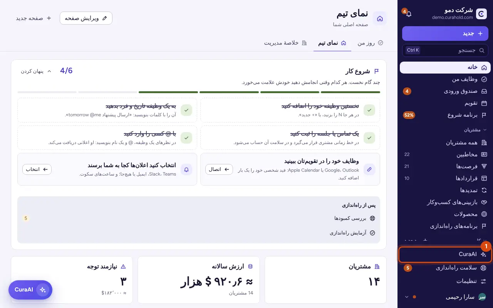
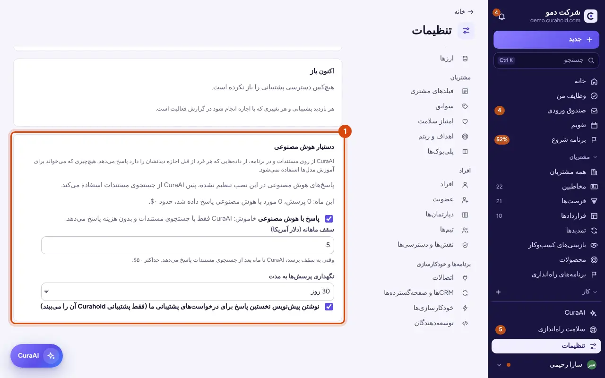
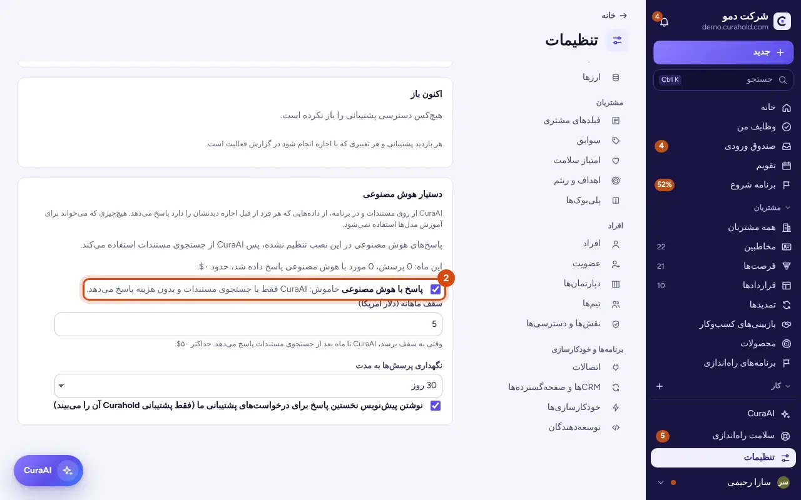

# دریافت کمک

دو قدم، به همین ترتیب: **بپرس**، و اگر مشکل حل نشد، **به پشتیبانی بنویس**.

## اول بپرس {#ask}

1. در منوی کناری روی **CuraAI** کلیک کنید (در تلفن، دکمهٔ گوشهٔ پایین؛ در این مستندات، دکمهٔ **بپرس**). سؤالتان را با کلمات خودتان بنویسید: «چطور مشتریان را وارد کنم»، «چه کسی این فیلد را می‌بیند».
   

پاسخ از همین مستندات می‌آید، همراه با جایی که از آن آمده. وقتی **پاسخ با هوش مصنوعی** در شرکت شما روشن است (پایین‌تر را ببینید)، CuraAI آنچه را در Curahold اجازهٔ دیدنش را دارید هم می‌خواند، مثل مشتریان، تمدیدها و وظایف، پس می‌توانید بپرسید «در ۹۰ روز آینده چه چیزهایی تمدید می‌شوند؟». فقط می‌خواند و هرگز چیزی را تغییر نمی‌دهد. وقتی خاموش است، راه‌اندازی نشده یا از سقف ماه گذشته، جست‌وجو در مستندات روی دستگاه خودتان انجام می‌شود و چیزی از آنچه می‌نویسید جایی فرستاده نمی‌شود.

اگر پاسخ آنچه لازم داشتید نبود، بگویید: نزدیک‌ترین جاهای بعدی و دکمه‌ای برای نوشتن به پشتیبانی، با سؤالی که از پیش پر شده، می‌گیرید.

## تماس با پشتیبانی: فرستادن درخواست

از **نوشتن به پشتیبانی** در پایین CuraAI استفاده کن. فرم آنچه را پشتیبانی برای پیدا کردن مشکل لازم دارد می‌پرسد تا مجبور نشود با سؤال به سراغت برگردد. هیچ‌چیز بدون این‌که ببینی فرستاده نمی‌شود؛ خودت انتخاب می‌کنی چه برود.

1. **موضوع**: چیزی کار نمی‌کند، چطور می‌توانم…؟، داده یا اتصال، یک ایده، یا صورتحساب و طرح.
2. **میزان اثر**: برای خطاها و مشکلات داده، بگو آیا کارت را متوقف می‌کند. ترتیب رسیدگی پشتیبانی از همین پیروی می‌کند.
3. **عنوان**: چند کلمه. هنگام نوشتن، صفحه‌هایی از راهنما که شاید از قبل جوابش را داشته باشند پیشنهاد می‌شوند.
4. **چه اتفاقی افتاد**: می‌خواستی چه کنی، چه انتظاری داشتی و به‌جایش چه شد. اگر پیام خطایی بود، کلمه به کلمه کپی‌اش کن.
5. **چطور می‌توانیم آن را ببینیم؟**: برای خطاها، قدم به قدم (اختیاری، اما خیلی کمک می‌کند).

6. **در جریان گذاشتن** و **مورد نیاز تا** (هر دو اختیاری): همکارانی که باید درخواست را بخوانند و پاسخ را بشنوند، و روزی که تا آن موقع به آن نیاز داری.

یک **شمارهٔ پیگیری** (مثلاً CH-000123) و یک نسخه با ایمیل می‌گیری.

## گفت‌وگو: پاسخ‌ها، جواب‌ها و این‌که نوبت کیست

هر درخواست یک گفت‌وگوست. آن را زیر **درخواست‌های من** (دکمهٔ صندوق ورودی بالای CuraAI) باز کن:

- **پاسخ پشتیبانی** با ایمیل و روی درخواست می‌رسد. نشانه‌ای روی دکمهٔ CuraAI می‌گوید پاسخی منتظر است.
- در محصول **پاسخ** بده، یا خیلی ساده **به ایمیل جواب بده**: آنچه بالای بخش نقل‌قول‌شده بنویسی روی درخواست می‌نشیند.
- درخواست می‌گوید **نوبت کیست**: *نزد پشتیبانی*، *در انتظار پاسخ شما* یا *حل‌شده*. **علامت‌گذاری به‌عنوان حل‌شده** آن را می‌بندد؛ نوشتن دوباره بازش می‌کند.
- **همکارانی که در جریان گذاشته شده‌اند** درخواست را می‌خوانند، پاسخ‌های پشتیبانی را با ایمیل می‌گیرند و می‌توانند جواب بدهند. فقط کسی که پرسیده آن‌ها را اضافه یا حذف می‌کند. مدیر می‌تواند هر درخواستی از شرکت را بخواند، اما فقط روی درخواست‌های خودش پاسخ می‌دهد.
- تیم Curahold ممکن است روی درخواست **یادداشت‌های خودش** را داشته باشد. این‌ها هرگز به شرکت تو نشان داده یا فرستاده نمی‌شوند.

## تصویر صفحه و فایل‌ها

- **گرفتن تصویر صفحه**: مرورگر می‌پرسد کدام زبانه به اشتراک گذاشته شود؛ زبانهٔ Curahold را انتخاب کن. پنجرهٔ کمک کنار می‌رود تا فقط خود صفحه گرفته شود.
- **جای‌گذاری یا رها کردن**: تصویری را که کپی کرده‌ای در فرم جای‌گذاری کن، یا فایل‌ها را روی آن رها کن.
- **علامت‌گذاری**: آنچه مهم است را با قاب قرمز مشخص کن. **پنهان کردن** هر چیزی را که پشتیبانی نباید ببیند (نام یک مشتری، یک مبلغ) می‌پوشاند؛ از تصویری که فرستاده می‌شود برداشته می‌شود.

تا ۶ فایل، هر کدام ۱۰ مگابایت. تصویر، PDF، متن، CSV، JSON، Excel و ویدیوهای کوتاه.

## جزئیات فنی که به درخواست افزوده می‌شود

فرم این‌ها را خودش اضافه می‌کند و پیش از فرستادن نشانت می‌دهد:

| جزئیات | چرا کمک می‌کند |
|---|---|
| نشانی صفحه | مشکل کجاست. بخش‌های محرمانهٔ نشانی (کدهای ورود و مانند آن) حذف می‌شوند. |
| مرورگر، صفحه‌نمایش، نسخهٔ برنامه | برای مشکلاتی که فقط در یک مرورگر پیش می‌آیند. |
| آخرین صفحه‌هایی که باز کردی | چطور به آن‌جا رسیدی. فقط نشانی‌ها، بدون محتوای صفحه. |
| خطاهای صفحه | پیام‌های خطای پس‌زمینه. نشانی‌های ایمیل و متن‌های شبیه کلید پوشانده می‌شوند. |
| درخواست‌های ناموفق | کدام کار ناموفق بود (مسیر و کد وضعیت). |
| آنچه الان باز است | مشتری، برد یا وظیفه‌ای که باز کرده‌ای. |

تیک هر چیزی را که ترجیح می‌دهی فرستاده نشود بردار. هیچ‌چیزی که نوشته‌ای و هیچ داده‌ای از صفحه بخشی از این جزئیات نیست.

## اجازه دادن به پشتیبانی برای دیدن حسابت

بعضی مشکلات بدون دیدنشان سخت حل می‌شوند. کادر **اجازه بده پشتیبانی Curahold حساب من را ببیند** در انتهای فرم برای همین است. هرگز به‌جای تو تیک نمی‌خورد.

- **پشتیبانی چه می‌بیند**: دقیقاً همان چیزی که تو می‌بینی؛ همان مشتری‌ها، بردها و فیلدها. نه بیشتر.
- **برای چه مدت**: ۲۴ ساعت، ۳ روز یا ۷ روز. دسترسی خودش تمام می‌شود. هر بازدید پشتیبانی حداکثر ۸ ساعت طول می‌کشد.
- **پشتیبانی چه می‌تواند بکند**: **فقط نگاه کند**. پشتیبانی هرگز چیزی را در حسابت تغییر نمی‌دهد.
- **هرگز در دسترس نیست**: دستگاه‌ها و نشست‌هایت، کلیدهای API، برنامه‌ها و webhookها، دعوت افراد، نقش‌ها، تنظیمات شرکت، خروجی گرفتن یا پاک کردن داده. پشتیبانی نمی‌تواند دسترسی خودش را تمدید کند.
- **بستن**: هر وقت خواستی، زیر **راهنما ← درخواست‌های من ← بستن دسترسی**. بازدید در حال انجام پشتیبانی فوراً تمام می‌شود. تا وقتی دسترسی باز است، نواری در بالای صفحه یادآوری‌ات می‌کند.
- **ثبت**: هر بازدید پشتیبانی و آنچه در طول آن می‌خواند، با نام فرد پشتیبان در **«تنظیمات» ← گزارش فعالیت** نوشته می‌شود.

وقتی پشتیبانی داخل است، نواری در بالای صفحه نشان می‌دهد چه کسی و تا کی نگاه می‌کند.

## تنظیم شرکت (مدیران)

در **«تنظیمات» ← امنیت ← دسترسی پشتیبانی** انتخاب کن چه کسی می‌تواند پشتیبانی را راه بدهد:

- **هر کسی**: برای آنچه خودش می‌تواند ببیند (پیش‌فرض).
- **فقط مدیران**: دسترسی باز بقیه همین حالا تمام می‌شود.
- **هیچ‌کس**: پشتیبانی هنوز می‌تواند با ایمیل پاسخ دهد، اما نمی‌تواند وارد شود.

همین صفحه دسترسی‌هایی را که الان باز است، این‌که چه کسی داده و آخرین بازدید را فهرست می‌کند و اجازه می‌دهد هر کدام را ببندی.

## ضبط نشست برای پشتیبانی

برای این‌که پشتیبانی وقتی چیزی خراب می‌شود ببیند چه شده (به‌جای این‌که از تو بخواهد توضیحش دهی)، صفحه هنگام استفاده‌ات خودش را ضبط می‌کند (کدام دکمه‌ها، کدام صفحه‌ها، برنامه چه چیزی کشید). این جدا از اجازهٔ دیدن حساب توسط پشتیبانی است؛ بی‌صدا در پس‌زمینه اجرا می‌شود.

- **هیچ‌چیزی که می‌نویسی ضبط نمی‌شود.** هر فیلد (جست‌وجوها، یادداشت‌ها، جزئیات مشتری که وارد می‌کنی) پوشانده می‌شود. ضبط از رابط کاربری است، نه از آنچه در آن می‌نویسی.
- **۷ روز نگه داشته می‌شود**، بعد حذف می‌شود.
- **فقط تیم پشتیبانی Curahold می‌تواند ضبطی را باز کند**، از میز کار خودش، و هر بار باز کردن در گزارش میز پشتیبانی نوشته می‌شود. شرکت تو ضبط‌های خودش را نمی‌بیند.
- **مدیران می‌توانند آن را خاموش کنند** زیر **«تنظیمات» ← امنیت ← دسترسی پشتیبانی ← ضبط نشست برای پشتیبانی**. وقتی خاموش باشد، چیزی ضبط نمی‌شود.

اگر سازمانت باید در اطلاعیهٔ حریم خصوصی این را به افراد خودش بگوید، این کلید و همین صفحه پایهٔ آن هستند.

## پاسخ با هوش مصنوعی (مدیران سیستم) {#ai-answers}

1. **تنظیمات ← دسترسی پشتیبانی** را باز کنید و تا **دستیار هوش مصنوعی** پایین بروید.
   
2. **پاسخ با هوش مصنوعی** را تیک بزنید تا CuraAI با هوش مصنوعی پاسخ دهد، یا تیکش را بردارید تا فقط با جست‌وجوی مستندات و بی‌هزینه پاسخ دهد. آنچه CuraAI می‌خواند هرگز برای آموزش مدل‌های هوش مصنوعی به کار نمی‌رود. شرکت تازه با این گزینهٔ **خاموش** شروع می‌کند: تا یک مدیر آن را تیک نزند، چیزی به ارائه‌دهندهٔ هوش مصنوعی فرستاده نمی‌شود و تا وقتی خاموش است، کارت همین را می‌گوید.
   

در همان کارت:

- **سقف ماهانه (دلار آمریکا)**: وقتی پر شود، CuraAI تا ماه بعد از جست‌وجوی مستندات پاسخ می‌دهد. کارت پرسش‌های این ماه و هزینه‌شان را نشان می‌دهد.
- **نگهداری پرسش‌ها به مدت**: پرسش‌ها چه مدت نگه داشته شوند (یا اصلاً نه). پرسش‌های هر کس در دانلود دادهٔ شخصی‌اش هست.
- **نوشتن پیش‌نویس نخستین پاسخ برای درخواست‌های پشتیبانی ما**: پشتیبانی Curahold پیش‌نویس نخستین پاسخ به درخواست‌هایتان را می‌بیند؛ شما هرگز پیش‌نویس را نمی‌بینید، فقط پاسخ واقعی پشتیبانی را. پیش‌نویس فقط برای درخواست‌های کسانی نوشته می‌شود که اطلاعیهٔ CuraAI را پذیرفته‌اند؛ درخواست دیگران بدون پیش‌نویس به پشتیبانی می‌رسد و متن آن به ارائه‌دهندهٔ هوش مصنوعی فرستاده نمی‌شود.

اگر کارت بگوید پاسخ با هوش مصنوعی روی این نصب راه‌اندازی نشده، CuraAI از جست‌وجوی مستندات استفاده می‌کند؛ کلید هوش مصنوعی را کسی اضافه می‌کند که سرور Curahold شما را اجرا می‌کند.

**اول از همه پرسیده می‌شود.** نخستین باری که کسی CuraAI را با پاسخ‌های هوش مصنوعیِ روشن باز می‌کند، CuraAI می‌گوید چه چیزی، چرا و تا چه مدت به ارائه‌دهندهٔ هوش مصنوعی فرستاده می‌شود، به اطلاعیهٔ حریم خصوصی پیوند می‌دهد و **می‌پذیرم** و **نمی‌پذیرم** را نشان می‌دهد (هیچ چیز از پیش تیک نخورده است). تا نپذیرد، چیزی از نوشته‌هایش از دستگاه بیرون نمی‌رود و جستجوی راهنما پاسخ می‌دهد؛ نپذیرفتن هزینه‌ای ندارد. هر زمان می‌تواند زیر CuraAI یا در **تنظیمات تو ← رضایت برای دستیار هوش مصنوعی** رضایت را پس بگیرد و با تغییر اطلاعیه دوباره پرسیده می‌شود. سرور پرسش بدون «بله» را رد می‌کند و هر پاسخ در گزارش فعالیت ثبت می‌شود. پورتال مشتری و راهنمای عمومی هم همین‌طور می‌پرسند.

## گزارش خطاها (مدیران سیستم) {#errors}

**تنظیمات ← خطاها** فهرست می‌کند در ۳۰ روز گذشته چه چیزی برای افرادتان خراب شد و کجا: صفحه، درخواستی که شکست خورد و چند بار. هیچ دادهٔ شخصی در آن نیست. وقتی به پشتیبانی می‌نویسید آنچه آنجا می‌بینید را پیوست کنید.
