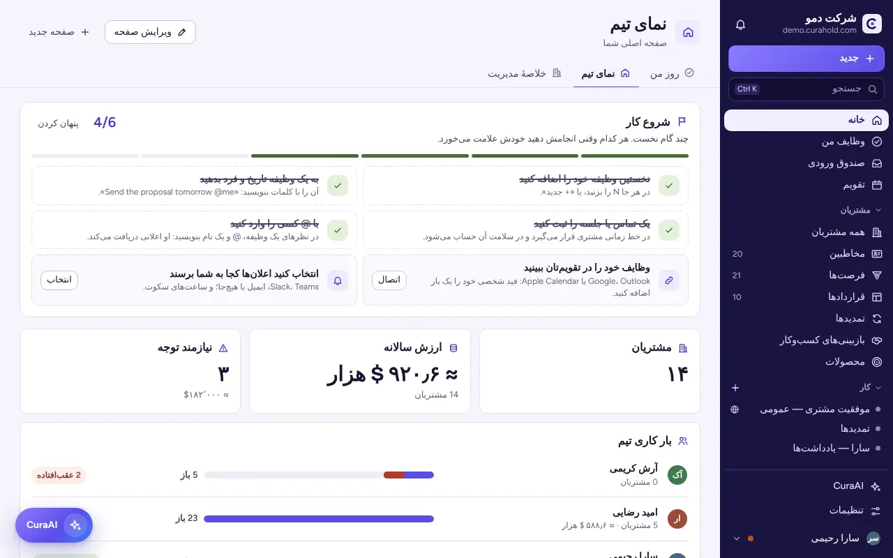

# شروع کار

Curahold جایی است که تیم‌های موفقیت مشتری و مدیریت حساب، مشتری‌ها، ذی‌نفعان و کارهای روزمره‌شان را یک‌جا پیش می‌برند. این صفحه پانزده دقیقهٔ اول تو را پوشش می‌دهد.

## آدرس شرکت

هر شرکت آدرس خودش را دارد: `yourcompany.curahold.com`. همهٔ اعضای تیمت از همین‌جا وارد می‌شوند. داده‌های هیچ شرکت دیگری هرگز در این آدرس دیده نمی‌شود؛ این جداسازی در خود پایگاه داده اعمال می‌شود.

## ورود

- **لینک ایمیل:** نشانی ایمیلت را بنویس و روی لینکی که می‌فرستیم بزن. بدون گذرواژه.
- **Google یا Microsoft:** با یک کلیک، اگر شرکتت آن را روشن کرده باشد. روی دستگاهی که قبلاً ندیده‌ایم، کد ۶ رقمی‌ای را هم که به ایمیلت فرستاده می‌شود می‌خواهیم.
- **کلید عبور:** اثر انگشت، چهره یا PIN دستگاه، بعد از اولین ورود.
- **مرحله دوم:** در «تنظیمات تو» ← **امنیت ورود** یک برنامهٔ احراز هویت اضافه کن، همراه با ۱۰ کد بازیابی. مدیر می‌تواند مرحلهٔ دوم را برای مدیران یا برای همه اجباری کند.
- پیش از کارهای حساس (تغییر نقش‌ها، کلیدهای API، خروجی گرفتن از داده‌ها…) اگر در ده دقیقهٔ گذشته وارد نشده باشی، پنجرهٔ **تأیید کنید که خودتان هستید** باز می‌شود.
- به هر نشانی در ۱۵ دقیقه حداکثر ۵ لینک ورود فرستاده می‌شود.

## راه‌اندازی اولیه

کسی که شرکت را می‌سازد یک الگو انتخاب می‌کند: موفقیت مشتری، مدیریت حساب، فروش، پشتیبانی یا خالی. الگو فیلدهای مشتری (تاریخ تمدید، ارزش سالانه، سلامت…)، بردها و خودکارسازی‌های آماده را با خودش می‌آورد. همه‌اش بعداً هم قابل تغییر است.

بعد تیمت را دعوت کن. اگر دامنهٔ ایمیل شرکتت (`@yourcompany.com`) را اضافه کنی، افراد آن دامنه می‌توانند درخواست عضویت بدهند یا مستقیم عضو شوند.

## روز اول

کارت **شروع کار** در صفحهٔ خانه چند قدم اول را نشان می‌دهد: افزودن اولین وظیفه، دادن تاریخ و مسئول به یک وظیفه، ثبت یک تماس، آوردن کسی با @، دیدن وظایفت در تقویم و انتخاب این‌که اعلان‌ها کجا به دستت برسند. هر قدم وقتی انجامش بدهی خودش تیک می‌خورد؛ **پنهان کردن** کارت را کنار می‌گذارد.

دکمهٔ **+ جدید** در کنار صفحه هر چیزی را از یک‌جا اضافه می‌کند: وظیفه، مشتری، یادداشت تماس یا برد. وقتی وظیفه‌ای می‌نویسی، می‌توانی تاریخ، مسئول و مشتری را در همان خط بیاوری؛ [افزودن سریع و میان‌برها](/docs/fa/quick-add/) را ببین. منوی تو (نامت در پایین کنار صفحه) حالت روشن یا تیره، زبان و میان‌برها را دارد؛ **تازه‌ها** آخرین افزوده‌ها را نشان می‌دهد.

## زبان

Curahold به نُه زبان حرف می‌زند: انگلیسی، ترکی، عربی، عبری، فارسی، چینی ساده و سنتی، ژاپنی و کره‌ای. زبان در یکی از این دو جا انتخاب می‌شود:

- **برای خودت:** «تنظیمات تو» ← زبان. در همهٔ دستگاه‌ها همراهت می‌آید.
- **برای شرکت:** مدیر آن را در «تنظیمات» ← شرکت تعیین می‌کند. افراد تازه با همین زبان شروع می‌کنند و ایمیل‌هایی که به کل شرکت می‌رود به همین زبان است.

هیچ چیز از مرورگرت حدس زده نمی‌شود، پس هر کس همان لینک را باز کند همان چیز را می‌بیند. تاریخ‌ها، عددها و مبلغ‌ها از زبانی که انتخاب کرده‌ای پیروی می‌کنند؛ عربی، عبری و فارسی از راست به چپ خوانده می‌شوند.

## محدودیت دستگاه‌ها

هر نفر می‌تواند هم‌زمان روی دو دستگاه وارد بماند؛ مدیر می‌تواند این عدد را بین ۱ تا ۵ تنظیم کند. ورود روی یک دستگاه دیگر، قدیمی‌ترین را خارج می‌کند. این‌طور یک صندلی بین چند نفر تقسیم نمی‌شود.

> **نکته:** «تنظیمات تو» ← دستگاه‌ها نشان می‌دهد کجا وارد شده‌ای و اجازه می‌دهد از هر کدام خارج شوی.

## نصب روی گوشی یا رایانه

Curahold مثل یک برنامه نصب می‌شود، بدون فروشگاه.

- **Android و رایانه‌ها (Chrome، Edge):** روی نامت در پایین کنار صفحه بزن ← **نصب Curahold**. نماد نصب در نوار نشانی مرورگر هم همین کار را می‌کند.
- **iPhone و iPad (Safari):** دکمهٔ اشتراک‌گذاری ← **Add to Home Screen** ← Add.

برنامهٔ نصب‌شده در پنجرهٔ خودش باز می‌شود؛ نگه داشتن طولانی روی نمادش، وظایف من، صندوق ورودی و مشتریان را پیشنهاد می‌دهد.

**بدون اتصال** هم برنامه باز می‌شود و آخرین چیزهایی را که دیده‌ای نشان می‌دهد: وظایف، بردها، مشتری‌ها و صندوق ورودی. نواری در بالای صفحه می‌گوید آفلاین هستی؛ تا وصل نشوی تغییرات ذخیره نمی‌شوند. خروج از حساب، نسخهٔ نگه‌داشته‌شده روی دستگاه را پاک می‌کند.

**به‌روزرسانی زنده:** تا وقتی صفحه‌ای باز است، تغییر دیگران (کارت تازه، وظیفهٔ جابه‌جاشده، دیدگاه، اعلان تازه) ظرف چند ثانیه خودبه‌خود نمایان می‌شود؛ لازم نیست صفحه را دوباره بارگذاری کنی. وقتی در حال نوشتن یا کشیدن کارتی هستی، چیزی زیر دستت جابه‌جا نمی‌شود.

## قدم بعدی

- [مشتری‌ها، فیلدها و سوابق](/docs/fa/customers/)
- [وظایف و بردها](/docs/fa/tasks/)
- [نقش‌ها و دسترسی](/docs/fa/roles-and-access/)
- [افزودن سریع و میان‌برها](/docs/fa/quick-add/)
