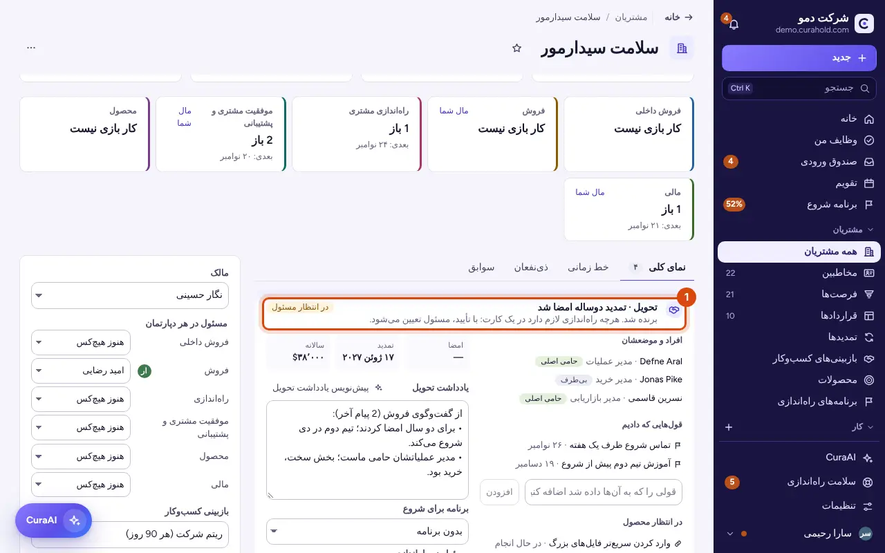
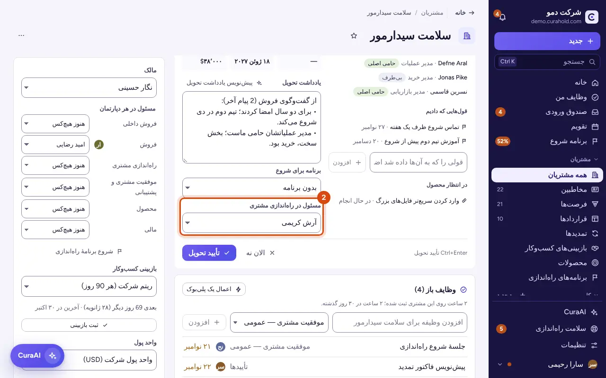
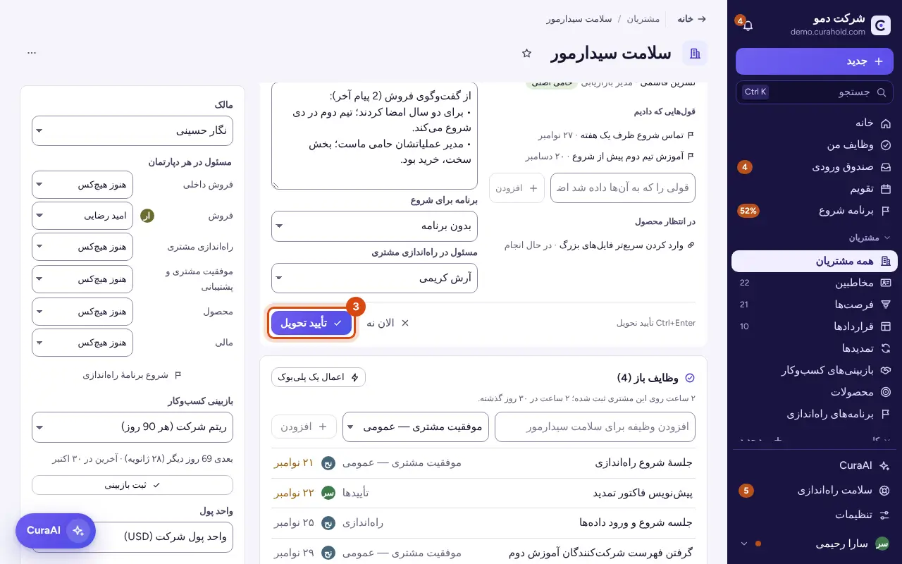
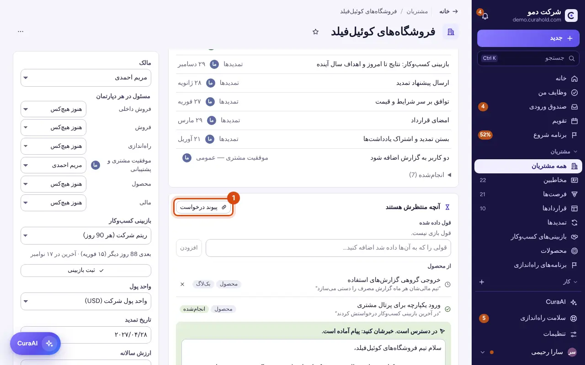
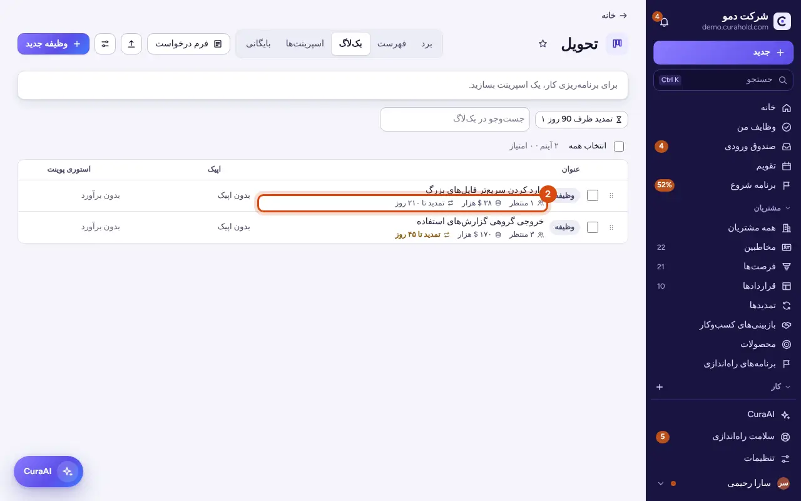
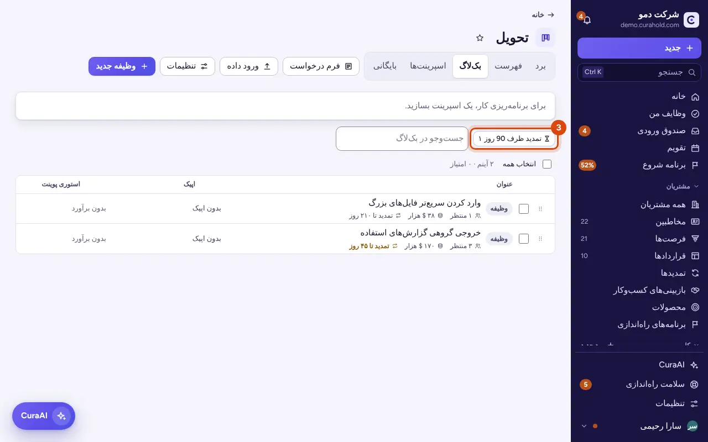
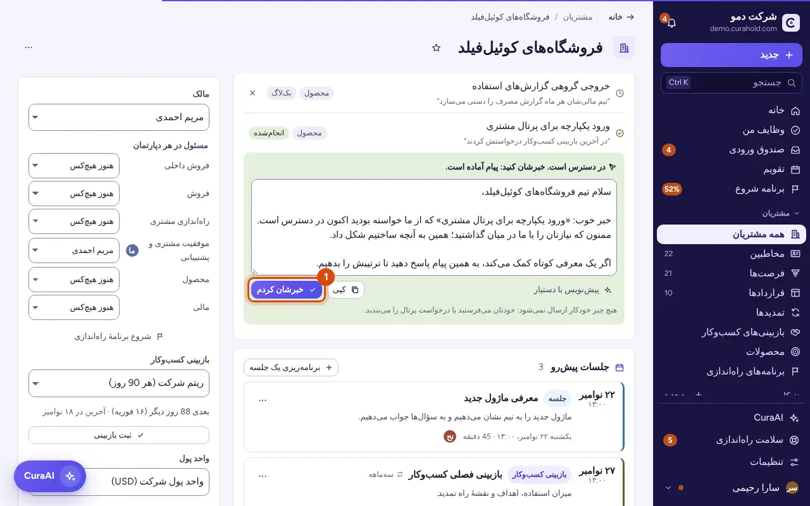
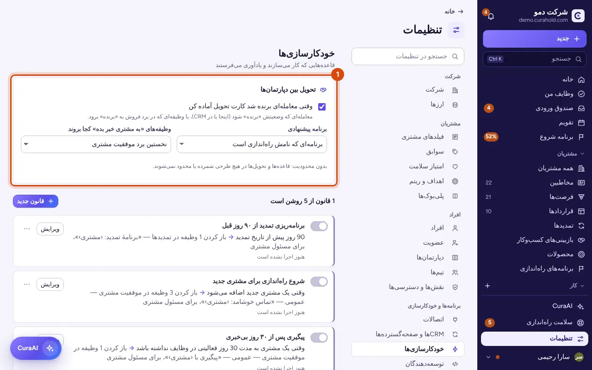

# تحویل، درخواست‌ها و بازگشت به مشتری

کار از فروش به راه‌اندازی مشتری یا موفقیت مشتری، و از مشتریان به محصول می‌رود. Curahold آنچه را هر تیم لازم دارد در صفحهٔ مشتری نگه می‌دارد تا چیزی دوباره تایپ نشود و کسی مجبور نباشد برد دپارتمان دیگری را باز کند.

## وقتی معامله‌ای برنده می‌شود {#handover}

معامله‌ای که وضعیتش **برنده** می‌شود (اینجا یا در CRM)، یا وظیفه‌ای که در برد فروش به **برنده** می‌رود، یک **کارت تحویل** در صفحهٔ مشتری می‌گیرد. اگر شرکت دپارتمان راه‌اندازی مشتری دارد کارت به **راه‌اندازی مشتری** می‌رود، وگرنه به **موفقیت مشتری**.

1. صفحهٔ مشتری را باز کنید. کارت بالای **نمای کلی** است و روی آن **در انتظار مسئول** آمده. آن را بخوانید: افراد و موضعشان، قول‌های فروش، آنچه مشتری هنوز از محصول منتظر است، تاریخ‌ها، ارزش سالانه (اگر اجازهٔ دیدن آن فیلد را دارید) و یادداشت تحویل از گفت‌وگوی فروش.
   
2. در **مسئول در …** انتخاب کنید چه کسی مشتری را تحویل می‌گیرد. **برنامه برای شروع** را هم کنارش ببینید.
   
3. روی **تأیید تحویل** کلیک کنید (یا Ctrl+Enter، در Mac ‏⌘+Enter). مسئول تعیین می‌شود، برنامه شروع می‌شود، به مسئول خبر می‌رسد و خط زمانی مشتری هر دو گام را ثبت می‌کند.
   

**الان نه** کارت را کنار می‌گذارد. **پیش‌نویس یادداشت تحویل** نوشتن یادداشت را به دستیار می‌سپارد؛ پیش از ذخیره آن را می‌خوانید و تغییر می‌دهید.

## پیوند دادن درخواست مشتری به کار محصول {#requests}

1. در صفحهٔ مشتری، زیر **آنچه منتظرش هستند**، روی **پیوند درخواست** کلیک کنید. در کارهای محصول جست‌وجو کنید، استوری را انتخاب کنید و اگر خواستید خواستهٔ مشتری را با کلمات خودش بیفزایید. اگر چیزی مناسب نبود، از همان پنجره از محصول بخواهید.
   

مشتریان زیادی می‌توانند منتظر یک استوری باشند و هر کدام شمرده می‌شود. هر کس مشتری را ببیند عنوان، وضعیت، پایان اسپرینت و دپارتمان کار را می‌بیند، هرگز برد محصول را.

## آنچه محصول می‌بیند {#backlog}

1. در یک برد محصول **بک‌لاگ** را باز کنید. زیر هر استوری: چند مشتری منتظرند، ارزش سالانه‌شان (فقط برای کسانی که اجازهٔ دیدن فیلد را دارند) و نزدیک‌ترین تمدید.
   
2. روی **تمدید ظرف 90 روز** کلیک کنید تا فقط کارهایی را ببینید که مشتریانِ نزدیک به تمدید منتظرشان هستند، نزدیک‌ترین اول.
   

## وقتی منتشر می‌شود {#shipped}

وقتی استوری پیوندخورده تمام شود، مسئول هر مشتری یک وظیفه می‌گیرد و در صفحهٔ مشتری زیر استوری پیامی آماده نمایش داده می‌شود.

1. پیام را بخوانید، اگر خواستید تغییرش دهید، روی **کپی** کلیک کنید و از ایمیل یا چت خودتان بفرستید. سپس روی **خبرشان کردم** کلیک کنید. اگر مشتری از پرتال خواسته بود، **بستن درخواست پرتال** آن را آنجا هم می‌بندد.
   

**هیچ چیز خودبه‌خود فرستاده نمی‌شود.** خط زمانی می‌نویسد «برایشان ساخته شد» و خلاصهٔ تمدید آن را فهرست می‌کند.

## تنظیمات (مدیران سیستم) {#settings}

1. **تنظیمات ← خودکارسازی‌ها** را باز کنید. زیر **تحویل بین دپارتمان‌ها** انتخاب کنید که معاملهٔ برنده کارت تحویل بگیرد یا نه، چه برنامه‌ای پیشنهاد شود و وظایف «به مشتری خبر بدهید» کجا بروند.
   

## پیش‌نویس‌های دستیار

یادداشت تحویل، پیام «منتشر شد» و قول‌ها و گام‌های بعدی یک جلسه را دستیار می‌تواند پیش‌نویس کند. هر پیش‌نویس را پیش از ذخیره می‌خوانید و تغییر می‌دهید، واگرد آن را برمی‌گرداند، و بدون دستیار (یا پس از سقف ماهانه‌اش) پیش‌نویس از الگو می‌آید.

## قواعد

قواعد می‌توانند با افزودن یا پایان یک وظیفه، رسیدن درخواست از فرم، رسیدن یک رکورد به یک مرحله یا باز شدن تیکت پشتیبانی شروع شوند و می‌توانند واگذار کنند، جابه‌جا کنند، فیلد پر کنند، نظر بنویسند، به وب‌هوک‌ها بفرستند یا تحویل را آماده کنند. قواعد هرگز شمرده یا سقف‌دار نمی‌شوند.
