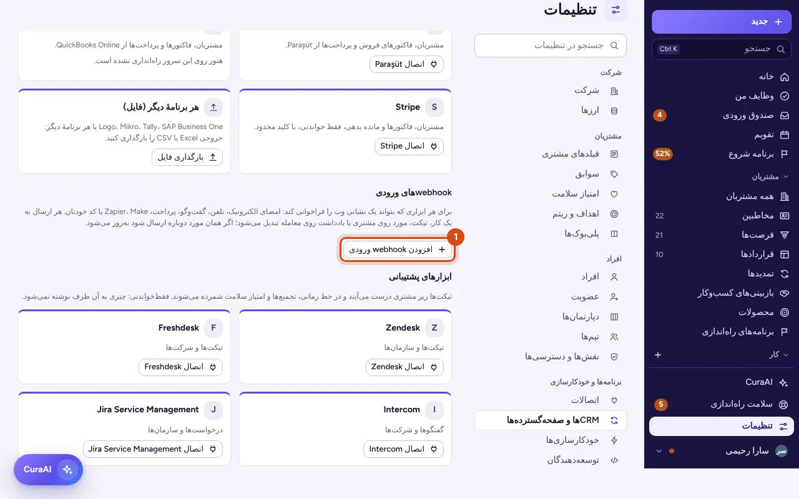
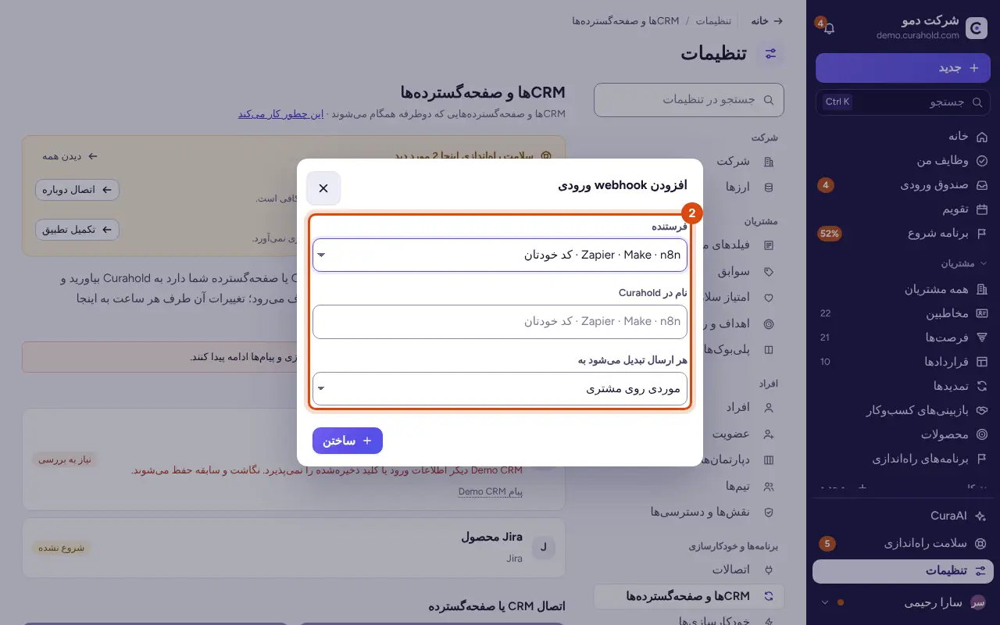
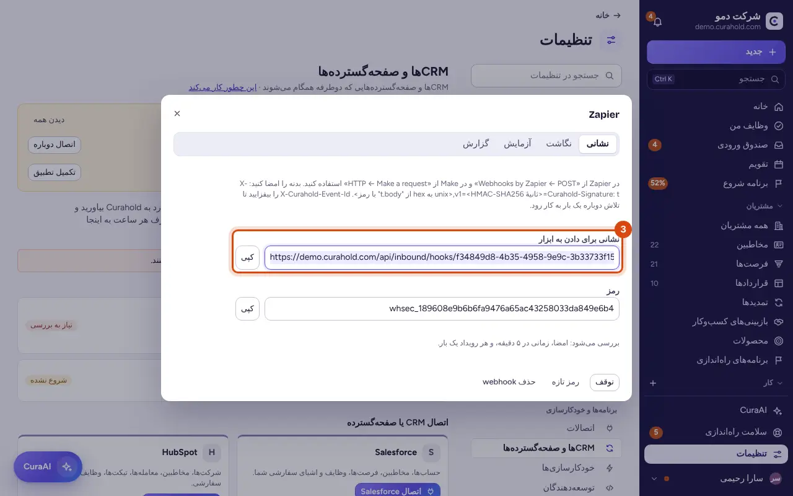
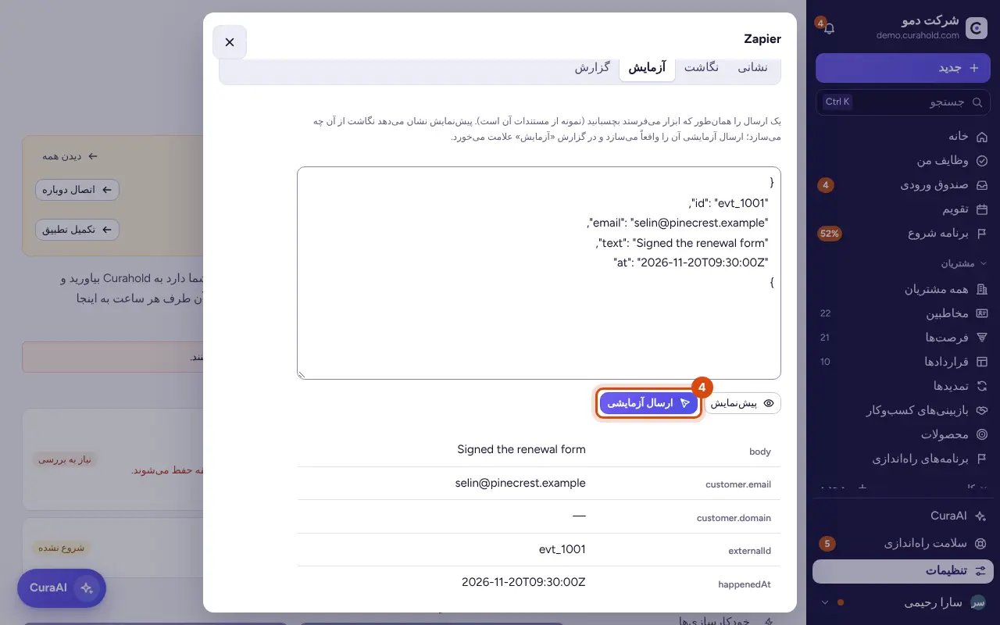
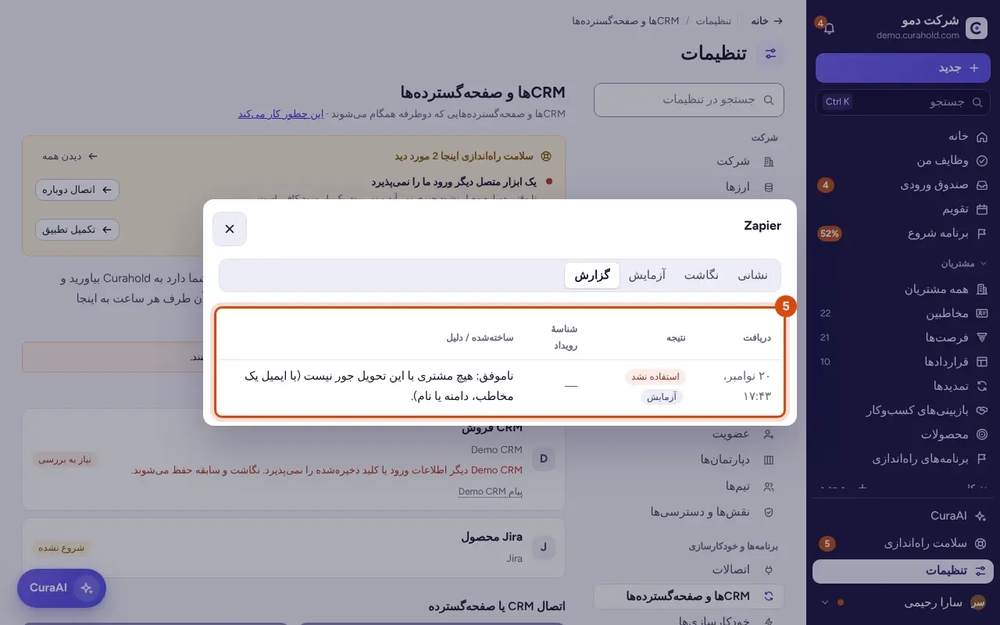

# webhookهای ورودی

برای ابزارهایی که Curahold برایشان اتصال آماده ندارد. ابزار به نشانی شما می‌فرستد؛ هر ارسال **کار**، **تیکت پشتیبانی**، **موردی در خط زمانی مشتری** یا **یادداشتی روی معامله** می‌شود. همان مورد اگر دوباره بیاید آنچه ساخته را به‌روز می‌کند. هر ارسال بررسی می‌شود: امضا (یا توکن مشترک)، زمان، و هر رویداد یک بار.

## در Curahold {#connect}

1. **تنظیمات ← CRMها و صفحه‌گسترده‌ها** را باز کنید، تا **webhookهای ورودی** پایین بروید و **افزودن webhook ورودی** را بزنید.
   
2. زیر **فرستنده** ابزار را انتخاب کنید (یا **Zapier · Make · n8n · کد خودتان**)، **هر ارسال تبدیل می‌شود به** را بررسی کنید و **ساختن** را بزنید.
   
3. در زبانهٔ **نشانی**، نشانی و رمز را در ابزار کپی کنید.
   
4. در زبانهٔ **آزمایش** روی **پیش‌نمایش** بزنید تا ببینید نگاشت از نمونه چه می‌سازد، سپس **ارسال آزمایشی**.
   
5. در زبانهٔ **گزارش** هر ارسال را بررسی کنید: استفاده شد، رد شد، استفاده نشد (با دلیل) یا رد شد (نامعتبر).
   

## نگاشت

هر مقدار متنی است با `{{path}}` برای مقداری از ارسال، مانند `{{data.envelopeSummary.status}}` یا `{{items[0].email}}`. مشتری با ایمیل یک مخاطب، سپس نشانی وب و سپس نام پیدا می‌شود. **شناسهٔ مورد در ابزار** «ساختن یا به‌روزرسانی» را ممکن می‌کند. **فقط وقتی این مقدار…** رویدادهای دیگر را رد می‌کند (به‌عنوان ردشده ثبت می‌شوند).

## دستورهای آماده

| ابزار | امضا | تبدیل می‌شود به |
| --- | --- | --- |
| امضای الکترونیک (DocuSign Connect؛ CloudSign، Modusign، Leegality به همین شکل) | `X-DocuSign-Signature-1`, HMAC-SHA256, base64, کلیدی که در ابزار می‌سازید | یادداشت روی معامله |
| Aircall | توکن webhook در بدنه | تماس روی مشتری |
| Tawk.to | `X-Tawk-Signature`, HMAC-SHA1, hex | تیکت |
| Razorpay (iyzico به همین شکل) | `X-Razorpay-Signature`, HMAC-SHA256, hex | مورد روی مشتری |
| Freshchat، Kylas، Sansan و هر ابزار دیگر | توکن مشترک (`X-Curahold-Token` / `?token=`) | به انتخاب شما |

## امضا کردن خودتان (Zapier، Make، n8n، کد) {#sign}

`X-Curahold-Signature` و `X-Curahold-Event-Id` را بفرستید:

```text
X-Curahold-Signature: t=1763631000,v1=<HMAC-SHA256 به hex از "1763631000.<بدنهٔ خام>" با رمز>
X-Curahold-Event-Id: evt_1001
```

در کد (Node.js):

```js
const t = Math.floor(Date.now() / 1000);
const v1 = crypto.createHmac('sha256', secret).update(`${t}.${body}`).digest('hex');
fetch(address, { method: 'POST', body, headers: { 'content-type': 'application/json', 'x-curahold-signature': `t=${t},v1=${v1}`, 'x-curahold-event-id': id } });
```

زمان باید در ۵ دقیقه باشد. شناسهٔ رویداد تکراری با `200` و `duplicate` پاسخ می‌گیرد و دوباره به کار نمی‌رود. پاسخ‌ها: `200` (با `status` ok، skipped یا failed)، `401` (امضا، زمان یا توکن)، `404` (ناشناخته یا متوقف). فهرست کامل: مرجع API.

## دستورهای Zapier و Make برای ابزارهایی که هنوز اتصال ندارند

از رویداد آغازگر ابزار استفاده کنید، سپس **Webhooks by Zapier ← POST** (Zapier) یا **HTTP ← Make a request** (Make) به نشانی بالا با دو هدر. مرحلهٔ **Custom JS** در Make یا **Code** در Zapier امضا را حساب می‌کند (کد بالا).

| ابزار | آغازگر | فیلدهای بدنه | تبدیل می‌شود به |
| --- | --- | --- | --- |
| LINE WORKS | پیام تازه در کانال بات | `id`، `email` فرستنده، `text` | مورد |
| Chatwork | پیام تازه در اتاق | `id`، `email`، `text` | مورد |
| kintone | رکورد افزوده یا ویرایش شد | `id`، `email`، `title`، `status` | کار |
| Money Forward Cloud | فاکتور ساخته یا پرداخت شد | `id`، `email`، `text` (شماره، مبلغ، سررسید) | مورد |
| Channel Talk | گفت‌وگو بسته شد | `id`، `email`، `title` | تیکت |
| KakaoWork | پیام بات | `id`، `email`، `text` | مورد |
| LeadSquared | سرنخ یا فرصت به‌روز شد | `id`، `email`، `title`، `status` | کار |
| Razorpay | پرداخت دریافت شد | `id`، `email`، `text` | مورد (یا دستور آماده) |
| DingTalk | پیام ربات | `id`، `email`، `text` | مورد |
| WeCom | پیام برنامه | `id`، `email`، `text` | مورد |

## نگه‌داری و حذف

گزارش ۳۰ روز و حداکثر ۵۰۰ ارسال برای هر webhook نگه می‌دارد. **رمز تازه** رمز قدیمی را بی‌درنگ از کار می‌اندازد؛ **توقف** تا ادامه `404` پاسخ می‌دهد؛ **حذف webhook** آن و گزارشش را پاک می‌کند و آنچه ساخته می‌ماند. webhook با دسترسی‌های کسی کار می‌کند که آن را ساخته: فقط به بردها و مشتریانی می‌رسد که او می‌رسد، و اگر او برود متوقف می‌شود.

## وقتی یک تحویل رد می‌شود یا استفاده نمی‌شود {#log}

زبانه **گزارش** می‌گوید برای هر تحویل چه پیش آمد، به زبان خودتان: امضا یا توکن اشتباه (رمز را دوباره از **نشانی** در ابزار کپی کنید)، خیلی وقت پیش فرستاده شده (ارسال دوباره یک تحویل قدیمی هم همین‌طور رد می‌شود)، مقداری که این webhook به کار نمی‌برد، مشتری جوری پیدا نشد، یا فیلدی خالی درآمد (**نگاشت** را بررسی کنید). همان تحویل اگر دو بار برسد، مثلاً تلاش دوباره Zapier یا Make، یک بار نگه داشته می‌شود. برد یک webhook وظیفه را می‌توان در **نگاشت** از **بُرد** عوض کرد: نشانی همان می‌ماند و در ابزار فرستنده چیزی عوض نمی‌شود.

## همچنین ببینید

- [اتصالات و CRM](/docs/fa/connections/)
