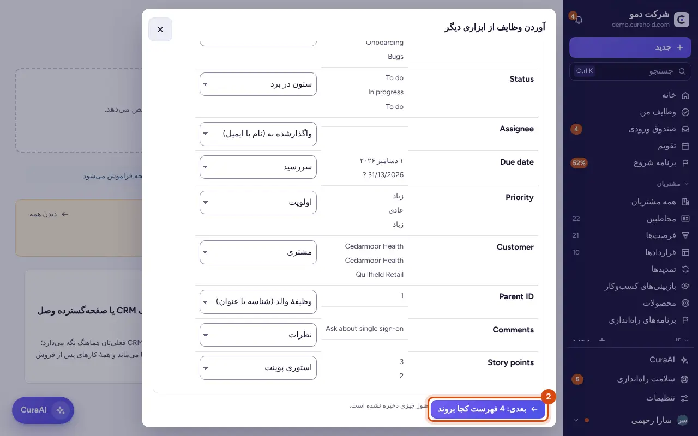
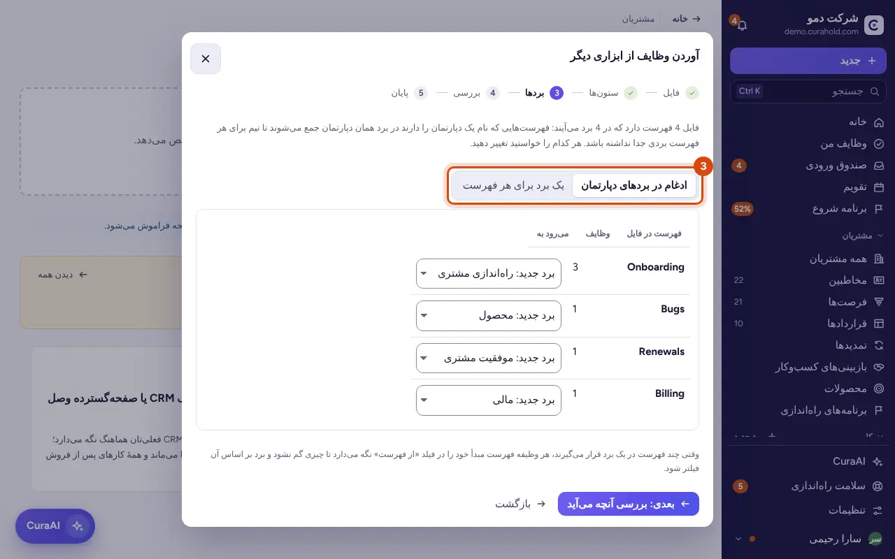
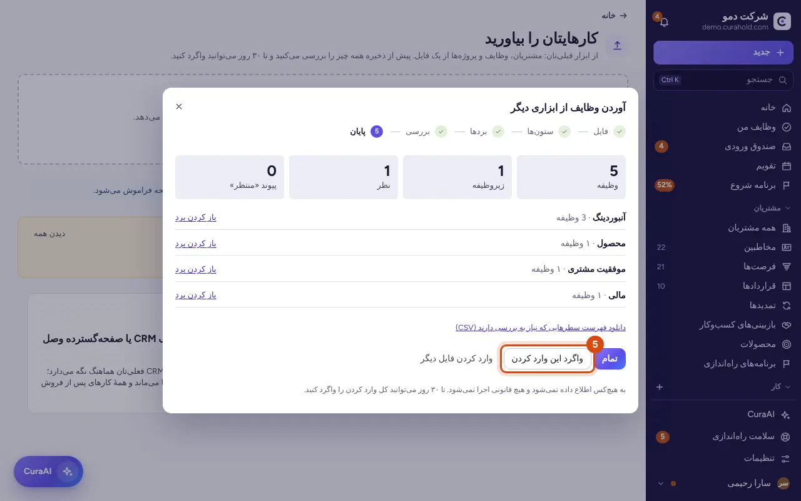

# آمدن از ابزاری دیگر

کارهایتان را از ابزار قبلی خروجی بگیرید (CSV، برگهٔ Excel ‏(.xlsx) یا خروجی JSON یک برد کانبان) و از همان فایل بیاورید. تا گام آخر چیزی ذخیره نمی‌شود، به کسی خبر نمی‌رود و هیچ قاعده‌ای اجرا نمی‌شود: این اسباب‌کشی است، نه کار تازه.

## آوردن وظایف {#tasks}

1. **کارهایتان را بیاورید** را باز کنید: در جست‌وجو (Ctrl K، در Mac ‏⌘ K) «import» بنویسید، یا دکمهٔ فلش بالا را در یک برد بزنید. فایل را روی **هر فایل خروجی را اینجا رها کنید** بیندازید یا روی **انتخاب فایل** کلیک کنید. Curahold از نام ستون‌ها مشتری را از وظیفه تشخیص می‌دهد؛ برای انتخاب خودتان **T** را برای وظایف یا **C** را برای مشتریان بزنید.
   
2. **ستون‌ها.** هر ستون فایل به مقصدش وصل می‌شود: عنوان، توضیح، ستون برد، افراد، تاریخ‌ها، اولویت، مشتری، امتیاز، شناسه در ابزار قبلی، وظیفهٔ والد، نظرها، پیوندهای «منتظر است» یا فیلدی از خودش. نخستین مقدارها نشان می‌دهند هر کدام چه می‌شود. هرچه را درست نیست عوض کنید و روی **بعدی** کلیک کنید.
   
3. **بردها.** اگر فایل فهرست‌های زیادی دارد، در چند برد دپارتمان ادغام می‌شوند: فهرستی به نام «Renewals» به موفقیت مشتری و «Bugs» به محصول می‌رود. برای جدا ماندن روی **یک برد برای هر فهرست** کلیک کنید، یا برای هر فهرست هر بردی را انتخاب کنید. هر وظیفه فهرست اصلی‌اش را در فیلد **از فهرست** نگه می‌دارد. روی **بعدی: بررسی آنچه می‌آید** کلیک کنید.
   
4. **بررسی.** برد به برد بخوانید چند وظیفه، زیروظیفه، نظر و پیوند می‌آید، و با شمارهٔ سطر، چه چیزی نمی‌آید یا متفاوت می‌آید. اگر می‌خواهید اول در فایل درستشان کنید، **دانلود فهرست سطرهایی که نیاز به بررسی دارند (CSV)**. سپس روی **… وظیفه را بیاورید** کلیک کنید.
   
5. **پایان.** هر برد پیوند **باز کردن برد** دارد. اگر چیزی آن‌طور که می‌خواستید نیست، روی **واگرد این وارد کردن** کلیک کنید.
   

Curahold سطر عنوانِ بالای سرستون‌ها، گروه‌هایی که سرستون‌ها زیر هر کدام تکرار شده‌اند و زیرآیتم‌های تورفته زیر آیتمشان را می‌فهمد.

## واگرد {#undo}

**واگرد این وارد کردن** تا ۳۰ روز کار می‌کند، از صفحهٔ نتیجه یا از **وارد کردن‌های قبلی شما** در گام اول. وظایفی که کسی به آن‌ها دست نزده به‌صورت یک مورد به سطل زباله می‌روند؛ وظیفه‌ای که از آن پس کسی تغییرش داده یا نظری رویش نوشته در بایگانی بردش می‌ماند. بردی که برای وارد کردن ساخته شده و خالی مانده کنار گذاشته می‌شود.

## الگو {#template}

**دانلود الگو** در گام اول فایلی می‌دهد با هر ستونی که Curahold می‌خواند و سه سطر نمونه؛ در Excel باز می‌شود. سطر اولش (Region نمونه‌ای از ستون خودتان است):

```text
ID,Title,Description,List,Status,Assignee,Due date,Priority,Customer,Parent ID,Comments,Depends on,Story points,Region
```

## در دمو

دمو کاملاً در زبانهٔ مرورگر شما اجرا می‌شود. **با فایل خودتان امتحان کنید** در نوار دمو همین صفحه را باز می‌کند: فایل در زبانه خوانده می‌شود، هرگز از دستگاهتان بیرون نمی‌رود و با تازه کردن صفحه فراموش می‌شود.
