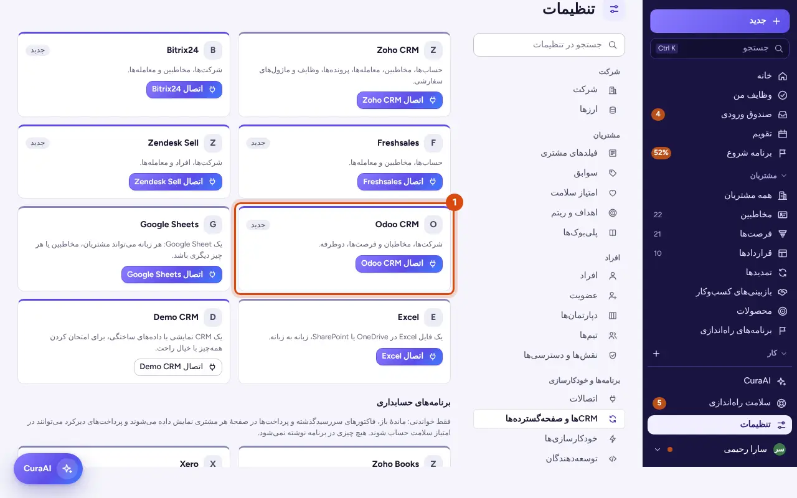

# Odoo CRM

شرکت‌ها، مخاطبانشان و فرصت‌ها از Odoo Online، Odoo.sh یا سرور خودتان، دوطرفه هماهنگ می‌مانند: تغییر در Odoo ظرف یک ساعت می‌رسد و تغییر در Curahold بی‌درنگ می‌رود.

## در Curahold {#connect}

1. **تنظیمات ← CRMها و صفحه‌گسترده‌ها** را باز کنید و روی کارت آن **اتصال Odoo CRM** بزنید.
   

سپس چهار فیلد را پر کنید و **اتصال** را بزنید:

- **نشانی Odoo**، برای نمونه:

```text
https://yourcompany.odoo.com
```

- **نام پایگاه داده**: فقط در Odoo.sh یا سرور خودتان با چند پایگاه داده.
- **نام کاربری (ایمیل)**: کاربر Odoo که Curahold با دسترسی‌های او کار می‌کند.
- **کلید API**: پایین را ببینید.

بعد **شرکت‌ها**، **مخاطبان** و **فرصت‌ها** را تیک بزنید، جفت فیلدهای پیشنهادی را بررسی کنید و **شروع همگام‌سازی** را بزنید. فرصت با احتمال ۱۰۰٪ برنده و وقتی Odoo بایگانی‌اش کند بازنده حساب می‌شود.

## در Odoo

1. روی تصویرتان (بالا) بزنید ← **Preferences** (در Odoo 17 به بعد: **My Profile**).
2. **Account Security** را باز کنید و **New API Key** را بزنید.
3. نامی بنویسید (مثلاً `Curahold`)، مدت اعتبار را انتخاب کنید و **Generate key** را بزنید.
4. کلید را کپی کنید. Odoo آن را فقط یک بار نشان می‌دهد.

در Odoo Online دسترسی API به طرح **Custom** نیاز دارد (قاعدهٔ Odoo). برنامهٔ CRM باید نصب باشد.

## محدودیت‌ها و زمان‌بندی

Odoo محدودیت ثابتی اعلام نمی‌کند؛ Curahold در حدود دو درخواست در ثانیه می‌ماند. Odoo 19 به بعد با JSON-2 API و نسخه‌های قدیمی‌تر با JSON-RPC پاسخ می‌دهند که Odoo در نسخهٔ ۲۰ حذفش می‌کند. در Odoo 19 هر کلید حداکثر سه ماه اعتبار دارد: پیش از پایان، کلید تازه بسازید و دوباره وصل شوید.

## تعارض‌ها، خطاها و برداشتن

وقتی هر دو طرف یک فیلد را تغییر داده‌اند، قاعدهٔ انتخاب‌شده برای اتصال تصمیم می‌گیرد (پیش‌فرض: تغییر جدیدتر). مقدار ردشده با پیام خود Odoo در زبانهٔ **وضعیت** منتظر می‌ماند. کلید باطل یا منقضی اتصال را **نیاز به بررسی** نشان می‌دهد: با **اتصال دوباره** کلید تازه را بچسبانید؛ نگاشت می‌ماند. **برداشتن** کلید را پاک می‌کند؛ مشتریان و رکوردهای آمده در Curahold می‌مانند.

## همچنین ببینید

- [اتصالات و CRM](/docs/fa/connections/)
- [Odoo (حسابداری)](/docs/fa/accounting-odoo/)
