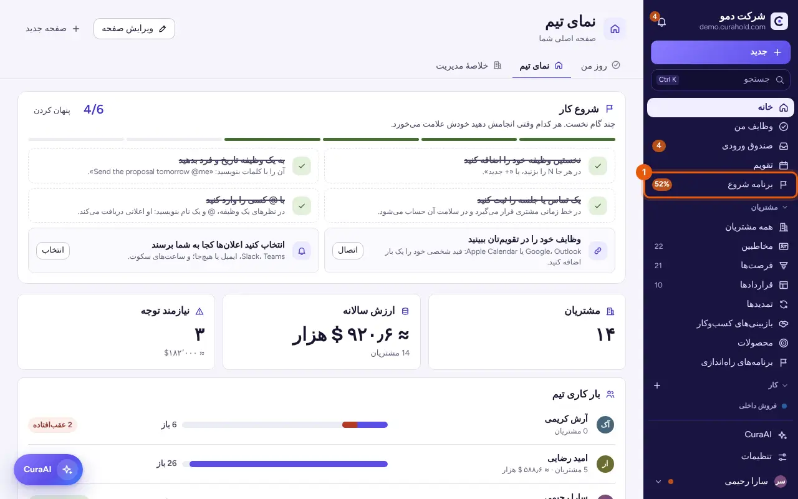
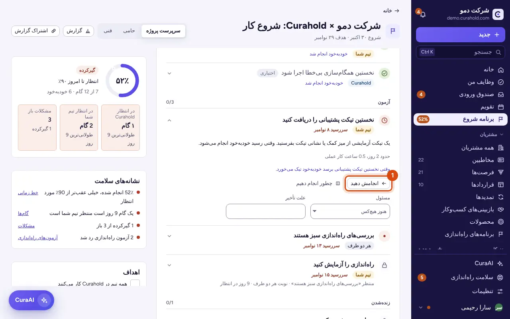
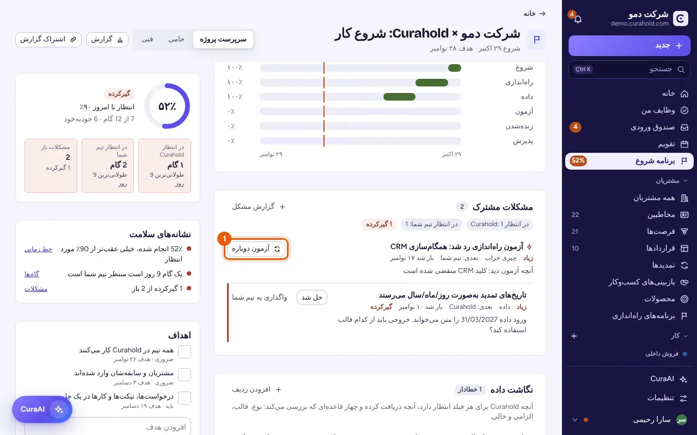
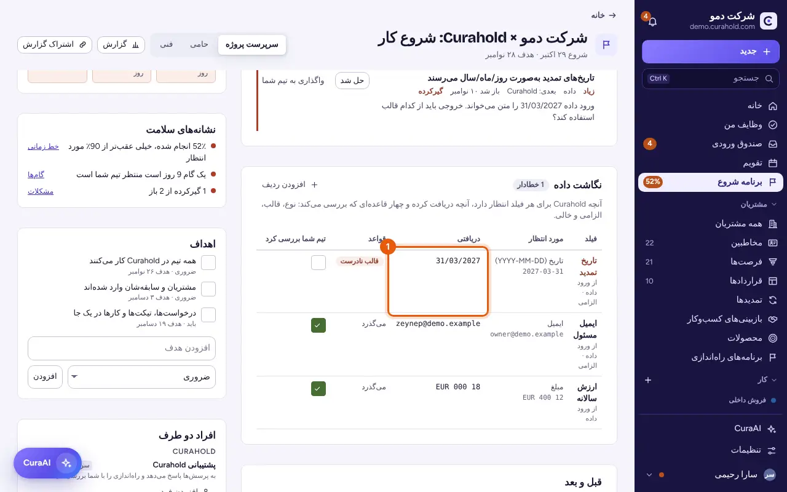
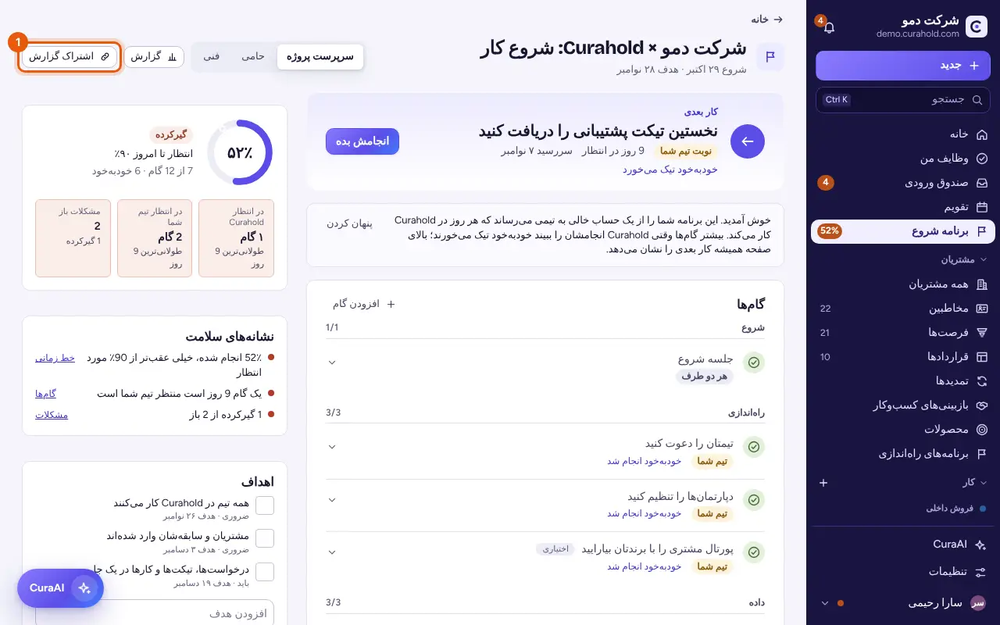
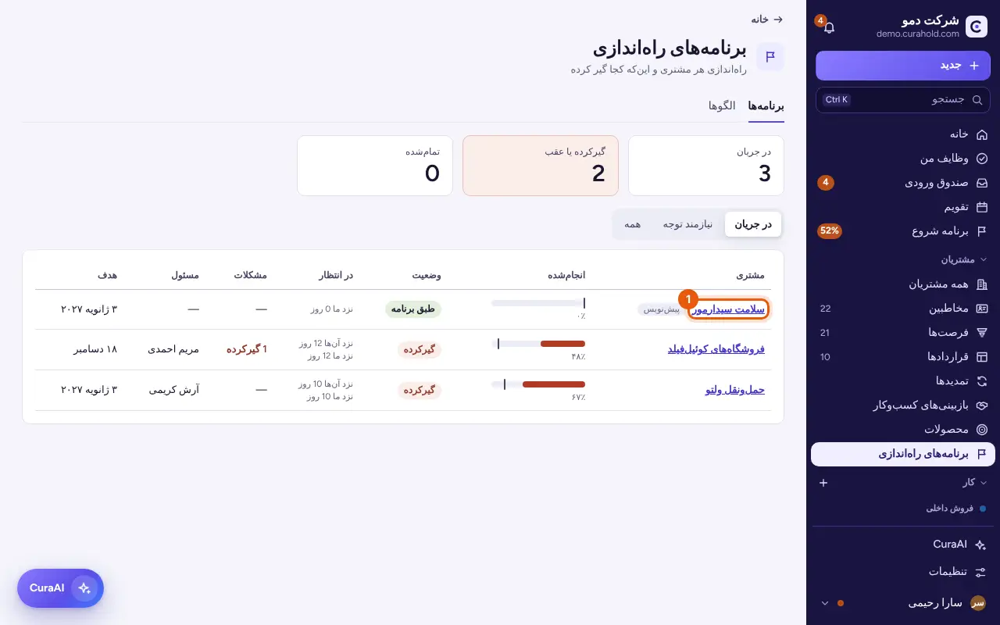
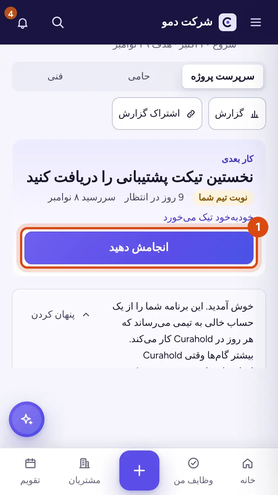

# برنامه راه‌اندازی

برنامه راه‌اندازی صفحه‌ای است که دو طرف با هم روی آن کار می‌کنند. شرکت شما برای شروع با Curahold از آن استفاده می‌کند و شما همان برنامه را برای هر مشتری که راه‌اندازی می‌کنید به کار می‌برید. بیشتر گام‌ها وقتی Curahold انجامشان را ببیند خودبه‌خود تیک می‌خورند؛ فقط چیزی را دستی تیک بزنید که Curahold نمی‌بیند، مثل یک جلسه.

## ۱. برنامه‌تان را باز کنید {#start}

در منوی کناری روی **برنامه شروع** بزنید. عدد کنارش میزان انجام‌شده است.

```text
https://<شرکت-شما>.curahold.com/onboarding
```



## ۲. کار بعدی را انجام دهید {#next}

کارت بالا همیشه کار بعدی، نوبت چه کسی و مدت انتظار را نشان می‌دهد. روی **انجامش بدهید** بزنید: Curahold صفحه انجام آن را باز می‌کند.


## ۳. یک گام را باز کنید {#team}

روی هر گام بزنید تا کاربرد، مدت و خودکار بودنش را ببینید. گام قفل‌شده منتظر گام دیگری است؛ خط زیرش می‌گوید کدام و نوبت کیست. **علامت انجام‌شده** را فقط برای گام‌هایی بزنید که Curahold نمی‌بیند.



## ۴. یک مشکل مشترک را حل کنید {#health}

هر مشکل می‌گوید حرکت با کیست؛ مشکلی که پنج روز باز مانده یا از تاریخش گذشته **گیرکرده** علامت می‌خورد. آزمون ردشده راه‌اندازی یک بار این‌جا می‌آید. پس از اصلاح روی **آزمون دوباره** بزنید: وقتی آزمون بگذرد مشکل خودبه‌خود بسته می‌شود.



## ۵. داده‌هایتان را بررسی کنید {#mapping}

جدول داده برای هر فیلد انتظار Curahold، مقدار دریافتی و چهار قاعده را نشان می‌دهد: نوع، قالب، الزامی و خالی. ردیف خطادار می‌گوید کدام قاعده رد شد. وقتی مقدار درست است کادر طرف خودتان را تیک بزنید.

```text
2027-03-31
```



## ۶. افراد را مشخص کنید {#people}

زیر **افراد دو طرف** روی **افزودن فرد** بزنید و نقشش را انتخاب کنید. Curahold وقتی نوبت مسئول هر گام برسد و اگر گام گیر کند، در برنامه به او یادآوری می‌کند. یادآوری ایمیلی خاموش است مگر مدیری روشنش کند.

## ۷. گزارش پیشرفت را به اشتراک بگذارید {#report}

روی **اشتراک گزارش** بزنید و پیوند را کپی کنید. دارنده پیوند فقط گزارش را می‌بیند (بدون یادداشت و اطلاعات تماس). برای چاپ یا ذخیره PDF، **گزارش** را باز کنید.



## ۸. برنامه‌های شروع مشتریانتان {#customers}

زیر مشتریان روی **برنامه‌های راه‌اندازی** بزنید. برنامه با برنده شدن معامله فقط وقتی خودبه‌خود باز می‌شود که این گزینه روشن باشد (بخش ۱۰). مشتری همان برنامه را در پورتال شما با رنگ‌های شما می‌بیند. در پایان روی **پایان و تحویل** بزنید: امتیاز سلامت خط مبنا می‌شود و موفقیت مشتری کارت تحویل می‌گیرد.

برای باز کردن برنامه برای یک مشتری، بالای صفحه روی **برنامهٔ جدید** بزنید، مشتری و الگو را انتخاب کنید و روی **باز کردن برنامه** بزنید. امروز شروع می‌شود: آن را مخصوص این مشتری کنید (بخش ۹).

در صفحهٔ مشتری، **شروع برنامهٔ آشنایی** زیر مالک در هر بخش همین کار را می‌کند.



## ۹. برنامهٔ مشتری را مال خودش کنید {#personal}

برنامهٔ هر مشتری نسخهٔ خود اوست: بدون دست زدن به الگو تغییرش دهید.

1. در بخش **گام‌ها**ی برنامه، روی **ویرایش برنامه** بزنید.
2. نام مرحله را در کادرش عوض کنید، با پیکان‌ها جابه‌جایش کنید یا با **افزودن مرحله** مرحلهٔ تازه بسازید. مرحله‌ای که گام دارد حذف نمی‌شود: اول گام‌هایش را جابه‌جا یا حذف کنید.
3. نام گام را در کادرش عوض کنید، با پیکان‌ها جابه‌جایش کنید، مرحلهٔ دیگری برایش بگذارید یا حذفش کنید.
4. روی **پایان ویرایش** بزنید. برای استفادهٔ دوباره از این برنامه، روی **ذخیره به‌عنوان الگو** بزنید و نامی بدهید.

## ۱۰. برنامه‌هایی که خودشان باز می‌شوند {#won}

این را یک مدیر در پایین **برنامه‌های راه‌اندازی ← الگوها** تعیین می‌کند:

1. **با بردن یک معامله، برنامهٔ شروع باز شود** را تیک بزنید. تا روشنش نکنید خاموش است.
2. الگویی را که باز می‌شود انتخاب کنید، یا **هر بار بپرسید**: در این صورت پیش‌نویس از کسی که مشتری را تحویل می‌گیرد می‌خواهد انتخاب کند.
3. اختیاری: قاعده‌هایی بر اساس بخش، بسته یا منطقه بیفزایید (هر فیلد مشتری). نخستین قاعده‌ای که مشتری با آن جور است الگو را انتخاب می‌کند.

یادآوری‌ها همیشه در برنامه دیده می‌شوند. هر کس در تنظیمات اعلان خودش تصمیم می‌گیرد که با ایمیل هم دریافتشان کند یا نه.

## روی تلفن

همان صفحه، یک ستون: اول کار بعدی.


