# سلامت راه‌اندازی و آزمودن راه‌اندازی

دو صفحه کمک می‌کنند راه‌اندازی را بدون حدس تمام کنید. **سلامت راه‌اندازی** می‌گوید چه چیزی کم است یا اشتباه است. **آزمایش راه‌اندازی** امکان می‌دهد همه چیز را همان‌طور که تیمتان استفاده می‌کند امتحان کنید. هیچ چیزی به‌جای شما تغییر نمی‌کند: هر رفع، دکمه‌ای است که صفحه درست را باز می‌کند و بقیه با شماست.

## آنچه کم است را پیدا کنید

1. در منوی کناری روی **سلامت راه‌اندازی** کلیک کنید. عدد کنارش تعداد مواردی است که ارزش نگاه دارند و وقتی همه چیز درست شد پنهان می‌شود.
   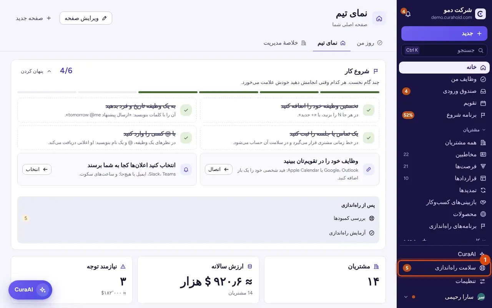
2. سطر اول را بخوانید. مهم‌ترین اول می‌آید: **اول این**، سپس **ارزش درست کردن دارد**، سپس **وقتی فرصت داشتید**. هر سطر می‌گوید چه دیدیم و چرا مهم است.
   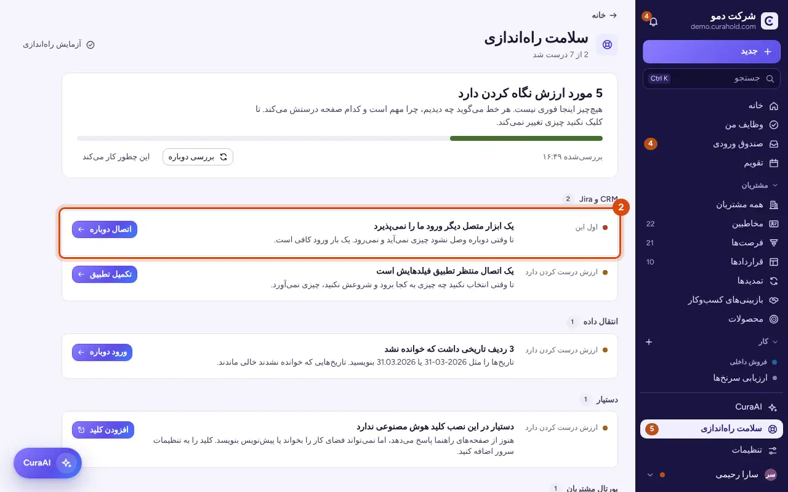
3. روی دکمه همان سطر کلیک کنید. دقیقاً صفحه‌ای باز می‌شود که در آن رفعش می‌کنید.
   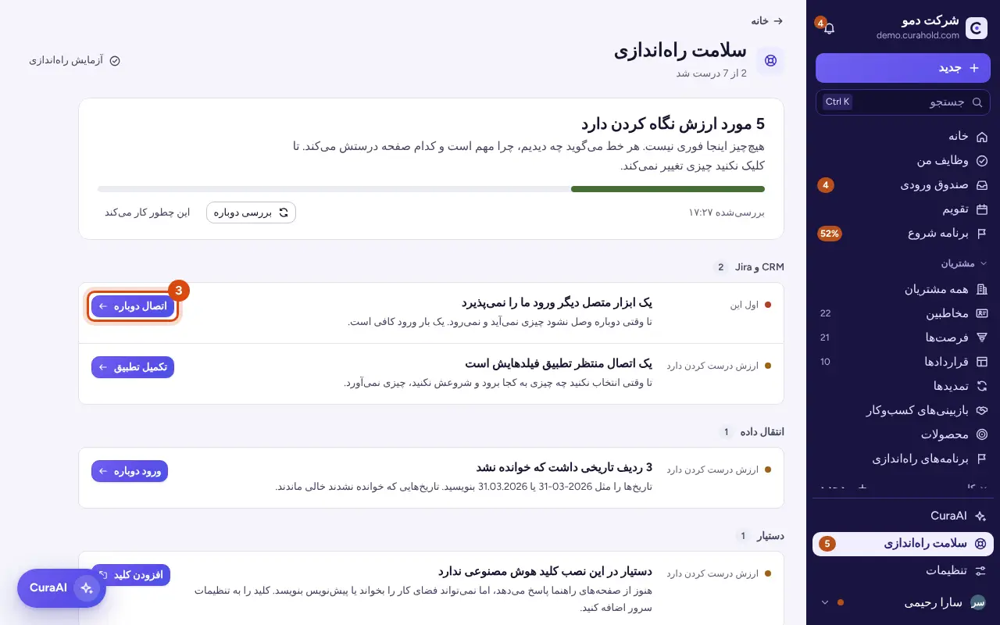
4. بعد از رفع، برگردید و روی **بررسی دوباره** کلیک کنید. سطر به **درست‌شده‌ها** می‌رود و بالای صفحه می‌گوید چند مورد رفع شده.
   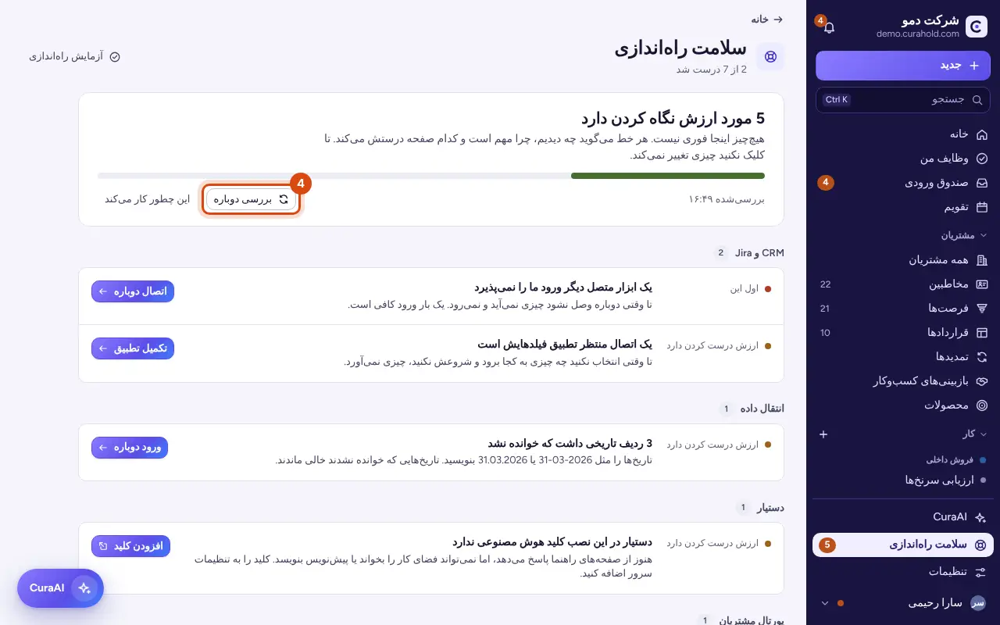
5. مشکل را در صفحه‌ای که رفعش می‌کند هم می‌بینید، در کادری زرد در بالا. برای فهرست کامل روی **دیدن همه** کلیک کنید.
   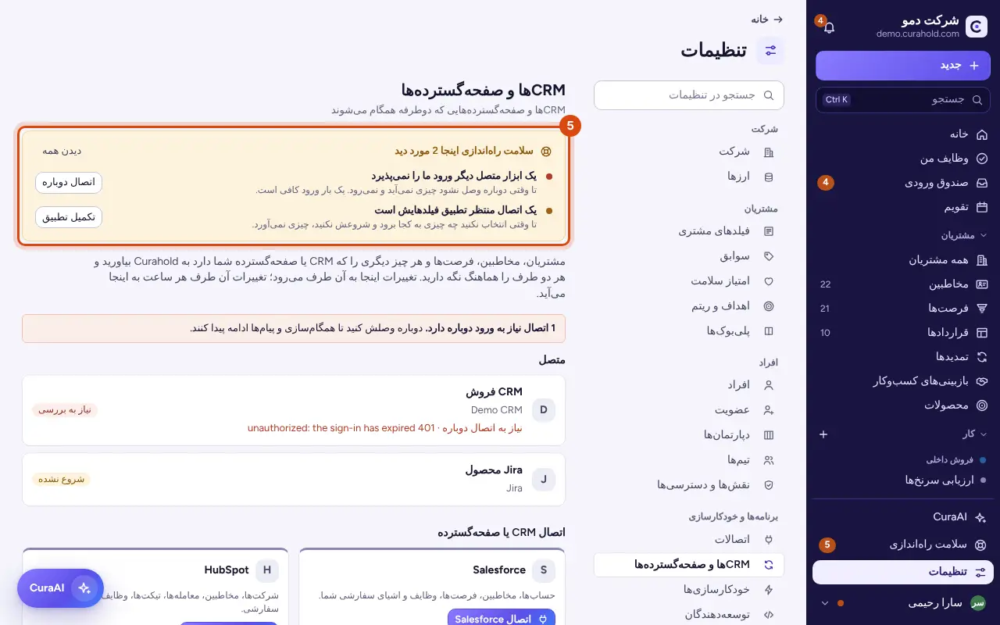

بعضی چیزها را از اینجا نمی‌توانیم بخوانیم، مثل رکوردهای SPF، DKIM و DMARC دامنه ایمیل شما. آن‌ها را اضافه کنید و سپس روی **انجامش دادم** در همان سطر کلیک کنید.

هر کس فقط چیزهایی را می‌بیند که می‌تواند رفع کند. مدیران همه چیز شرکت را می‌بینند؛ کسی که سرور Curahold را اجرا می‌کند ایمیل و کلید هوش مصنوعی را هم می‌بیند. روزی یک بار دوباره بررسی می‌کنیم و هر مورد تازه را علامت می‌زنیم.

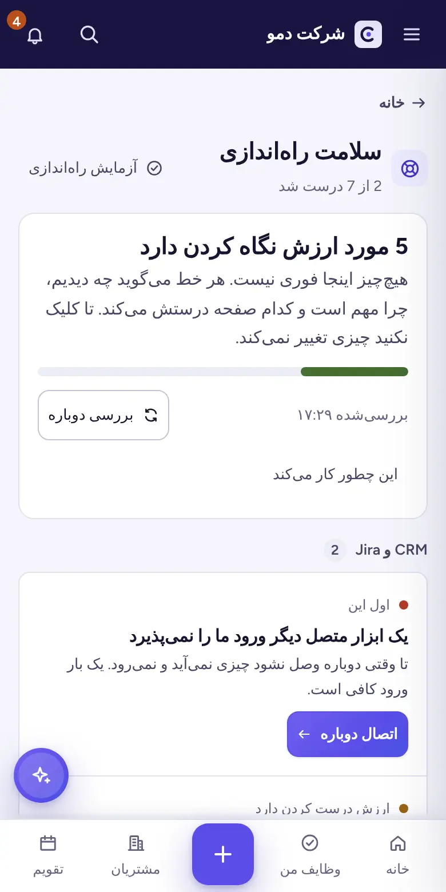

## از دستیار بپرسید

دستیار را باز کنید و دقیقاً این را بپرسید:

```text
چه مشکلی در تنظیمات هست؟
```

همان مشکل‌ها را با دکمه‌هایشان فهرست می‌کند. فقط می‌خواند و هرگز خودش چیزی را رفع نمی‌کند.

## راه‌اندازی را بیازمایید

1. در **سلامت راه‌اندازی**، روی **آزمایش راه‌اندازی** در بالا کلیک کنید.
   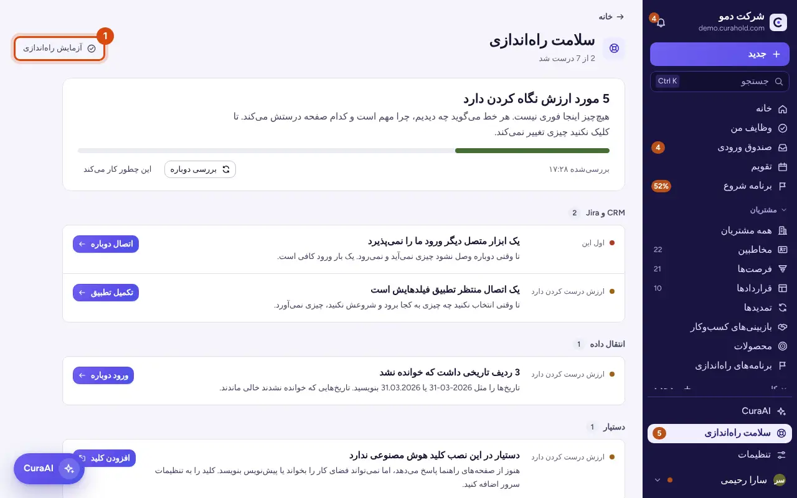
2. روی **آزمایش** در یک گام کلیک کنید. گام‌هایی که با چشم بررسی می‌کنید به‌جای آن **کار کرد** و **کار نکرد** دارند. اگر گام بپرسد با چه چیزی آزموده شود (یک مشتری، یک اتصال، یک همکار)، یک بار انتخاب کنید: برای دفعه بعد نگه داشته می‌شود.
   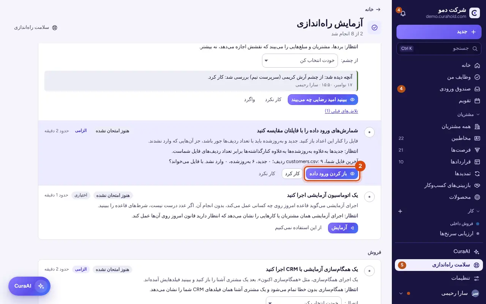
3. **آنچه دیده شد** را با **انتظار** مقایسه کنید. اگر یکی بودند، گام رد شده. هر تلاش با اینکه چه کسی و کی انجامش داد نگه داشته می‌شود، پس هر وقت خواستید دوباره بیازمایید.
   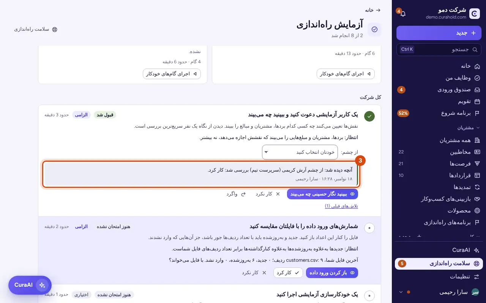
4. اگر کار نکرد، روی **باز کردن صفحه‌ای که درستش می‌کند** کلیک کنید، رفعش کنید و دوباره بیازمایید. اگر کمک لازم دارید، روی **ثبت مشکل** کلیک کنید: مشکل کنار گام می‌ماند و وقتی گام رد شود خودبه‌خود بسته می‌شود.
   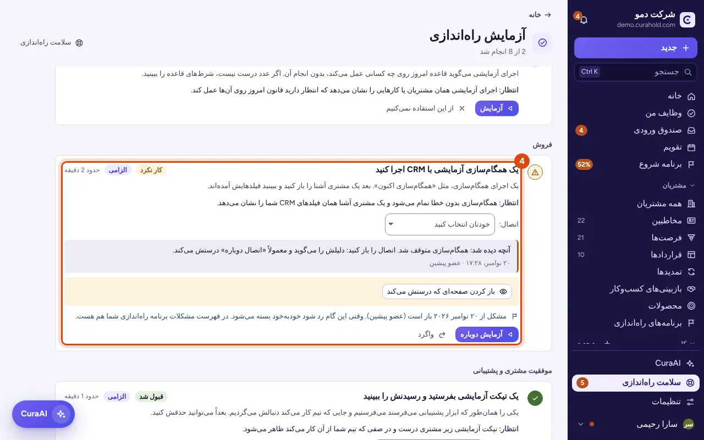
5. برای اجرای چند گام با هم، یک بسته انتخاب کنید: **پیش از راه‌اندازی نهایی** یا **بررسی ماهانه**، سپس **اجرای گام‌های خودکار**.
   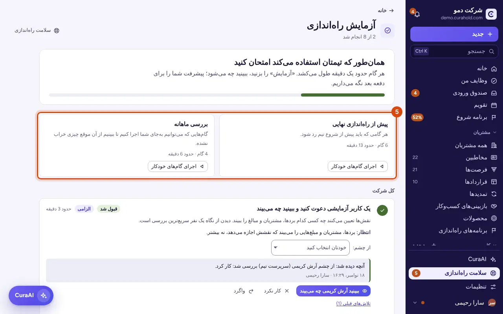
6. وقتی همه گام‌های **الزامی** رد شد، یکی از مدیران شرکت شما روی **تأیید** کلیک می‌کند و سپس کسی از Curahold. آن‌وقت صفحه **راه‌اندازی کامل شد** را با تاریخ نشان می‌دهد.
   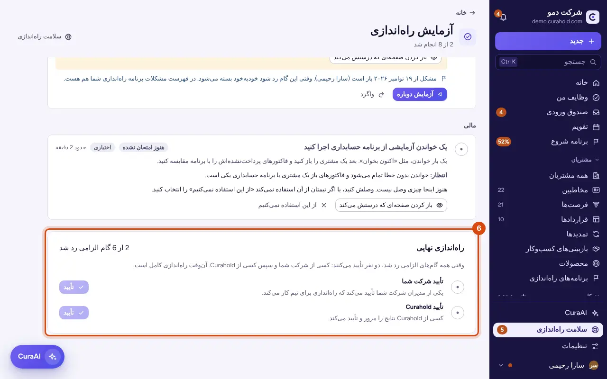

## هر بررسی چه معنایی دارد

جدول از واژه‌های خود محصول نوشته می‌شود، پس همیشه با صفحه یکی است.

<!-- setup-checks:start (scripts/docs/setup-health-page.ts writes this part) -->

### تیم

| آنچه می‌بینیم | چرا مهم است | دکمه |
| --- | --- | --- |
| فعلاً فقط شما اینجا هستید (اول این) | کارها، تحویل‌ها و یادآوری‌ها باید به کسی برسند. کسانی را که در Curahold کار می‌کنند دعوت کنید. | **دعوت از افراد** |
| … دعوت بیش از یک هفته است پذیرفته نشده (وقتی فرصت داشتید) | شاید ایمیل را ندیده‌اند. دوباره بفرستید یا نشانی را بررسی کنید. | **دیدن دعوت‌ها** |
| … نقش هیچ عضوی ندارند (وقتی فرصت داشتید) | نقشی که کسی ندارد کاری نمی‌کند. آن را به افراد درست بدهید یا حذفش کنید تا فهرست مرتب بماند. | **باز کردن نقش‌ها** |

### دپارتمان‌ها

| آنچه می‌بینیم | چرا مهم است | دکمه |
| --- | --- | --- |
| دپارتمان‌ها هنوز راه‌اندازی نشده‌اند (ارزش درست کردن دارد) | بردها، تحویل‌ها و اینکه چه کسی چه چیزی می‌بیند، همه بر اساس دپارتمان است. هر کس را در دپارتمان خودش بگذارید. | **راه‌اندازی دپارتمان‌ها** |
| … دپارتمان سرپرست ندارند (ارزش درست کردن دارد) | فقط سرپرست می‌تواند بردهای دپارتمان را باز کند و تحویل‌ها به او می‌رسد. | **انتخاب سرپرست** |

### انتقال داده

| آنچه می‌بینیم | چرا مهم است | دکمه |
| --- | --- | --- |
| … ردیف از آخرین ورود داده وارد نشد (ارزش درست کردن دارد) | چیزی در این ردیف‌ها خوانده نشد. صفحه ورود داده آن‌ها را با شماره ردیف نشان می‌دهد. | **باز کردن ورود داده** |
| … ردیف در آخرین ورود داده نام مشتری نداشت (ارزش درست کردن دارد) | نام تنها ستونی است که هر ردیف لازم دارد. آن را در فایل پر کنید و دوباره وارد کنید: ردیف‌های موجود به‌روز می‌شوند و تکراری نمی‌شوند. | **ورود دوباره** |
| … ردیف تاریخی داشت که خوانده نشد (ارزش درست کردن دارد) | تاریخ‌ها را مثل 2026-03-31 یا 31.03.2026 بنویسید. تاریخ‌هایی که خوانده نشدند خالی ماندند. | **ورود دوباره** |
| … ردیف مبلغی داشت که خوانده نشد (ارزش درست کردن دارد) | فقط از رقم استفاده کنید، مثل 12500 یا 12.500,00، و واحد پول را در ستونی جدا بنویسید. آن مبلغ‌ها خالی ماندند. | **ورود دوباره** |
| … مشتری دو بار ثبت شده‌اند (وقتی فرصت داشتید) | کارها و یادداشت‌ها بین دو نسخه پخش می‌شوند. یکی را نگه دارید و دیگری را در آن ادغام کنید. | **نمایش** |

### CRM و Jira

| آنچه می‌بینیم | چرا مهم است | دکمه |
| --- | --- | --- |
| یک ابزار متصل دیگر ورود ما را نمی‌پذیرد (اول این) | تا وقتی دوباره وصل نشود چیزی نمی‌آید و نمی‌رود. یک بار ورود کافی است. | **اتصال دوباره** |
| آخرین همگام‌سازی با … ابزار کامل نشد (اول این) | تغییرات از آن زمان در انتظارند. صفحه اتصال می‌گوید چه چیزی آن را متوقف کرد. | **ببینید چه شد** |
| یک webhook ورودی یک روز است چیزی را به کار نبرده است (ارزش درست کردن دارد) | هر ارسال رد شد (رمز نادرست) یا قابل استفاده نبود (مشتری مطابقی نیست، محتوا تغییر کرده). گزارش آن می‌گوید کدام. | **باز کردن webhookهای ورودی** |
| WhatsApp وصل است اما هیچ پیامی نرسیده است (ارزش درست کردن دارد) | پس از یک روز، معمولاً یعنی نشانی callback و توکن تأیید در برنامهٔ Meta ذخیره نشده یا «messages» مشترک نشده است. | **باز کردن اتصال** |
| یک اتصال منتظر تطبیق فیلدهایش است (ارزش درست کردن دارد) | تا وقتی انتخاب نکنید چه چیزی به کجا برود و شروعش نکنید، چیزی نمی‌آورد. | **تکمیل تطبیق** |
| … تغییر به ابزار دیگر فرستاده نشد (ارزش درست کردن دارد) | سه بار تلاش کردیم. صفحه اتصال هر کدام را با دلیلش نشان می‌دهد و می‌تواند دوباره تلاش کند. | **بررسی** |
| … کلید API ظرف دو هفته از کار می‌افتند (ارزش درست کردن دارد) | هر چیزی که از آن استفاده می‌کند ارسال را متوقف می‌کند. پیش از آن کلید تازه بسازید و جایگزین کنید. | **باز کردن کلیدهای API** |
| این هفته ابزار دیگر روی … تغییر نوشت (وقتی فرصت داشتید) | هر دو طرف یک چیز را تغییر دادند. چیزی گم نشده: مقدار جایگزین‌شده در تاریخچه هر کار هست. مطمئن شوید قاعده اتصال همان است که می‌خواهید. | **بررسی قاعده** |

### حسابداری

| آنچه می‌بینیم | چرا مهم است | دکمه |
| --- | --- | --- |
| برنامه حسابداری شما خوانده نشد (اول این) | فاکتورها و پرداخت‌ها در صفحه‌های مشتری همان‌طور که در آخرین خواندن موفق بودند می‌مانند. | **باز کردن اتصال** |
| حسابداری دو روز است خوانده نشده (ارزش درست کردن دارد) | ممکن است فاکتورهای معوق به‌روز نباشند. همین حالا بخوانید یا ببینید چرا خواندن روزانه متوقف شد. | **باز کردن اتصال** |

### ابزارهای BI

| آنچه می‌بینیم | چرا مهم است | دکمه |
| --- | --- | --- |
| … کلید تحلیل ظرف دو هفته از کار می‌افتند (ارزش درست کردن دارد) | گزارش‌های ابزار BI دیگر به‌روز نمی‌شوند. کلید را عوض کنید و کلید تازه را آنجا بچسبانید. | **باز کردن کلیدهای تحلیل** |
| ابزار BI شما یک هفته است داده‌ای نگرفته (وقتی فرصت داشتید) | داشبوردهایش اعداد هفته گذشته را نشان می‌دهند. به‌روزرسانی زمان‌بندی‌شده یا کلیدی را که استفاده می‌کند بررسی کنید. | **باز کردن کلیدهای تحلیل** |

### بررسی‌های پورتال مشتریان

| آنچه می‌بینیم | چرا مهم است | دکمه |
| --- | --- | --- |
| پورتال مشتریان روشن است اما چیزی به آن‌ها نشان نمی‌دهد (ارزش درست کردن دارد) | دست‌کم یک برد را با پورتال به اشتراک بگذارید تا مشتریان درخواست بفرستند و پیگیری کنند. | **انتخاب آنچه به اشتراک برود** |
| هنوز کسی به پورتال دعوت نشده (وقتی فرصت داشتید) | مشتریان فقط پس از دعوت می‌توانند وارد شوند. برای شروع یک نفر از یک مشتری را دعوت کنید. | **دعوت از مشتری** |
| پورتال هنوز رنگ‌های Curahold را دارد (وقتی فرصت داشتید) | لوگو و رنگ شما به مشتریان می‌گوید جای درستی هستند. | **افزودن برند** |

### خودکارسازی‌ها

| آنچه می‌بینیم | چرا مهم است | دکمه |
| --- | --- | --- |
| … خودکارسازی از فیلدی حذف‌شده استفاده می‌کنند (اول این) | به این شکل هرگز اجرا نمی‌شود. فیلد دیگری انتخاب کنید یا قاعده را خاموش کنید. | **اصلاح قاعده** |
| … خودکارسازی به بردی اشاره می‌کنند که دیگر نیست (اول این) | کارهایی که باید بسازد جایی برای رفتن ندارند. برد دیگری انتخاب کنید. | **اصلاح قاعده** |
| هنوز خودکارسازی‌ای نیست (وقتی فرصت داشتید) | یک قاعده، مثل یک کار ۶۰ روز پیش از هر تمدید، هر بار یک یادآوری را انجام می‌دهد. قاعده‌های آماده منتظر روشن شدن‌اند. | **دیدن قاعده‌های آماده** |

### بررسی‌های داده‌های شما

| آنچه می‌بینیم | چرا مهم است | دکمه |
| --- | --- | --- |
| … مشتری مسئول ندارند (ارزش درست کردن دارد) | یادآوری‌هایشان به کسی نمی‌رسد و در فهرست هیچ‌کس نیستند. برای هر کدام مسئولی بگذارید. | **تعیین مسئول** |
| … فرصت باز مرحله ندارند (ارزش درست کردن دارد) | از قیف فروش و پیش‌بینی بیرون می‌مانند. | **باز کردن فرصت‌ها** |
| … تیکت باز کسی را ندارند که پیگیرشان باشد (وقتی فرصت داشتید) | تیکتی که مسئول ندارد در صف هیچ‌کس نیست. هر کدام را واگذار کنید یا قاعده‌ای بسازید که این کار را بکند. | **باز کردن تیکت‌ها** |

### ایمیل

| آنچه می‌بینیم | چرا مهم است | دکمه |
| --- | --- | --- |
| این نصب هنوز ایمیل نمی‌فرستد (اول این) | دعوت‌ها، پیوندهای ورود و یادآوری‌ها فقط در گزارش سرور نوشته می‌شوند. رله ایمیل یا یک سرویس ایمیل را راه‌اندازی کنید. | **راه‌اندازی ایمیل** |
| رکوردهای SPF، DKIM و DMARC دامنه ایمیل را تأیید کنید (ارزش درست کردن دارد) | بدون آن‌ها دعوت‌ها به اسپم می‌روند یا رد می‌شوند. از اینجا نمی‌توانیم DNS شما را بخوانیم: رکوردها را اضافه کنید و سپس تأیید کنید. | **دیدن رکوردها** |

### حریم خصوصی

| آنچه می‌بینیم | چرا مهم است | دکمه |
| --- | --- | --- |
| کسی نمی‌تواند به درخواست‌های داده شخصی پاسخ دهد (ارزش درست کردن دارد) | طبق KVKK و GDPR کسی باید بتواند داده یک فرد را خروجی بگیرد یا پاک کند. به یک نقش مجوز حریم خصوصی بدهید. | **باز کردن نقش‌ها** |

### دوره آزمایشی و طرح

| آنچه می‌بینیم | چرا مهم است | دکمه |
| --- | --- | --- |
| دوره آزمایشی شما در … تمام می‌شود (ارزش درست کردن دارد) | پس از آن تا انتخاب یک طرح، فضای کار فقط‌خواندنی است. چیزی پاک نمی‌شود. | **انتخاب طرح** |
| همه صندلی‌های دوره آزمایشی پر است (ارزش درست کردن دارد) | افراد تازه فقط به‌عنوان بیننده می‌توانند بپیوندند. صندلی بیشتری بخواهید یا یکی را آزاد کنید. | **دیدن صندلی‌ها** |

### دستیار

| آنچه می‌بینیم | چرا مهم است | دکمه |
| --- | --- | --- |
| دستیار در این نصب کلید هوش مصنوعی ندارد (ارزش درست کردن دارد) | هنوز از صفحه‌های راهنما پاسخ می‌دهد، اما نمی‌تواند فضای کار را بخواند یا پیش‌نویس بنویسد. کلید را به تنظیمات سرور اضافه کنید. | **افزودن کلید** |

<!-- setup-checks:end -->

## برای توسعه‌دهندگان

همین بررسی‌ها در API هم هست و به نام صاحب کلید خوانده می‌شود. نشانی شرکت و کلید خود را به‌جای دو نمونه بگذارید:

```bash
curl -H "Authorization: Bearer YOUR_API_KEY" https://your-company.curahold.com/api/setup-health
```

فهرست کامل نشانی‌ها در [مرجع: سلامت راه‌اندازی](/docs/fa/ref-setup/) است.
