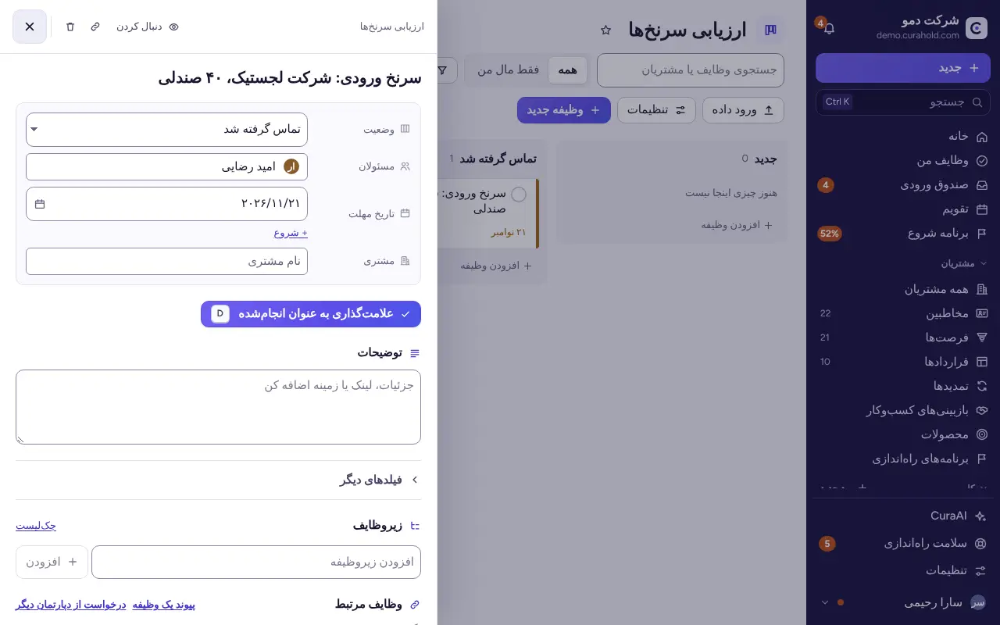

# وظایف و بردها

کار روی بردها پیش می‌رود. هر برد مال یک تیم، کل شرکت یا فقط خودت است و ستون‌هایش را تو انتخاب می‌کنی.

## وظیفه

هر وظیفه عنوان، توضیح، افراد (تا ۱۰ نفر)، موعد، اولویت و در صورت نیاز یک مشتری دارد. زیروظیفه، فایل و دیدگاه به آن اضافه کن. وظیفه در پنلی کنار برد باز می‌شود و لینکش برای هر کسی که بفرستی کار می‌کند.

نوار باریک کنار هر کارت نشان می‌دهد وظیفه نسبت به زمان کجاست: آرام، نزدیک، امروز، عقب‌افتاده، انجام‌شده. همین رنگ‌ها در تقویم و «وظایف من» هم تکرار می‌شوند. تاریخ‌ها با انتخابگر تاریخ خود محصول انتخاب می‌شوند، به زبان تو و به ترتیبی که تاریخ می‌نویسی.

## وقتی دو نفر یک وظیفه را تغییر می‌دهند

Curahold هرگز بی‌صدا روی کار کسی نمی‌نویسد. اگر کسی وقتی تو در حال ویرایش بودی ذخیره کرده باشد، تغییر او حفظ می‌شود و تغییر تو روی آن اعمال می‌شود. فقط وقتی همان فیلد واقعاً تداخل داشته باشد از تو پرسیده می‌شود.

## تغییر چند مورد با هم و واگرد

چند وظیفه را روی برد یا در فهرست انتخاب کن و وضعیت، افراد، تاریخ یا اولویتشان را یک‌جا عوض کن. پیام پایین صفحه **واگرد** را پیشنهاد می‌دهد.

## وظایف تکرارشونده

می‌توانی وظیفه‌ای را هر چند روز، هفته یا ماه یک بار تکرار کنی. وظیفهٔ بعدی وقتی باز می‌شود که فعلی تمام شود. تاریخ تازه به یکی از این دو شکل حساب می‌شود:

- **از موعد:** برای تقویم‌های ثابت، مثل «گزارش روز اول هر ماه».
- **از روزی که تمام شد:** برای کارهایی مثل «دو هفته بعد از آخرین تماس دوباره زنگ بزن».

## اشاره و بی‌صدا کردن

در دیدگاه `@` بنویس تا به کسی اشاره کنی؛ به او خبر داده می‌شود. اگر دیگر نمی‌خواهی دربارهٔ وظیفه‌ای چیزی بشنوی، در منوی آن **توقف اعلان‌های نظر برای این وظیفه** را بزن.

## جست‌وجوی سریع

هر جا که باشی Ctrl K (در Mac ‏⌘ K) را بزن تا مشتری، وظیفه، فرد، برد یا صفحه‌ای را پیدا کنی. با کلیدهای جهت حرکت کن و با Enter باز کن.

## بیشتر دربارهٔ وظیفه

- **دنبال کردن:** با دکمهٔ بالای وظیفه، از دیدگاه‌ها و جابه‌جایی ستون در وظیفه‌ای که مال تو نیست باخبر شو.
- **وظایف مرتبط:** بگو وظیفه‌ای **منتظر** وظیفهٔ دیگری است، **مانع** دیگری است یا **مرتبط با** آن است. وظیفهٔ منتظر روی کارتش «منتظر ۱» نشان می‌دهد؛ وقتی وظیفه‌ای که منتظرش است تمام شود، افرادش اعلان «می‌توانید شروع کنید» می‌گیرند. وظایف را نمی‌شود در یک دور بسته منتظر هم گذاشت.
- **تاریخ شروع:** **+ شروع** کنار موعد ثبت می‌کند کار کی شروع می‌شود؛ خط زمانی آن را به شکل یک نوار می‌کشد.
- **زمان صرف‌شده:** دکمه‌های +۱۵ دقیقه، +۳۰ دقیقه، +۱ ساعت، یا دستی («1.5»، «45m»، «1:30»). صفحهٔ مشتری جمع زمان ثبت‌شده برای آن مشتری را نشان می‌دهد.
- **چک‌لیست:** قدم‌هایی را که زیاد به کار می‌بری یک بار ذخیره کن (زیروظیفه اضافه کن ← **این زیروظایف را به عنوان چک‌لیست ذخیره کن**) و بعد با یک کلیک به هر وظیفه‌ای اضافه‌شان کن.
- **تاریخچه:** چه کسی چه چیزی را کی عوض کرد، سطر به سطر، در پایین وظیفه.
- **هشدار شباهت:** اگر وظیفه‌ای که داری اضافه می‌کنی شبیه وظیفه‌ای باشد که هنوز باز است، افزودن سریع خبرت می‌کند.

## فیلدهای خود برد

تنظیمات برد ← **فیلدها و فرم درخواست**: برای همهٔ وظایف آن برد فیلد اضافه کن (متن، عدد، مبلغ، تاریخ، گزینه، لینک، ایمیل، فرد، بله/خیر). فیلدی که **برای پایان الزامی است** علامت خورده، باید پیش از رفتن وظیفه به ستون «انجام‌شده» پر شود؛ تغییر گروهی از چنین وظایفی می‌گذرد و می‌گوید چندتا بودند. فیلدهای گزینه‌ای روی کارت‌ها به شکل برچسب‌های رنگی دیده می‌شوند و قابل فیلترند.

## فیلترها و نماهای ذخیره‌شده

**فیلتر** در بالای برد آن را بر اساس فرد، موعد (عقب‌افتاده، امروز، ۷ روز…)، اولویت و فیلدهای گزینه‌ای برد محدود می‌کند. روی گوشی همهٔ فیلترها با هم در یک برگهٔ **فیلتر** هستند. فیلترهای روشن را با **نماها ← ذخیره** نام‌گذاری کن و اگر خواستی آن نما را به همهٔ اعضای برد نشان بده.

## فرم درخواست

در تنظیمات برد **دریافت درخواست‌ها از طریق فرم** را روشن کن و انتخاب کن فرم چه چیزهایی بپرسد. همکاران از دکمهٔ **فرم درخواست** روی برد استفاده می‌کنند؛ درخواست به‌صورت یک وظیفه در ستونی که انتخاب کرده‌ای می‌نشیند و درخواست‌دهنده خودکار دنبالش می‌کند.

## آمدن از ابزاری دیگر: وارد کردن وظایف از فایل

دکمهٔ فلش رو به بالا در بالای برد (**وارد کردن وظایف از فایل**) فایل CSV یا Excel را که از ابزار قبلی‌ات گرفته‌ای می‌پذیرد. فایل در مرورگر خوانده می‌شود؛ تا نبینی کدام ستون به کجا می‌رود چیزی فرستاده نمی‌شود.

- ستون‌ها خودبه‌خود شناخته می‌شوند (Title، Description، Status، Assignee، Due date، Start date، Priority، Customer، Completed on و نام‌های ترکی‌شان). هر کدام را می‌توانی عوض کنی؛ ستون «تبدیل می‌شود به» نشان می‌دهد ردیف‌های اول چطور وارد می‌شوند.
- **Status** به ستونی از برد با همان نام می‌رود. نام‌های رایج مثل «To do»، «In progress» و «Done» هم فهمیده می‌شوند؛ بقیه در ستون اول می‌نشینند و در نتیجه فهرست می‌شوند.
- **Assignee** با نام یا ایمیل جور می‌شود؛ کسانی که پیدا نشوند کنار می‌مانند و به تو گفته می‌شود چه کسانی. نام مشتری هم به همین شکل جور می‌شود.
- وظایف انجام‌شده وارد نمی‌شوند، مگر این‌که «وظایف انجام‌شده را هم بیاور» را تیک بزنی.
- به هیچ‌کس اعلانی نمی‌رود و هیچ قانونی اجرا نمی‌شود. کل ورود را تا ۳۰ روز می‌توانی **واگرد** کنی: وظایفی که کسی به آن‌ها دست نزده حذف می‌شوند و آن‌هایی که رویشان کار شده به بایگانی می‌روند.

هر بار حداکثر ۵٬۰۰۰ ردیف.

## تقویم

**تقویم** نشان می‌دهد چه چیزی به کدام روز می‌افتد: وظایف بر اساس موعدشان، جلسه‌ها، تماس‌ها و بازبینی‌هایی که برگزار شده‌اند، تمدیدها و بازبینی‌های کسب‌وکاری که موعدشان می‌رسد. برچسب‌های بالای آن هر نوع را روشن یا خاموش می‌کنند.

- **روز، هفته، ماه، سال:** کلید بالای صفحه. نمای روز هر چه در آن روز هست را با مشتری و صاحبش فهرست می‌کند؛ نمای سال دوازده ماه کوچک را نشان می‌دهد که هر جا کار بیشتر است تیره‌تر است. با کلیک روی عدد یک روز، همان روز باز می‌شود.
- **تقویم چه کسی:** مال خودت، یا همهٔ کسانی که می‌توانی ببینی. کسی که نقشش اجازهٔ *دیدن تقویم هم‌تیمی‌ها* را دارد (در آغاز مدیران و سرپرستان تیم) می‌تواند یک نفر یا یک تیم کامل را هم انتخاب کند. این کار فقط چیزی را که از قبل می‌دید محدود می‌کند و چیز تازه‌ای نشان نمی‌دهد؛ پس برد خصوصی خصوصی می‌ماند.
- نما، روز و این‌که تقویم مال کیست در نشانی صفحه هستند، پس لینک همان را باز می‌کند.

## بایگانی

وظایف انجام‌شده وقتی برد به اندازهٔ کافی نگهشان داشت (به‌طور پیش‌فرض ۹۰ روز؛ در تنظیمات برد ۳۰ تا ۳۶۵ روز یا «همیشه») خودبه‌خود به **بایگانی** برد می‌روند. بردی که سال‌ها استفاده شده باز هم فوراً باز می‌شود. وظایف بایگانی‌شده در گزارش‌ها شمرده می‌شوند؛ آن‌ها را در نمای **بایگانی** کنار برد / فهرست جست‌وجو کن و با **بازگرداندن** یکی را برگردان. وظیفهٔ برگردانده‌شده دوباره به همان تعداد روز روی برد می‌ماند. وظایفی که از نمای فهرست دستی بایگانی کرده‌ای هم این‌جا هستند.

## حذف وظیفه و برگرداندن وظیفهٔ حذف‌شده

وظیفهٔ حذف‌شده با زیروظایف، دیدگاه‌ها، زمان و فایل‌هایش به [سطل زباله](/docs/fa/trash/) می‌رود و تا ۳۰ روز قابل برگرداندن است: درست بعد از حذف در پیام **واگرد** را بزن، یا منوی خودت را باز کن، **سطل زباله** و بعد **بازگرداندن** را انتخاب کن. فقط سازندهٔ وظیفه یا کسی که نقشش اجازهٔ حذف هر وظیفه‌ای را دارد می‌تواند آن را حذف کند. برای کنار گذاشتن وظیفهٔ انجام‌شده بدون حذف، بایگانی‌اش کن.
