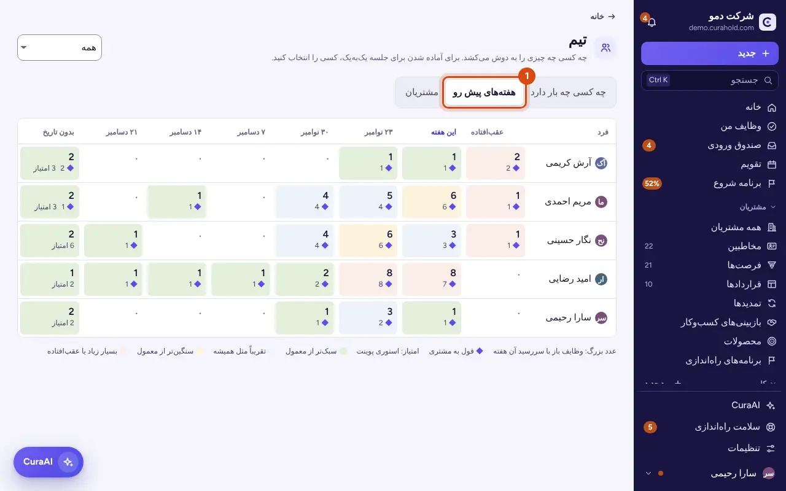
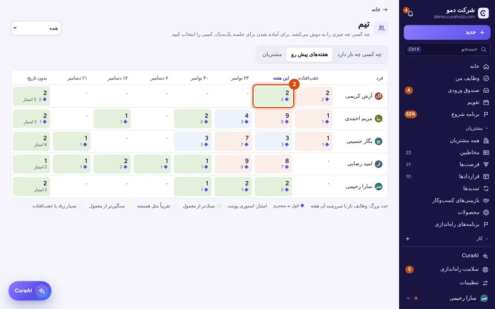
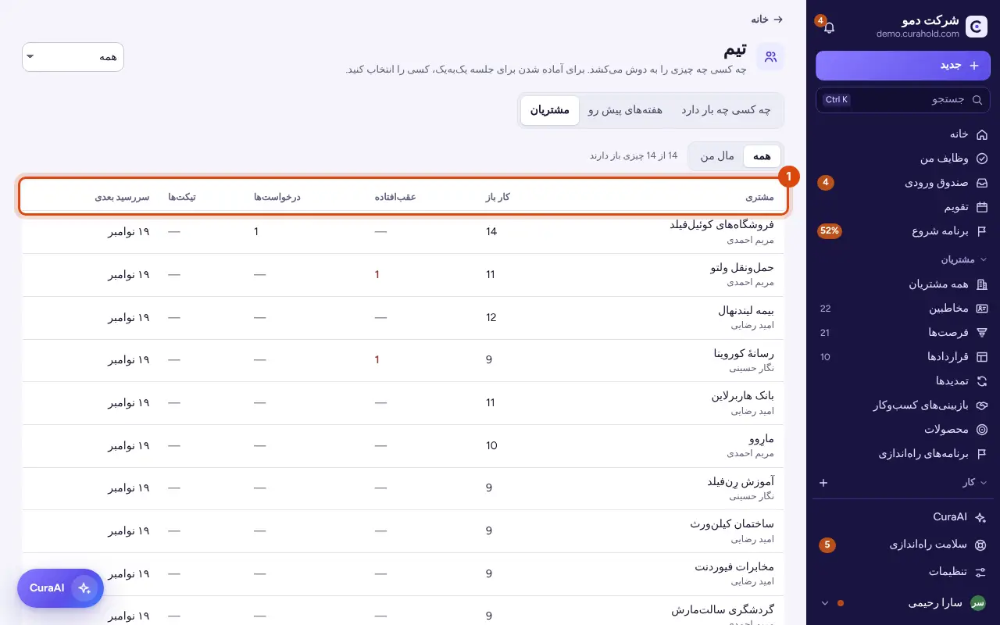
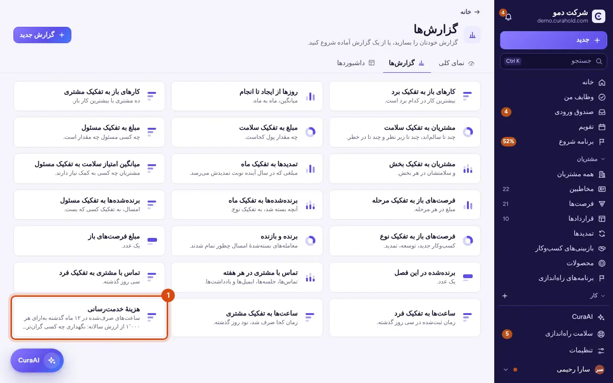

# هفته‌های تیم، سبد مشتریان و هزینهٔ خدمت‌رسانی

**تیم** (در منوی کناری) سه نما دارد: **چه کسی چه بار دارد**، **هفته‌های پیش رو** و **مشتریان**. برای محدود کردن هر کدام، بالای صفحه یک تیم انتخاب کنید. فقط وظایفی شمرده می‌شوند که اجازهٔ دیدنشان را دارید.

## چه کسی در هفته‌های پیش رو جا دارد {#weeks}

1. **تیم** را باز کنید و روی **هفته‌های پیش رو** کلیک کنید.
   
2. ردیف یک نفر را هفته به هفته بخوانید. در هر خانه، عدد بزرگ وظایف باز آن هفته است، ◆ تعداد آن‌هایی که قول به مشتری‌اند و **pt** امتیازشان. رنگ، هفته را با بار معمول آن فرد مقایسه می‌کند: سبک‌تر، معمول، سنگین‌تر یا خیلی بیشتر. **عقب‌افتاده** و **بدون تاریخ** ستون‌های خودشان را دارند. روی یک خانه کلیک کنید تا نمای ۱:۱ آن فرد باز شود.
   

## کار باز هر مشتری {#customers}

1. **تیم** را باز کنید و روی **مشتریان** کلیک کنید. هر مشتری که کار بازی دارد، شلوغ‌ترین اول، فهرست می‌شود: کار باز، مقدار عقب‌افتاده، درخواست‌هایی که افرادش از پرتال فرستاده‌اند، تیکت‌های حل‌نشده و موعد بعدی. برای مرتب کردن روی نام ستون کلیک کنید؛ بین **همه** و **مال من** جابه‌جا شوید.
   

مبلغ‌ها عمداً اینجا نیستند: این‌که چه کسی پول را ببیند فیلد به فیلد تعیین می‌شود.

## هزینهٔ خدمت‌رسانی {#cost-to-serve}

1. در منو **گزارش‌ها** را باز کنید، روی زبانهٔ **گزارش‌ها** و سپس **هزینهٔ خدمت‌رسانی** کلیک کنید. برای هر مشتری ساعت‌های ثبت‌شده روی کارش در ۱۲ ماه گذشته به‌ازای هر ۱٬۰۰۰ از ارزش سالانه نشان داده می‌شود (ARR، وگرنه MRR × 12، وگرنه نخستین فیلد مبلغ). بالاترین‌ها مشتریانی هستند که نگهداری‌شان گران‌تر است.
   

دو فیلد همراهش در سازندهٔ گزارش می‌آید: **زمان ثبت‌شده، ۱۲ ماه گذشته** و **ساعت به‌ازای هر ۱٬۰۰۰ از ارزش سالانه**. کسی که اجازهٔ دیدن ارزش مشتری را ندارد رقم هزینه را هم نمی‌بیند.
