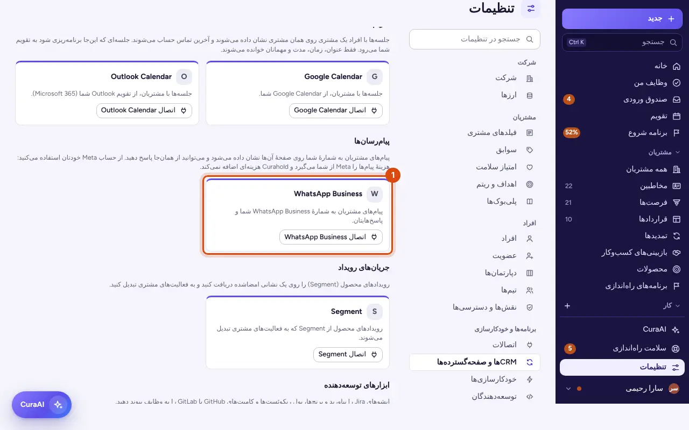
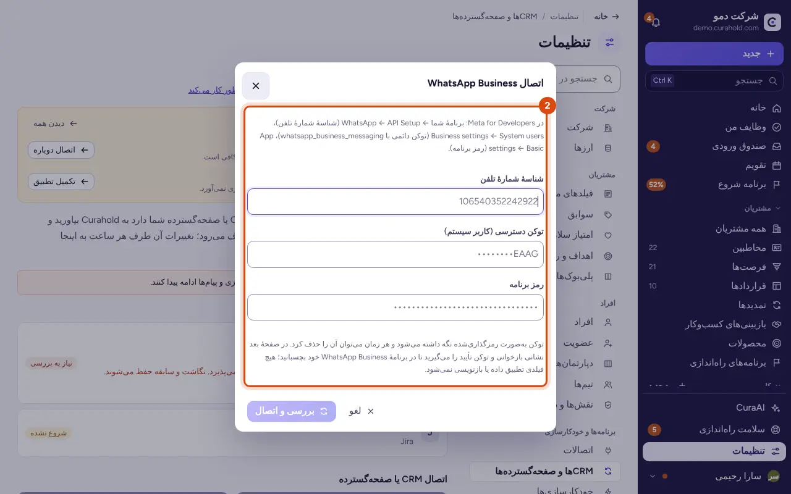

# WhatsApp Business

پیام‌هایی که مشتریان به شمارهٔ WhatsApp Business شما می‌فرستند در صفحهٔ آن‌ها دیده می‌شود و از همان‌جا پاسخ می‌دهید. از برنامهٔ Meta **خودتان** و شمارهٔ خودتان استفاده می‌کنید: هزینهٔ پیام‌ها را Meta از شما می‌گیرد، Curahold هزینه‌ای نمی‌افزاید و فاکتور Meta را نمی‌بیند.

## پیش از شروع

به یک حساب تجاری Meta با شمارهٔ WhatsApp Business روی Cloud API، یک برنامهٔ Meta با محصول WhatsApp، و یک **کاربر سیستم** با توکن دائمی (مجوز `whatsapp_business_messaging`) نیاز دارید. صفحه‌های Meta گام‌به‌گام راهنمایی می‌کنند؛ حدود ۱۵ دقیقه طول می‌کشد.

## در Curahold {#connect}

1. **تنظیمات ← CRMها و صفحه‌گسترده‌ها** را باز کنید، **پیام‌رسان‌ها** را بیابید و **اتصال WhatsApp Business** را بزنید.
   
2. سه مقدار زیر را بچسبانید و **بررسی و اتصال** را بزنید. صفحهٔ اتصال سپس یک **نشانی callback** و یک **توکن تأیید** نشان می‌دهد.
   

- **شناسهٔ شمارهٔ تلفن**: Meta for Developers ← برنامه ← **WhatsApp ← API Setup**.
- **توکن دسترسی (کاربر سیستم)**: Business settings ← **System users** ← کاربر ← **Generate new token**.
- **رمز برنامه**: برنامه ← **App settings ← Basic** ← **App secret** ← **Show**.

## در Meta

1. برنامه را باز کنید ← **WhatsApp ← Configuration**. کنار **Webhook** روی **Edit** بزنید.
2. نشانی callback را در **Callback URL** و توکن تأیید را در **Verify token** بچسبانید. **Verify and save** را بزنید.
3. زیر **Webhook fields** روی **Manage** بزنید و در **messages** مشترک شوید.

## چه می‌رسد و چطور پاسخ دهید

پیام به‌صورت یادداشت به مشتری‌ای می‌رسد که یکی از مخاطبانش شمارهٔ فرستنده را دارد (شکل‌های محلی مانند `0532…` هم مطابق می‌شوند). روی آن یادداشت **پاسخ در WhatsApp** را بزنید. WhatsApp متن آزاد را فقط تا ۲۴ ساعت پس از آخرین پیام مشتری می‌پذیرد؛ پس از آن Curahold نام و زبان یک **قالب** تأییدشده را می‌خواهد.

## محدودیت‌ها و زمان‌بندی

پیام‌ها همان‌طور که Meta می‌فرستد می‌رسند. Meta ارسال ناموفق را تا ۷ روز دوباره می‌فرستد؛ هر پیام یک بار نگه داشته می‌شود. Meta سرعت ارسال هر شماره را محدود می‌کند؛ پاسخ «مشغول» این را می‌گوید و چیزی گم نمی‌شود.

## اگر مشکلی پیش آمد

توکن منقضی یا باطل هنگام پاسخ دیده می‌شود: با **اتصال دوباره** توکن تازه را بچسبانید. پیام از شماره‌ای که در هیچ مخاطبی نیست روی اتصال شمرده می‌شود و ذخیره نمی‌شود. **برداشتن** callback را بی‌درنگ متوقف می‌کند؛ یادداشت‌های روی مشتریان می‌مانند.

## همچنین ببینید

- [خط زمانی و امتیاز سلامت](/docs/fa/timeline-and-health/)
- [اتصالات و CRM](/docs/fa/connections/)
