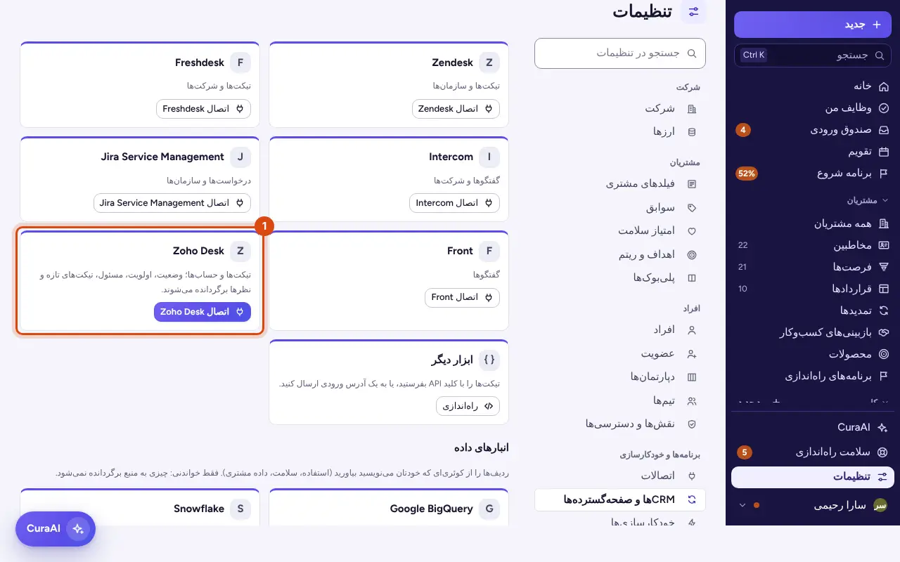

# Zoho Desk

تیکت‌ها و حساب‌های Zoho Desk روی مشتری مطابق، در جمع‌ها و در امتیاز سلامت نشان داده می‌شوند. وضعیت، اولویت و مسئولی که در Curahold تغییر کند به Zoho Desk برمی‌گردد، تیکتی که در Curahold ساخته شود آن‌جا هم ساخته می‌شود و پاسخ یا یادداشت خصوصی به‌صورت نظر افزوده می‌شود.

## در Curahold {#connect}

1. **تنظیمات ← CRMها و صفحه‌گسترده‌ها** را باز کنید، **ابزارهای پشتیبانی** را بیابید و **اتصال Zoho Desk** را بزنید.
   

صفحهٔ Zoho باز می‌شود. با یکی از کارشناسان میز پشتیبانی وارد شوید و **Accept** را بزنید. Curahold مرکز داده (.com، .eu، .in، .com.au، .jp، .sa، .uk، .ae، .ca، .com.cn) و پورتال شما را پیدا می‌کند. در بازگشت **تیکت‌ها** و **حساب‌ها** را تیک بزنید، جفت فیلدها را بررسی کنید و **شروع همگام‌سازی** را بزنید.

## محدودیت‌ها و زمان‌بندی

تغییرات هر ساعت خوانده می‌شوند. Zoho برای هر فراخوانی از سهمیهٔ روزانهٔ طرح اعتبار کم می‌کند؛ وقتی تمام شد Zoho می‌خواهد صبر کنید و Curahold دفعهٔ بعد ادامه می‌دهد. پاسخ عمومی از Curahold یک نظر عمومی روی تیکت است؛ پاسخ ایمیلی از Zoho Desk فرستاده می‌شود.

## اگر مشکلی پیش آمد

ورود منقضی خودش تمدید می‌شود. اگر کارشناس دسترسی‌اش را از دست داد، اتصال **نیاز به بررسی** نشان می‌دهد: **اتصال دوباره** و ورود دوباره. **برداشتن** ورود را پاک می‌کند؛ تیکت‌های آمده می‌مانند.

## همچنین ببینید

- [اتصالات و CRM](/docs/fa/connections/)
