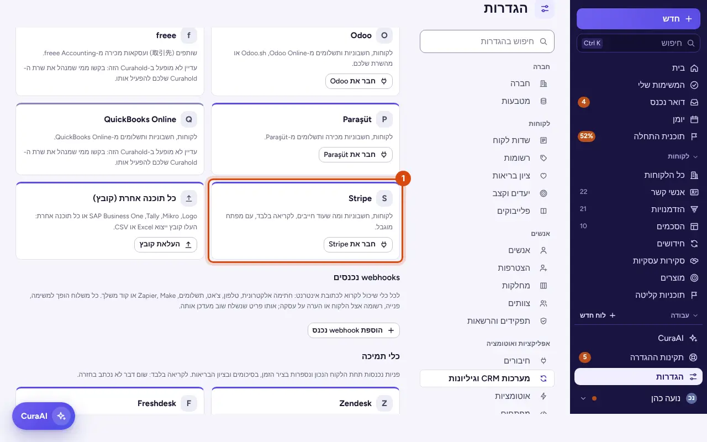

# Stripe (קריאה בלבד)

לקוחות, חשבוניות (עם תאריך פירעון ומה שעוד חייבים) ותשלומים מ-Stripe. ‏Curahold לעולם לא כותב ל-Stripe: המפתח שנותנים לו יכול רק לקרוא.

## ב-Curahold {#connect}

1. פותחים **הגדרות ← מערכות CRM וגיליונות**, מוצאים **תוכנות הנהלת חשבונות** ולוחצים **חבר את Stripe**.
   

מדביקים את המפתח המוגבל ב-**מפתח מוגבל** ולוחצים **בדוק וחבר**. מפתח סודי מלא (`sk_…`) נדחה בכוונה. אחר כך לוחצים **התחל** ובודקים בלשונית **התאמה** את הלקוחות שלא הותאמו.

## ב-Stripe

1. פותחים **Developers ← API keys** ולוחצים **Create restricted key**.
2. קוראים לו `Curahold`.
3. מגדירים **Customers**, ‏**Invoices** ו-**Events** כ-**Read**. כל השאר נשאר **None**.
4. לוחצים **Create key**, מאשרים בשלב השני ומעתיקים את המפתח. הוא מתחיל כך:

```text
rk_live_
```

כדי לנסות קודם, משתמשים במפתח מ-sandbox (`rk_test_…`).

## מגבלות ותזמון

הקריאה הראשונה מביאה הכול; אחר כך רק מה שהשתנה, מרשימת האירועים של Stripe (נשמרת 30 יום). Stripe מאפשר 100 בקשות בשנייה (25 ב-sandbox); ‏Curahold נשאר הרבה מתחת. הסכומים לפי הספרות העשרוניות של כל מטבע (לין אין). חשבונית ש-Stripe מסמן „uncollectible” נשארת חוב כאן, כך שהאיחור עדיין נראה.

## אם משהו משתבש

מפתח שהוחלף או נמחק מסמן את החיבור **דורש תשומת לב**: יוצרים מפתח מוגבל חדש ומדביקים עם **חבר מחדש**. אם חסרה הרשאה, שלב החיבור אומר איזו. **הסר** מוחק את המפתח; הנתונים שנקראו נשארים עד שמסירים אותם.

## ראו גם

- [תוכנות הנהלת חשבונות](/docs/he/accounting/)
