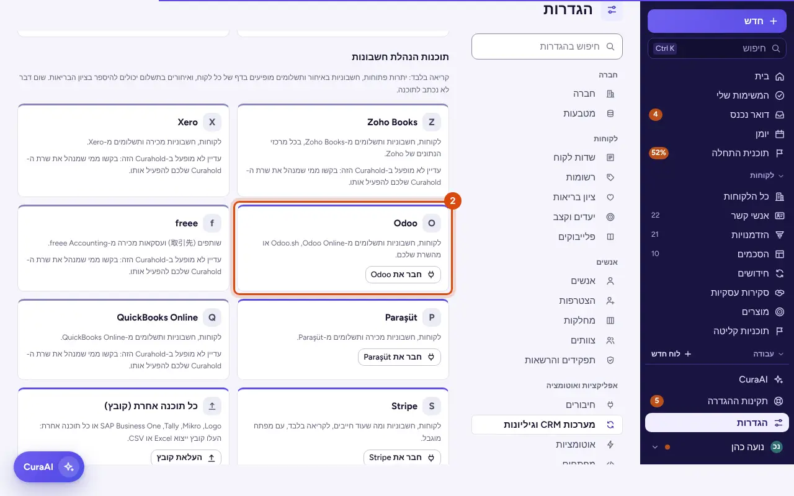

# תוכנות הנהלת חשבונות

חברו את תוכנת הנהלת החשבונות ודף כל לקוח יראה מה הוא חייב: יתרה פתוחה, מה באיחור וכמה זמן, התשלום האחרון והחשבוניות. איחורים בתשלום יכולים להיספר בציון הבריאות. ‏Curahold רק קורא: שום דבר לא נכתב לתוכנה.

## אילו תוכנות

| תוכנה | איך מתחברים | דף |
| --- | --- | --- |
| Zoho Books | התחברות עם Zoho | [Zoho Books](/docs/he/accounting-zohobooks/) |
| Xero | התחברות עם Xero | [Xero](/docs/he/accounting-xero/) |
| Odoo | כתובת, שם משתמש ומפתח API | [Odoo](/docs/he/accounting-odoo/) |
| freee | התחברות עם freee | [freee](/docs/he/accounting-freee/) |
| Paraşüt | מספר חברה, לקוח API ומשתמש | [Paraşüt](/docs/he/accounting-parasut/) |
| QuickBooks Online | התחברות עם Intuit | [QuickBooks Online](/docs/he/accounting-quickbooks/) |
| כל תוכנה אחרת (Logo, ‏Mikro, ‏Tally, ‏SAP Business One…) | קובץ Excel או CSV | [קובץ](/docs/he/accounting-file/) |

## חיבור התוכנה {#connect}

צריך הרשאה לנהל חיבורים (יש אותה למנהלי מערכת).

1. פותחים **הגדרות ← מערכות CRM וגיליונות** וגוללים אל **תוכנות הנהלת חשבונות**. לוחצים **חבר את …** באריח של התוכנה שלכם, או **העלאת קובץ** ב**כל תוכנה אחרת (קובץ)**, וממשיכים לפי הדף של אותה תוכנה בטבלה שלמעלה.
   

## התאמת לקוחות

כל לקוח בתוכנת הנהלת החשבונות מותאם ללקוח אחד ב-Curahold: קודם לפי מספר עוסק, אחר כך לפי כתובת אתר או דומיין הדוא״ל, ואז לפי שם (צורות התאגדות כמו Ltd., ‏A.Ş. או 株式会社 לא נחשבות). כשמתאים בדיוק לקוח אחד ההתאמה נעשית; כשאף אחד או כמה מתאימים, היא ממתינה בלשונית **התאמה** של החיבור. שם אפשר לבחור את הלקוח או להשאיר אותו בחוץ. התאמות ידניות נשמרות.

## מי רואה את הנתונים

סכומים מוצגים לתפקידים עם **צפייה בנתונים כספיים** (בהתחלה מנהלי מערכת ומנהלים; משנים בהגדרות ← תפקידים והרשאות). כל מי שרואה את הלקוח רואה רק, בתוך ציון הבריאות, בכמה ימים התשלום מאחר — אף פעם לא סכום.

גם אנשי מחלקת **כספים** רואים את הסכומים, בלי קשר לתפקידם, וכך גם המחלקות שנבחרו תחת **מי רואה את כספים בדף הלקוח** בהגדרות ← מחלקות. כיבוי מחלקת כספים מבטל זאת.

## איחורים בתשלום בציון הבריאות

כשמתחילים את הקריאה הראשונה אפשר לסמן **לספור איחורים בתשלום בציון הבריאות**. האות **תשלום בזמן** נותן ניקוד מלא כשאין איחור, ואפס כשהחשבונית הישנה ביותר שלא שולמה באיחור של 60 יום; את שני המספרים משנים בהגדרות ← ציון בריאות. לקוחות שלא הותאמו לתוכנה לא נספרים.

## תקינות החיבור

חיבורי הנהלת חשבונות מופיעים בהגדרות ← חיבורים יחד עם האחרים: עובד, בעיה או מושהה, ומתי עבד לאחרונה.
