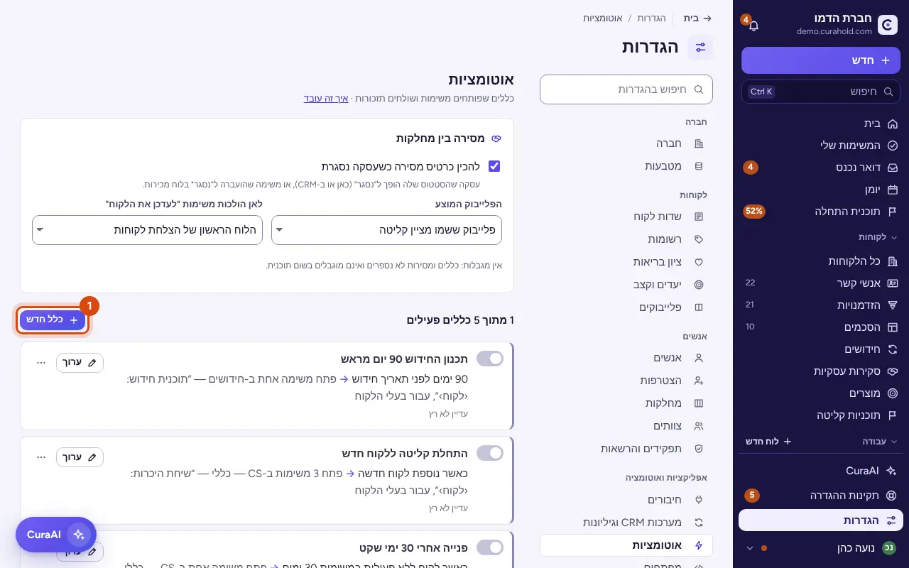
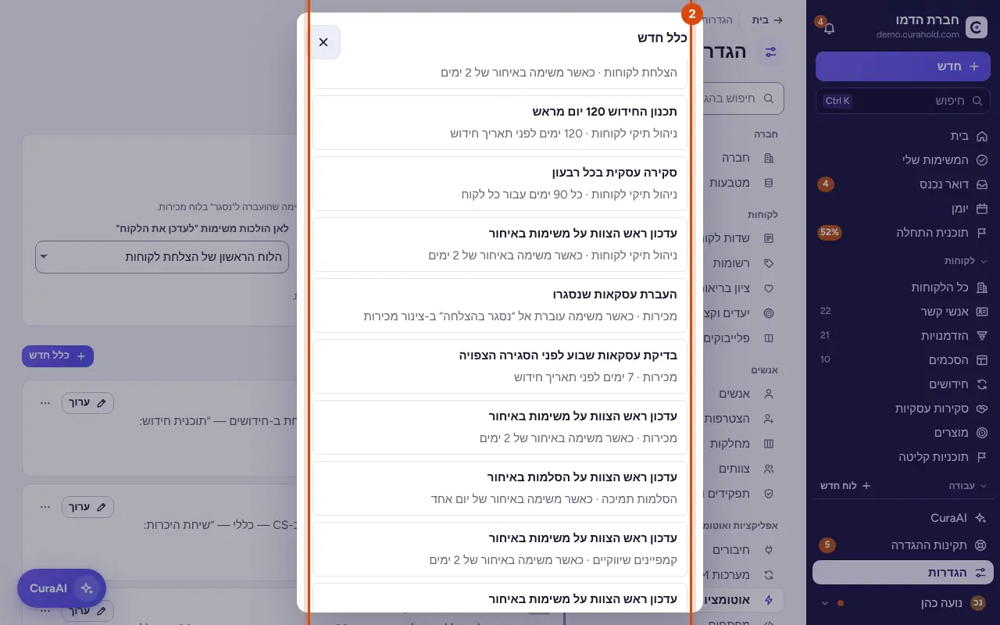
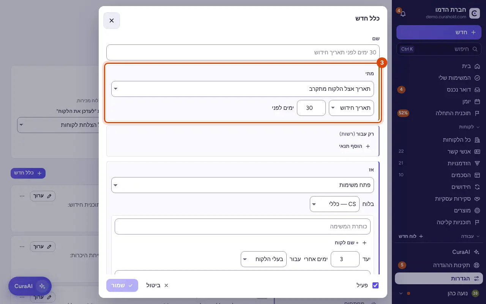
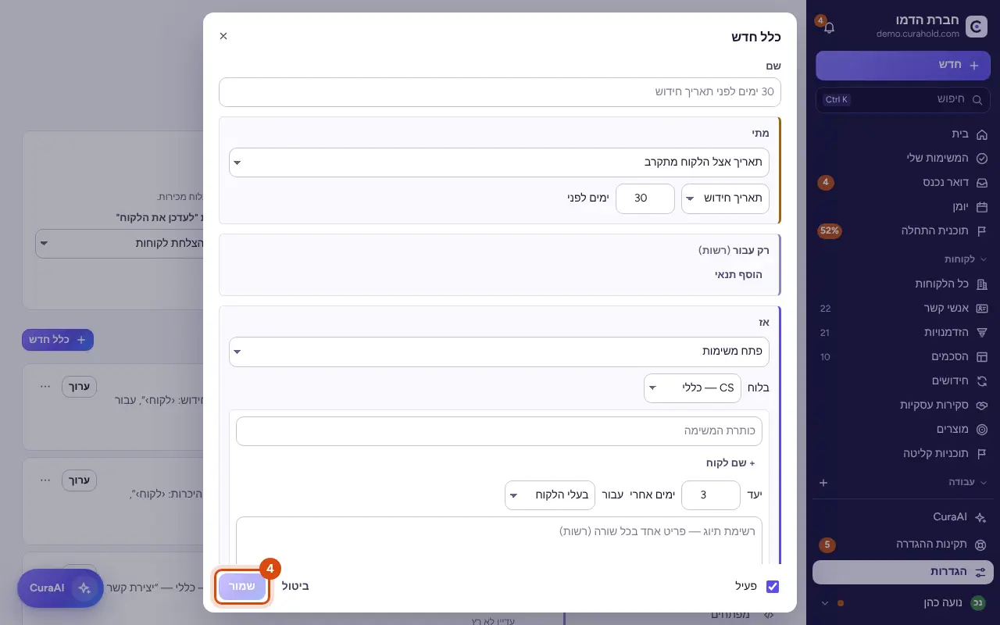

# אוטומציות

כללים עושים בשבילכם את השגרה: תוכנית חידוש 90 יום מראש, שיחת היכרות ללקוח חדש, תזכורת כשמשימה מאחרת, כרטיס מסירה כשעסקה נסגרת. הם לא נספרים ואין להם תקרה באף תוכנית.

## יצירת כלל {#new-rule}

צריך הרשאה לנהל אוטומציות (יש אותה למנהלי מערכת).

1. פותחים **הגדרות ← אוטומציות** ולוחצים **כלל חדש**.
   
2. בוחרים כלל מוכן שמתאים, או **התחל מאפס**.
   
3. תחת **מתי** בוחרים מה מפעיל את הכלל ואת הפרטים (איזה תאריך, כמה ימים, איזה לוח). לוחצים **הוסף תנאי** כדי לצמצם ללקוחות או למשימות מסוימים. תחת **אז** בוחרים מה קורה. השורה "היום הכלל הזה היה פועל על…" מראה במה הוא היה נוגע עכשיו; שום דבר עוד לא משתנה.
   
4. נותנים **שם**, משאירים **פעיל** מסומן ולוחצים **שמור**.
   

## מה מפעיל כלל {#when}

תאריך מתקרב אצל הלקוח (חידוש, סוף חוזה), כל כמה ימים לכל לקוח, לקוח שנעשה שקט, לקוח חדש, משימה באיחור, משימה שעוברת לעמודה, משימה שנוספה או הסתיימה, בקשה דרך טופס של לוח, רשומה שמגיעה לשלב, קריאת תמיכה שנפתחת.

## מה כלל יכול לעשות {#then}

לפתוח משימות (עם רשימת תיוג, לבעלים של הלקוח או לכל אחד), לשלוח תזכורת, לשבץ, להעביר, למלא שדה, לכתוב תגובה, לשלוח ל-webhooks או להכין את כרטיס המסירה.

## הרצה ועצירה {#running}

כל כלל מראה כמה פעמים רץ ב-30 הימים האחרונים. **הרץ עכשיו** מריץ כלל מתוזמן מיד במקום לחכות לשעה הבאה; הוא עדיין פועל פעם אחת לכל מקרה. מכבים כלל כדי להשהות אותו. מחיקת כלל משאירה את המשימות שכבר פתח, והכלל נשאר בסל המחזור 30 יום.

הגדרות המסירה בראש אותו דף נמצאות ב[מסירה, בקשות והחזרה ללקוח](/docs/he/handover-and-requests/).
