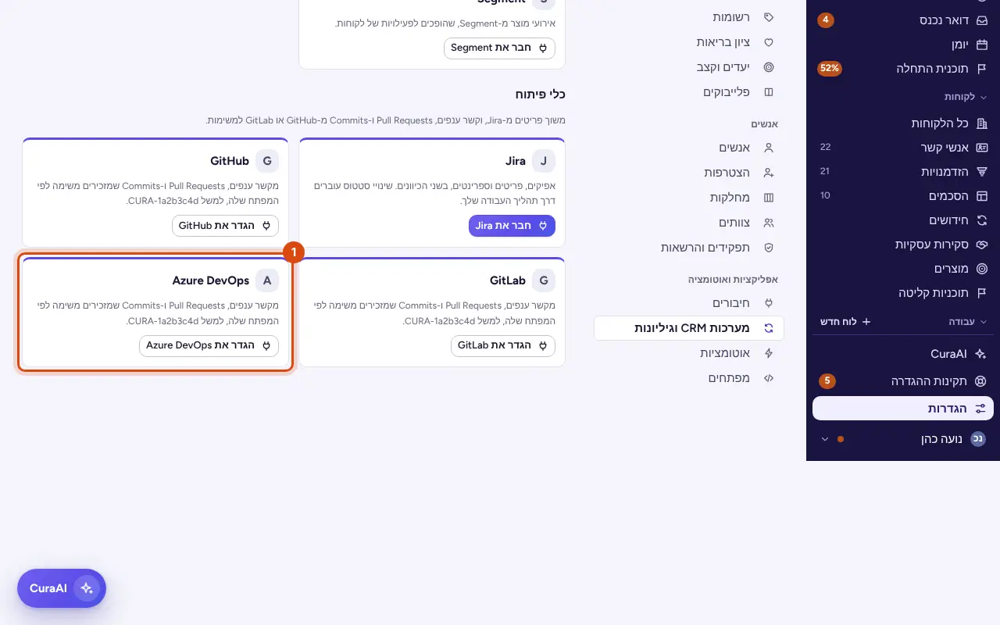
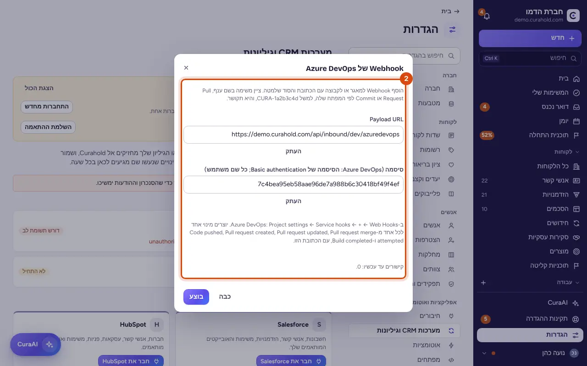

# Azure DevOps

ענפים, pull requests ו-commits ב-Azure Repos שמזכירים משימה מקושרים אליה, עם המצב (פתוח, מוזג, נסגר) ותוצאת ה-build. זה עובד כמו GitHub ו-GitLab: כותבים את מפתח המשימה, למשל `CURA-1a2b3c4d`, בשם הענף, בכותרת ה-pull request או בהודעת ה-commit.

## ב-Curahold {#connect}

1. פותחים **הגדרות ← מערכות CRM וגיליונות**, מוצאים **כלי פיתוח** ולוחצים **הגדר את Azure DevOps**.
   
2. לוחצים **הפעל** ומעתיקים את **הכתובת** ואת **הסיסמה** שמוצגות.
   

## ב-Azure DevOps

עושים זאת פעם אחת לכל אירוע (Code pushed, Pull request created, Pull request updated, Pull request merge attempted, Build completed):

1. פותחים את הפרויקט ← **Project settings** ← **Service hooks** ← **+** (Create subscription).
2. בוחרים **Web Hooks** ולוחצים **Next**.
3. בוחרים את האירוע, משאירים את המסננים, ולוחצים **Next**.
4. מדביקים את הכתובת ב-**URL**. מקלידים **Username** כלשהו (למשל `azure`) ומדביקים את הסיסמה ב-**Password**.
5. משאירים **Resource details to send** על **All**, לוחצים **Test** ואז **Finish**.

## מגבלות ותזמון

הקישורים מופיעים ברגע ש-Azure DevOps שולח אותם. Azure DevOps שולח רק ב-HTTPS ואינו חותם: הסיסמה היא ההוכחה, לכן שומרים עליה כמו על סיסמה.

## אם משהו משתבש

Azure DevOps מציג את התשובה לכל משלוח ב-**Service hooks ← History**: ‏401 פירושו סיסמה שגויה (מפעילים שוב את ה-webhook לסיסמה חדשה ומעדכנים כל מינוי). **כבה** עוצר קישורים חדשים; קישורים קיימים נשארים במשימות.

## ראו גם

- [חיבורים ו-CRM](/docs/he/connections/)
- [משימות ולוחות](/docs/he/tasks/)
