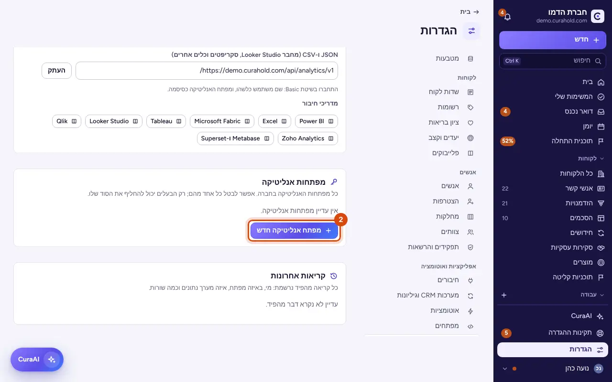
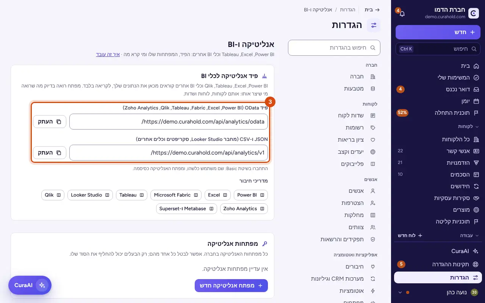

# חיבור כלי BI

ב-Curahold יש **פיד אנליטיקה** אחד לקריאה בלבד עבור כלי BI. ‏Power BI,‏ Excel,‏ Microsoft Fabric,‏ Tableau,‏ Qlik ו-Zoho Analytics קוראים אותו כ**פיד OData**; ‏Looker Studio, סקריפטים וכלים אחרים מקבלים את אותם נתונים כ-**JSON או CSV**. דרכו אי אפשר לשנות שום דבר ב-Curahold.

שמות התפריטים שלהלן הם כפי שהם מופיעים בממשק האנגלי של כל כלי; בממשק בעברית בחרו את המקבילים.

## לפני שמתחילים {#key}

צריך הרשאה לייצא נתונים (יש אותה למנהלי מערכת ולמנהלים).

1. פותחים **הגדרות ← אנליטיקה ו-BI** ולוחצים **מפתח אנליטיקה חדש**. נותנים שם (למשל "לוח מחוונים מכירות ב-Power BI"), בוחרים מערכי נתונים, מחלקות ותאריך סיום, ויוצרים. מעתיקים את המפתח מיד: הוא מוצג פעם אחת בלבד ומתחיל ב-`chb_`.
   
2. באותו דף, תחת **פיד אנליטיקה לכלי BI**, לוחצים **העתק** ליד הכתובת שהכלי צריך. הן נראות כך, עם הכתובת של החברה שלכם:
   

פיד OData ‏(Power BI, ‏Excel, ‏Fabric, ‏Tableau, ‏Qlik, ‏Zoho Analytics):

```text
https://your-company.curahold.com/api/analytics/odata/
```

‏JSON ו-CSV ‏(Looker Studio, סקריפטים, כלים אחרים):

```text
https://your-company.curahold.com/api/analytics/v1/
```

כשהכלי שואל איך להתחבר, בחרו **Basic**: הקלידו כל דבר כשם משתמש והדביקו את המפתח כסיסמה.

המפתח קורא בדיוק את מה שאתם רואים ב-Curahold: אותם לקוחות, לוחות ושדות. שדה שהתפקיד שלכם לא רואה לא יופיע אפילו כעמודה. אם תעזבו את החברה או תאבדו את הרשאת הייצוא, המפתח יפסיק לעבוד. **החלפת הסוד** נותנת לאותו מפתח ערך חדש; **בטל** מסיים אותו מיד.

## מערכי נתונים

| מערך נתונים | מה יש בו |
| --- | --- |
| `Customers` | שורה לכל לקוח, וכל שדה לקוח שמותר לכם לראות בעמודה משלו |
| `Renewals` | לקוחות עם תאריך חידוש: שווי, בריאות ועסקאות חידוש פתוחות |
| `HealthHistory` | ציון הבריאות של כל לקוח בכל יום |
| `Opportunities` | צנרת המכירות: סכום, שלב, סטטוס, תאריך סגירה |
| `Tickets` | פניות תמיכה |
| `Contacts` | אנשי קשר אצל הלקוחות |
| `Records…` | מערך לכל סוג רשומה שהוספתם (חוזים, סיכונים…) |
| `Boards`,‏ `Tasks`,‏ `TaskAssignees` | לוחות, המשימות שלהם, ושורה לכל משימה ואחראי |
| `Sprints`,‏ `SprintBurndown` | ספרינטים, והיקף ועבודה שנותרה לכל יום |
| `People` | שם ותפקיד, כדי לשים שמות על מזהי בעלים ואחראים |

בכל מערך נתונים יש `Id` ו-`ModifiedAt` (מתי השורה השתנתה לאחרונה). ברובם יש גם `IsDeleted`: שורות שהועברו לארכיון נשארות בפיד עם `IsDeleted = true`, כך שרענון יכול להסיר אותן מהדוחות. חברו מערכי נתונים לפי עמודות המזהה: `Tasks.CustomerId` ← `Customers.Id`,‏ `Tasks.BoardId` ← `Boards.Id`,‏ `OwnerId` ← `People.Id`.

## Power BI

1. ב-Power BI Desktop בחרו **Get data → OData feed**.
2. הדביקו את כתובת ה-OData ובחרו **OK**.
3. בחרו **Basic**. שם משתמש: כל דבר. סיסמה: מפתח האנליטיקה. בחרו **Connect**.
4. סמנו ב-Navigator את מערכי הנתונים הרצויים ובחרו **Load** (או **Transform data** כדי להסיר עמודות קודם).
5. אחרי הפרסום פתחו את **Settings → Data source credentials** של המודל הסמנטי, בחרו שוב **Basic** עם המפתח, והפעילו **scheduled refresh**.

אם שירות Power BI דורש שער (gateway) להתחברות Basic, השתמשו במפתח כ-**Web API key**: ב-**Transform data → Advanced editor** כתבו את המקור כך `OData.Feed("https://your-company.curahold.com/api/analytics/odata/Tasks", null, [ApiKeyName = "key", Implementation = "2.0"])`, ואז בחרו **Web API** והדביקו את המפתח כש-Power BI מבקש.

**מערכי נתונים גדולים.** לרענון מצטבר שימו את הטווח בכתובת, כך ש-Curahold יסנן לפני השליחה:

```
let
    Start = DateTime.ToText(RangeStart, "yyyy-MM-ddTHH:mm:ss") & "Z",
    End = DateTime.ToText(RangeEnd, "yyyy-MM-ddTHH:mm:ss") & "Z",
    Source = OData.Feed("https://your-company.curahold.com/api/analytics/odata/Tasks?$filter=CreatedAt ge " & Start & " and CreatedAt lt " & End, null, [Implementation = "2.0"])
in
    Source
```

ואז הגדירו כרגיל את מדיניות הרענון המצטבר לטבלה, וסמנו **Detect data changes** עם העמודה `ModifiedAt`, כך שתקופה שהשורות שלה השתנו תיקרא מחדש.

## Excel

1. ב-Excel ל-Windows בחרו **Data → Get Data → From Other Sources → From OData Feed**.
2. הדביקו את כתובת ה-OData ובחרו **OK**.
3. בחרו **Basic**, הקלידו שם משתמש כלשהו והדביקו את המפתח כסיסמה, ואז **Connect**.
4. בחרו את מערכי הנתונים ב-Navigator ואז **Load**.
5. ‏**Data → Refresh All** מביא את הנתונים העדכניים מתי שתרצו.

## Microsoft Fabric

1. בסביבת העבודה בחרו **New item → Dataflow Gen2**, ואז **Get data → OData**.
2. הדביקו את כתובת ה-OData. בפרטי ההתחברות בחרו **Basic**: שם משתמש כלשהו והמפתח כסיסמה.
3. בחרו מערכי נתונים, עבדו אותם לפי הצורך והוסיפו **data destination** (‏lakehouse או warehouse).
4. בחרו **Publish** והגדירו לוח זמנים לרענון של זרימת הנתונים.

גם **Copy activity** בצינור נתונים יכול לקרוא את אותו פיד עם מחבר OData והתחברות Basic.

## Tableau

1. ב-Tableau Desktop בחרו **Connect → To a Server → OData**.
2. כשרת, הדביקו את הכתובת של מערך נתונים אחד, למשל `https://your-company.curahold.com/api/analytics/odata/Customers`.
3. בחרו **Use username and password**: שם משתמש כלשהו והמפתח כסיסמה. בחרו **Sign In**.
4. ‏Tableau קורא OData כ-**extract**. הוסיפו חיבור OData נוסף לכל מערך נתונים שתרצו וקשרו ביניהם לפי עמודות המזהה.
5. בפרסום ל-Tableau Cloud או ל-Server הטמיעו את פרטי ההתחברות והגדירו לוח זמנים לרענון ה-extract.

## Looker Studio

כדי ש-Looker Studio יקרא פיד כזה צריך מחבר. **מחבר Looker Studio של Curahold יגיע בקרוב.** עד אז:

1. בגיליון Google חדש כתבו בתא A1: `=IMPORTDATA("https://your-company.curahold.com/api/analytics/v1/Customers.csv?limit=5000&key=המפתח-שלכם")`.
2. ב-Looker Studio בחרו **Create → Data source → Google Sheets** ובחרו את הגיליון.
3. צרו מפתח רק לשם כך, מוגבל למערכי הנתונים שהגיליון צריך: כל מי שיכול לערוך את הגיליון רואה את המפתח בנוסחה. אם הגיליון משותף ביותר מדי, בטלו את המפתח ב-Curahold.

אפשר גם לשמור גיליון מעודכן דרך **מערכות CRM וגיליונות** (הגדרות ← מערכות CRM וגיליונות) ולהשתמש בו ב-Looker Studio.

## Qlik

1. ב-Qlik Sense או ב-Qlik Cloud בחרו **Add data → OData** (או **Create new connection → OData**).
2. הדביקו את כתובת ה-OData ובחרו אימות **Basic**: שם משתמש כלשהו והמפתח כסיסמה.
3. בחרו מערכי נתונים וטענו אותם; קבעו לוח זמנים לטעינה מחדש בהגדרות האפליקציה.

גם מחבר ה-REST של Qlik עובד עם כתובת ה-JSON ‏(`…/api/analytics/v1/Customers.json`), עם התחברות Basic ועימוד "next URL" לפי השדה `next`.

## Zoho Analytics

1. בחרו **Create → New Workspace → Web URL / Feeds** (ייבוא מפיד אינטרנט).
2. הדביקו את הכתובת של מערך נתונים אחד: כתובת OData ‏(`…/api/analytics/odata/Customers`) או כתובת CSV ‏(`…/api/analytics/v1/Customers.csv`).
3. באימות בחרו **Basic**: שם משתמש כלשהו והמפתח כסיסמה.
4. לעימוד בחרו **next page URL**: ‏`@odata.nextLink` ב-OData,‏ `next` ב-JSON.
5. קבעו באיזו תדירות הייבוא חוזר.

## Metabase / Superset

‏Metabase ו-Superset קוראים מסדי נתונים, לא פידים מהאינטרנט. חיבור ישיר יתאפשר עם **הייצוא למחסן נתונים** של Curahold (ל-BigQuery או ל-Snowflake), שיגיע בקרוב. עד אז, אם ההתקנה שלכם מאפשרת העלאת קבצים, העלו CSV מהכתובת `…/api/analytics/v1/<מערך-נתונים>.csv`.

## כלים אחרים וסקריפטים

כתובת ה-JSON וה-CSV מקבלת:

| אפשרות | משמעות |
| --- | --- |
| `limit` | שורות לעמוד, עד 5000 (ברירת מחדל 1000) |
| `page` או `offset` | עימוד לפי מספר עמוד או לפי שורה |
| `cursor` | ערך `next` מהעמוד הקודם (המהיר ביותר במערכים גדולים) |
| `since` | רק שורות שהשתנו בתאריך או בשעה הזו או אחריהם, למשל `2026-11-01` |
| `fields` | רק העמודות האלה, למשל `Id,Name,ModifiedAt` |
| `filter`,‏ `orderby` | אותם ביטויים כמו `$filter` ו-`$orderby` של OData |
| `count=1` | להחזיר גם את מספר השורות הכולל |

שלחו את המפתח כ-Basic (סיסמה) או ככותרת `Authorization: Bearer chb_…`. עמוד JSON נראה כך `{ "dataset": "Tasks", "rows": [...], "next": "…" }`; עמודי CSV נותנים את הכתובת הבאה בכותרת `Link`. כלים כמו Domo,‏ SAP Analytics Cloud,‏ Quick BI ו-FineBI קוראים את כתובת ה-JSON או ה-OData באותה דרך.

פיד ה-OData מבין `$select`,‏ `$filter` ‏(`eq ne gt ge lt le`,‏ `and`,‏ `or`,‏ `not`,‏ `contains`,‏ `startswith`,‏ `endswith`),‏ `$orderby`,‏ `$top`,‏ `$skip`,‏ `$count` ו-`/$count`. הוא לא מציע `$expand`: חברו מערכי נתונים לפי עמודות המזהה במקום.

## רענון ומגבלות

- מערכי נתונים גדולים מגיעים בעמודים של 1,000 שורות; כלי BI עוקבים בעצמם אחרי הקישור לעמוד הבא.
- **רק שינויים:** סננו לפי `ModifiedAt` ‏(`$filter=ModifiedAt ge 2026-11-01T00:00:00Z`) או השתמשו ב-`since` ב-JSON. עם הכותרת `Prefer: odata.track-changes` העמוד האחרון נותן גם `@odata.deltaLink`, שמחזיר מאוחר יותר רק את מה שהשתנה.
- כל מפתח יכול לשלוח בערך שתי בקשות בשנייה, ולכל חברה יש מכסה יומית של שורות. מעבר לה הפיד מחזיר 429 ואומר מתי לנסות שוב.
- כל קריאה נרשמת (מי, באיזה מפתח, איזה מערך נתונים, כמה שורות) ומופיעה בהגדרות תחת **קריאות אחרונות**.

## כשמשהו לא עובד

- **401 / הכלי מבקש שוב פרטי התחברות:** המפתח שגוי, בוטל או שעבר תאריך הסיום שלו, או ששדה שם המשתמש נשאר ריק בכלי שדורש אותו: הקלידו בו כל דבר.
- **403:** לבעלים של המפתח כבר אין הרשאה לייצוא נתונים.
- **404 למערך נתונים:** המפתח מוגבל למערכי נתונים או למחלקות אחרים, או שהשדות של המערך סגורים בפני התפקיד של הבעלים.
- **400 עם הודעה:** השאילתה משתמשת במשהו שהפיד לא תומך בו; ההודעה אומרת במה.
