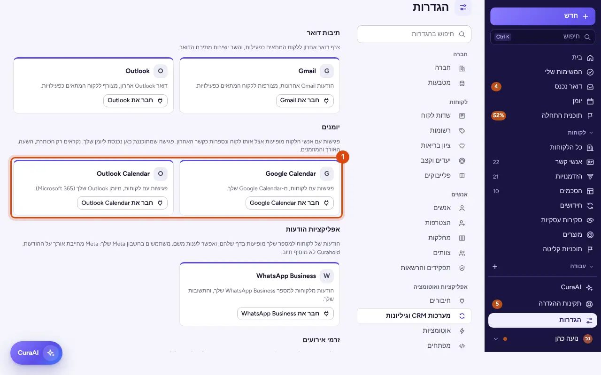

# Google Calendar ו-Outlook Calendar

מחברים את היומן וכל פגישה שהייתה עם אנשי לקוח מופיעה בציר הזמן שלו כפגישה עם משכה, ונספרת כקשר האחרון. מציר הזמן של הלקוח אפשר לתכנן פגישה ישר ביומן; היומן שולח את ההזמנות.

## מה נקרא ומה לא

רק פגישות שכבר התקיימו, מהיומן הראשי: הכותרת, השעה, המשך והמוזמנים. אף פעם לא התיאור, המקום או קישור השיחה. פגישות פרטיות, אירועי יום שלם ופגישות בלי אף אחד מבחוץ לא נכללות. פגישה משויכת ללקוח שאיש קשר שלו מוזמן, או שכתובת האתר שלו היא הדומיין של מוזמן.

## ב-Curahold {#connect}

1. פותחים **הגדרות ← מערכות CRM וגיליונות**, מוצאים **יומנים** ולוחצים **חבר את Google Calendar** או **חבר את Outlook Calendar**.
   

Google או Microsoft נפתחים. בוחרים את חשבון העבודה ולוחצים **Allow** (Google) או **Accept** (Microsoft). בחזרה ב-Curahold לוחצים **התחל**: 90 הימים האחרונים נקראים, ואחר כך כל שעה.

## תכנון פגישה

בדף הלקוח פותחים **ציר זמן** ולוחצים **לתכנן פגישה ב-Google Calendar** (או Outlook). מקלידים כותרת, שעה, משך ואימיילים של המוזמנים, ולוחצים **להוסיף ל-…**. הפגישה מופיעה בציר הזמן אחרי שהתקיימה.

## מגבלות ותזמון

נקרא כל שעה; פגישה מהשבוע האחרון ששמה שונה או שבוטלה מתעדכנת או מוסרת. Google ו-Microsoft מגבילים בקשות לדקה: תשובת „עמוס” עוצרת את הקריאה, והיא ממשיכה בפעם הבאה.

## אם משהו משתבש

כניסה שפג תוקפה מתחדשת לבד. אם הגישה בוטלה (סיסמה חדשה, החלטת מנהל) החיבור מציג **דורש תשומת לב**: לוחצים **חבר מחדש** ומתחברים עם אותו חשבון. **הסר** מוחק את הכניסה; פגישות שכבר בצירי הזמן נשארות.

## ראו גם

- [ציר זמן וציון בריאות](/docs/he/timeline-and-health/)
- [חיבורים ו-CRM](/docs/he/connections/)
