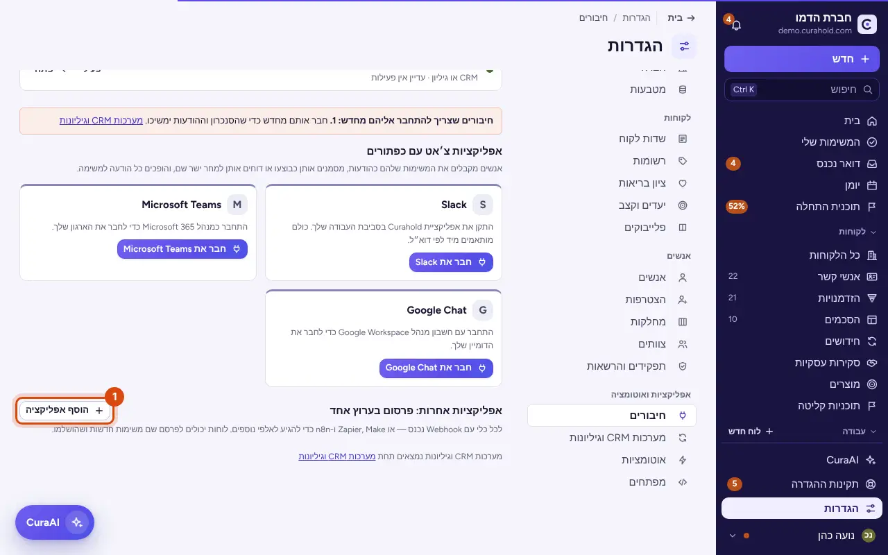
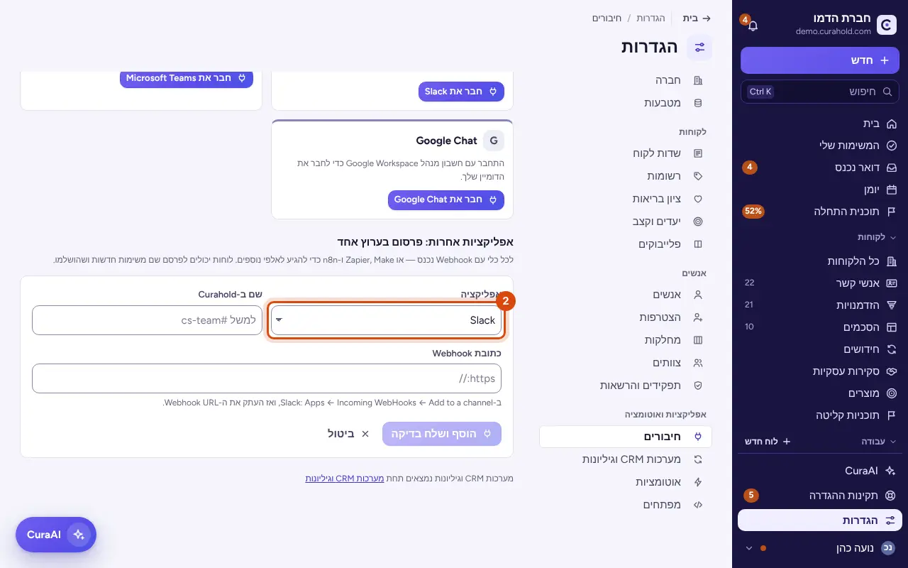

# התראות Lark, Feishu ו-Telegram

לוח יכול לפרסם את החדשות שלו (משימה חדשה, משימה שהסתיימה) בצ'אט קבוצתי. Lark ו-Feishu משתמשים בבוט המותאם של הקבוצה; Telegram בבוט שיוצרים בשתי דקות. שניהם חד-כיווניים: הם מפרסמים, ולא עונים דרכם.

## ב-Curahold {#connect}

1. פותחים **הגדרות ← חיבורים** ולוחצים **הוסף אפליקציה**.
   
2. בוחרים **Lark · Feishu** או **Telegram**, מדביקים את מה שהשלבים למטה נותנים, ולוחצים **הוסף ושלח בדיקה**. הודעת בדיקה מגיעה לקבוצה.
   

אחר כך פותחים את הלוח, בהגדרות שלו בוחרים התראות, ובוחרים את החיבור החדש לחדשות הרצויות.

## Lark · Feishu

1. בקבוצה פותחים **Settings ← Bots ← Add bot ← Custom bot**, נותנים שם ולוחצים **Add**.
2. מעתיקים את **כתובת ה-webhook**. היא נראית כך:

```text
https://open.larksuite.com/open-apis/bot/v2/hook/0f3c2a9e-7d1b-4c55-9a7e-2b8f6c1d3e4f
```

רשות, ומומלץ: תחת **Security settings** מסמנים **Signature verification** ומעתיקים את הסוד ל-**מפתח חתימה** ב-Curahold. לא משתמשים במסנן מילות מפתח: הודעות יושמטו.

## Telegram

1. ב-Telegram כותבים ל-**‎@BotFather‎**, שולחים `/newbot`, עונים על שתי השאלות ומעתיקים את **האסימון**.
2. מוסיפים את הבוט לקבוצה (לערוץ: כמנהל).
3. שולחים הודעה אחת בקבוצה. Curahold מוצא ממנה את הקבוצה, כך שלא צריך את המזהה שלה.
4. מדביקים את האסימון ב-**אסימון הבוט** ב-Curahold. לערוץ ציבורי אפשר להקליד את `@השם` שלו.

## מגבלות ותזמון

Lark מקבל כ-100 פרסומים בדקה לבוט ו-Telegram כ-20 בדקה לקבוצה; תשובת „עמוס” נשלחת שוב ולא אובדת. הודעות Telegram הן טקסט פשוט, עד 4,096 תווים.

## אם משהו משתבש

סוד חתימה שגוי, בוט שהוסר או אסימון שבוטל מסמנים את החיבור **דורש תשומת לב** בהגדרות ← חיבורים, והבדיקה אומרת זאת. מתקנים בצד השני ולוחצים שוב **שלח בדיקה**: בדיקה שעובדת מנקה את הבעיה. **הסר** עוצר את הפרסומים; הבוט נשאר בקבוצה עד שמסירים אותו שם.

## ראו גם

- [חיבורים ו-CRM](/docs/he/connections/)
- [התראות](/docs/he/notifications/)
