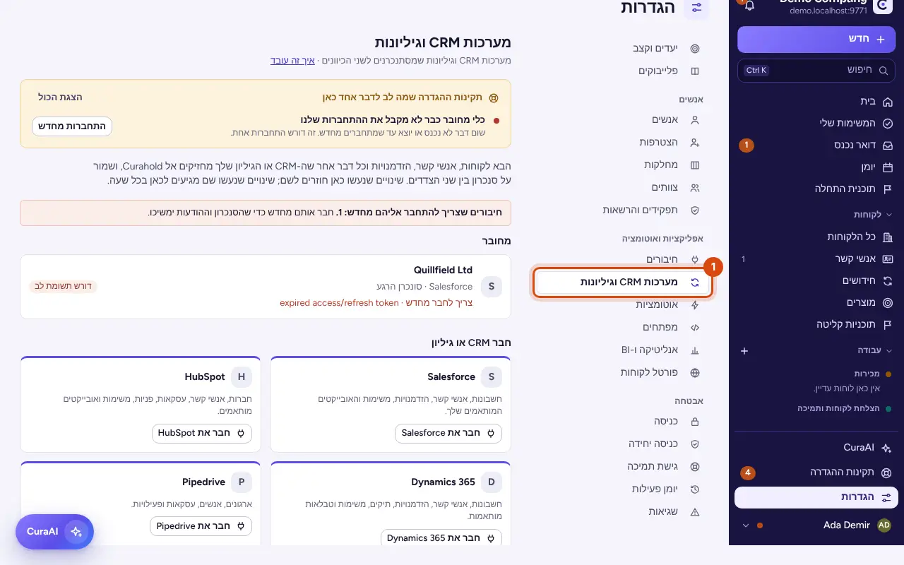
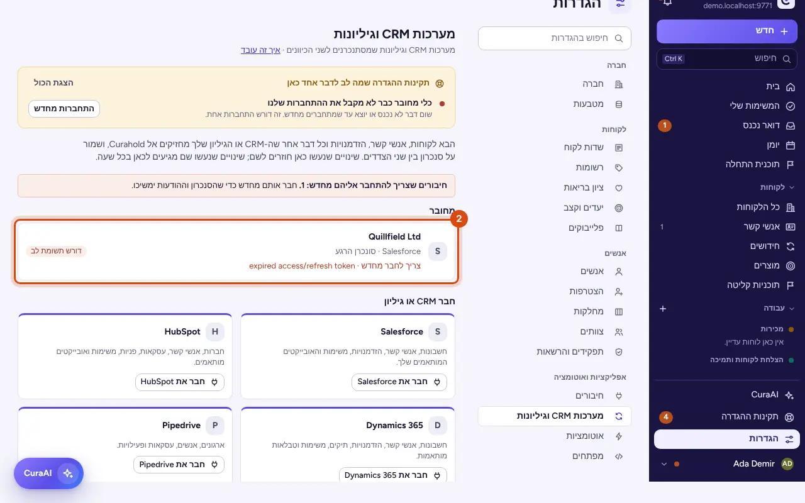
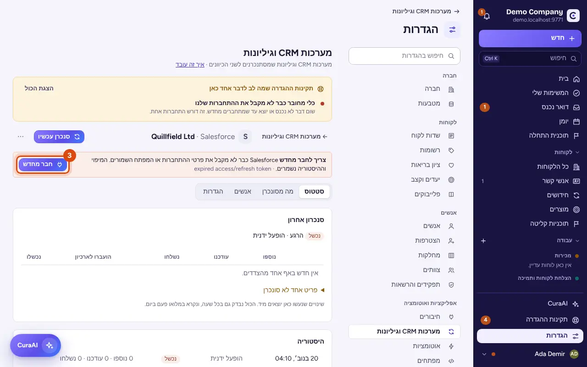
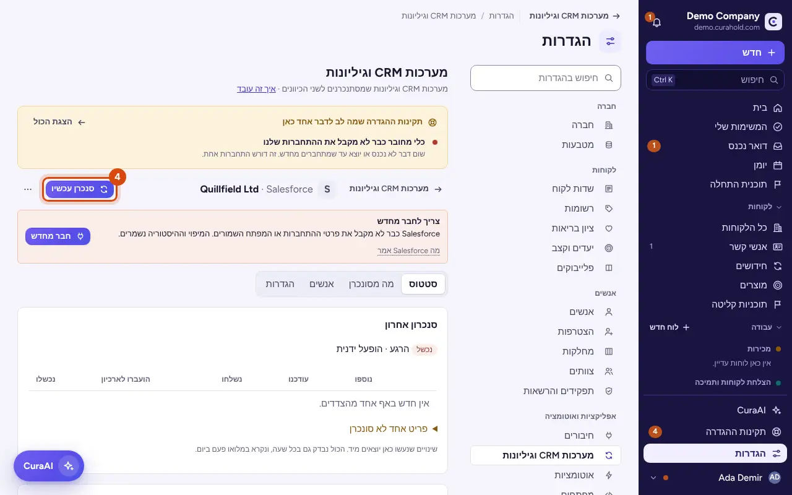

# חיבורים ו-CRM

Curahold עובד לצד הכלים שהצוות שלכם כבר משתמש בהם. מנהלים חיבורים ב'הגדרות' ← חיבורים וב'הגדרות' ← מקורות נתונים.

## אפליקציות צ'אט

כש-Slack, ‏Microsoft Teams או Google Chat מחוברים, ההתראות מגיעות לאנשים כהודעות ישירות, ואפשר לסיים משימה או לפתוח אותה מחדש ישירות מההודעה.

## CRM וגיליונות

מסנכרנים לקוחות, אנשי קשר והזדמנויות עם Salesforce, ‏HubSpot, ‏Microsoft Dynamics, ‏Pipedrive, ‏Zoho, ‏Bitrix24, ‏Freshsales, ‏Zendesk Sell, ‏Google Sheets ו-Excel. פותחים את **'הגדרות' ← מערכות CRM וגיליונות** ובוחרים **חבר**.

1. **התחברות.** מועברים לעמוד הכניסה של ה-CRM עצמו ומאשרים מה Curahold רשאי לקרוא ולכתוב. אף פעם לא מקלידים סיסמה ב-Curahold. (‏Bitrix24, ‏Freshsales ו-Zendesk Sell מקבלים במקום זאת מפתח; ראו בהמשך.)
2. **בוחרים מה מגיע.** מסמנים את האובייקטים שצריך ואומרים מה כל אחד מהם ב-Curahold: לקוחות, אנשי קשר, הזדמנויות, סוג רשומה משלכם, או משימות בלוח.
3. **מתאימים את השדות.** Curahold מציע התאמה לכל שדה; אפשר לשנות כל אחת, ולבחור לכל שדה אם הוא רק נכנס או נשמר זהה בשני הצדדים.
4. **בדיקה והתחלה.** התצוגה המקדימה מראה כמה יתווספו וכמה יתעדכנו לפני שמשהו משתנה.

מאז הסנכרון רץ מעצמו כל שעה, ושינוי שנעשה ב-Curahold נכתב ל-CRM מיד. כל מה שלא הצליח להסתנכרן מופיע ברשימה עם הסיבה, ואפשר לנסות שוב. כשאותו דבר השתנה בשני הצדדים, השינוי החדש יותר מנצח; אפשר לקבוע במקום זאת שה-CRM או Curahold ינצחו תמיד (בלשונית ההגדרות של החיבור).

חיבור דורש הרשאה לנהל חיבורים. אנשים מותאמים לפי דוא״ל, כך שהבעלים של כל לקוח ב-CRM הופך לבעלים שלו ב-Curahold.

## Salesforce

מגיעים: accounts, ‏contacts, ‏opportunities, ‏tasks והאובייקטים המותאמים שלכם. מסמנים **Sandbox** לפני החיבור כדי להשתמש בארגון בדיקה.

**בפעם הראשונה, מנהל Salesforce מתקין את Curahold.** ‏Salesforce חוסם אפליקציות שלא הותקנו בארגון שלכם, ולכן לפני הכניסה הראשונה מנהל פותח את עמוד ההתקנה (הקישור מופיע כשבוחרים חבר) ומאשר אותו. החבילה לא מוסיפה קוד, שדות או אובייקטים: היא רק מאפשרת לאנשים בארגון לאשר את Curahold. אפשר להסיר אותה בכל עת מ-Setup ← Installed Packages, ו-Curahold מאבד גישה מיד. אם Salesforce עונה שהאפליקציה לא מורשית, השלב הזה עוד לא בוצע. המשתמש שמתחבר צריך גישת API ב-Salesforce (כלולה ב-Enterprise ומעלה, תוספת ב-Professional).

## HubSpot

מגיעים: companies, ‏contacts, ‏deals, ‏tickets, ‏tasks ואובייקטים מותאמים. ‏HubSpot שואל איזה חשבון לחבר ומפרט מה Curahold רשאי לקרוא ולכתוב; contacts ו-deals מתבקשים רק אם התוכנית שלכם ב-HubSpot כוללת אותם.

## Microsoft Dynamics 365

מגיעים: accounts, ‏contacts, ‏opportunities, ‏cases, ‏tasks וטבלאות מותאמות. לפני הכניסה מזינים את הכתובת של הארגון (היא נראית כמו `https://yourcompany.crm4.dynamics.com`). אם Microsoft מציג "Need admin approval", מנהל Microsoft 365 צריך לאשר את Curahold עבור הארגון פעם אחת.

## Pipedrive

מגיעים: organizations, ‏people, ‏deals ו-activities. שדות מותאמים מותאמים כמו השדות הרגילים.

## Zoho CRM

מגיעים: accounts, ‏contacts, ‏deals, ‏cases, ‏tasks ומודולים מותאמים. Curahold מוצא את מרכז הנתונים של Zoho שלכם (ארה״ב, האיחוד האירופי, הודו, אוסטרליה…) בעצמו.

## Bitrix24, ‏Freshsales ו-Zendesk Sell

שלושת אלה מתחברים עם מפתח שיוצרים ב-CRM עצמו, כך שאין עמוד כניסה ואין מה לאשר. Curahold בודק את המפתח ברגע שמדביקים אותו, שומר אותו מוצפן ולא מציג אותו שוב; מסירים את החיבור והמפתח נעלם. כל השאר זהה ל-CRM האחרים: בוחרים מה מגיע, מתאימים את השדות, והשינויים עוברים לשני הכיוונים.

| CRM | מה מדביקים | איפה מוצאים | מה מגיע |
| --- | --- | --- | --- |
| Bitrix24 | כתובת ה-inbound webhook | Developer resources ← Other ← Inbound webhook; נותנים לו את הרשאת CRM, וגם Users כדי שאפשר יהיה להתאים בעלים | companies, ‏contacts, ‏deals |
| Freshsales | הכתובת שלכם ומפתח ה-API | תמונת הפרופיל ← Settings ← API settings | accounts, ‏contacts, ‏deals |
| Zendesk Sell | access token | Settings ← Integrations ← OAuth ← Access tokens | companies, ‏people, ‏deals |

טוב לדעת:

- **מפתח פועל בשם מי שיצר אותו.** Curahold רואה את מה שהאדם הזה רואה ב-CRM. צרו את המפתח עם חשבון שרואה כל לקוח שאתם רוצים כאן.
- **דוא״ל, טלפון וכתובת אתר ב-Bitrix24** הם רשימות שם. Curahold קורא את הראשון וממלא אותו כשהוא יוצר איש קשר או חברה חדשים, אבל לעולם לא כותב מחדש את הרשימה אחר כך.
- **Freshsales נקרא דרך התצוגות "All accounts", ‏"All contacts" ו-"All deals".** אם אחת מהן שונה שמה או הוסרה, הרשימה הזו לא נקראת וההרצה אומרת זאת, במקום להביא רק חלק ממנה.
- **עסקה ב-Zendesk Sell צריכה חברה.** עסקה שנוצרה ב-Curahold נוצרת שם תחת החברה של הלקוח.
- המחברים האלה חדשים. אם משהו לא מגיע כמו שציפיתם, כתבו לנו מ'עזרה' במוצר.

## Google Sheets ו-Excel

גיליון הוא הדרך הפשוטה ביותר להכניס נתונים, והוא מתאים לכל כלי שיכול לייצא אחד. מחברים Google Sheet, או קובץ Excel ב-OneDrive או ב-SharePoint, לשונית אחרי לשונית; כל לשונית יכולה להיות לקוחות, אנשי קשר או סוג רשומה משלכם. בוחרים את העמודה שמזהה שורה, כך ששורה שמשתנה מעדכנת את אותו לקוח במקום להוסיף עוד אחד. גיליון לא שומר זמן שינוי לכל שורה, ולכן כשאותו תא השתנה בשני הצדדים, השינוי שנעשה ב-Curahold גובר; כדי שהגיליון יגבור, בחרו זאת בלשונית ההגדרות של החיבור.

## כלי תמיכה

Zendesk, ‏Freshdesk, ‏Intercom ו-Jira Service Management מתחברים עם כתובת ומפתח API; הפניות נוחתות תחת הלקוח הנכון. אפשר למפות גם cases של Salesforce ו-Dynamics כפניות תמיכה. פרטים: [פניות תמיכה](/docs/he/support-tickets/).

## כשסנכרון נעצר {#sync-stops}

הלשונית **סטטוס** של החיבור מסבירה מה קרה במילים פשוטות, ומתחת מופיעה ההודעה של השירות עצמו.

| מה כתוב | מה לעשות |
| --- | --- |
| השירות ביקש מ-Curahold להאט | כלום. המקום נשמר וההרצה השעתית הבאה ממשיכה. |
| הוא כבר לא מקבל את הכניסה או המפתח של Curahold | חברו מחדש, לפי השלבים למטה. |
| לחשבון אין הרשאה לקרוא או לשנות משהו | בקשו ממנהל הכלי לתת לחשבון גישה, ואז לחצו **סנכרן עכשיו**. |
| לא הצלחנו להגיע אליו | כלום. Curahold ינסה שוב בהרצה השעתית הבאה. |

כדי לחבר מחדש:

1. פתחו **הגדרות ← מערכות CRM וגיליונות**.
   
2. לחצו על החיבור שמסומן **דורש תשומת לב**.
   
3. לחצו **חבר מחדש** בראש העמוד.
   
   היכנסו לאותו חשבון כמו קודם (או הדביקו את המפתח החדש) ואשרו.
4. לחצו **סנכרן עכשיו**. השדות שהתאמתם נשארים כמו שהיו.
   

כדי להסיר חיבור, פתחו אותו, לחצו **⋯** ובחרו **הסרה**. הסנכרון נעצר; לקוחות, אנשי קשר והזדמנויות שהגיעו נשארים ב-Curahold, ושום דבר לא נמחק בכלי השני. בתוכנת הנהלת חשבונות, היתרות, החשבוניות והתשלומים שנקראו ממנה יוסרו מדפי הלקוחות.

## הכלים שלכם

כדי לחבר מערכת אחרת, ראו [מפתחות API](/docs/he/api-keys/), ‏[webhooks](/docs/he/webhooks/) או [חיבור Claude ו-ChatGPT](/docs/he/ai-assistants/).
