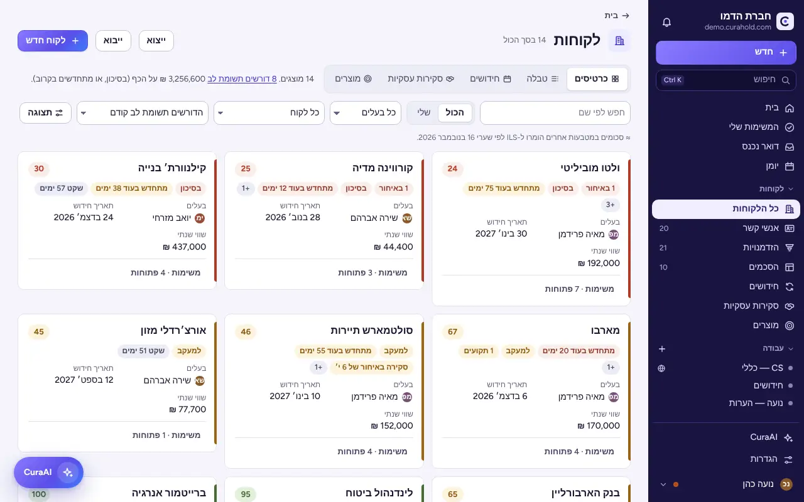
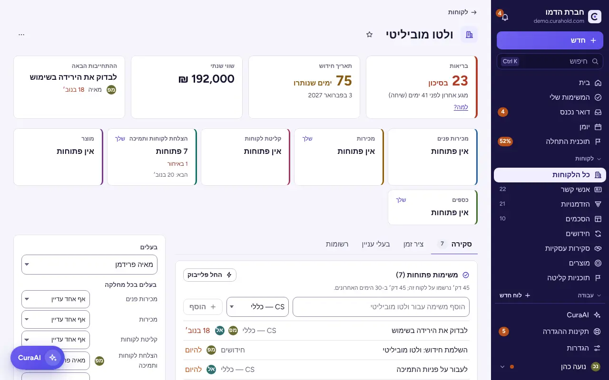

# לקוחות, שדות ורשומות

הלקוחות נמצאים במרכז של Curahold. לכל לקוח יש בעלים, צוות (לא חובה) ושדות משלכם.

## עמוד הלקוח

בראש עמוד הלקוח יש פס שקוראים במבט אחד: **בריאות** עם הסיבה שלה וכפתור **למה?**, תאריך החידוש והימים שנותרו, השווי השנתי, ו**ההתחייבות הבאה**: הצעד הקרוב ביותר שהבטחתם ללקוח, ומי אחראי עליו. מתחת לפס יש לשוניות: **סקירה** (משימות פתוחות ופגישות קרובות), **ציר זמן**, **בעלי עניין**, **רשומות** ו**פרטים**. הלשונית הפתוחה נשמרת בכתובת, כך שרענון או קישור ששלחתם חוזרים אליה.

## שדות

מוסיפים שדות ב'הגדרות' ← שדות לקוח: טקסט, מספר, סכום כסף, תאריך, בחירה, דוא״ל, קישור. לאפשרויות של שדה בחירה אפשר לתת צבע, כך ששדה כמו בריאות מופיע בצבע הזה ברשימות ובכרטיסים.

אפשר גם לשנות את השם "לקוח": "תיק לקוח", "מותג", "שותף" – המילה שהצוות שלכם משתמש בה תופיע בכל הממשק.

## רשומות: אנשי קשר, הזדמנויות ועוד

שומרים רשומות תחת לקוחות:

- **אנשי קשר (בעלי עניין):** תפקיד, תפקיד בהחלטה (מקבל החלטות, מאשר (תקציב), משפיע, מעריך, משתמש) והיחס אליכם (תומך מרכזי, תומך, ניטרלי, ספקן, חוסם).
- **הזדמנויות:** סכום, תאריך סגירה, שלב וסטטוס.
- **סוגי רשומות משלכם:** למשל "פרויקטים" או "חוזים".

רשומות יכולות להזין שדות לקוח: "צינור מכירות פתוח", "מספר תומכים מרכזיים", "מספר חוסמים". השדה מתעדכן מעצמו כשרשומה משתנה.

## תצוגות: כרטיסים, טבלה, חידושים, מוצרים

עוברים בין ארבע תצוגות בכפתורים שבראש עמוד הלקוחות; הבחירה נשמרת במכשיר הזה.

- **כרטיסים:** כרטיס לכל לקוח, שאומר מה דורש בדיקה: משימות באיחור, בריאות בסיכון או במעקב, חידוש שמתקרב או שעבר, משימות שלא נגעו בהן 14 יום, אין קשר 30 יום. החמור ביותר ראשון; "הכול תקין" כשאין כלום. הכרטיסים מסודרים כברירת מחדל לפי "צריך תשומת לב קודם", ואפשר למיין לפי שם, בריאות, שווי, חידוש או משימות פתוחות. בוחרים אילו שדות יופיעו על הכרטיס מתפריט **תצוגה**.
- **טבלה:** רשימה ממוינת שבה אפשר לשנות לקוחות רבים בבת אחת.
- **חידושים:** החידושים של 12 החודשים הקרובים, חודש אחרי חודש, עם הסכום של כל חודש וכמה ממנו בסיכון או במעקב.
- **מוצרים:** למי יש איזה מוצר, לפי שדה בחירה של סוג רשומה (למשל "מנוי ← מוצר"). ה-**+** בתא ריק פותח משימת מכירה משלימה ללקוח הזה.

המשפט בראש העמוד אומר כמה לקוחות צריכים תשומת לב וכמה שווי בסיכון; הקישור "צריכים תשומת לב" מצמצם את הרשימה אליהם. בטלפון כל המסננים נמצאים יחד בגיליון **סינון** אחד.

## הוספת חידוש

חידוש הוא **תאריך החידוש** של הלקוח. פותחים את הלקוח וממלאים אותו תחת **פרטים**, או מביאים אותו בעמודה בזמן ייבוא. מעכשיו הלקוח מופיע ב**חידושים**, בחודש שלו ועם השווי שלו. אין עדיין שדה כזה? מוסיפים שדה תאריך ב'הגדרות' ← שדות לקוח. כדי שעבודת החידוש תיפתח מעצמה, מפעילים את **התחל חידושים מעצמם** ב'הגדרות' ← **יעדים וקצב** ובוחרים כמה זמן מראש ועם איזה playbook.

## ייבוא

גוררים קובץ Excel או CSV, מתאימים עמודות לשדות, בודקים את התצוגה המקדימה ומייבאים. ייבוא שהשתבש אפשר לבטל בלחיצה אחת במשך 30 יום.

## ייצוא

מורידים רשימות לקוחות ורשומות, עם המסנן הפעיל, כ-Excel או CSV. הקובץ נוצר בדפדפן שלכם, ושדות שאינכם רואים לא נכנסים אליו.

## שינוי של רבים בבת אחת

בוחרים כמה לקוחות ברשימה ומשנים יחד את הבעלים, הצוות או שדה. ההודעה בתחתית מציעה **בטל**.

## מחיקת לקוח, והחזרת לקוח שנמחק

לקוח שנמחק עובר ל[סל המחזור](/docs/he/trash/) עם הרשומות, ציר הזמן, הפגישות ואנשי הפורטל שלו, ואפשר להחזיר אותו במשך 30 יום: בוחרים **בטל** בהודעה מיד אחרי המחיקה, או פותחים את התפריט שלכם, בוחרים **סל מחזור** ואז **החזר**. המשימות שלו נשארות בלוחות בלי לקוח, וכשהוא חוזר הן מצביעות עליו שוב. כדי להוציא לקוח מהדרך בלי למחוק אותו, מעבירים אותו לארכיון.

## פלייבוקים

**פלייבוק** הוא סט משימות מתוזמנות שמוצמדות ללקוח בלחיצה אחת: קליטה, הכנה לחידוש, QBR. מנהל כותב אותו פעם אחת ב'הגדרות' ← **פלייבוקים** (כותרת המשימה, כמה ימים אחרי ההתחלה, למי); בעמוד הלקוח, **החל פלייבוק** מאפשר לבחור את יום ההתחלה ולהוסיף את כולן. `{account_name}` בכותרת הופך לשם הלקוח.

## סקירות עסקיות

מחליטים פעם אחת כל כמה זמן יושבים עם כל לקוח: 'הגדרות' ← **יעדים וקצב** ← *סקירות עסקיות* (למשל כל 90 יום). ללקוח אחד יכול להיות קצב משלו בשדה **סקירה עסקית** בעמוד שלו; "ללא סקירות" מוציא את הלקוח הזה מהקצב.

סקירה עסקית היא פגישה שמקיימים עם כל לקוח מדי פעם (QBR) כדי לעבור על התוצאות והתוכניות. **לקוחות ← סקירות עסקיות** מציג את אלה שהגיע זמנן: באיחור, ב-30 הימים הקרובים, ומאוחר יותר. אחרי שקיימתם את הסקירה, **הושלם** בשורה (או בעמוד הלקוח) פותח את טופס הפגישה; אחרי השמירה היא נכנסת ל**פגישות** ולציר הזמן של הלקוח כ"סקירה עסקית", והתאריך הבא מתעדכן מעצמו. ללקוח שעוד לא נסקר, הספירה מתחילה ביום שבו נוסף. סקירה באיחור מופיעה גם כסימן על כרטיס הלקוח.

## פגישות

**פגישות** בעמוד הלקוח מציג כל פגישה, סקירה עסקית ושיחה עם הלקוח, מהחדשה לישנה: התאריך, הסוג, הכותרת, האורך, מי תיעד, מי השתתף (מהצד שלהם ומהצד שלנו), ההערות והצעדים הבאים. הכפתורים שמעל הרשימה מציגים סוג אחד בלבד; התאריך של הסקירה העסקית הבאה מופיע ליד הכותרת.

**תעד פגישה** (בעמוד הלקוח, או **+ חדש ← תעד פגישה, שיחה או הערה**) מבקש:

- את הסוג (פגישה, סקירה עסקית, שיחה), כותרת, תאריך ואורך,
- את האנשים שלהם שהשתתפו (אנשי הקשר של הלקוח) ואת שלנו,
- הערות: על מה דיברו ומה הוחלט,
- צעדים הבאים: כל אחד, עם מי אחראי ועד מתי, הופך למשימה בלוח שתבחרו, על הלקוח הזה.

הצעדים הבאים מופיעים מתחת לפגישה עם מצבם (שהושלמו מסומנים בקו); לחיצה על אחד פותחת את המשימה. אפשר לערוך פגישה אחר כך, להוסיף לה צעדים או למחוק אותה; המשימות של פגישה שנמחקה נשארות, ואת הפגישה עצמה אפשר להחזיר מ[סל המחזור](/docs/he/trash/) במשך 30 יום.
