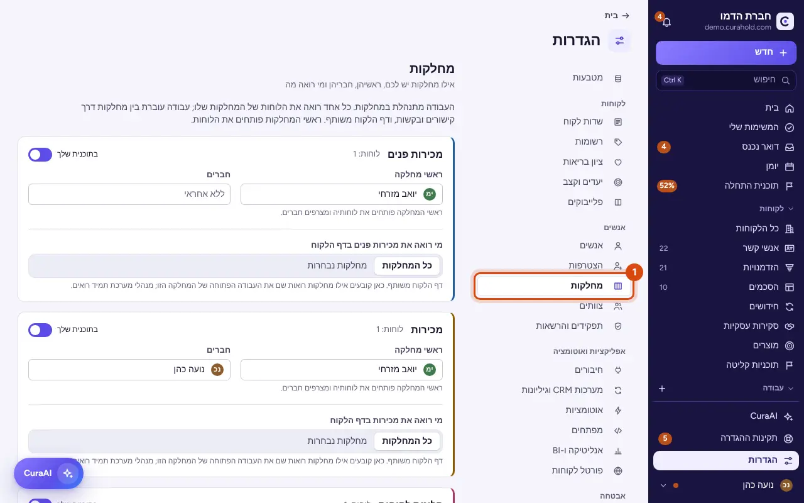
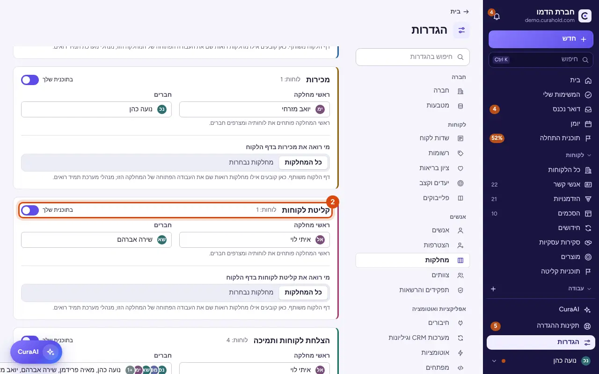
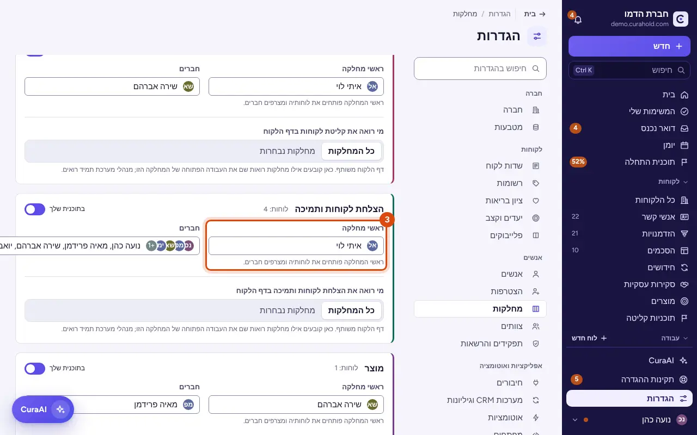
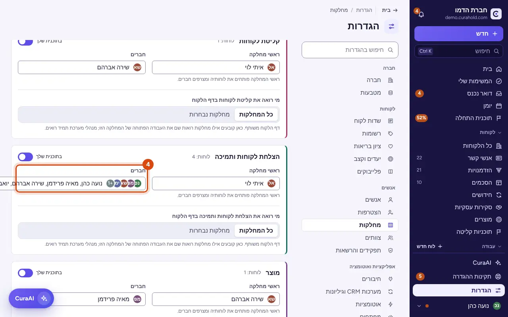
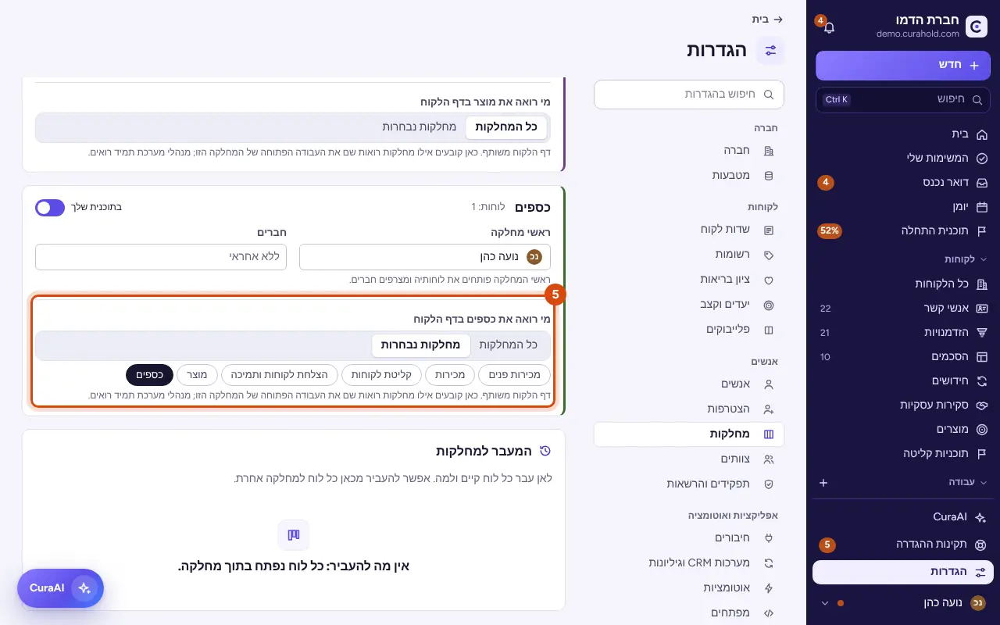
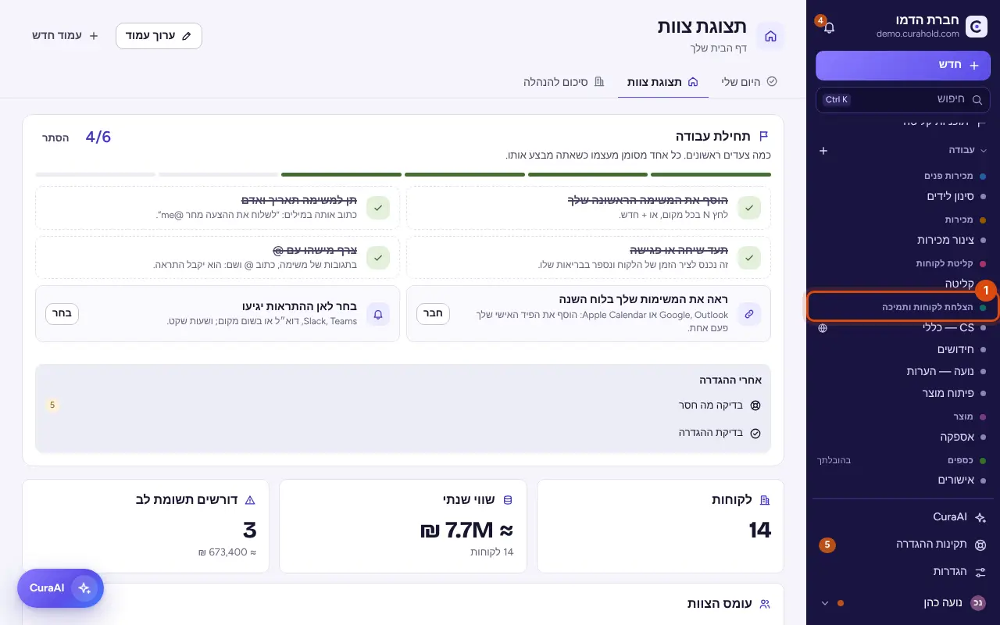
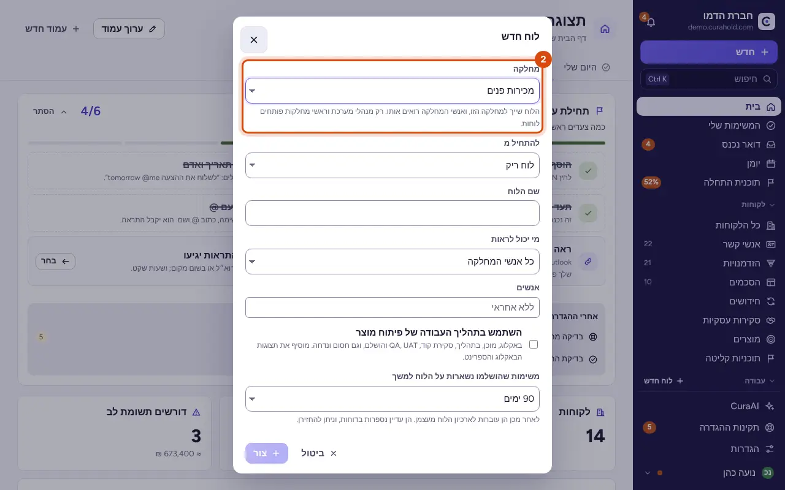
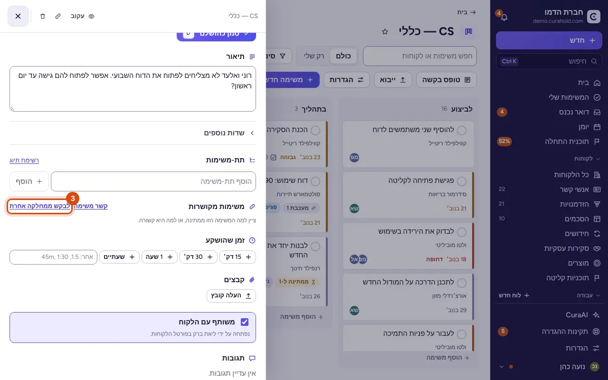
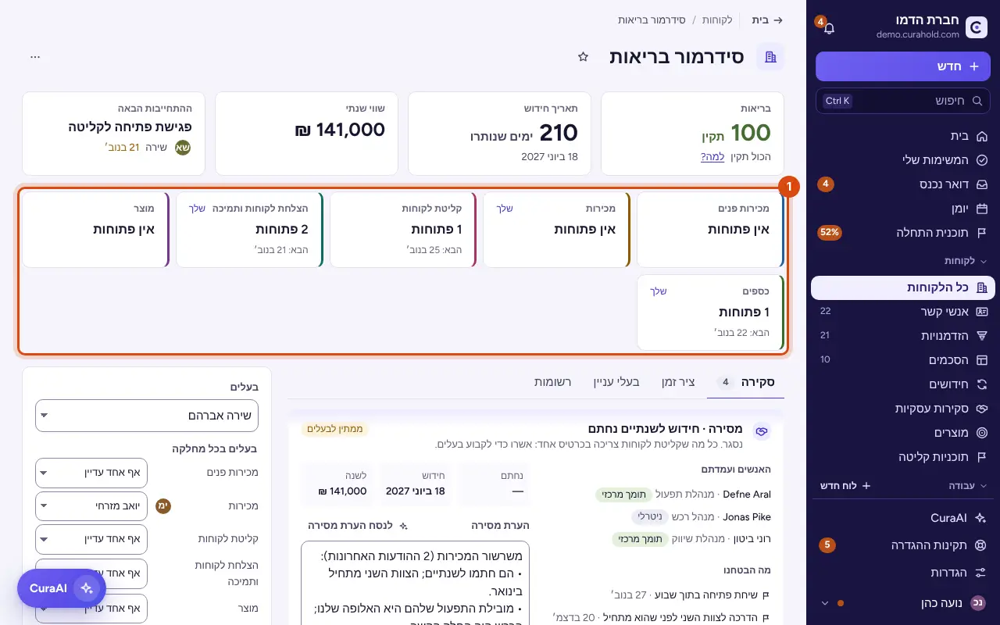
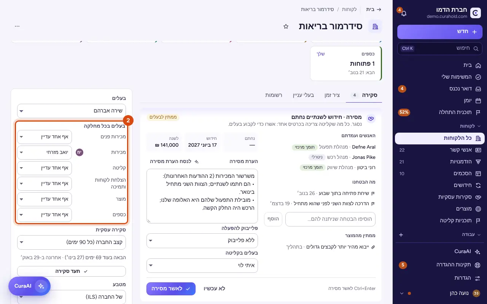

# מחלקות

העבודה ב-Curahold חיה במחלקות: מכירות פנים, מכירות, קליטת לקוחות, הצלחת לקוחות ותמיכה, מוצר וכספים. כל אחד רואה את הלוחות של המחלקות שלו. עבודה עוברת למחלקה אחרת דרך בקשה, ודף הלקוח משותף לכל מי שרשאי לראות את הלקוח.

## הגדרת המחלקות {#set-up}

צריך להיות מנהל מערכת (או מי שמנהל אנשים).

1. בתפריט שבצד, לוחצים על **הגדרות** ואז על **מחלקות** (תחת **אנשים**).
   
2. משאירים את **בתוכנית שלך** פעיל בכל מחלקה שיש בחברה. מכבים אותו במחלקה שלא משתמשים בה: היא מוסתרת מכולם, והלוחות שלה נשמרים עד שמפעילים אותה שוב.
   
3. ב**ראשי מחלקה** בוחרים מי מוביל את המחלקה. ראשי המחלקה פותחים את הלוחות שלה ומוסיפים את חבריה.
   
4. ב**חברים** בוחרים את כל השאר שעובדים בה. אדם יכול להיות ביותר ממחלקה אחת.
   
5. תחת **מי רואה את … בדף הלקוח** בוחרים **כל המחלקות**, או **מחלקות נבחרות** ולוחצים על המחלקות שרשאיות לראות שם את העבודה הפתוחה של המחלקה. מנהלי מערכת תמיד רואים. כספים מתחילה גלויה לכספים בלבד.
   

הכול נשמר תוך כדי. מי שעדיין לא נמצא באף מחלקה שומר את העבודה שלו ב**המשימות שלי** עד שמוסיפים אותו.

כשהחברה עברה למחלקות, כל לוח קיים שובץ במחלקה. **המעבר למחלקות** בתחתית אותו דף מראה לאן הלך כל לוח ולמה; משם משנים מחלקה של לוח. **אנשים לשיבוץ** מציג מי שראה לוח בעבר ולא עובד עליו: **לתת גישה** הופך אותם לחברים.

## לוחות במחלקה {#boards}

1. בתפריט, הלוחות מקובצים תחת שם המחלקה שלהם. ליד מחלקה שאתם מובילים מופיע **בהובלתך**.
   
2. כדי לפתוח לוח חדש לוחצים על **+** ליד **עבודה**. ב**מחלקה** בוחרים איפה הלוח יחיה, נותנים לו שם ולוחצים על **צור**. רק מנהלי מערכת וראשי מחלקות פותחים לוחות.
   

ברירת המחדל של מי רואה היא **כל אנשי המחלקה**; אפשר לצמצם לצוות או לאנשים נבחרים.

## לבקש ממחלקה אחרת {#ask}

1. פותחים את המשימה שהבקשה נוגעת לה ולוחצים על **לבקש ממחלקה אחרת**. בוחרים את לוח המחלקה ברשימה, ממלאים את טופס הבקשה ושולחים.
   

הבקשה נוחתת בלוח של אותה מחלקה ומקושרת למשימה שלכם. רואים את הכותרת ואת המצב שלה, אף פעם לא את הלוח של המחלקה האחרת. מחלקה מקבלת בקשות ברגע שראש המחלקה מפעיל טופס בקשה בלוח (**הגדרות הלוח ← שדות וטופס בקשה**).

## בדף הלקוח {#customer-page}

1. בדף של לקוח, **בכל המחלקות** מראה את העבודה הפתוחה של כל מחלקה מול הלקוח, כמה ממנה באיחור ואת התאריך הבא. **שלך** מסמן את המחלקות שאתם בהן.
   
2. בצד, **בעלים בכל מחלקה** מראה מי מטפל בלקוח בכל מחלקה. בוחרים אדם כדי לקבוע.
   

מסירות בין מחלקות (עסקה שנסגרה ועוברת לקליטה או להצלחת לקוחות) נמצאות ב[מסירה, בקשות והחזרה ללקוח](/docs/he/handover-and-requests/).
