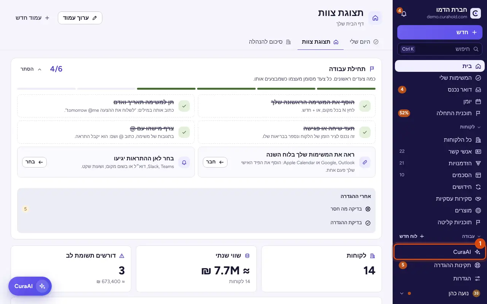
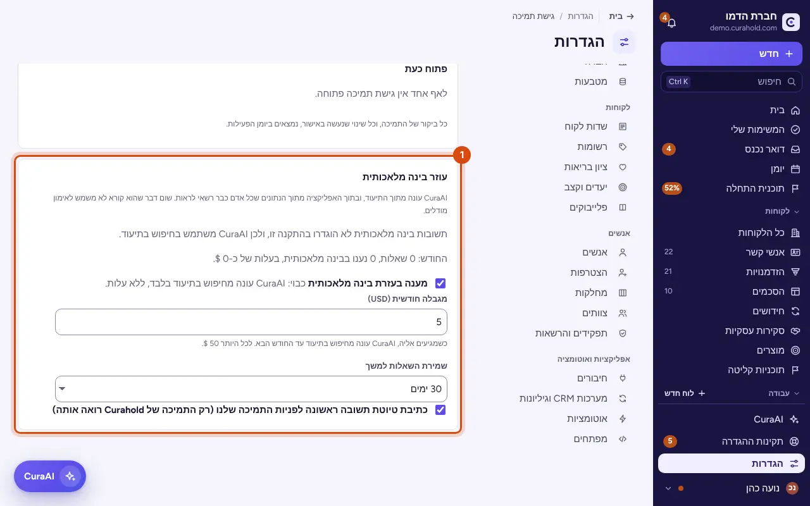
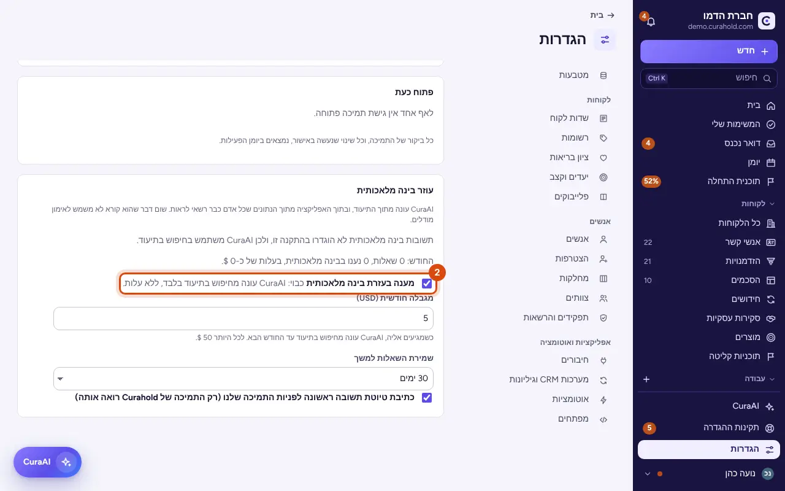

# קבלת עזרה

שני צעדים, בסדר הזה: **שואלים**, ואם זה לא פתר את העניין, **כותבים לתמיכה**.

## קודם שואלים {#ask}

1. לוחצים על **CuraAI** בתפריט שבצד (בטלפון, הכפתור בפינה; במסמכים האלה, הכפתור **שאלו**). כותבים את השאלה במילים שלכם: "איך מייבאים לקוחות", "מי רואה את השדה הזה".
   

התשובה מגיעה מהמסמכים האלה, עם המקום שממנו הגיעה. כשבחברה **מענה בעזרת בינה מלאכותית** פעיל (ראו בהמשך), CuraAI קורא גם את מה שכבר מותר לכם לראות ב-Curahold, כמו לקוחות, חידושים ומשימות, כך שאפשר לשאול "מה מתחדש ב-90 הימים הקרובים?". הוא רק קורא ואף פעם לא משנה דבר. כשהמענה כבוי, לא הוגדר או עבר את מגבלת החודש, החיפוש במסמכים נעשה במכשיר שלכם ושום דבר ממה שאתם כותבים לא נשלח.

אם התשובה לא מה שהייתם צריכים, אמרו זאת: תקבלו את המקומות הקרובים הבאים וכפתור לכתוב לתמיכה עם השאלה כבר ממולאת.

## פנייה לתמיכה: שליחת בקשה

משתמשים ב**כתוב לתמיכה** בתחתית CuraAI. הטופס מבקש את מה שהתמיכה צריכה כדי למצוא את הבעיה בלי לחזור אליכם עם שאלות. שום דבר לא נשלח בלי שראיתם אותו; אתם בוחרים מה הולך.

1. **נושא**: משהו לא עובד, איך אני…?, נתונים או חיבור, רעיון, או חיוב ותוכנית.
2. **השפעה**: לשגיאות ולבעיות נתונים, אומרים אם זה עוצר את העבודה. סדר הטיפול של התמיכה הולך לפי זה.
3. **כותרת**: כמה מילים. בזמן ההקלדה מוצעים עמודי תיעוד שאולי כבר עונים על השאלה.
4. **מה קרה**: מה ניסיתם לעשות, מה ציפיתם ומה קרה במקום. אם הופיעה הודעת שגיאה, העתיקו אותה מילה במילה.
5. **איך נוכל לראות את זה קורה?**: לשגיאות, צעד אחרי צעד (לא חובה, אבל עוזר מאוד).

6. **עדכן** ו**נדרש עד** (שניהם לא חובה): עמיתים שצריכים לקרוא את הבקשה ולשמוע את התשובה, והיום שעד אליו אתם צריכים אותה.

מקבלים **מספר הפניה** (למשל CH-000123) ועותק בדוא״ל.

## השיחה: תשובות, תגובות, ותור של מי

בקשה היא שיחה. פותחים אותה תחת **הפניות שלי** (כפתור תיבת הדואר בראש CuraAI):

- **התשובה של התמיכה** מגיעה בדוא״ל ובבקשה. סימן על כפתור CuraAI אומר שתשובה מחכה.
- **השב** במוצר, או פשוט **עונים לדוא״ל**: מה שכותבים מעל החלק המצוטט נוחת בבקשה.
- הבקשה אומרת **בתור של מי היא**: *אצל התמיכה*, *ממתין לתשובתך* או *נפתר*. **סמן כנפתרה** סוגר אותה; כתיבה מחדש פותחת אותה.
- **עמיתים שמעודכנים** קוראים את הבקשה, מקבלים את תשובות התמיכה בדוא״ל ויכולים להגיב. רק מי ששאל מוסיף או מסיר אותם. מנהל מערכת יכול לקרוא כל בקשה של החברה, אבל עונה רק על שלו.
- הצוות של Curahold יכול לנהל **הערות משלו** על בקשה. הן לעולם לא מוצגות ולא נשלחות לחברה שלכם.

## צילומי מסך וקבצים

- **צלם מסך**: הדפדפן שואל איזו לשונית לשתף; בוחרים את הלשונית של Curahold. חלון העזרה זז הצידה, כך שרק העמוד מצולם.
- **הדבקה או גרירה**: מדביקים תמונה שהועתקה לתוך הטופס, או גוררים אליו קבצים.
- **סמן**: מדגישים את מה שחשוב במסגרת אדומה. **הסתר** מכסה כל מה שהתמיכה לא צריכה לראות (שם של לקוח, סכום); הוא מוסר מהתמונה שנשלחת.

עד 6 קבצים, 10MB כל אחד. תמונות, PDF, טקסט, CSV, ‏JSON, ‏Excel וסרטונים קצרים.

## פרטים טכניים שמתווספים לבקשה

הטופס מוסיף אותם בעצמו ומציג לכם אותם לפני השליחה:

| פרט | למה זה עוזר |
|---|---|
| כתובת העמוד | איפה הבעיה. חלקים סודיים של הכתובת (קודי כניסה וכדומה) מוסרים. |
| דפדפן, מסך, גרסת האפליקציה | לבעיות שקורות רק בדפדפן אחד. |
| העמודים האחרונים שפתחתם | איך הגעתם לשם. כתובות בלבד, בלי תוכן עמודים. |
| שגיאות בעמוד | הודעות שגיאה מהרקע. כתובות דוא״ל וטקסט שדומה למפתח מוסתרים. |
| בקשות שנכשלו | איזו פעולה נכשלה (נתיב וקוד סטטוס). |
| מה פתוח עכשיו | הלקוח, הלוח או המשימה שפתוחים אצלכם. |

מבטלים את הסימון של כל מה שתעדיפו לא לשלוח. שום דבר שהקלדתם ושום נתון מהעמוד אינו חלק מהפרטים האלה.

## לתת לתמיכה להסתכל בחשבון שלכם

יש בעיות שקשה לתקן בלי לראות אותן. התיבה **אפשר לתמיכה של Curahold להיכנס לחשבון שלי** בסוף הטופס נועדה לזה. היא לעולם לא מסומנת בשבילכם.

- **מה התמיכה רואה**: בדיוק מה שאתם רואים – אותם לקוחות, לוחות ושדות. לא יותר.
- **למשך כמה זמן**: 24 שעות, 3 ימים או 7 ימים. הגישה מסתיימת מעצמה. כל ביקור של התמיכה נמשך לכל היותר 8 שעות.
- **מה התמיכה יכולה לעשות**: **רק להסתכל**. התמיכה לעולם לא משנה שום דבר בחשבון שלכם.
- **לעולם לא בהישג יד**: המכשירים וההתחברויות שלכם, מפתחות API, אפליקציות ו-webhooks, הזמנת אנשים, תפקידים, הגדרות החברה, ייצוא או מחיקה של נתונים. התמיכה גם לא יכולה להאריך את הגישה של עצמה.
- **סגירה**: בכל עת, תחת **עזרה ← הפניות שלי ← סגירת הגישה**. ביקור תמיכה שמתבצע באותו רגע מסתיים מיד. כל עוד הגישה פתוחה, פס בראש העמוד מזכיר לכם.
- **תיעוד**: כל ביקור של התמיכה, ומה שהיא קוראת במהלכו, נכתב ל**'הגדרות' ← יומן פעילות** עם שם איש התמיכה.

כשהתמיכה בפנים, פס בראש המסך מראה מי מסתכל ועד מתי.

## הגדרת החברה (מנהלי מערכת)

ב**'הגדרות' ← אבטחה ← גישת תמיכה** בוחרים מי יכול להכניס את התמיכה:

- **כל אחד**: למה שהוא עצמו יכול לראות (ברירת המחדל).
- **מנהלי מערכת בלבד**: הגישה הפתוחה של כל השאר מסתיימת עכשיו.
- **אף אחד**: התמיכה עדיין יכולה לענות בדוא״ל, אבל לא יכולה להיכנס.

באותו עמוד מופיעות הגישות הפתוחות כרגע, מי נתן אותן והביקור האחרון, ואפשר לסגור כל אחת מהן.

## הקלטת הפעלה עבור התמיכה

כדי שהתמיכה תוכל לראות מה קרה כשמשהו נשבר – במקום לבקש מכם לתאר זאת – העמוד מקליט את עצמו בזמן שאתם משתמשים בו (אילו כפתורים, אילו מסכים, מה האפליקציה ציירה). זה נפרד ממתן גישה לתמיכה לחשבון שלכם; זה רץ בשקט ברקע.

- **שום דבר שאתם מקלידים לא מוקלט.** כל שדה – חיפושים, הערות, פרטי לקוח שאתם מזינים – מוסתר. ההקלטה היא של הממשק, לא של מה שאתם כותבים בו.
- **נשמרת 7 ימים**, ואז נמחקת.
- **רק צוות התמיכה של Curahold יכול לפתוח הקלטה**, מהעמדה שלו, וכל פתיחה נכתבת ליומן של עמדת התמיכה. החברה שלכם לא רואה את ההקלטות שלה.
- **מנהלי מערכת יכולים לכבות זאת** תחת **'הגדרות' ← אבטחה ← גישת תמיכה ← הקלטת הפעלה עבור התמיכה**. כשזה כבוי, שום דבר לא מוקלט.

אם הארגון שלכם צריך לספר על כך לאנשים שלו בהודעת פרטיות, המתג הזה והעמוד הזה הם הבסיס לכך.

## מענה בעזרת בינה מלאכותית (מנהלי מערכת) {#ai-answers}

1. פותחים **הגדרות ← גישת תמיכה** וגוללים אל **עוזר בינה מלאכותית**.
   
2. מסמנים **מענה בעזרת בינה מלאכותית** כדי ש-CuraAI יענה בבינה מלאכותית, או מבטלים את הסימון כדי שיענה בחיפוש במסמכים בלבד, בלי עלות. מה ש-CuraAI קורא לעולם לא משמש לאימון מודלים.
   

באותו כרטיס:

- **מגבלה חודשית (USD)**: כשמגיעים אליה, CuraAI עונה מהחיפוש במסמכים עד החודש הבא. הכרטיס מראה את השאלות של החודש ואת העלות.
- **שמירת השאלות למשך**: כמה זמן השאלות נשמרות (או בכלל לא). השאלות של אדם נמצאות בהורדת המידע האישי שלו.
- **כתיבת טיוטת תשובה ראשונה לפניות התמיכה שלנו**: התמיכה של Curahold רואה טיוטת תשובה ראשונה לפניות שלכם; אתם אף פעם לא רואים את הטיוטה, רק את התשובה האמיתית.

אם הכרטיס אומר שמענה בבינה מלאכותית לא הוגדר בהתקנה הזו, CuraAI משתמש בחיפוש במסמכים; את מפתח הבינה המלאכותית מוסיף מי שמפעיל את שרת ה-Curahold שלכם.

## יומן השגיאות (מנהלי מערכת) {#errors}

**הגדרות ← שגיאות** מציג מה השתבש לאנשים שלכם ב-30 הימים האחרונים ואיפה: המסך, הבקשה שנכשלה וכמה פעמים. אין בו שום מידע אישי. צרפו את מה שאתם רואים שם כשאתם כותבים לתמיכה.
