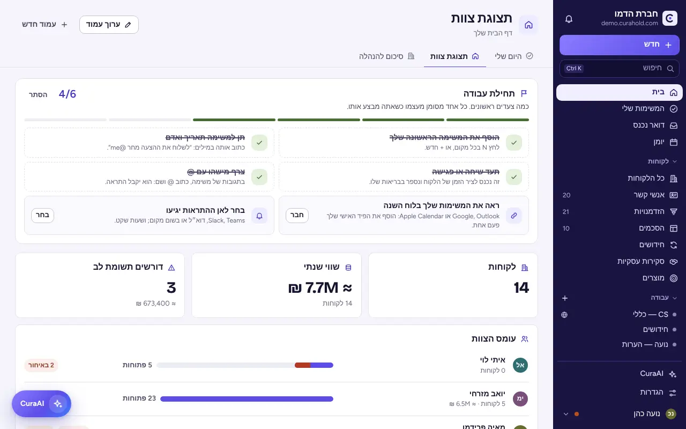

# תחילת עבודה

Curahold הוא המקום שבו צוותי הצלחת לקוחות וניהול תיקי לקוחות מנהלים את הלקוחות, את בעלי העניין ואת העבודה היומיומית, הכול במקום אחד. העמוד הזה עוסק ברבע השעה הראשונה שלכם.

## התחלת תקופת ניסיון

הכפתור **תקופת ניסיון חינם** באתר מבקש תקופת ניסיון ולא פותח חברה מיד: טופס קצר, קוד שנשלח לדוא״ל של העבודה, ותשובה מאיתנו, בדרך כלל תוך יום עבודה אחד. אחרי האישור החברה שלכם נוצרת ומגיע אליכם קישור התחברות; משך התקופה, מספר המושבים והתזכורות מפורטים ב[תוכניות וחיוב](/docs/he/billing/).

## כתובת החברה

לכל חברה יש כתובת משלה: `yourcompany.curahold.com`. כל הצוות שלכם נכנס דרכה. נתונים של חברה אחרת לעולם לא יופיעו בכתובת הזו; ההפרדה נאכפת בתוך מסד הנתונים עצמו.

## כניסה

- **קישור בדוא״ל:** מקלידים את כתובת הדוא״ל ולוחצים על הקישור שאנחנו שולחים. בלי סיסמאות.
- **Google או Microsoft:** לחיצה אחת, אם החברה הפעילה את האפשרות. במכשיר שלא ראינו קודם נבקש גם את הקוד בן 6 הספרות שנשלח לדוא״ל שלכם.
- **מפתח גישה:** טביעת אצבע, זיהוי פנים או קוד המכשיר, אחרי כניסה ראשונה.
- **שלב שני:** מוסיפים אפליקציית אימות ב'ההגדרות שלך' ← **אבטחת כניסה**, עם 10 קודי שחזור. מנהל מערכת יכול לחייב שלב שני למנהלי המערכת או לכולם.
- לפני פעולות רגישות (שינוי תפקידים, מפתחות API, ייצוא הנתונים…) יופיע החלון **אשר שזה אתה** אם לא נכנסתם בעשר הדקות האחרונות.
- כתובת מקבלת לכל היותר 5 קישורי כניסה ב-15 דקות.

## הגדרה ראשונה

מי שיוצר את החברה בוחר תבנית: הצלחת לקוחות, ניהול תיקי לקוחות, מכירות, תמיכה או ריקה. התבנית מביאה שדות לקוח (תאריך חידוש, שווי שנתי, בריאות…), לוחות ואוטומציות מוכנות. אפשר לשנות הכול גם אחר כך.

אחר כך מזמינים את הצוות. אם תוסיפו את דומיין הדוא״ל של החברה (`@yourcompany.com`), אנשים מהדומיין הזה יוכלו לבקש להצטרף, או להצטרף מיד.

## היום הראשון

כרטיס **תחילת עבודה** בעמוד הבית מציג כמה צעדים ראשונים: הוספת המשימה הראשונה, קביעת תאריך ואדם למשימה, תיעוד שיחה, צירוף מישהו עם @, הצגת המשימות ביומן ובחירה לאן יגיעו ההתראות. כל צעד מסומן מעצמו כשאתם עושים אותו; **הסתר** מסלק את הכרטיס.

הכפתור **+ חדש** משמאל מוסיף כל דבר ממקום אחד: משימה, לקוח, הערת שיחה או לוח. כשכותבים משימה אפשר לשים את התאריך, האדם והלקוח באותה שורה; ראו [הוספה מהירה וקיצורי דרך](/docs/he/quick-add/). בתפריט שלכם (השם שלכם בפינה התחתונה) יש מצב בהיר או כהה, השפה וקיצורי הדרך; **מה חדש** מציג את התוספות האחרונות.

## שפה

Curahold מדבר אחת עשרה שפות: אנגלית, טורקית, ערבית, עברית, פרסית, סינית מפושטת ומסורתית, יפנית, קוריאנית, הינדי ומלאית. בוחרים את השפה באחד משני מקומות:

- **בשבילכם:** 'ההגדרות שלך' ← שפה. היא עוברת איתכם לכל מכשיר.
- **בשביל החברה:** מנהל מערכת קובע אותה ב'הגדרות' ← חברה. אנשים חדשים מתחילים אז בשפה הזו, והודעות דוא״ל לכל החברה נשלחות בה.

שום דבר לא מנוחש מהדפדפן, כך שכל מי שפותח את אותו קישור רואה אותו דבר. תאריכים, מספרים וסכומים מוצגים לפי השפה שבחרתם; ערבית, עברית ופרסית נקראות מימין לשמאל.

## מגבלת מכשירים

אדם יכול להישאר מחובר בשני מכשירים בו־זמנית; מנהל יכול לקבוע ערך בין 1 ל-5. כניסה ממכשיר נוסף מנתקת את הוותיק שבהם. כך מושב אחד לא משמש כמה אנשים.

> **טיפ:** 'ההגדרות שלך' ← מכשירים מציג איפה אתם מחוברים, ומאפשר להתנתק מכל אחד מהם.

## התקנה בטלפון או במחשב

Curahold מותקן כמו אפליקציה, בלי חנות.

- **Android ומחשבים (Chrome, Edge):** לוחצים על השם שלכם בפינה התחתונה ← **התקן את Curahold**. סמל ההתקנה בשורת הכתובת של הדפדפן עושה אותו דבר.
- **iPhone ו-iPad (Safari):** כפתור השיתוף ← **הוספה למסך הבית** ← הוסף.

האפליקציה המותקנת נפתחת בחלון משלה; לחיצה ארוכה על הסמל שלה מציעה את המשימות שלי, דואר נכנס ולקוחות.

**בלי חיבור** האפליקציה עדיין נפתחת ומציגה את מה שראיתם לאחרונה: המשימות, הלוחות, הלקוחות ותיבת הדואר הנכנס. פס בראש המסך מציין שאתם במצב לא מקוון; אי אפשר לשמור שינויים עד שתתחברו. יציאה מהחשבון מוחקת את העותק השמור במכשיר.

**רענון חי:** כל עוד עמוד פתוח, שינוי של מישהו אחר (כרטיס חדש, משימה שהועברה, תגובה, התראה חדשה) מופיע מעצמו תוך שניות; אין צורך לטעון מחדש. שום דבר לא זז לכם מתחת לידיים בזמן שאתם מקלידים או גוררים כרטיס.

## ומה הלאה

- [לקוחות, שדות ורשומות](/docs/he/customers/)
- [משימות ולוחות](/docs/he/tasks/)
- [תפקידים והרשאות](/docs/he/roles-and-access/)
- [הוספה מהירה וקיצורי דרך](/docs/he/quick-add/)
