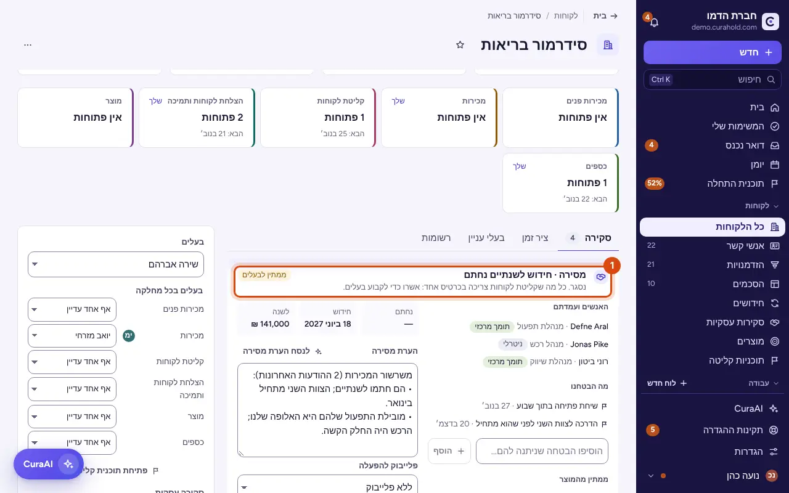
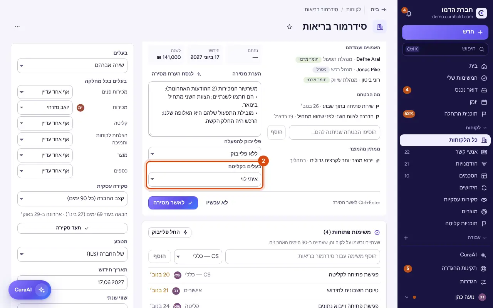
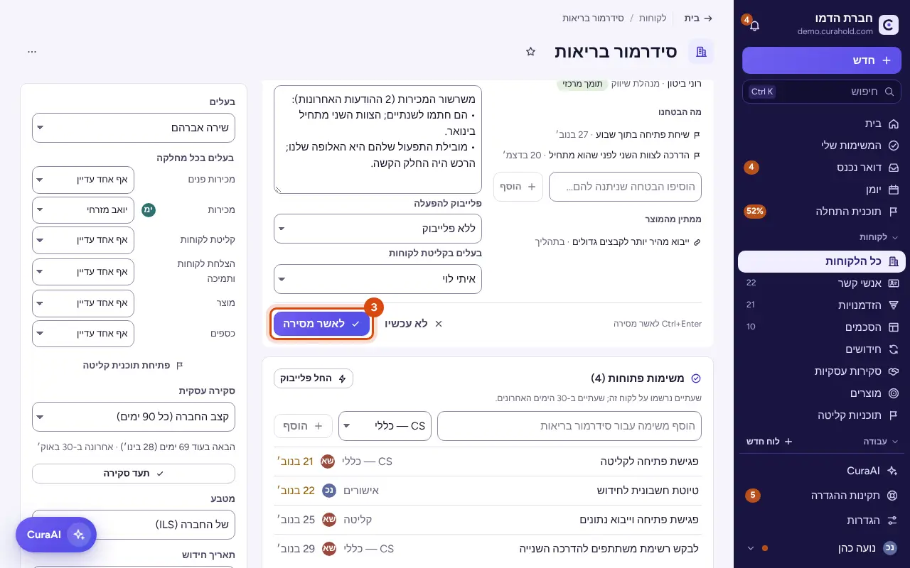
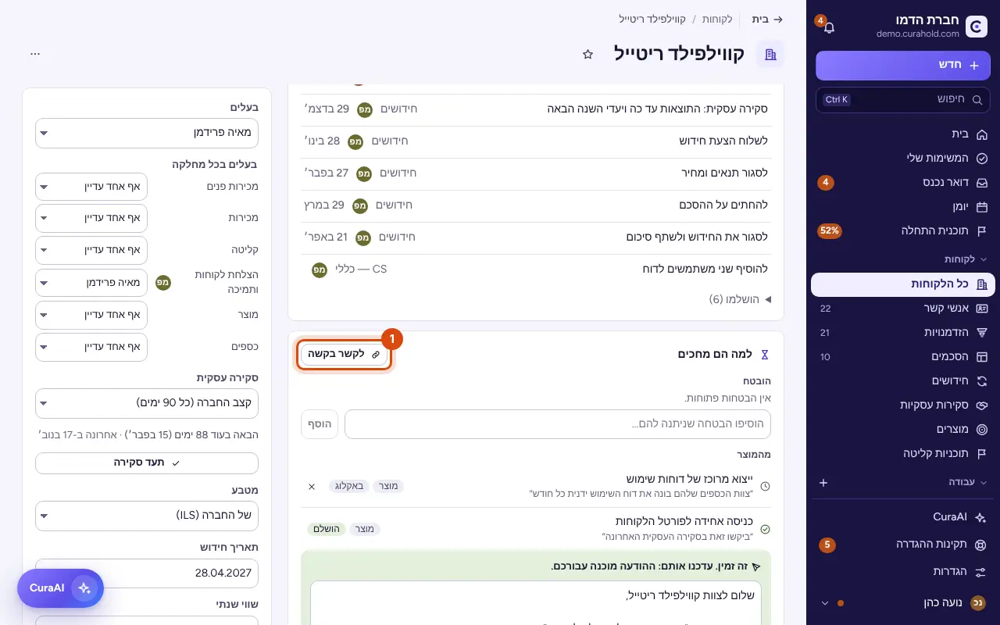
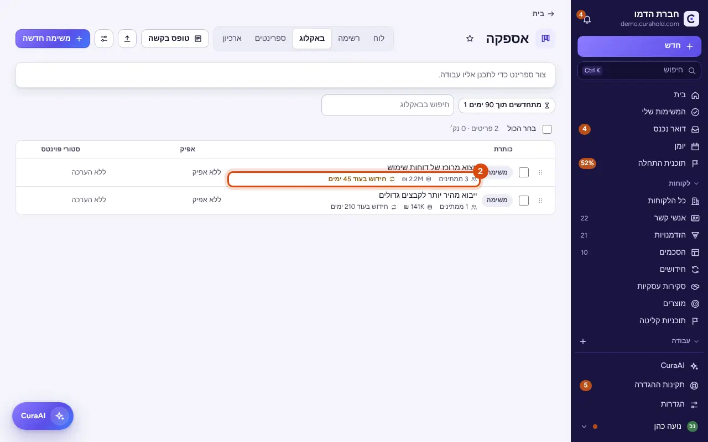
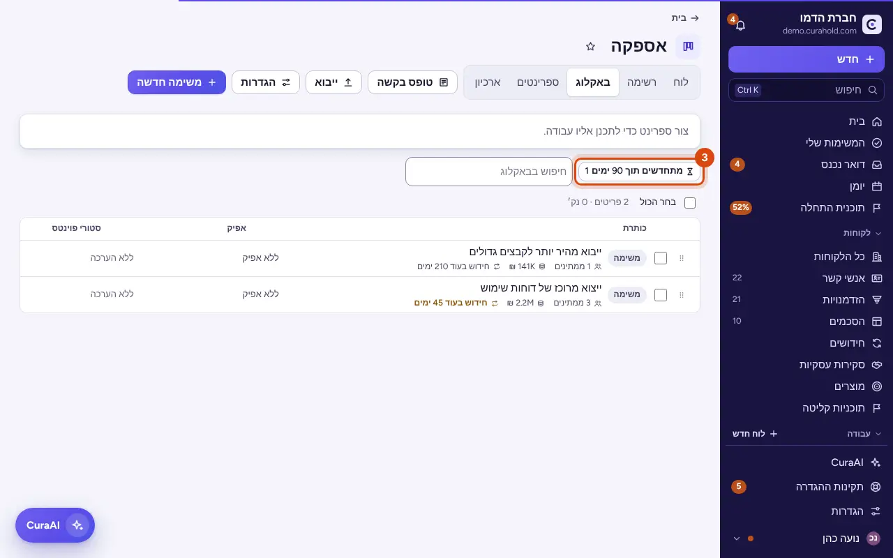
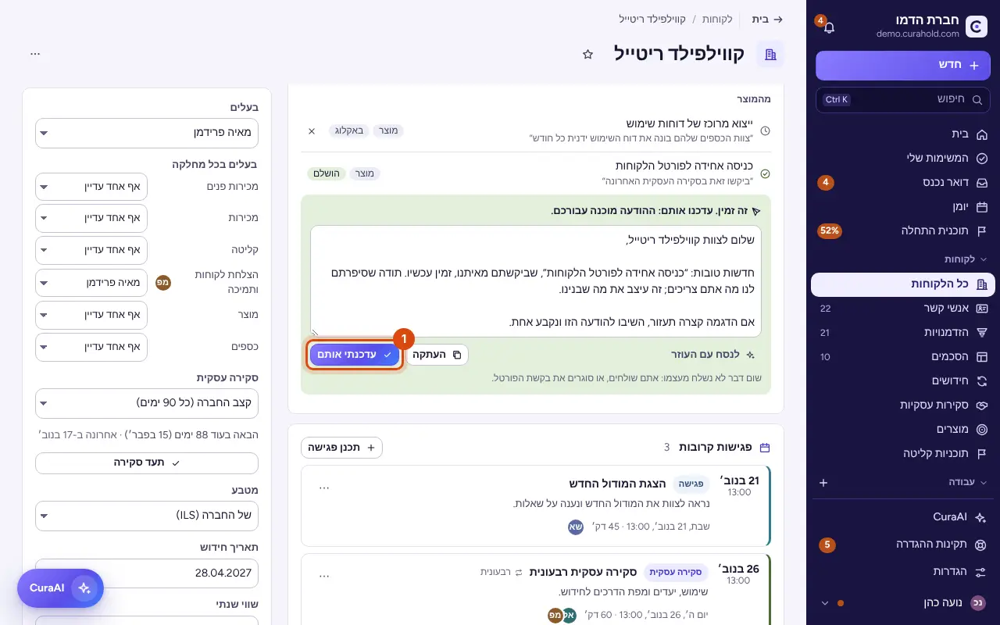
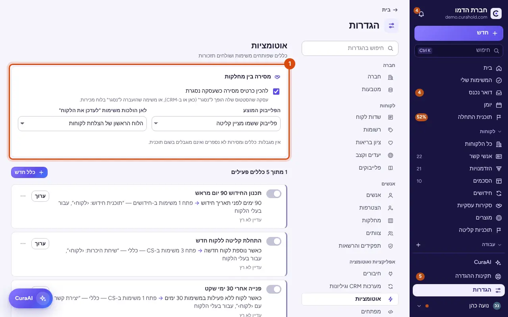

# מסירה, בקשות והחזרה ללקוח

עבודה עוברת ממכירות לקליטת לקוחות או להצלחת לקוחות, ומהלקוחות למוצר. Curahold שומר את מה שכל צוות צריך בדף הלקוח, כך ששום דבר לא מוקלד מחדש ואף אחד לא צריך לפתוח לוח של מחלקה אחרת.

## כשעסקה נסגרת {#handover}

עסקה שהסטטוס שלה הופך ל**נסגרה בהצלחה** (כאן או ב-CRM), או משימה שעוברת ל**נסגרה בהצלחה** בלוח מכירות, מקבלת **כרטיס מסירה** אחד בדף הלקוח. הוא הולך ל**קליטת לקוחות** אם יש מחלקה כזו בחברה, ואחרת ל**הצלחת לקוחות**.

1. פותחים את דף הלקוח. הכרטיס בראש **סקירה**, ועליו **ממתין לבעלים**. קוראים: האנשים ואיפה הם עומדים, מה המכירות הבטיחו, מה הלקוח עוד מחכה לו מהמוצר, התאריכים, הערך השנתי (אם מותר לכם לראות את השדה) והערת המסירה משרשור המכירות.
   
2. ב**בעלים ב…** בוחרים מי מקבל את הלקוח. בודקים לידו את **פלייבוק להפעלה**.
   
3. לוחצים על **לאשר מסירה** (או Ctrl+Enter, ‏⌘+Enter ב-Mac). הבעלים נקבע, הפלייבוק מתחיל, הבעלים מקבל הודעה וציר הזמן של הלקוח רושם את שני השלבים.
   

**לא עכשיו** מסיר את הכרטיס. **לנסח הערת מסירה** מבקש מהעוזר לכתוב את ההערה; קוראים ומשנים לפני שמשהו נשמר.

## לקשר בקשת לקוח לעבודת מוצר {#requests}

1. בדף הלקוח, תחת **למה הם מחכים**, לוחצים על **לקשר בקשה**. מחפשים בעבודות של המוצר, בוחרים את הסיפור, ואפשר להוסיף מה ביקשו במילים שלהם. אם שום דבר לא מתאים, מבקשים מהמוצר מאותו חלון.
   

הרבה לקוחות יכולים לחכות לאותו סיפור, וכל אחד נספר. כל מי שרואה את הלקוח רואה את הכותרת, המצב, סוף הספרינט והמחלקה של העבודה, אף פעם לא את לוח המוצר.

## מה המוצר רואה {#backlog}

1. בלוח של המוצר פותחים את **באקלוג**. מתחת לכל סיפור: כמה לקוחות מחכים לו, מה הערך השנתי שלהם (רק למי שרשאי לראות את השדה) והחידוש הקרוב.
   
2. לוחצים על **מתחדשים תוך 90 ימים** כדי לראות רק את העבודה שלקוחות שמתחדשים בקרוב מחכים לה, הקרוב ביותר קודם.
   

## כשזה יוצא לאוויר {#shipped}

כשסיפור מקושר מסתיים, הבעלים של כל לקוח מקבל משימה, ובדף הלקוח מופיעה הודעה מוכנה מתחת לסיפור.

1. קוראים את ההודעה, משנים אם רוצים, לוחצים על **העתקה** ושולחים מהדוא״ל או מהצ'אט שלכם. אחר כך לוחצים על **עדכנתי אותם**. אם הלקוח ביקש דרך הפורטל, **לסגור את בקשת הפורטל** סוגר אותה גם שם.
   

**שום דבר לא נשלח מעצמו.** בציר הזמן כתוב "נבנה עבורם", וסיכום החידוש מפרט את זה.

## הגדרות (מנהלי מערכת) {#settings}

1. פותחים **הגדרות ← אוטומציות**. תחת **מסירה בין מחלקות** בוחרים אם עסקה שנסגרה מקבלת כרטיס מסירה, איזה פלייבוק הוא מציע ולאן הולכות משימות "לעדכן את הלקוח".
   

## טיוטות מהעוזר

את הערת המסירה, הודעת "יצא לאוויר" ואת ההבטחות והצעדים הבאים מפגישה העוזר יכול לנסח. קוראים ומשנים כל טיוטה לפני שמשהו נשמר, ביטול מחזיר אותה, ובלי העוזר (או מעבר למגבלה החודשית שלו) הטיוטה מגיעה מהתבנית.

## כללים

כללים יכולים להתחיל כשמשימה נוספת או מסתיימת, כשבקשה מגיעה דרך טופס, כשרשומה מגיעה לשלב או כשנפתחת קריאת תמיכה, ויכולים לשבץ, להעביר, למלא שדה, להגיב, לשלוח ל-webhooks או להכין את המסירה. כללים אף פעם לא נספרים ואין להם תקרה.
