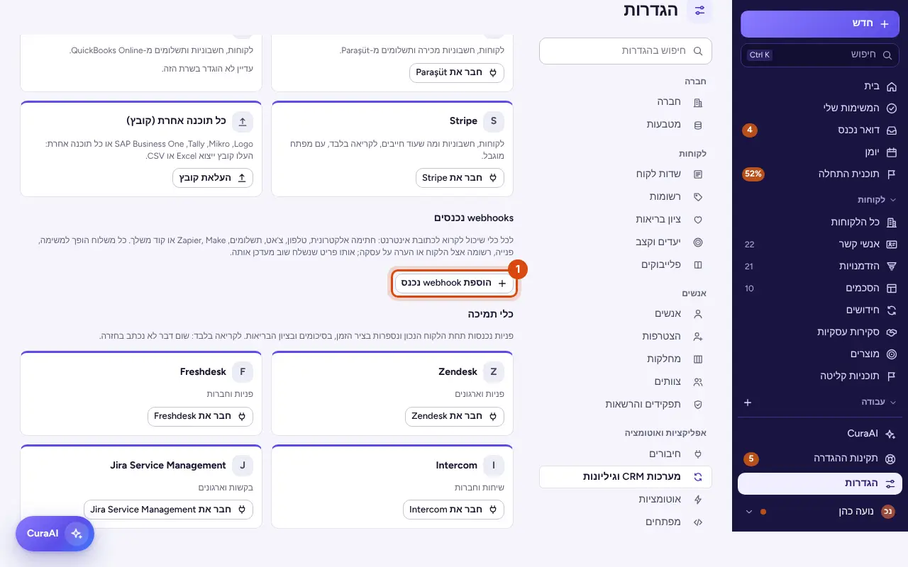
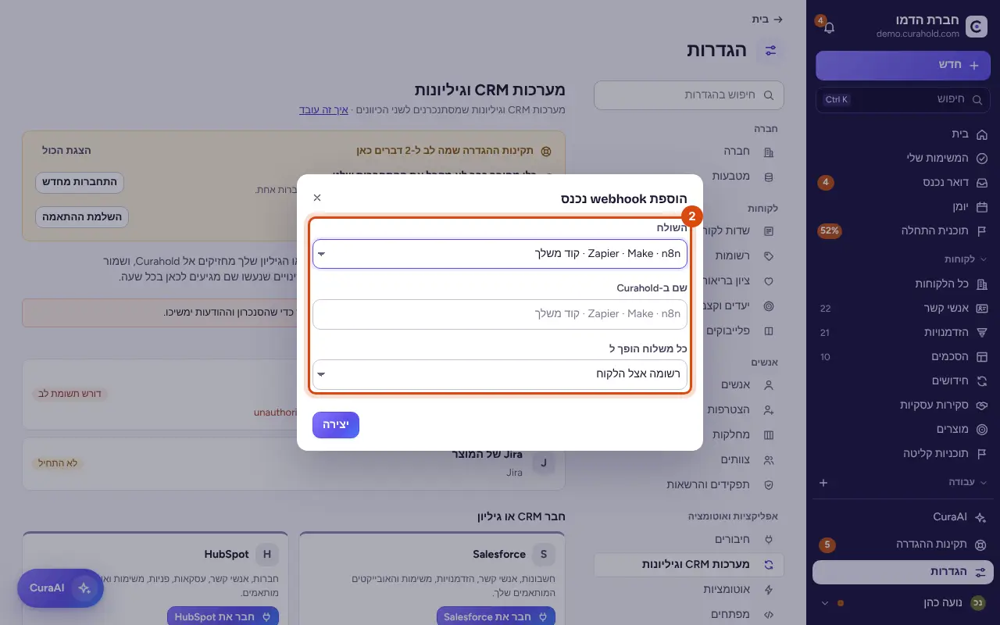
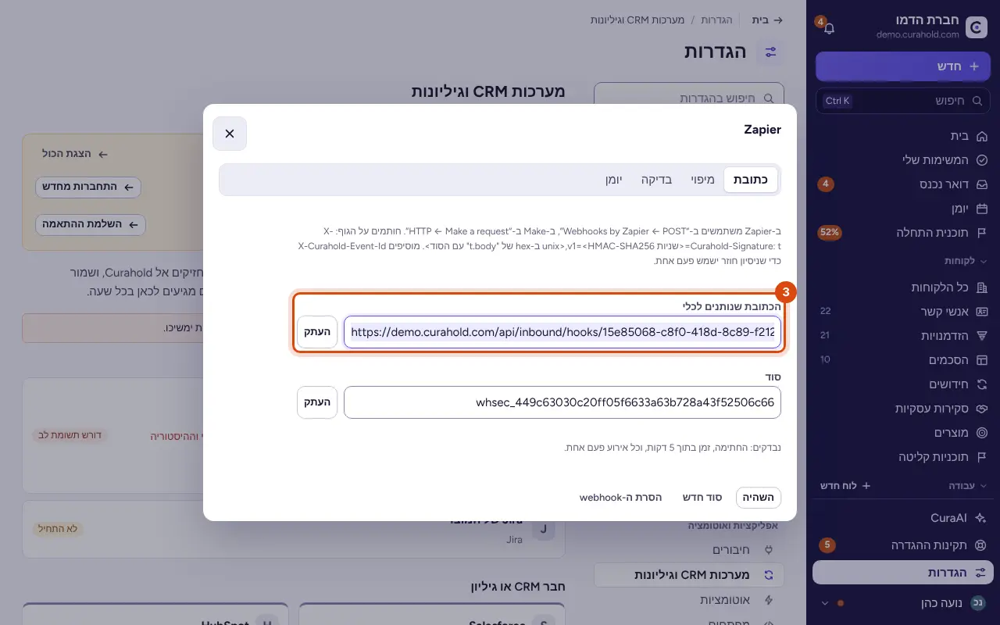
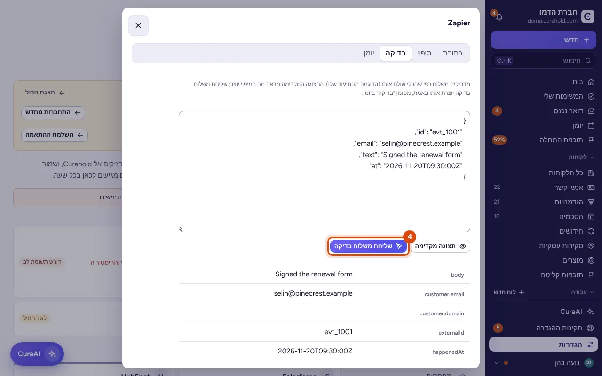
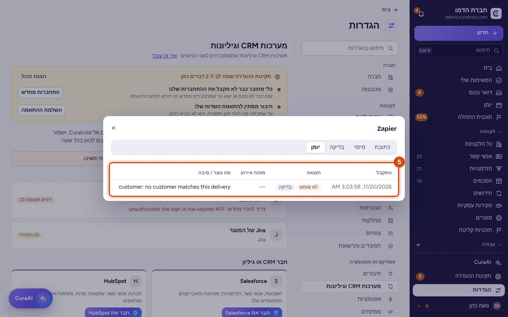

# webhooks נכנסים

לכלים שאין להם ב-Curahold מחבר מוכן. הכלי שולח לכתובת שלך; כל משלוח הופך ל**משימה**, ל**פניית תמיכה**, ל**רשומה בציר הזמן של הלקוח** או ל**הערה על עסקה**. אותו פריט שנשלח שוב מעדכן את מה שנוצר. כל משלוח נבדק: חתימה (או אסימון משותף), הזמן, וכל אירוע פעם אחת.

## ב-Curahold {#connect}

1. פותחים **הגדרות ← מערכות CRM וגיליונות**, גוללים אל **webhooks נכנסים** ולוחצים **הוספת webhook נכנס**.
   
2. תחת **השולח** בוחרים את הכלי (או **Zapier · Make · n8n · קוד משלך**), בודקים את **כל משלוח הופך ל**, ולוחצים **יצירה**.
   
3. בלשונית **כתובת** מעתיקים את הכתובת ואת הסוד לכלי.
   
4. בלשונית **בדיקה** לוחצים **תצוגה מקדימה** כדי לראות מה המיפוי יוצר מהדוגמה, ואז **שליחת משלוח בדיקה**.
   
5. בלשונית **יומן** בודקים כל משלוח: שומש, דולג, לא שומש (עם הסיבה) או נדחה.
   

## מיפוי

כל ערך הוא טקסט עם `{{path}}` לערך מהמשלוח, למשל `{{data.envelopeSummary.status}}` או `{{items[0].email}}`. הלקוח נמצא לפי אימייל של איש קשר, אחר כך כתובת אתר, ואז השם. **המזהה של הפריט בכלי** מפעיל „צור או עדכן”. **להשתמש רק כשהערך הזה…** מדלג על אירועים אחרים (הם נרשמים כדולגו).

## מתכונים מוכנים

| כלי | חתימה | הופך ל |
| --- | --- | --- |
| חתימה אלקטרונית (DocuSign Connect; ‏CloudSign, ‏Modusign, ‏Leegality באותה דרך) | `X-DocuSign-Signature-1`, HMAC-SHA256, base64, המפתח שיוצרים בכלי | הערה על העסקה |
| Aircall | האסימון של ה-webhook בגוף ההודעה | שיחה אצל הלקוח |
| Tawk.to | `X-Tawk-Signature`, HMAC-SHA1, hex | פנייה |
| Razorpay (‏iyzico באותה דרך) | `X-Razorpay-Signature`, HMAC-SHA256, hex | רשומה אצל הלקוח |
| Freshchat, ‏Kylas, ‏Sansan וכל השאר | אסימון משותף (`X-Curahold-Token` / `?token=`) | לבחירתך |

## לחתום בעצמך (Zapier, ‏Make, ‏n8n, קוד) {#sign}

שולחים `X-Curahold-Signature` ו-`X-Curahold-Event-Id`:

```text
X-Curahold-Signature: t=1763631000,v1=<HMAC-SHA256 ב-hex של "1763631000.<הגוף הגולמי>" עם הסוד>
X-Curahold-Event-Id: evt_1001
```

בקוד (Node.js):

```js
const t = Math.floor(Date.now() / 1000);
const v1 = crypto.createHmac('sha256', secret).update(`${t}.${body}`).digest('hex');
fetch(address, { method: 'POST', body, headers: { 'content-type': 'application/json', 'x-curahold-signature': `t=${t},v1=${v1}`, 'x-curahold-event-id': id } });
```

הזמן חייב להיות בתוך 5 דקות. מזהה אירוע חוזר נענה ב-`200` עם `duplicate` ולא משמש שוב. תשובות: `200` (עם `status` ok, ‏skipped או failed), ‏`401` (חתימה, זמן או אסימון), ‏`404` (לא מוכר או מושהה). הרשימה המלאה: מדריך ה-API.

## מתכוני Zapier ו-Make לכלים שעוד אין להם מחבר

משתמשים בטריגר של הכלי, ואז **Webhooks by Zapier ← POST** ‏(Zapier) או **HTTP ← Make a request** ‏(Make) לכתובת שלמעלה, עם שתי הכותרות. השלב **Custom JS** ב-Make או **Code** ב-Zapier מחשב את החתימה (הקוד שלמעלה).

| כלי | טריגר | שדות לשליחה | הופך ל |
| --- | --- | --- | --- |
| LINE WORKS | הודעה חדשה בערוץ בוט | `id`, ‏`email` של השולח, `text` | רשומה |
| Chatwork | הודעה חדשה בחדר | `id`, ‏`email`, ‏`text` | רשומה |
| kintone | רשומה נוספה או נערכה | `id`, ‏`email`, ‏`title`, ‏`status` | משימה |
| Money Forward Cloud | חשבונית נוצרה או שולמה | `id`, ‏`email`, ‏`text` (מספר, סכום, פירעון) | רשומה |
| Channel Talk | צ'אט נסגר | `id`, ‏`email`, ‏`title` | פנייה |
| KakaoWork | הודעת בוט | `id`, ‏`email`, ‏`text` | רשומה |
| LeadSquared | ליד או הזדמנות עודכנו | `id`, ‏`email`, ‏`title`, ‏`status` | משימה |
| Razorpay | תשלום התקבל | `id`, ‏`email`, ‏`text` | רשומה (או המתכון) |
| DingTalk | הודעת רובוט | `id`, ‏`email`, ‏`text` | רשומה |
| WeCom | הודעת אפליקציה | `id`, ‏`email`, ‏`text` | רשומה |

## שמירה והסרה

היומן שומר 30 יום ועד 500 משלוחים לכל webhook. **סוד חדש** עוצר את הישן מיד; **השהיה** עונה `404` עד החידוש; **הסרת ה-webhook** מוחקת אותו ואת היומן, ומה שנוצר נשאר. ה-webhook פועל בהרשאות של מי שהגדיר אותו: הוא מגיע רק ללוחות וללקוחות שהוא מגיע אליהם, ונעצר אם הוא עוזב.

## כשמשלוח נדחה או לא נוצל {#log}

הלשונית **יומן** אומרת מה קרה לכל משלוח, בשפה שלכם: חתימה או טוקן שגויים (העתיקו שוב את הסוד מ-**כתובת** לכלי), נשלח לפני זמן רב מדי (כך נדחה גם משלוח חוזר), ערך שה-webhook הזה לא משתמש בו, אין לקוח תואם, או שדה שיצא ריק (בדקו את **מיפוי**). אותו משלוח שמגיע פעמיים, למשל ניסיון חוזר מ-Zapier או מ-Make, נשמר פעם אחת. את הלוח של webhook משימות אפשר לשנות ב-**מיפוי** בשדה **לוח**: הכתובת נשארת, ובכלי השולח לא משתנה דבר.

## ראו גם

- [חיבורים ו-CRM](/docs/he/connections/)
