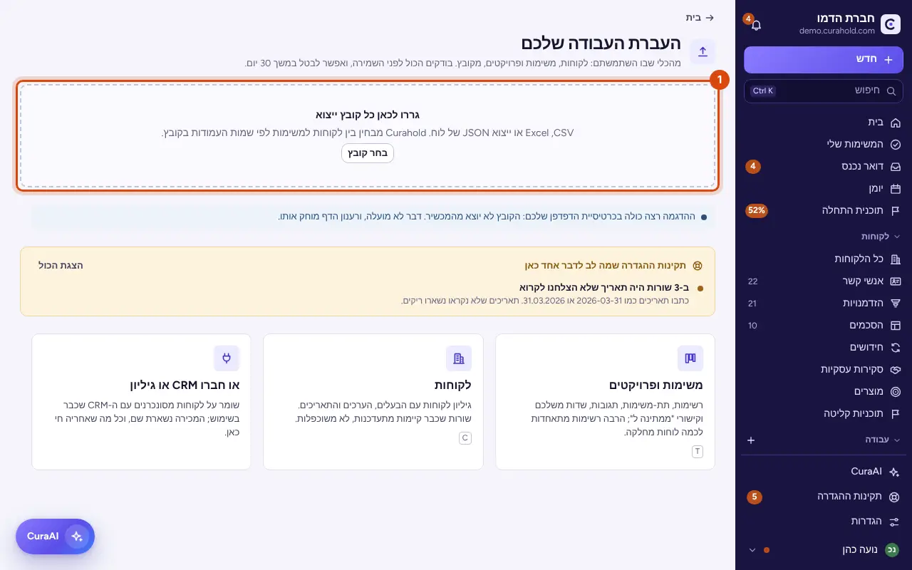
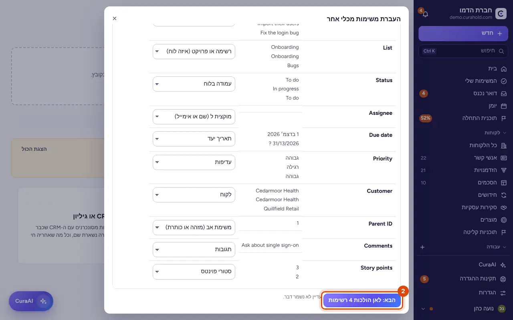
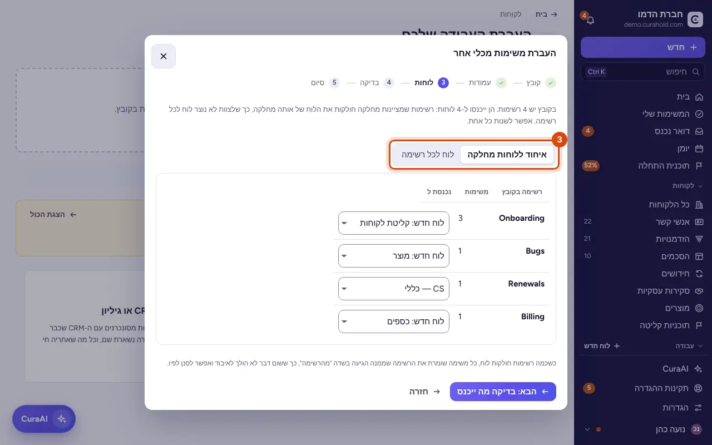
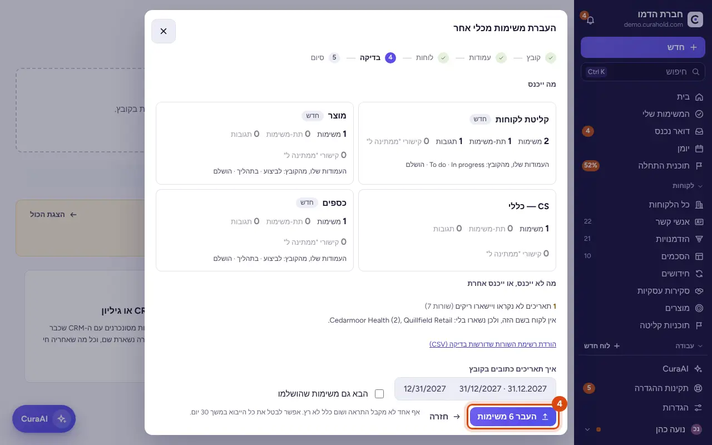
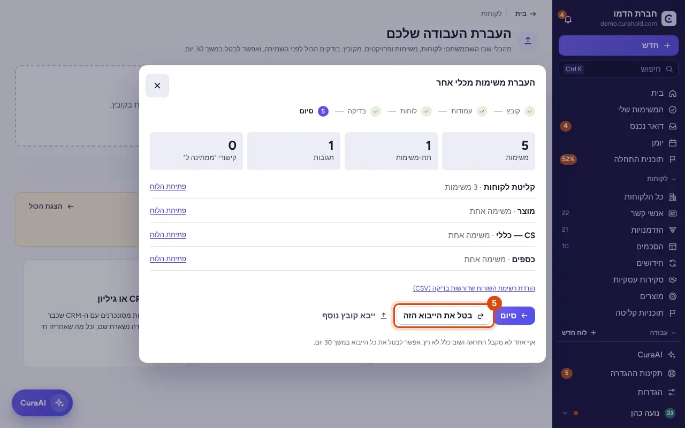

# מעבר מכלי אחר

מייצאים את העבודה מהכלי הקודם (CSV, גיליון Excel ‏(.xlsx) או ייצוא JSON של לוח קנבן) ומעבירים אותה מהקובץ. שום דבר לא נשמר עד הצעד האחרון, אף אחד לא מקבל הודעה ושום כלל לא רץ: זה מעבר דירה, לא עבודה חדשה.

## העברת המשימות {#tasks}

1. פותחים את **העברת העבודה שלכם**: מקלידים "import" בחיפוש (Ctrl K, או ⌘ K ב-Mac), או לוחצים על כפתור החץ למעלה בלוח. גוררים את הקובץ אל **גררו לכאן כל קובץ ייצוא**, או לוחצים **בחר קובץ**. ‏Curahold מבחין בין לקוחות למשימות לפי שמות העמודות; לוחצים **T** למשימות או **C** ללקוחות כדי לבחור בעצמכם.
   
2. **עמודות.** כל עמודה בקובץ מותאמת ליעד שלה: כותרת, תיאור, עמודה בלוח, אנשים, תאריכים, עדיפות, לקוח, נקודות, המזהה בכלי הישן, משימת אב, תגובות, קישורי "ממתין ל-" או שדה משלה. הערכים הראשונים מראים מה כל אחת תהיה. מתקנים מה שלא נכון ולוחצים **הבא**.
   
3. **לוחות.** אם בקובץ יש הרבה רשימות, הן מתאחדות לכמה לוחות מחלקה: רשימה בשם "Renewals" הולכת להצלחת לקוחות, "Bugs" למוצר. לוחצים **לוח לכל רשימה** כדי להשאיר אותן נפרדות, או בוחרים כל לוח לכל רשימה. כל משימה שומרת את הרשימה שממנה באה בשדה **מהרשימה**. לוחצים **הבא: בדיקה מה ייכנס**.
   
4. **בדיקה.** קוראים, לוח אחר לוח, כמה משימות, משימות משנה, תגובות וקישורים ייכנסו, ועם מספרי שורות מה לא ייכנס או ייכנס אחרת. **הורדת רשימת השורות שדורשות בדיקה (CSV)** אם רוצים לתקן קודם בקובץ. ואז לוחצים **העבר … משימות**.
   
5. **סיום.** לכל לוח יש קישור **פתיחת הלוח**. אם משהו לא כמו שרציתם, לוחצים **בטל את הייבוא הזה**.
   

‏Curahold מבין שורת כותרת מעל הכותרות, קבוצות שהכותרות חוזרות מתחת לכל אחת, ופריטי משנה מוזחים מתחת לפריט שלהם.

## ביטול {#undo}

**בטל את הייבוא הזה** עובד 30 יום, ממסך התוצאה או מ**הייבואים הקודמים שלך** בצעד הראשון. משימות שאיש לא נגע בהן עוברות לסל המחזור כפריט אחד; משימה שמישהו שינה או הגיב עליה מאז נשמרת בארכיון הלוח שלה. לוח שנפתח לייבוא ונשאר ריק מוסר.

## תבנית {#template}

**הורדת תבנית** בצעד הראשון נותנת קובץ עם כל עמודה ש-Curahold קורא ושלוש שורות לדוגמה. הוא נפתח ב-Excel. השורה הראשונה שלו (Region היא דוגמה לעמודה משלכם):

```text
ID,Title,Description,List,Status,Assignee,Due date,Priority,Customer,Parent ID,Comments,Depends on,Story points,Region
```

## בהדגמה

ההדגמה רצה כולה בלשונית הדפדפן. **נסו עם קובץ משלכם** בסרגל ההדגמה פותח את אותו דף: הקובץ נקרא בלשונית ולא יוצא מהמכשיר, ורענון הדף שוכח אותו.
