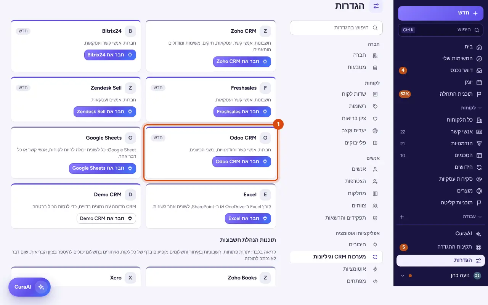

# Odoo CRM

חברות, אנשי הקשר שלהן והזדמנויות מ-Odoo Online, ‏Odoo.sh או מהשרת שלך, בהתאמה בשני הכיוונים: שינוי ב-Odoo מגיע תוך שעה, שינוי ב-Curahold יוצא מיד.

## ב-Curahold {#connect}

1. פותחים **הגדרות ← מערכות CRM וגיליונות** ולוחצים **חבר את Odoo CRM** על האריח שלו.
   

ממלאים את ארבעת השדות ולוחצים **חבר**:

- **כתובת Odoo**, למשל:

```text
https://yourcompany.odoo.com
```

- **שם מסד הנתונים**: רק ב-Odoo.sh או בשרת שלך עם כמה מסדי נתונים.
- **שם משתמש (אימייל)**: משתמש Odoo שבהרשאותיו Curahold עובד.
- **מפתח API**: ראו למטה.

אחר כך מסמנים **חברות**, **אנשי קשר** ו-**הזדמנויות**, בודקים את צמדי השדות המוצעים ולוחצים **התחל לסנכרן**. הזדמנות נחשבת לזכייה בהסתברות 100% ולהפסד כש-Odoo מעביר אותה לארכיון.

## ב-Odoo

1. לוחצים על התמונה שלך (למעלה) ← **Preferences** (ב-Odoo 17 ואילך: **My Profile**).
2. פותחים **Account Security** ולוחצים **New API Key**.
3. מקלידים שם (למשל `Curahold`), בוחרים לכמה זמן ולוחצים **Generate key**.
4. מעתיקים את המפתח. Odoo מציג אותו פעם אחת.

ב-Odoo Online גישת API דורשת את תוכנית **Custom** (כלל של Odoo). אפליקציית CRM חייבת להיות מותקנת.

## מגבלות ותזמון

Odoo לא מפרסם מגבלה קבועה; Curahold נשאר בכשתי בקשות בשנייה. Odoo 19 ואילך עונה ב-JSON-2 API, גרסאות ישנות ב-JSON-RPC, ש-Odoo מסיר בגרסה 20. ב-Odoo 19 מפתח תקף עד שלושה חודשים: יוצרים חדש ומתחברים מחדש לפני שהוא פג.

## התנגשויות, שגיאות והסרה

כששני הצדדים שינו אותו שדה, מכריע הכלל שנבחר לחיבור (ברירת מחדל: השינוי המאוחר). ערך שנדחה ממתין בלשונית **סטטוס** עם ההודעה של Odoo. מפתח שבוטל או פג מסמן את החיבור **דורש תשומת לב**: מדביקים מפתח חדש עם **חבר מחדש**; המיפוי נשמר. **הסר** מוחק את המפתח; לקוחות ורשומות שכבר הגיעו נשארים ב-Curahold.

## ראו גם

- [חיבורים ו-CRM](/docs/he/connections/)
- [Odoo (הנהלת חשבונות)](/docs/he/accounting-odoo/)
