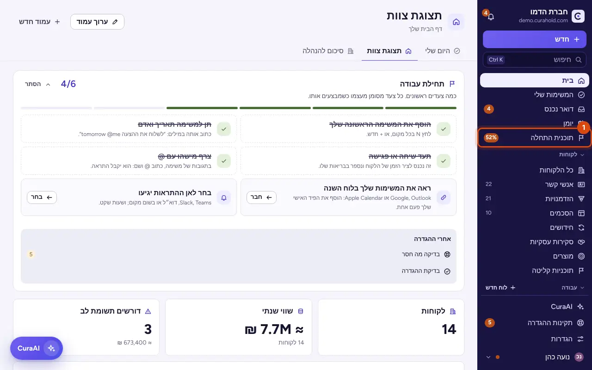
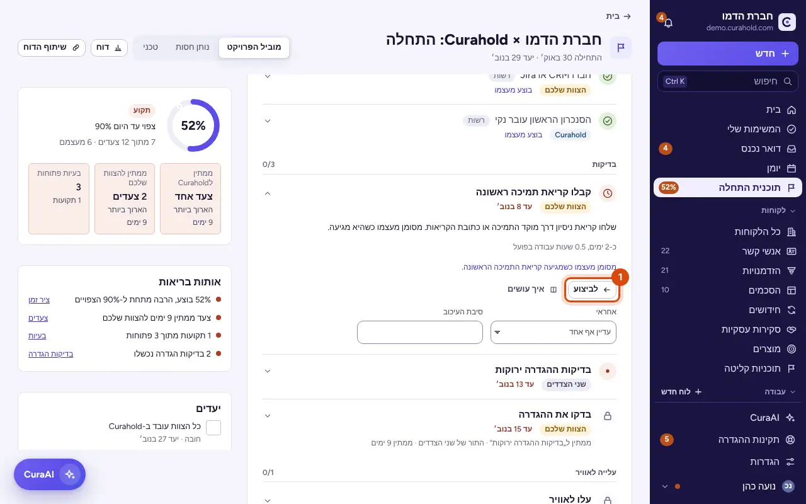
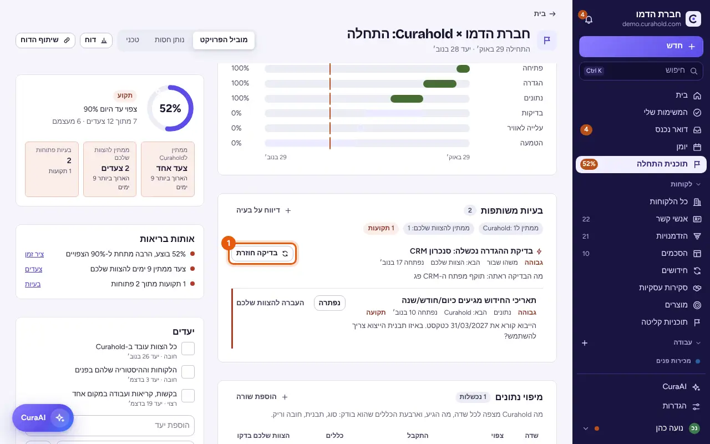
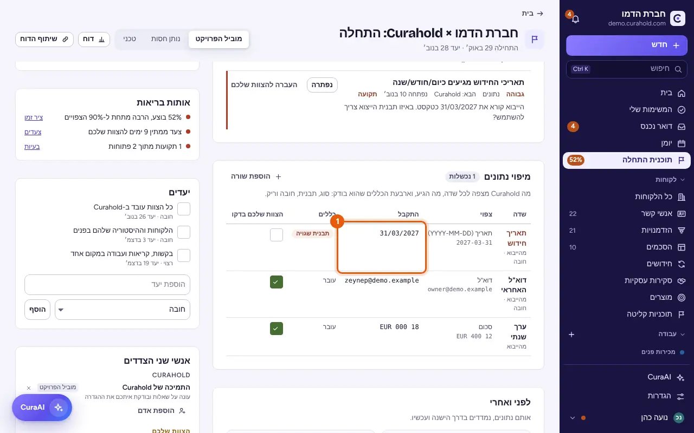
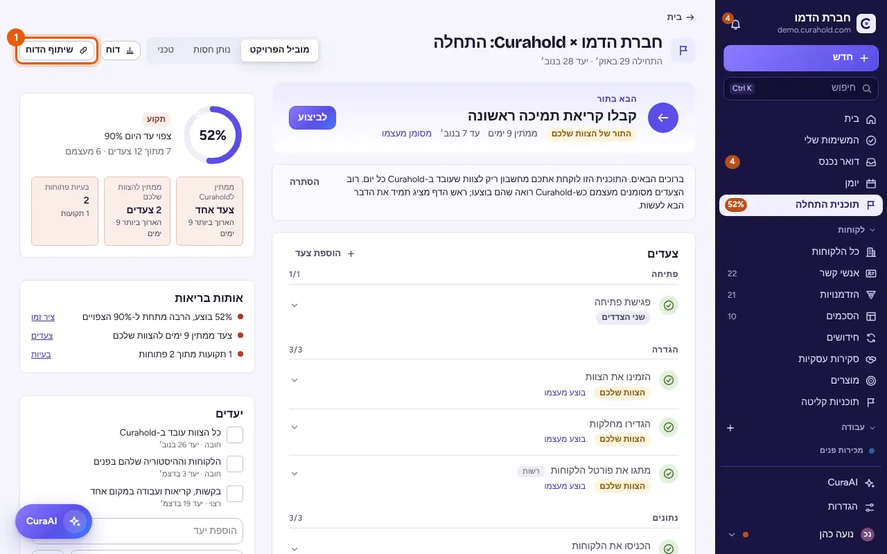
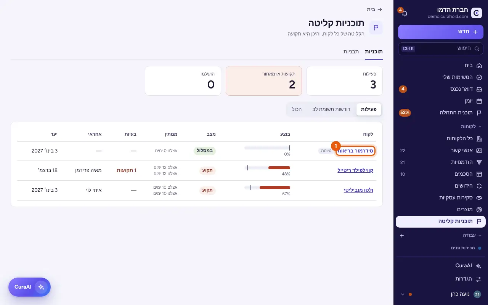
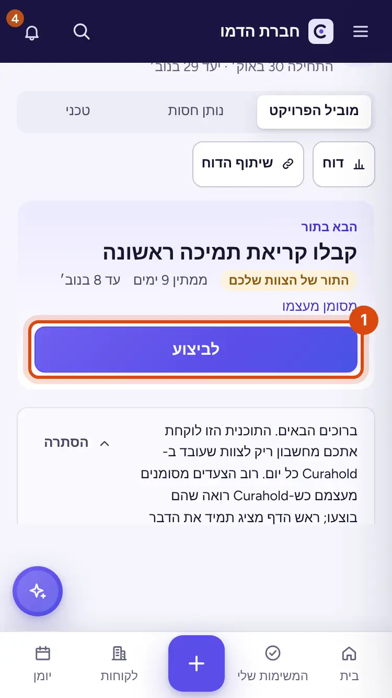

# תוכנית קליטה

תוכנית הקליטה היא דף אחד ששני צדדים עובדים עליו יחד. החברה שלכם משתמשת בה כדי להתחיל עם Curahold, ואתם משתמשים באותה תוכנית לכל לקוח שאתם קולטים. רוב הצעדים מסומנים מעצמם כש-Curahold רואה שהם בוצעו; ידנית מסמנים רק מה ש-Curahold לא רואה, כמו פגישה.

## 1. פתחו את התוכנית {#start}

לחצו על **תוכנית התחלה** בתפריט הצד. המספר לידה הוא כמה בוצע.

```text
https://<החברה-שלכם>.curahold.com/onboarding
```



## 2. עשו את הדבר הבא {#next}

הכרטיס למעלה מציג תמיד את הדבר הבא, של מי התור וכמה זמן הוא ממתין. לחצו על **לביצוע**: Curahold פותח את המסך שבו עושים את זה.


## 3. פתחו צעד {#team}

לחצו על צעד כדי לראות למה הוא, כמה זמן לוקח והאם הוא מסומן מעצמו. צעד נעול ממתין לצעד אחר; השורה מתחתיו אומרת לאיזה ושל מי התור. לחצו על **סימון כבוצע** רק בצעדים ש-Curahold לא רואה.



## 4. תקנו בעיה משותפת {#health}

כל בעיה אומרת של מי המהלך; בעיה פתוחה חמישה ימים או אחרי התאריך מסומנת **תקועה**. בדיקת הגדרה שנכשלה מופיעה כאן פעם אחת. לחצו על **בדיקה חוזרת** אחרי התיקון: כשהבדיקה עוברת, הבעיה נסגרת מעצמה.



## 5. בדקו את הנתונים {#mapping}

טבלת הנתונים מציגה לכל שדה מה Curahold מצפה, מה התקבל וארבעה כללים: סוג, תבנית, חובה וריק. שורה שנכשלה אומרת איזה כלל. כשהערך נכון, סמנו את התיבה של הצד שלכם.

```text
2027-03-31
```



## 6. קבעו אנשים {#people}

תחת **אנשי שני הצדדים** לחצו על **הוספת אדם** ובחרו תפקיד. Curahold מזכיר לאחראי כל צעד באפליקציה כשמגיע תורו, ושוב אם הצעד נתקע. תזכורות בדוא"ל כבויות אלא אם מנהל מפעיל אותן.

## 7. שתפו את דוח ההתקדמות {#report}

לחצו על **שיתוף הדוח** והעתיקו את הקישור. מי שיש לו רואה רק את הדוח (בלי הערות ופרטי קשר). פתחו **דוח** כדי להדפיס או לשמור PDF.



## 8. תוכניות ההתחלה של הלקוחות {#customers}

לחצו על **תוכניות קליטה** תחת לקוחות. כשנסגרת עסקה נפתחת מעצמה תוכנית טיוטה עם הערת העברה, והיא מתחילה כשההעברה מאושרת. הלקוח רואה את אותה תוכנית בפורטל שלכם, בצבעים שלכם. בסיום לחצו על **סיום והעברה**: ציון הבריאות נשמר כקו בסיס והצלחת לקוחות מקבלת כרטיס העברה.



## בטלפון

אותו דף, עמודה אחת: הדבר הבא קודם.


