# תקינות ההגדרה ובדיקת ההגדרה

שני מסכים עוזרים לסיים את ההגדרה בלי לנחש. **תקינות ההגדרה** אומר מה חסר או שגוי. **בדיקת ההגדרה** מאפשר לנסות הכול כמו שהצוות ישתמש. שום דבר לא משתנה בשבילך: כל תיקון הוא כפתור שפותח את המסך הנכון, ואת השאר עושים בעצמך.

## למצוא מה חסר

1. בתפריט הצד, לוחצים על **תקינות ההגדרה**. המספר לידו הוא כמה דברים שווים מבט. הוא נעלם כשהכול תקין.
   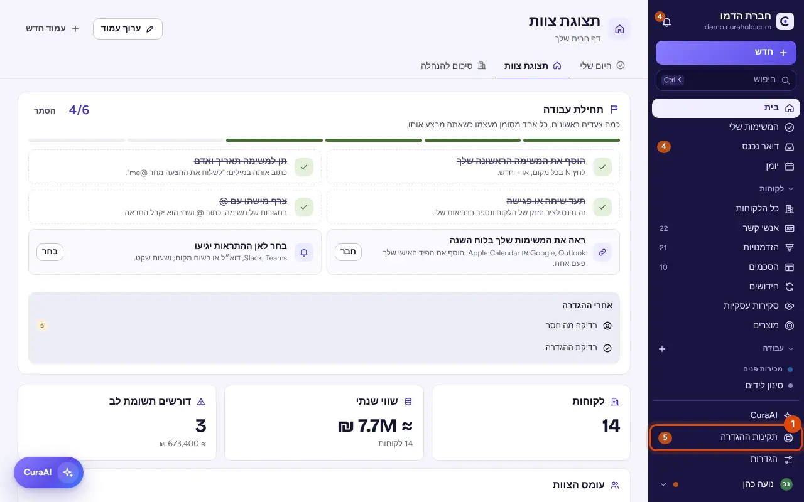
2. קוראים את השורה הראשונה. החשוב ביותר ראשון: **לתקן קודם**, אחריו **כדאי לתקן**, ואחריו **כשיש לכם דקה**. כל שורה אומרת מה זיהינו ולמה זה חשוב.
   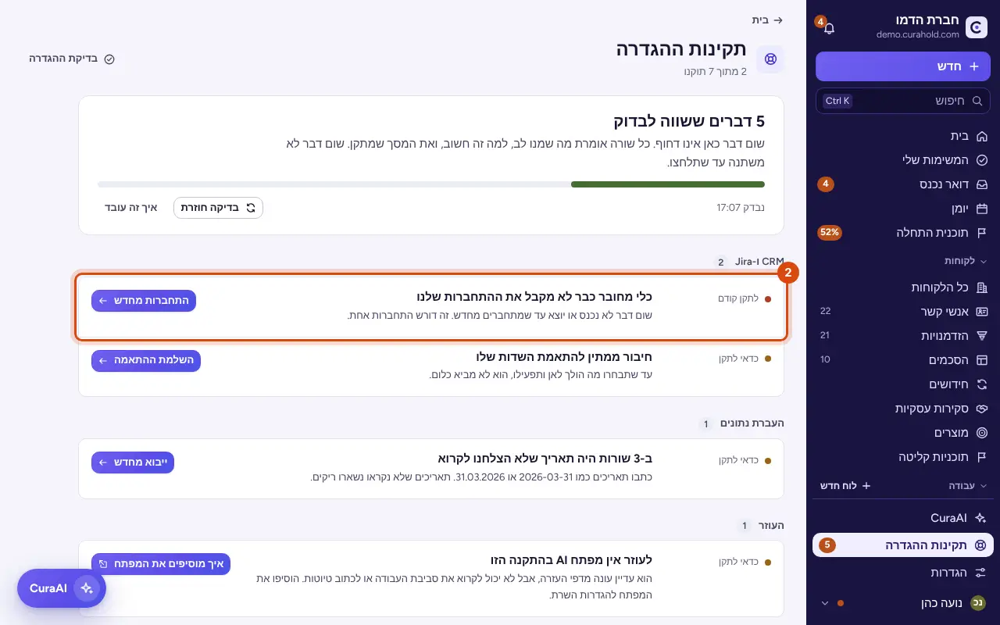
3. לוחצים על הכפתור בשורה. הוא פותח בדיוק את המסך שבו מתקנים.
   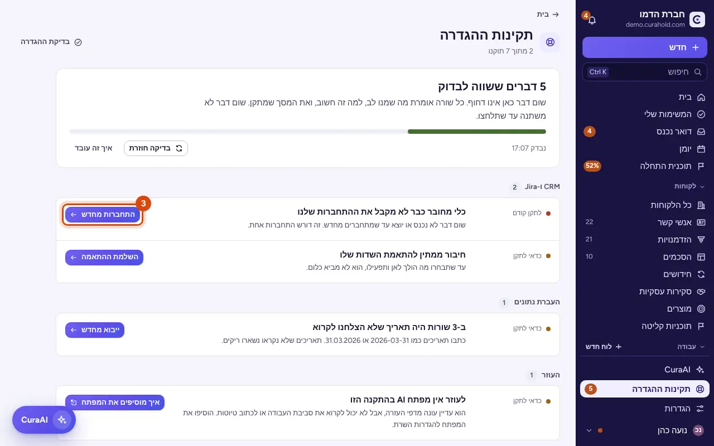
4. אחרי התיקון חוזרים ולוחצים על **בדיקה חוזרת**. השורה עוברת אל **תוקנו**, וראש הדף אומר כמה תוקנו.
   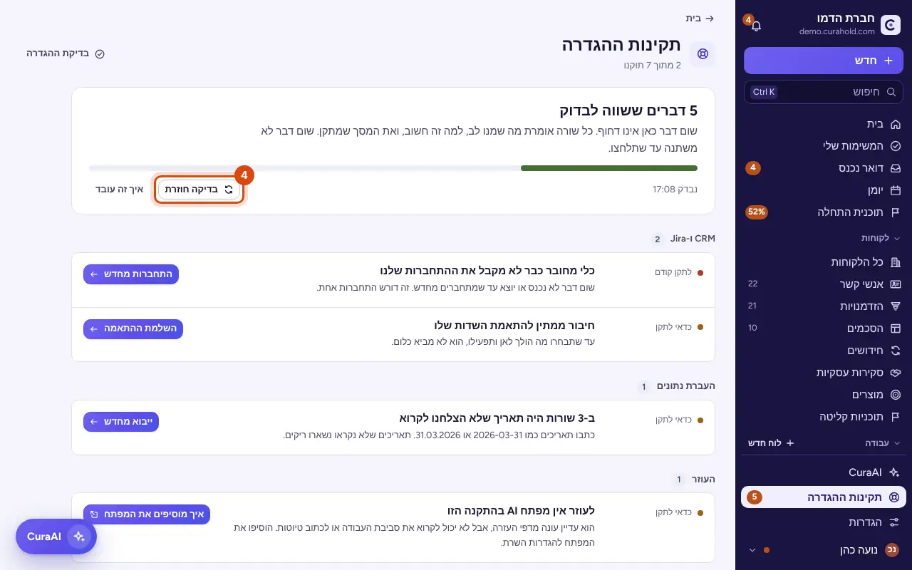
5. רואים את הבעיה גם במסך שמתקן אותה, בתיבה צהובה למעלה. לוחצים על **הצגת הכול** לרשימה המלאה.
   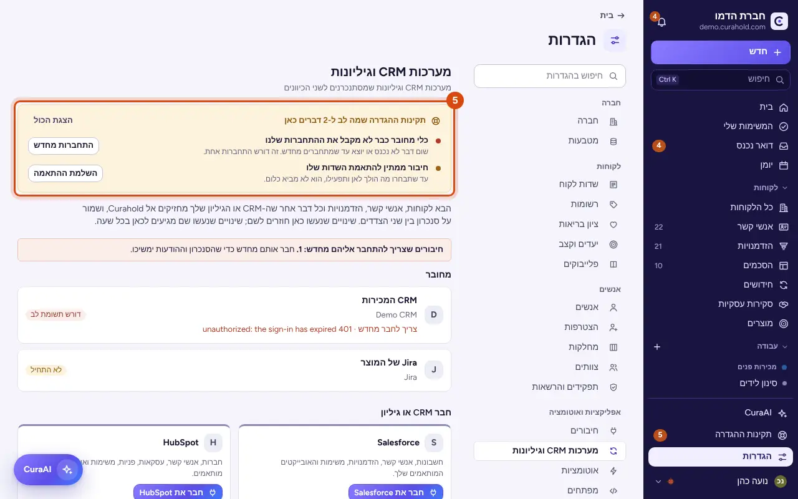

יש דברים שאיננו יכולים לקרוא מכאן, כמו רשומות SPF,‏ DKIM ו-DMARC של דומיין הדואר. מוסיפים אותן ואז לוחצים על **עשיתי את זה** בשורה.

כל אחד רואה רק את מה שהוא יכול לתקן. מנהלי מערכת רואים הכול על החברה; מי שמפעיל את שרת Curahold רואה גם את הדואר ואת מפתח הבינה המלאכותית. אנחנו בודקים שוב פעם ביום ומסמנים כל דבר חדש.

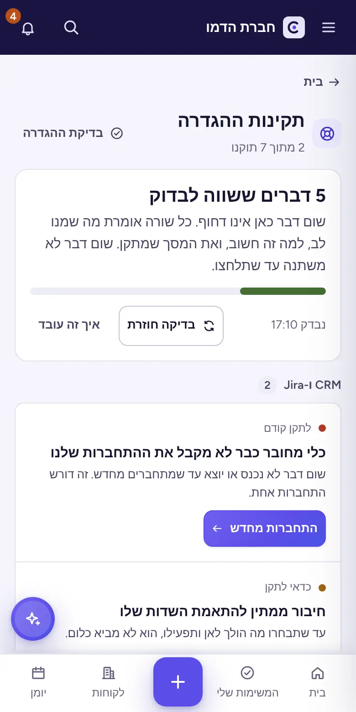

## לשאול את העוזר

פותחים את העוזר ושואלים מילה במילה:

```text
מה לא בסדר בהגדרות?
```

הוא מציג את אותן בעיות עם הכפתורים שלהן. הוא רק קורא; הוא אף פעם לא מתקן בעצמו.

## לבדוק את ההגדרה

1. בדף **תקינות ההגדרה**, לוחצים על **בדיקת ההגדרה** למעלה.
   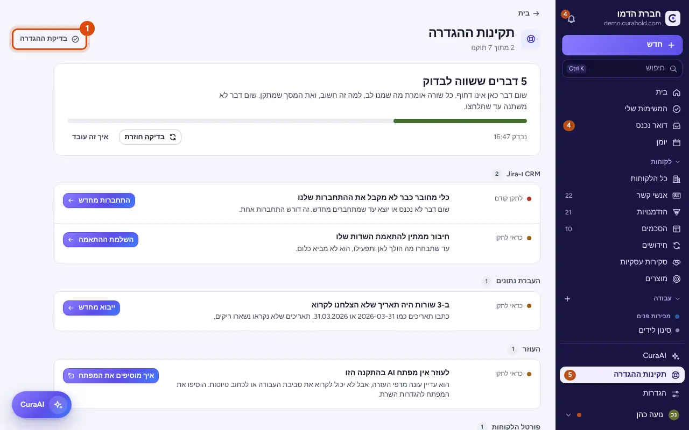
2. לוחצים על **בדיקה** בשלב. בשלבים שבודקים בעין יש במקום זה **זה עבד** ו-**זה לא עבד**. אם השלב שואל במה לנסות (לקוח, חיבור, עמית), בוחרים פעם אחת: הבחירה נשמרת לניסיון הבא.
   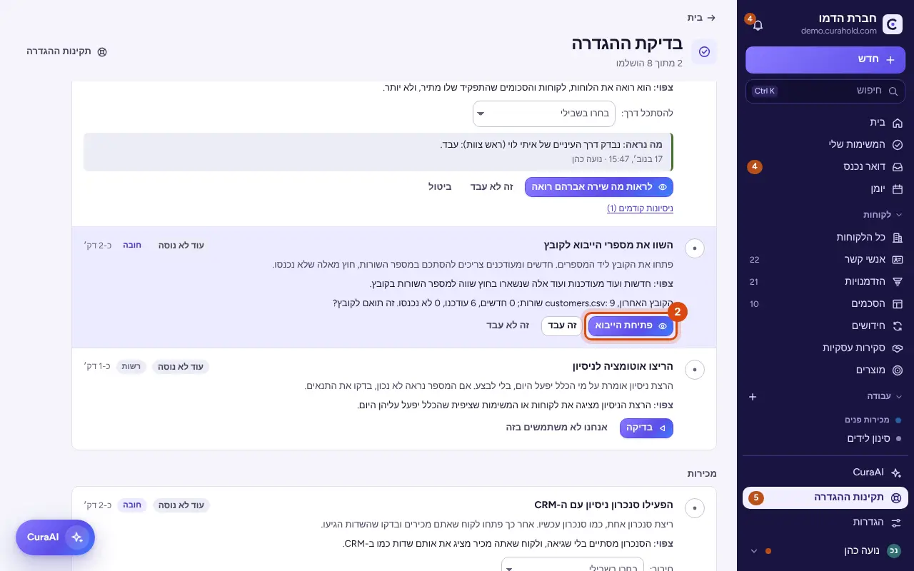
3. משווים את **מה נראה** אל **צפוי**. אם הם זהים, השלב עבר. כל ניסיון נשמר עם מי הריץ ומתי, כך שאפשר לבדוק שוב בכל זמן.
   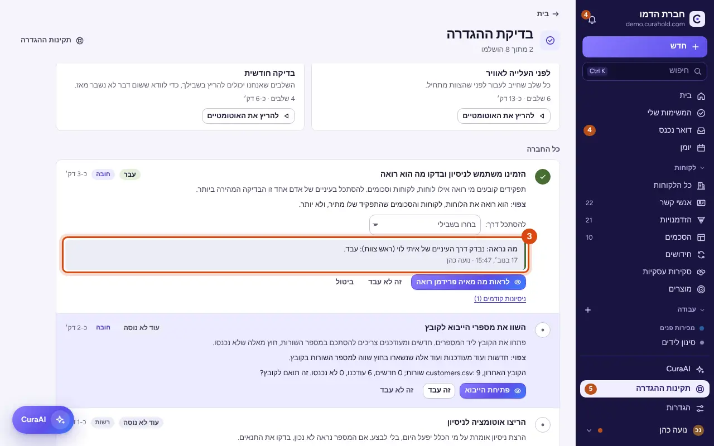
4. אם לא עבד, לוחצים על **פתיחת המסך שמתקן**, מתקנים ובודקים שוב. אם צריך עזרה, לוחצים על **לפתוח תקלה**: התקלה נשארת עם השלב ונסגרת מעצמה כשהוא עובר.
   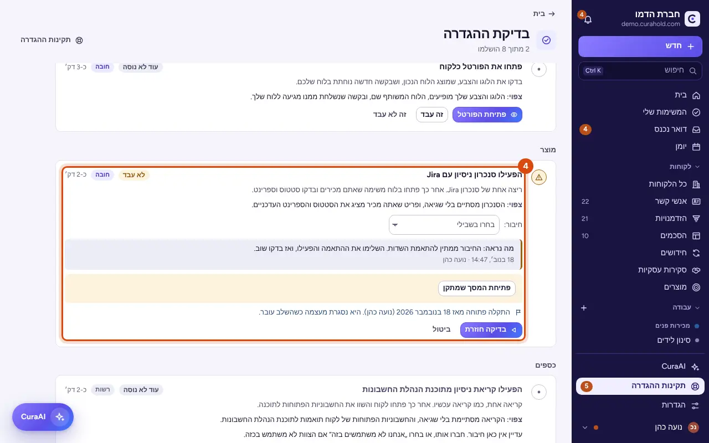
5. כדי להריץ כמה יחד, בוחרים חבילה: **לפני העלייה לאוויר** או **בדיקה חודשית**, ואז **להריץ את האוטומטיים**.
   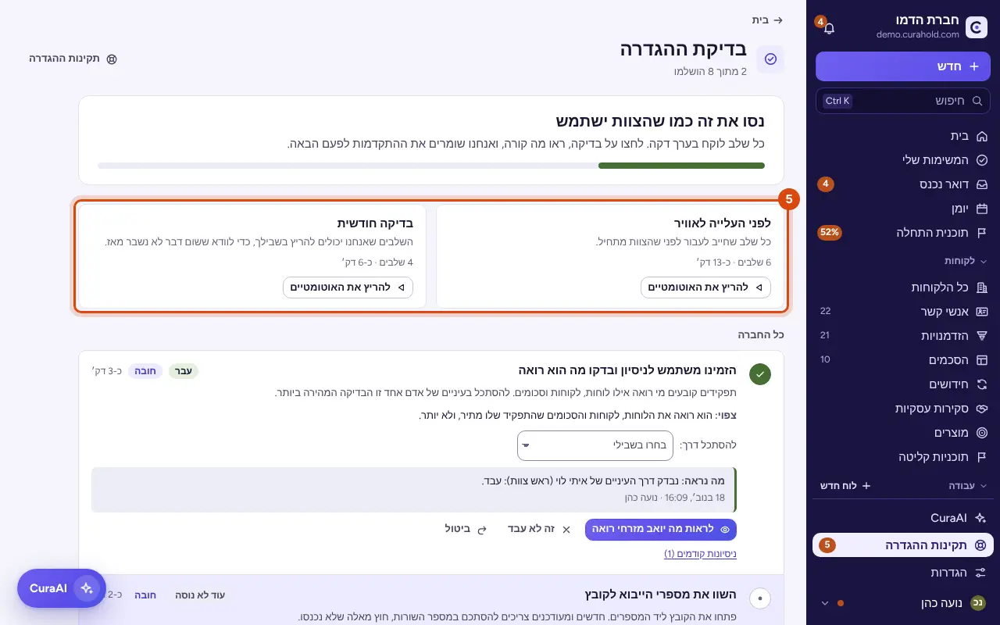
6. כשכל שלב **חובה** עבר, מנהל מערכת בחברה לוחץ על **לאשר**, ואחריו מישהו מ-Curahold. אז הדף מציג **ההגדרה הושלמה**, עם התאריך.
   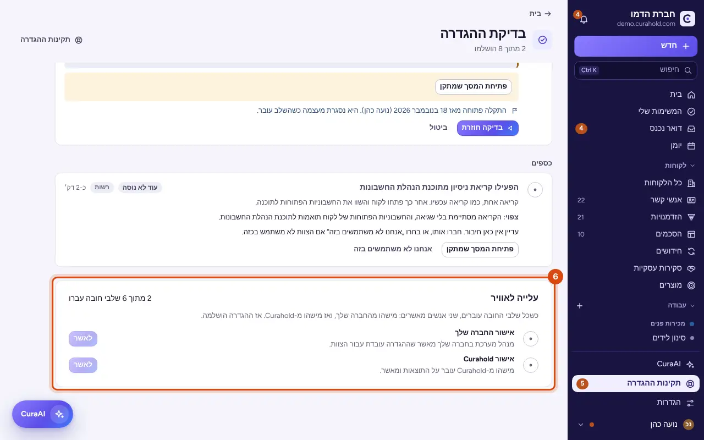

## מה כל בדיקה אומרת

הטבלה נכתבת מהמילים של המוצר עצמו, ולכן תמיד תואמת למסך.

<!-- setup-checks:start (scripts/docs/setup-health-page.ts writes this part) -->

### הצוות

| מה אנחנו מזהים | למה זה חשוב | הכפתור |
| --- | --- | --- |
| בינתיים רק אתם כאן (לתקן קודם) | משימות, העברות ותזכורות צריכות למי ללכת. הזמינו את מי שיעבוד ב-Curahold. | **הזמינו אנשים** |
| … הזמנות לא התקבלו כבר יותר משבוע (כשיש לכם דקה) | ייתכן שפספסו את המייל. שלחו שוב או בדקו את הכתובת. | **הצגת ההזמנות** |
| ב-… תפקידים אין אף אחד (כשיש לכם דקה) | תפקיד שאף אחד לא מחזיק בו לא עושה דבר. תנו אותו לאנשים הנכונים, או מחקו אותו כדי שהרשימה תישאר ברורה. | **פתיחת התפקידים** |

### מחלקות

| מה אנחנו מזהים | למה זה חשוב | הכפתור |
| --- | --- | --- |
| המחלקות עוד לא הוגדרו (כדאי לתקן) | לוחות, העברות ומי רואה מה – הכול לפי מחלקות. שייכו כל אחד למחלקה שלו. | **הגדרת מחלקות** |
| ל-… מחלקות אין מוביל (כדאי לתקן) | רק מוביל יכול לפתוח את הלוחות של המחלקה, והעברות למחלקה מגיעות אליו. | **בחירת מוביל** |

### העברת נתונים

| מה אנחנו מזהים | למה זה חשוב | הכפתור |
| --- | --- | --- |
| … שורות מהייבוא האחרון לא נכנסו (כדאי לתקן) | משהו בשורות האלה לא נקרא. הרשימה עם מספרי השורות מוצגת מיד אחרי הייבוא; תקנו את השורות בקובץ וייבאו שוב: שורות שכבר נכנסו מתעדכנות ולא מוכפלות. | **פתיחת הייבוא** |
| ב-… שורות בייבוא האחרון לא היה שם לקוח (כדאי לתקן) | שם הוא העמודה היחידה שכל שורה צריכה. מלאו אותה בקובץ וייבאו שוב: שורות שכבר נכנסו מתעדכנות ולא מוכפלות. | **ייבוא מחדש** |
| ב-… שורות היה תאריך שלא הצלחנו לקרוא (כדאי לתקן) | כתבו תאריכים כמו 2026-03-31 או 31.03.2026. תאריכים שלא נקראו נשארו ריקים. | **ייבוא מחדש** |
| ב-… שורות היה סכום שלא הצלחנו לקרוא (כדאי לתקן) | השתמשו בספרות בלבד, כמו 12500 או 12.500,00, והמטבע בעמודה נפרדת. הסכומים האלה נשארו ריקים. | **ייבוא מחדש** |
| … לקוחות מופיעים פעמיים (כשיש לכם דקה) | משימות והערות מתפצלות בין שני העותקים. השאירו אחד ומזגו את השני לתוכו. | **הצגה** |

### CRM ו-Jira

| מה אנחנו מזהים | למה זה חשוב | הכפתור |
| --- | --- | --- |
| כלי מחובר כבר לא מקבל את ההתחברות שלנו (לתקן קודם) | שום דבר לא נכנס או יוצא עד שמתחברים מחדש. זה דורש התחברות אחת. | **התחברות מחדש** |
| הסנכרון האחרון עם … כלים לא הסתיים (לתקן קודם) | שינויים שנעשו מאז ממתינים. דף החיבור מראה מה עצר אותו. | **מה קרה** |
| חיבור ממתין להתאמת השדות שלו (כדאי לתקן) | עד שתבחרו מה הולך לאן ותפעילו, הוא לא מביא כלום. | **השלמת ההתאמה** |
| … שינויים לא נשלחו לכלי השני (כדאי לתקן) | ניסינו שלוש פעמים. דף החיבור מראה כל אחד ואת הסיבה, ויכול לנסות שוב. | **בדיקה** |
| … מפתחות API יפסיקו לעבוד בתוך שבועיים (כדאי לתקן) | כל מה שמשתמש בו יפסיק לשלוח. צרו מפתח חדש והחליפו לפני כן. | **פתיחת מפתחות API** |
| השבוע הכלי השני דרס … שינויים (כשיש לכם דקה) | שני הצדדים שינו את אותו דבר. שום דבר לא אבד: הערך שהוחלף נמצא בהיסטוריה של כל משימה. בדקו שכלל החיבור הוא הכלל שאתם רוצים. | **בדיקת הכלל** |

### הנהלת חשבונות

| מה אנחנו מזהים | למה זה חשוב | הכפתור |
| --- | --- | --- |
| לא הצלחנו לקרוא את תוכנת הנהלת החשבונות (לתקן קודם) | החשבוניות והתשלומים בדפי לקוחות נשארים כפי שהיו בקריאה המוצלחת האחרונה. | **פתיחת החיבור** |
| הנהלת החשבונות לא נקראה כבר יומיים (כדאי לתקן) | ייתכן שחשבוניות באיחור לא מעודכנות. קראו עכשיו, או בדקו למה הקריאה היומית נעצרה. | **פתיחת החיבור** |

### כלי BI

| מה אנחנו מזהים | למה זה חשוב | הכפתור |
| --- | --- | --- |
| … מפתחות ניתוח יפסיקו לעבוד בתוך שבועיים (כדאי לתקן) | הדוחות בכלי ה-BI יפסיקו להתרענן. החליפו את המפתח והדביקו שם את החדש. | **פתיחת מפתחות הניתוח** |
| כלי ה-BI לא משך נתונים כבר שבוע (כשיש לכם דקה) | הדשבורדים שלו מציגים מספרים של שבוע שעבר. בדקו את הרענון המתוזמן או את המפתח שבו הוא משתמש. | **פתיחת מפתחות הניתוח** |

### בדיקות פורטל הלקוחות

| מה אנחנו מזהים | למה זה חשוב | הכפתור |
| --- | --- | --- |
| פורטל הלקוחות פועל, אבל לא מראה ללקוחות כלום (כדאי לתקן) | שתפו לפחות לוח אחד עם הפורטל כדי שלקוחות יוכלו לשלוח בקשות ולעקוב אחריהן. | **בחירה מה לשתף** |
| עוד אף אחד לא הוזמן לפורטל (כשיש לכם דקה) | לקוחות יכולים להתחבר רק אחרי שהוזמנו. התחילו בהזמנת איש קשר אצל לקוח אחד. | **הזמנת לקוח** |
| לפורטל עדיין יש את הצבעים של Curahold (כשיש לכם דקה) | הלוגו והצבע שלכם אומרים ללקוחות שהם במקום הנכון. | **הוספת המותג** |

### אוטומציות

| מה אנחנו מזהים | למה זה חשוב | הכפתור |
| --- | --- | --- |
| … אוטומציות עוקבות אחרי שדה שלא קיים (לתקן קודם) | במצב הזה היא לא תוכל לרוץ אף פעם. לחצו על תיקון הכלל, אחר כך על ערוך ועל שמור: היא תעבור לשדה התאריך שלכם. או כבו את הכלל. | **תיקון הכלל** |
| … אוטומציות מצביעות על לוח שכבר לא קיים (לתקן קודם) | למשימות שהוא אמור ליצור אין לאן ללכת. בחרו לוח אחר. | **תיקון הכלל** |
| עדיין אין אוטומציות (כשיש לכם דקה) | כלל אחד, כמו משימה 60 יום לפני כל חידוש, חוסך תזכורת בכל פעם. יש כללים מוכנים שמחכים להפעלה. | **כללים מוכנים** |

### בדיקות הנתונים שלכם

| מה אנחנו מזהים | למה זה חשוב | הכפתור |
| --- | --- | --- |
| ל-… לקוחות אין אחראי (כדאי לתקן) | התזכורות שלהם לא מגיעות לאף אחד, והם לא ברשימה של אף אחד. תנו לכל אחד אחראי. | **הגדרת אחראי** |
| ל-… עסקאות פתוחות אין שלב (כדאי לתקן) | הן נשארות מחוץ לצנרת ולתחזית. | **פתיחת העסקאות** |
| ב-… פניות פתוחות אף אחד לא מטפל (כשיש לכם דקה) | פנייה בלי אחראי לא נמצאת בתור של אף אחד. הקצו כל אחת, או הוסיפו כלל שעושה זאת. | **פתיחת הפניות** |

### דואר

| מה אנחנו מזהים | למה זה חשוב | הכפתור |
| --- | --- | --- |
| ההתקנה הזו עוד לא שולחת דואר (לתקן קודם) | הזמנות, קישורי התחברות ותזכורות נכתבים רק ליומן השרת. הגדירו ממסר דואר או ספק דואר. | **איך מגדירים דואר** |
| אשרו את רשומות SPF, DKIM ו-DMARC של דומיין הדואר (כדאי לתקן) | בלעדיהן הזמנות נוחתות בספאם או נדחות. אנחנו לא יכולים לקרוא את ה-DNS מכאן: הוסיפו את הרשומות ואז אשרו. | **הצגת הרשומות** |

### פרטיות

| מה אנחנו מזהים | למה זה חשוב | הכפתור |
| --- | --- | --- |
| אף אחד לא יכול לענות לבקשות על מידע אישי (כדאי לתקן) | לפי KVKK ו-GDPR מישהו חייב להיות מסוגל לייצא או למחוק מידע של אדם. תנו לתפקיד אחד את הרשאת הפרטיות. | **פתיחת התפקידים** |

### ניסיון ותוכנית

| מה אנחנו מזהים | למה זה חשוב | הכפתור |
| --- | --- | --- |
| תקופת הניסיון מסתיימת ב-… (כדאי לתקן) | אחרי זה סביבת העבודה לקריאה בלבד עד שבוחרים תוכנית. שום דבר לא נמחק. | **בחירת תוכנית** |
| כל המושבים בתקופת הניסיון תפוסים (כדאי לתקן) | אנשים חדשים יכולים להצטרף רק כצופים. בקשו עוד מושבים, או פנו מושב. | **הצגת המושבים** |

### העוזר

| מה אנחנו מזהים | למה זה חשוב | הכפתור |
| --- | --- | --- |
| לעוזר אין מפתח AI בהתקנה הזו (כדאי לתקן) | הוא עדיין עונה מדפי העזרה, אבל לא יכול לקרוא את סביבת העבודה או לכתוב טיוטות. הוסיפו את המפתח להגדרות השרת. | **איך מוסיפים את המפתח** |

<!-- setup-checks:end -->

## למפתחים

אותן בדיקות זמינות ב-API, ונקראות בשם בעל המפתח. מחליפים את שתי הדוגמאות בכתובת החברה ובמפתח שלכם:

```bash
curl -H "Authorization: Bearer YOUR_API_KEY" https://your-company.curahold.com/api/setup-health
```

הרשימה המלאה של הכתובות נמצאת ב[עיון: תקינות ההגדרה](/docs/he/ref-setup/).
