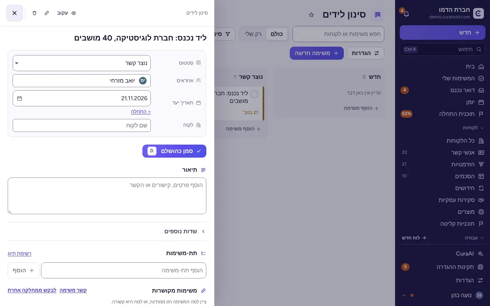

# משימות ולוחות

העבודה מתנהלת על לוחות. לוח שייך לצוות, לכל החברה או רק לכם, ואתם בוחרים את העמודות שלו.

## משימה

למשימה יש כותרת, תיאור, אנשים (עד 10), תאריך יעד, עדיפות ולקוח (לא חובה). מוסיפים לה תת־משימות, קבצים ותגובות. משימה נפתחת בחלונית לצד הלוח, והקישור אליה עובד אצל כל מי שתשלחו לו.

הפס הדק בקצה כל כרטיס מראה איפה המשימה עומדת מול הזמן: רגועה, בקרוב, היום, באיחור, הושלמה. אותם צבעים חוזרים ביומן וב'המשימות שלי'. תאריכים נבחרים בבורר התאריכים של המוצר, בשפה שלכם ובסדר שבו אתם כותבים תאריכים.

## כששני אנשים משנים את אותה משימה

Curahold אף פעם לא דורס אף אחד בשקט. אם מישהו שמר בזמן שערכתם, השינוי שלו נשמר והשינוי שלכם מוחל מעליו. שואלים אתכם רק כשאותו שדה באמת מתנגש.

## שינוי של כמה יחד, וביטול

בוחרים כמה משימות בלוח או ברשימה ומשנים יחד את הסטטוס, האנשים, התאריך או העדיפות. ההודעה בתחתית מציעה **בטל**.

## משימות חוזרות

אפשר לגרום למשימה לחזור כל כמה ימים, שבועות או חודשים. הבאה נפתחת כשהנוכחית מסתיימת. התאריך החדש נספר באחת משתי דרכים:

- **מתאריך היעד:** ללוחות זמנים קבועים, כמו "דוח ב-1 לכל חודש".
- **מהיום שבו הושלמה:** לעבודה כמו "להתקשר שוב שבועיים אחרי השיחה האחרונה".

## אזכורים והשתקה

מקלידים `@` בתגובה כדי להזכיר מישהו; הוא יקבל הודעה. אם כבר לא רוצים לשמוע על משימה, בוחרים בתפריט שלה **הפסק התראות תגובה למשימה זו**.

## חיפוש מהיר

לוחצים Ctrl K (⌘ K ב-Mac) בכל מקום כדי למצוא לקוח, משימה, אדם, לוח או עמוד. זזים עם מקשי החצים ופותחים עם Enter.

## עוד במשימה

- **עקוב:** עם הכפתור בראש המשימה, שומעים על תגובות ועל מעברי עמודה גם במשימה שאינה שלכם.
- **משימות מקושרות:** מציינים שמשימה **ממתינה ל**משימה אחרת, **מעכבת** אחרת או **קשורה ל**אחרת. משימה ממתינה מציגה על הכרטיס "ממתינה ל-1"; כשהמשימה שהיא מחכה לה מסתיימת, האנשים שלה מקבלים הודעה "אפשר להתחיל". אי אפשר לגרום למשימות לחכות זו לזו במעגל.
- **תאריך התחלה:** **+ התחלה** ליד תאריך היעד רושם מתי העבודה מתחילה; ציר הזמן מצייר אותה כפס.
- **זמן שהושקע:** הכפתורים ‎+15 דק׳, ‎+30 דק׳, ‎+1 שע׳, או ידנית ("1.5", "45m", "1:30"). עמוד הלקוח מציג את הסכום שנרשם עבור הלקוח הזה.
- **רשימת תיוג:** שומרים פעם אחת את הצעדים שחוזרים עליהם (מוסיפים תת־משימות ← **שמור את תת-המשימות האלה כרשימת תיוג**), ואז מוסיפים אותם לכל משימה בלחיצה אחת.
- **היסטוריה:** מי שינה מה ומתי, שורה אחרי שורה, בתחתית המשימה.
- **אזהרת דמיון:** אם המשימה שאתם עומדים להוסיף דומה לאחת שכבר פתוחה, ההוספה המהירה אומרת זאת.

## השדות של לוח

הגדרות הלוח ← **שדות וטופס בקשה**: מוסיפים שדות לכל משימה בלוח (טקסט, מספר, סכום כסף, תאריך, בחירה, קישור, דוא״ל, אדם, כן/לא). שדה שמסומן **חובה למלא כדי לסיים** חייב להיות מלא לפני שמשימה עוברת לעמודת "הושלם"; שינוי מרוכז מדלג על משימות כאלה ואומר כמה. שדות בחירה מופיעים כתוויות צבעוניות על הכרטיסים ואפשר לסנן לפיהם.

## מסננים ותצוגות שמורות

**סינון** בראש הלוח מצמצם לפי אדם, תאריך יעד (באיחור, היום, 7 ימים…), עדיפות ושדות הבחירה של הלוח. בטלפון כל המסננים נמצאים יחד בגיליון **סינון** אחד. נותנים שם למסננים הפעילים עם **תצוגות ← שמור**, ואם רוצים מציגים את התצוגה לכל מי שבלוח.

## טופס בקשה

בהגדרות הלוח מפעילים **קבל בקשות דרך טופס** ובוחרים על מה הטופס שואל. עמיתים משתמשים בכפתור **טופס בקשה** בלוח; הבקשה נוחתת כמשימה בעמודה שבחרתם, ומי שביקש עוקב אחריה אוטומטית.

## מעבר מכלי אחר: ייבוא משימות מקובץ

כפתור החץ למעלה בראש הלוח (**ייבוא משימות מקובץ**) מקבל את קובץ ה-CSV או ה-Excel שייצאתם מהכלי הקודם. הקובץ נקרא בדפדפן; שום דבר לא נשלח לפני שראיתם איזו עמודה הולכת לאן.

- העמודות מזוהות מעצמן (Title, Description, Status, Assignee, Due date, Start date, Priority, Customer, Completed on, וגם השמות הטורקיים שלהן). אפשר לשנות כל אחת; העמודה "הופך ל" מראה איך השורות הראשונות ייכנסו.
- **Status** הולך לעמודת הלוח עם אותו שם. גם שמות נפוצים כמו "To do", "In progress" ו-"Done" מובנים; כל השאר נוחת בעמודה הראשונה ומפורט בתוצאה.
- **Assignee** מותאם לפי שם או דוא״ל; אנשים שלא נמצאו נשארים בחוץ, ואומרים לכם מי. שם לקוח מותאם באותה דרך.
- משימות שהושלמו נשארות בחוץ, אלא אם מסמנים "הבא גם משימות שהושלמו".
- אף אחד לא מקבל הודעה ושום כלל לא רץ. אפשר **לבטל** את כל הייבוא במשך 30 יום: משימות שאף אחד לא נגע בהן נמחקות, ואלה שמישהו עבד עליהן עוברות לארכיון.

עד 5,000 שורות בכל פעם.

## היומן

**יומן** מראה מה נופל באיזה יום: משימות לפי תאריך היעד, פגישות, שיחות וסקירות שהתקיימו, חידושים, וסקירות עסקיות שמועדן מגיע. התגיות שמעליו מדליקות ומכבות כל סוג.

- **יום, שבוע, חודש, שנה:** המתג בראש העמוד. יום מפרט כל מה שבו עם הלקוח ולמי זה שייך; השנה מציגה שנים־עשר חודשים קטנים, כהים יותר איפה שנופל יותר. לחיצה על מספר יום פותחת את היום הזה.
- **היומן של מי:** שלכם, או של כל מי שאתם יכולים לראות. מי שהתפקיד שלו מאפשר *לראות את היומנים של חברי הצוות* (בהתחלה מנהלי מערכת וראשי צוותים) יכול גם לבחור אדם אחד או צוות שלם. זה מצמצם את מה שהוא כבר יכול לראות; זה לא מציג שום דבר חדש, כך שלוח פרטי נשאר פרטי.
- התצוגה, היום והיומן של מי – כולם בכתובת, כך שקישור פותח אותו דבר.

## ארכיון

משימות שהושלמו עוברות מעצמן ל**ארכיון** של הלוח אחרי שהלוח החזיק בהן מספיק זמן (90 יום כברירת מחדל; 30–365 יום או "תמיד" בהגדרות הלוח). לוח שבשימוש כבר שנים עדיין נפתח מיד. משימות בארכיון ממשיכות להיספר בדוחות; מחפשים אותן בתצוגת **ארכיון** לצד לוח / רשימה ומחזירים אחת עם **החזר**. משימה שהוחזרה נשארת בלוח שוב לאותו מספר ימים. גם משימות שהעברתם לארכיון ידנית מתצוגת הרשימה נמצאות כאן.

## מחיקת משימה, והחזרת משימה שנמחקה

משימה שנמחקה עוברת ל[סל המחזור](/docs/he/trash/) עם תת־המשימות, התגובות, הזמן והקבצים שלה, ואפשר להחזיר אותה במשך 30 יום: בוחרים **בטל** בהודעה מיד אחרי המחיקה, או פותחים את התפריט שלכם, בוחרים **סל מחזור** ואז **החזר**. רק מי שיצר משימה יכול למחוק אותה, או מי שהתפקיד שלו מאפשר למחוק כל משימה. כדי להוציא משימה שהושלמה מהדרך בלי למחוק אותה, מעבירים אותה לארכיון.
