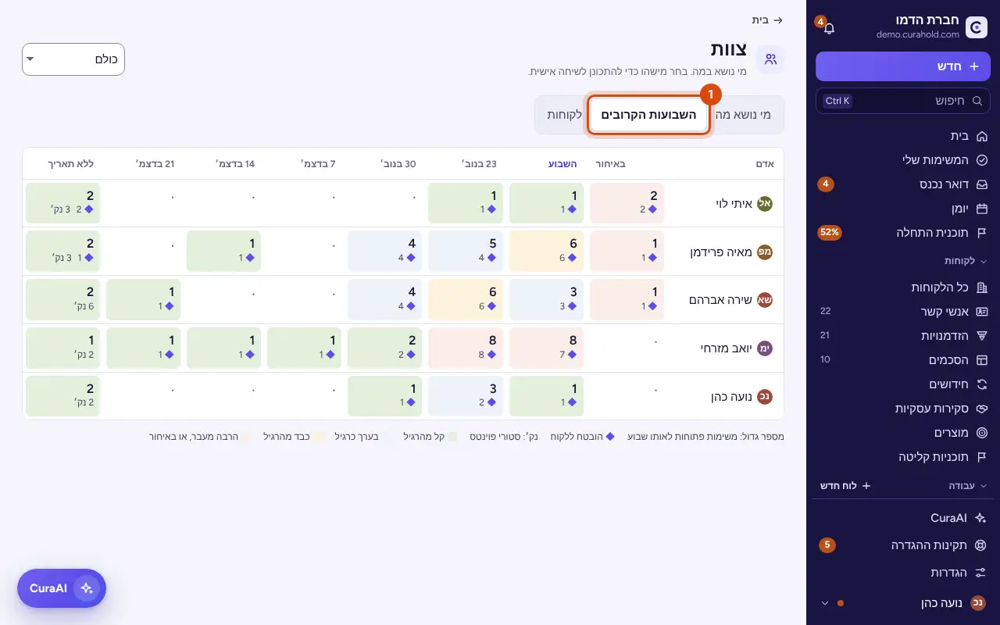
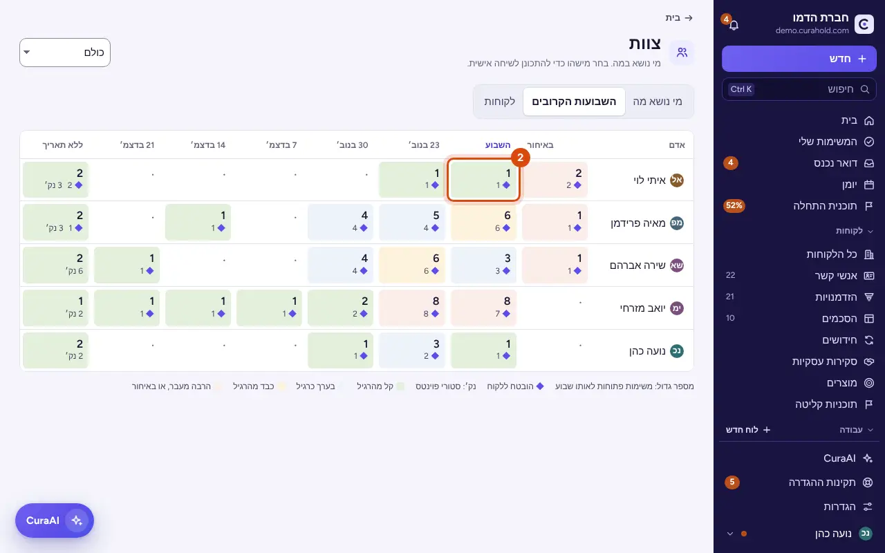
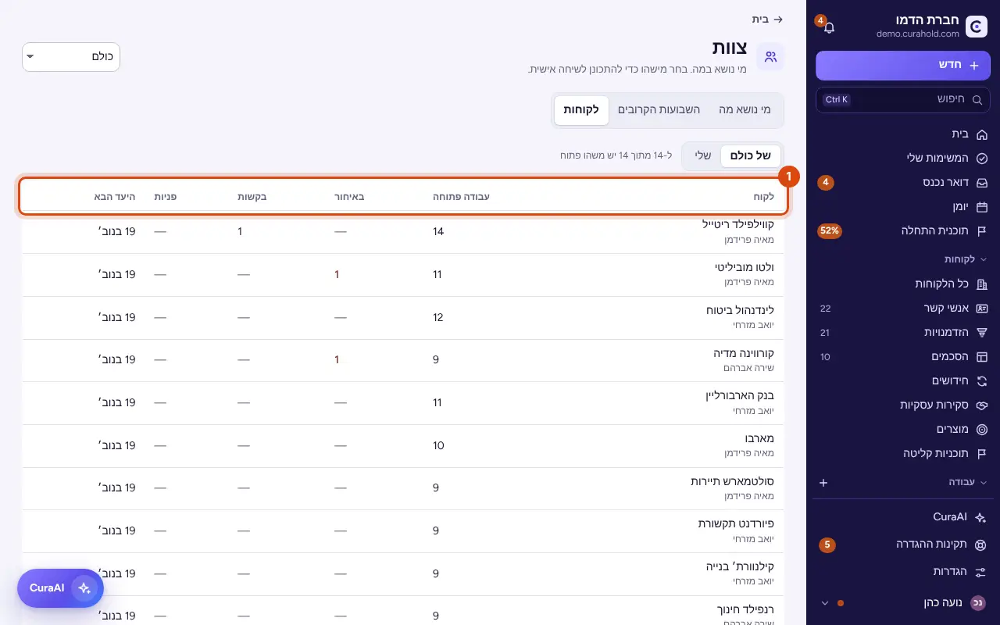
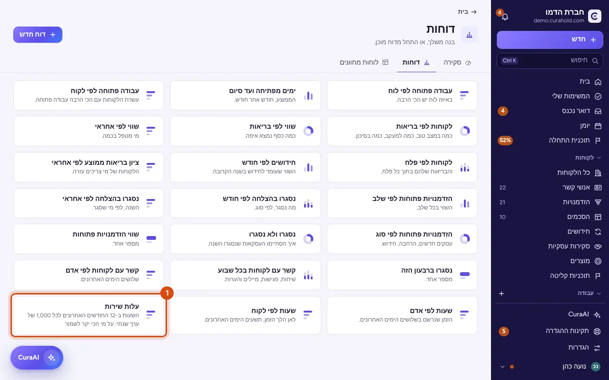

# השבועות של הצוות, תיק הלקוחות ועלות השירות

ל**צוות** (בתפריט שבצד) יש שלוש תצוגות: **מי נושא מה**, **השבועות הקרובים** ו**לקוחות**. בוחרים צוות למעלה כדי לצמצם כל אחת מהן. נספרות רק משימות שמותר לכם לראות.

## למי יש מקום בשבועות הקרובים {#weeks}

1. פותחים **צוות** ולוחצים **השבועות הקרובים**.
   
2. קוראים את השורה של אדם שבוע אחר שבוע. בכל תא: המספר הגדול הוא המשימות הפתוחות לאותו שבוע, ◆ כמה מהן הבטחות ללקוח, ו-**pt** הנקודות שלהן. הצבע משווה את השבוע למה שהאדם נושא בדרך כלל: קל יותר, כרגיל, כבד יותר או הרבה מעבר. ל**באיחור** ול**ללא תאריך** יש עמודות משלהן. לוחצים על תא כדי לפתוח את תצוגת ה-1:1 של האדם.
   

## העבודה הפתוחה של כל לקוח {#customers}

1. פותחים **צוות** ולוחצים **לקוחות**. כל לקוח שיש לו משהו פתוח מופיע, העמוס ביותר קודם: עבודה פתוחה, כמה ממנה באיחור, בקשות שאנשיו שלחו דרך הפורטל, קריאות תמיכה שלא נפתרו והתאריך הבא. לוחצים על שם עמודה כדי למיין לפיה; עוברים בין **של כולם** ל**שלי**.
   

סכומים לא מוצגים כאן בכוונה: מי רשאי לראות כסף נקבע שדה אחר שדה.

## עלות שירות {#cost-to-serve}

1. פותחים **דוחות** בתפריט, לוחצים על הלשונית **דוחות** ואז על **עלות שירות**. לכל לקוח מוצגות השעות שנרשמו על העבודה שלו ב-12 החודשים האחרונים לכל 1,000 של ערך שנתי (ARR, אחרת MRR × 12, אחרת שדה הסכום הראשון). הגבוהים ביותר הם הלקוחות שהכי יקר לשמור עליהם.
   

שני שדות מגיעים איתו בבונה הדוחות: **זמן שנרשם, 12 החודשים האחרונים** ו**שעות לכל 1,000 של ערך שנתי**. מי שאינו רשאי לראות את הערך של לקוח לא מקבל נתון עלות.
