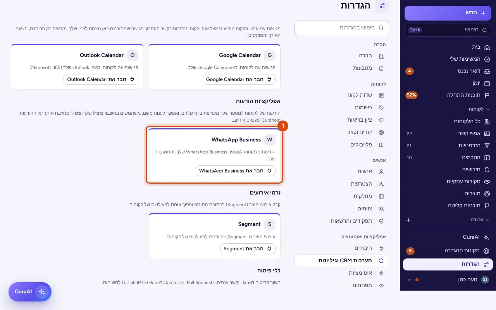
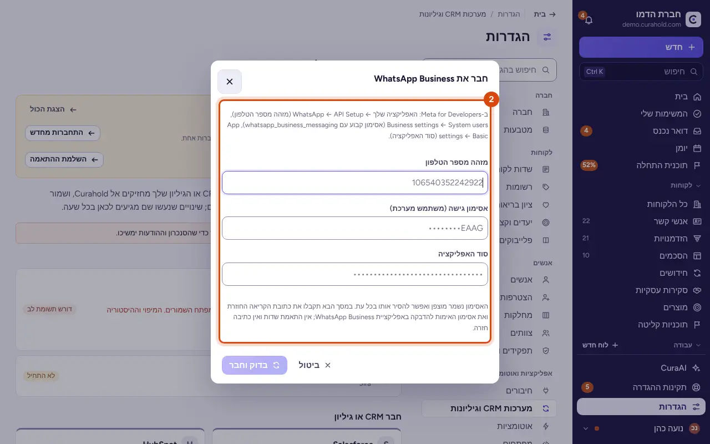

# WhatsApp Business

הודעות שלקוחות שולחים למספר ה-WhatsApp Business שלך מופיעות בדף שלהם, ועונים משם. משתמשים באפליקציית Meta **שלך** ובמספר שלך: ‏Meta מחייבת אותך על ההודעות, ‏Curahold לא מוסיף חיוב ולא רואה את חשבונית Meta.

## לפני שמתחילים

צריך חשבון עסקי ב-Meta עם מספר WhatsApp Business ב-Cloud API, אפליקציית Meta עם המוצר WhatsApp, ו-**משתמש מערכת** עם אסימון קבוע (הרשאה `whatsapp_business_messaging`). הדפים של Meta מדריכים צעד אחר צעד; זה לוקח כרבע שעה.

## ב-Curahold {#connect}

1. פותחים **הגדרות ← מערכות CRM וגיליונות**, מוצאים **אפליקציות הודעות** ולוחצים **חבר את WhatsApp Business**.
   
2. מדביקים את שלושת הערכים שלמטה ולוחצים **חבר**. דף החיבור מציג אז **כתובת callback** ו-**אסימון אימות**.
   

- **מזהה מספר הטלפון**: ‏Meta for Developers ← האפליקציה ← **WhatsApp ← API Setup**.
- **אסימון גישה (משתמש מערכת)**: ‏Business settings ← **System users** ← המשתמש ← **Generate new token**.
- **סוד האפליקציה**: האפליקציה ← **App settings ← Basic** ← **App secret** ← **Show**.

## ב-Meta

1. פותחים את האפליקציה ← **WhatsApp ← Configuration**. ליד **Webhook** לוחצים **Edit**.
2. מדביקים את כתובת ה-callback ב-**Callback URL** ואת אסימון האימות ב-**Verify token**. לוחצים **Verify and save**.
3. תחת **Webhook fields** לוחצים **Manage** ונרשמים ל-**messages**.

## מה מגיע, ואיך עונים

הודעה מגיעה כהערה ללקוח שלאיש קשר שלו יש את מספר השולח (גם צורות מקומיות כמו `0532…` מתאימות). בהערה לוחצים **לענות ב-WhatsApp**. ‏WhatsApp מאפשר טקסט חופשי רק בתוך 24 שעות מההודעה האחרונה של הלקוח; אחר כך Curahold מבקש שם ושפה של **תבנית** מאושרת.

## מגבלות ותזמון

הודעות מגיעות כפי ש-Meta שולחת אותן. Meta מנסה שוב משלוח שנכשל עד 7 ימים; כל הודעה נשמרת פעם אחת. Meta מגבילה את קצב השליחה ממספר; תשובת „עמוס” אומרת זאת ושום דבר לא אובד.

## אם משהו משתבש

אסימון שפג או בוטל מתגלה בתשובה: מדביקים חדש עם **חבר מחדש**. הודעה ממספר שאין לאף איש קשר נספרת בחיבור ולא נשמרת. **הסר** עוצר את ה-callback מיד; הערות שכבר אצל לקוחות נשארות.

## ראו גם

- [ציר זמן וציון בריאות](/docs/he/timeline-and-health/)
- [חיבורים ו-CRM](/docs/he/connections/)
