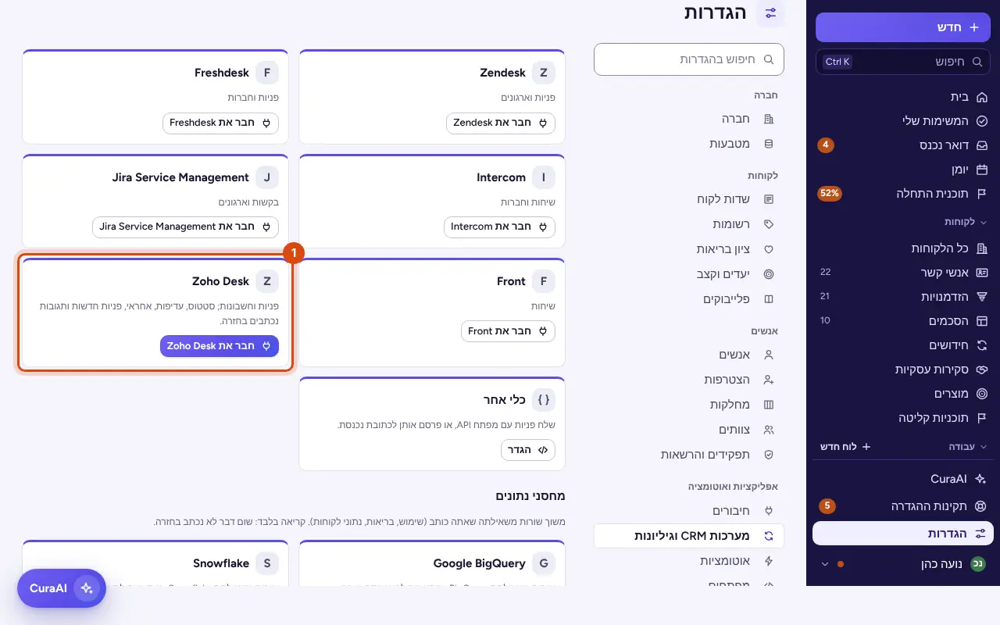

# Zoho Desk

פניות וחשבונות מ-Zoho Desk מופיעים אצל הלקוח המתאים, בסיכומים ובציון הבריאות. סטטוס, עדיפות ואחראי שמשתנים ב-Curahold חוזרים ל-Zoho Desk, פנייה שנפתחת ב-Curahold נפתחת שם, ותשובה או הערה פרטית נוספות כתגובה.

## ב-Curahold {#connect}

1. פותחים **הגדרות ← מערכות CRM וגיליונות**, מוצאים **כלי תמיכה** ולוחצים **חבר את Zoho Desk**.
   

Zoho נפתח. מתחברים עם נציג של מוקד התמיכה ולוחצים **Accept**. ‏Curahold מוצא את מרכז הנתונים (.com, .eu, .in, .com.au, .jp, .sa, .uk, .ae, .ca, .com.cn) ואת הפורטל. בחזרה מסמנים **פניות** ו-**חשבונות**, בודקים את צמדי השדות ולוחצים **התחל לסנכרן**.

## מגבלות ותזמון

שינויים נקראים כל שעה. Zoho סופר קרדיטים לכל קריאה מתוך מכסה יומית לפי התוכנית; כשהיא נגמרת Zoho מבקש להמתין ו-Curahold ממשיך בפעם הבאה. תשובה ציבורית מ-Curahold היא תגובה ציבורית בפנייה; תשובה באימייל נשלחת מ-Zoho Desk.

## אם משהו משתבש

כניסה שפג תוקפה מתחדשת לבד. אם הנציג איבד גישה החיבור מציג **דורש תשומת לב**: **חבר מחדש** ומתחברים שוב. **הסר** מוחק את הכניסה; פניות שכבר הגיעו נשארות.

## ראו גם

- [חיבורים ו-CRM](/docs/he/connections/)
