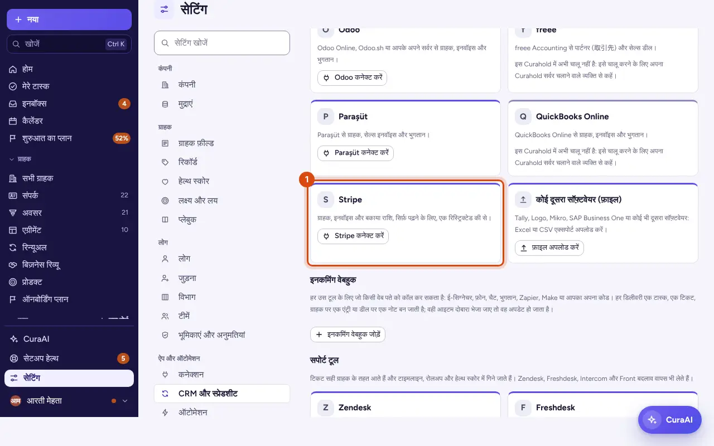

# Stripe (सिर्फ़ पढ़ने के लिए)

Stripe से ग्राहक, इनवॉइस (उनकी ड्यू डेट और बकाया राशि के साथ) और भुगतान। Curahold कभी Stripe में कुछ नहीं लिखता: जो की आप उसे देते हैं, वह सिर्फ़ पढ़ सकती है।

## Curahold में {#connect}

1. **सेटिंग → CRM और स्प्रेडशीट** खोलें, **अकाउंटिंग सॉफ़्टवेयर** ढूंढें और **Stripe कनेक्ट करें** पर क्लिक करें।
   

रिस्ट्रिक्टेड की को **रिस्ट्रिक्टेड की** में पेस्ट करें और **जांचें और कनेक्ट करें** पर क्लिक करें। पूरी secret key (`sk_…`) जान-बूझकर अस्वीकार की जाती है। फिर **शुरू करें** पर क्लिक करें और **मिलान** टैब पर वे ग्राहक जांचें जिन्हें मिलाया नहीं जा सका।

## Stripe में

1. **Developers → API keys** खोलें और **Create restricted key** पर क्लिक करें।
2. इसका नाम `Curahold` रखें।
3. **Customers**, **Invoices** और **Events** को **Read** पर रखें। बाकी सब **None** पर छोड़ दें।
4. **Create key** पर क्लिक करें, अपने दूसरे स्टेप से पुष्टि करें, और की कॉपी करें। यह ऐसे शुरू होती है:

```text
rk_live_
```

पहले आज़माने के लिए sandbox की की (`rk_test_…`) इस्तेमाल करें।

## सीमाएं और समय

पहली बार में सब कुछ पढ़ा जाता है; उसके बाद सिर्फ़ वही जो बदला, Stripe की इवेंट सूची से (जिसे Stripe 30 दिन रखता है)। Stripe प्रति सेकंड 100 अनुरोध (sandbox में 25) स्वीकार करता है; Curahold इससे बहुत नीचे रहता है। राशियां हर मुद्रा के अपने दशमलव मानती हैं (येन में कोई नहीं)। जिस इनवॉइस को Stripe "uncollectible" मार्क करता है, वह यहां बकाया ही रहता है, ताकि देर से भुगतान दिखता रहे।

## अगर कुछ ग़लत हो जाए

बदली गई या हटाई गई की कनेक्शन को **ध्यान देने की ज़रूरत** के रूप में दिखाती है: नई रिस्ट्रिक्टेड की बनाएं और उसे **फिर से कनेक्ट करें** से पेस्ट करें। अगर कोई अनुमति छूटी हो, तो कनेक्ट करने वाला स्टेप उसका नाम बताता है। **हटाएं** की मिटा देता है; पहले से पढ़े गए आंकड़े तब तक बने रहते हैं जब तक आप उन्हें न हटाएं।

## यह भी देखें

- [अकाउंटिंग सॉफ़्टवेयर](/docs/hi/accounting/)
