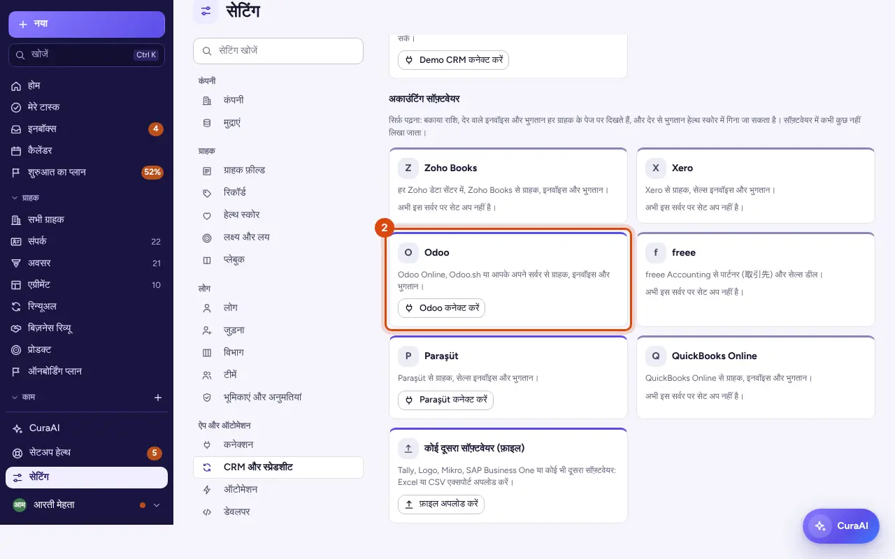

# अकाउंटिंग सॉफ़्टवेयर

अपना अकाउंटिंग सॉफ़्टवेयर कनेक्ट करें, और हर ग्राहक का पेज दिखाता है कि उस पर कितना बकाया है: बकाया बैलेंस, कितना ओवरड्यू है और कब से, आखिरी भुगतान और इनवॉइस। देर से भुगतान हेल्थ स्कोर में गिने जा सकते हैं। Curahold सिर्फ़ पढ़ता है: सॉफ़्टवेयर में कभी कुछ नहीं लिखा जाता।

## कौन-से सॉफ़्टवेयर

| सॉफ़्टवेयर | कैसे कनेक्ट होता है | पेज |
| --- | --- | --- |
| Zoho Books | Zoho से साइन इन | [Zoho Books](/docs/hi/accounting-zohobooks/) |
| Xero | Xero से साइन इन | [Xero](/docs/hi/accounting-xero/) |
| Odoo | पता, लॉगिन और API की | [Odoo](/docs/hi/accounting-odoo/) |
| freee | freee से साइन इन | [freee](/docs/hi/accounting-freee/) |
| Paraşüt | कंपनी नंबर, API क्लाइंट और एक यूज़र | [Paraşüt](/docs/hi/accounting-parasut/) |
| QuickBooks Online | Intuit से साइन इन | [QuickBooks Online](/docs/hi/accounting-quickbooks/) |
| कोई भी दूसरा (Logo, Mikro, Tally, SAP Business One…) | एक Excel या CSV फ़ाइल | [फ़ाइल](/docs/hi/accounting-file/) |

## अपना सॉफ़्टवेयर कनेक्ट करें {#connect}

आपके पास कनेक्शन संभालने की अनुमति होनी चाहिए (एडमिन के पास होती है)।

1. **सेटिंग → CRM और स्प्रेडशीट** खोलें और **अकाउंटिंग सॉफ़्टवेयर** तक स्क्रॉल करें। अपने सॉफ़्टवेयर की टाइल पर **कनेक्ट करें …** पर क्लिक करें, या **कोई दूसरा सॉफ़्टवेयर (फ़ाइल)** पर **फ़ाइल अपलोड करें** चुनें, और ऊपर की टेबल में उस सॉफ़्टवेयर का पेज फ़ॉलो करें।
   

## ग्राहकों का मिलान

अकाउंटिंग सॉफ़्टवेयर के हर ग्राहक का मिलान Curahold के एक ग्राहक से किया जाता है: पहले टैक्स नंबर से, फिर वेब पते या ईमेल डोमेन से, फिर नाम से (Ltd., A.Ş., Pvt. Ltd. या 株式会社 जैसे कंपनी के रूप अनदेखे किए जाते हैं)। जब ठीक एक ग्राहक फ़िट होता है, तो मिलान हो जाता है; जब कोई नहीं या कई फ़िट होते हैं, तो वह कनेक्शन के **मिलान** टैब पर इंतज़ार करता है। वहां आप ग्राहक चुन सकते हैं, या उसे छोड़ सकते हैं। आपके हाथ से किए गए मिलान बने रहते हैं।

## आंकड़े कौन देखता है

रकम उन भूमिकाओं को दिखाई जाती है जिनके पास **फ़ाइनेंस के आंकड़े देखें** है (शुरुआत में एडमिन और मैनेजर; इसे सेटिंग → भूमिकाएं और अनुमतियां में बदलें)। ग्राहक को देखने वाले बाकी सभी लोग हेल्थ स्कोर के अंदर सिर्फ़ यह देखते हैं कि भुगतान कितने दिन देर से है — रकम कभी नहीं।

**फ़ाइनेंस** विभाग के लोग भी रकम देखते हैं, उनकी भूमिका कुछ भी हो, और वे विभाग भी जिन्हें सेटिंग → विभाग में **ग्राहक के पेज पर फ़ाइनेंस कौन देखता है** के तहत चुना गया है। फ़ाइनेंस बंद करने पर यह हट जाता है।

## हेल्थ स्कोर में देर से भुगतान

पहली रीडिंग शुरू करते समय आप **देर से भुगतान को हेल्थ स्कोर में गिनें** पर टिक कर सकते हैं। **समय पर भुगतान** संकेत तब पूरे अंक देता है जब कुछ भी ओवरड्यू न हो, और तब कोई अंक नहीं जब सबसे पुराना बिना चुकाया इनवॉइस 60 दिन देर से हो; दोनों संख्याएं सेटिंग → हेल्थ स्कोर में बदली जा सकती हैं। जिन ग्राहकों का सॉफ़्टवेयर से मिलान नहीं हुआ, वे इसमें शामिल नहीं होते।

## कनेक्शन हेल्थ

अकाउंटिंग कनेक्शन बाकी कनेक्शनों के साथ सेटिंग → कनेक्शन में दिखते हैं: चल रहा है, कोई समस्या है, या रुका हुआ है, और वे आखिरी बार कब चले।
