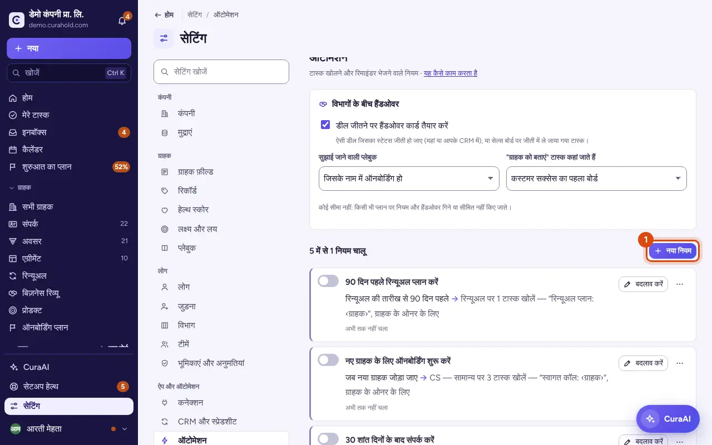
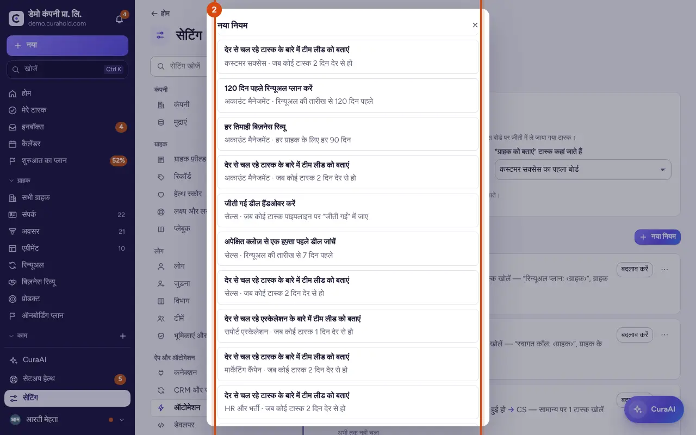
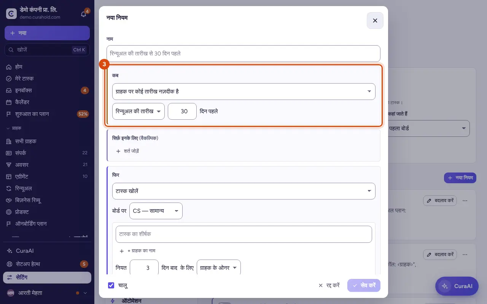
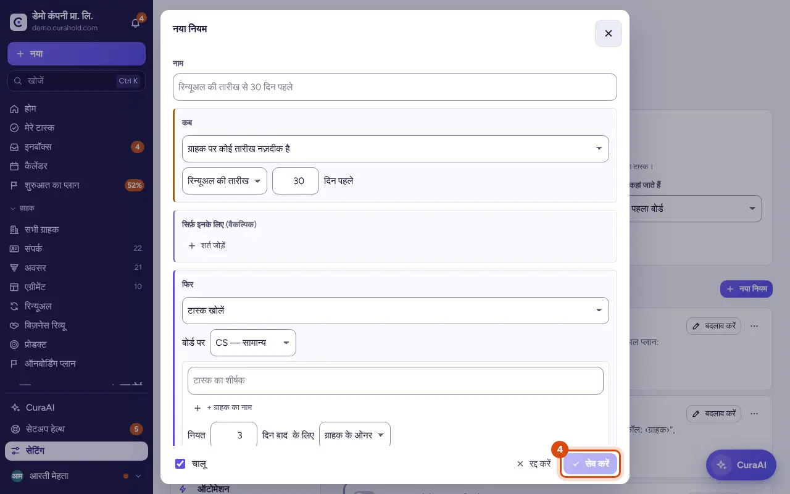

# ऑटोमेशन

नियम आपके लिए रोज़ का काम करते हैं: 90 दिन पहले रिन्यूअल प्लान, नए ग्राहक के लिए वेलकम कॉल, टास्क देर होने पर रिमाइंडर, डील जीतने पर हैंडओवर कार्ड। किसी भी प्लान में इन्हें न गिना जाता है, न इनकी कोई सीमा है।

## नियम बनाएं {#new-rule}

आपके पास ऑटोमेशन संभालने की अनुमति होनी चाहिए (एडमिन के पास होती है)।

1. **सेटिंग → ऑटोमेशन** खोलें और **नया नियम** पर क्लिक करें।
   
2. कोई फ़िट होने वाला तैयार नियम चुनें, या **शुरू से बनाएं**।
   
3. **कब** में चुनें कि नियम किस बात से शुरू हो, और उसकी जानकारी (कौन-सी तारीख, कितने दिन, कौन-सा बोर्ड)। इसे कुछ ग्राहकों या टास्क तक सीमित करने के लिए **शर्त जोड़ें** पर क्लिक करें। **फिर** में चुनें कि क्या हो। नीचे "आज यह … पर काम करेगा" दिखाता है कि यह अभी किन चीज़ों पर असर डालेगा; अभी कुछ नहीं बदला जाता।
   
4. इसे एक **नाम** दें, **चालू** पर टिक रहने दें और **सेव करें** पर क्लिक करें।
   

## नियम किस बात से शुरू हो सकता है {#when}

ग्राहक की कोई आने वाली तारीख (रिन्यूअल, कॉन्ट्रैक्ट खत्म होना), हर ग्राहक के लिए हर कुछ दिनों में, शांत हो गया ग्राहक, नया ग्राहक, ओवरड्यू टास्क, किसी कॉलम में जाता टास्क, जोड़ा गया या पूरा हुआ टास्क, किसी बोर्ड के फ़ॉर्म से आया अनुरोध, किसी स्टेज तक पहुंचा रिकॉर्ड, खुला सपोर्ट टिकट।

## नियम क्या कर सकता है {#then}

टास्क खोलना (चेकलिस्ट के साथ, ग्राहक के ओनर या किसी के भी लिए), रिमाइंडर भेजना, असाइन करना, आगे बढ़ाना, कोई फ़ील्ड भरना, कमेंट लिखना, आपके वेबहुक पर भेजना, या हैंडओवर कार्ड तैयार करना।

## चलाना और रोकना {#running}

हर नियम दिखाता है कि वह पिछले 30 दिनों में कितनी बार चला। **अभी चलाएं** किसी शेड्यूल्ड नियम को अगले घंटे का इंतज़ार किए बिना तुरंत चलाता है; तब भी वह हर मौके पर एक ही बार काम करता है। किसी नियम को रोकने के लिए उसे बंद करें। नियम हटाने पर उसके पहले से खोले गए टास्क बने रहते हैं, और नियम 30 दिन तक ट्रैश में रहता है।

उसी पेज के ऊपर की हैंडओवर सेटिंग [हैंडओवर, अनुरोध और वापसी का लूप](/docs/hi/handover-and-requests/) पर हैं।
