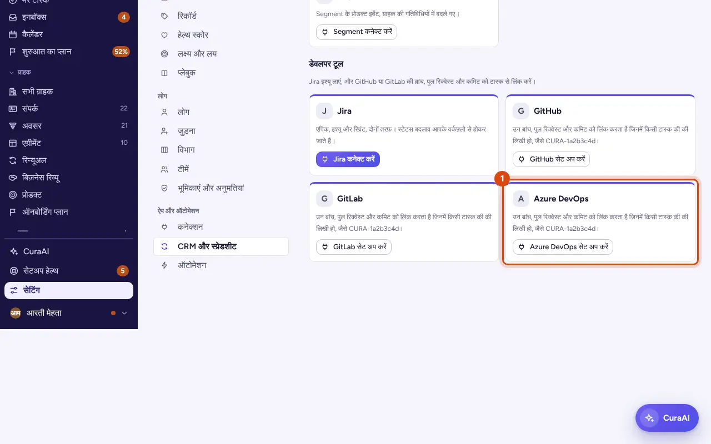
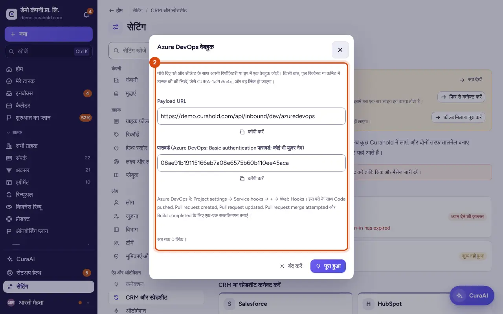

# Azure DevOps

Azure Repos की जो ब्रांच, pull request और commit किसी टास्क का नाम लेते हैं, वे उस टास्क से लिंक हो जाते हैं, उनकी स्थिति (खुला, merge हुआ, बंद) और बिल्ड के नतीजे के साथ। यह GitHub और GitLab की तरह काम करता है: टास्क की की, उदाहरण के लिए `CURA-1a2b3c4d`, ब्रांच के नाम, pull request के टाइटल या commit मैसेज में लिखें।

## Curahold में {#connect}

1. **सेटिंग → CRM और स्प्रेडशीट** खोलें, **डेवलपर टूल** ढूंढें और **Azure DevOps सेट अप करें** पर क्लिक करें।
   
2. **चालू करें** पर क्लिक करें, फिर दिखाया गया **पता** और **पासवर्ड** कॉपी करें।
   

## Azure DevOps में

हर इवेंट (Code pushed, Pull request created, Pull request updated, Pull request merge attempted, Build completed) के लिए यह एक बार करें:

1. प्रोजेक्ट खोलें → **Project settings** → **Service hooks** → **+** (Create subscription)।
2. **Web Hooks** चुनें और **Next** पर क्लिक करें।
3. इवेंट चुनें, फ़िल्टर जैसे हैं वैसे छोड़ें, और **Next** पर क्लिक करें।
4. पते को **URL** में पेस्ट करें। कोई भी **Username** लिखें (उदाहरण के लिए `azure`) और पासवर्ड को **Password** में पेस्ट करें।
5. **Resource details to send** को **All** पर छोड़ें, **Test** पर क्लिक करें, फिर **Finish** पर।

## सीमाएं और समय

Azure DevOps जैसे ही भेजता है, लिंक दिखने लगते हैं। Azure DevOps सिर्फ़ HTTPS से भेजता है और कुछ भी साइन नहीं करता: पासवर्ड ही सबूत है, इसलिए उसे पासवर्ड की तरह ही संभालकर रखें।

## अगर कुछ ग़लत हो जाए

Azure DevOps हर डिलीवरी का जवाब **Service hooks → History** में दिखाता है: 401 का मतलब है कि पासवर्ड ग़लत है (नए पासवर्ड के लिए वेबहुक दोबारा चालू करें और हर subscription अपडेट करें)। **बंद करें** नए लिंक रोक देता है; जो लिंक बन चुके हैं वे टास्क पर बने रहते हैं।

## यह भी देखें

- [टास्क और बोर्ड](/docs/hi/tasks/)
- [कनेक्शन और CRM](/docs/hi/connections/)
