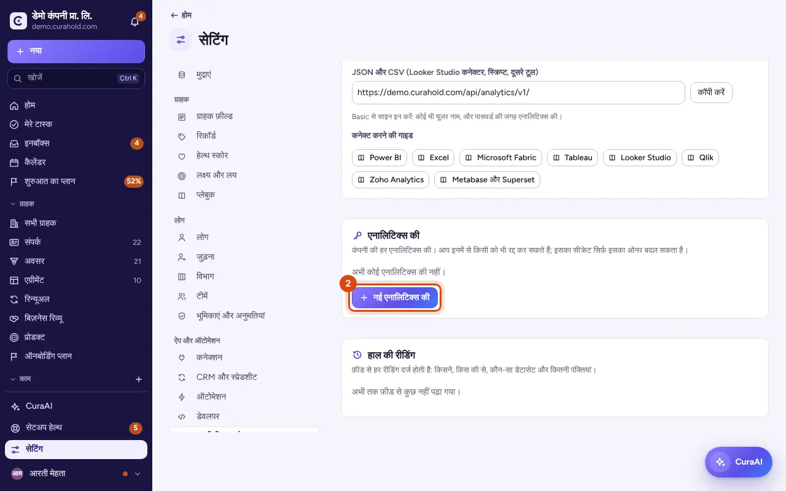
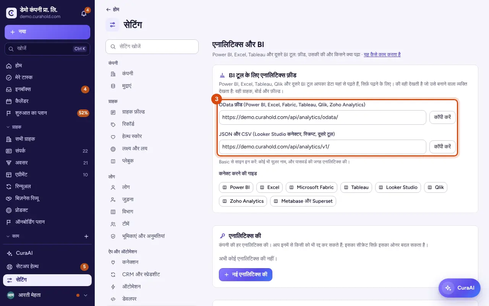

# कोई BI टूल कनेक्ट करें

Curahold में BI टूल के लिए एक सिर्फ़ पढ़ने वाली **एनालिटिक्स फ़ीड** है। Power BI, Excel, Microsoft Fabric, Tableau, Qlik और Zoho Analytics इसे **OData फ़ीड** के रूप में पढ़ते हैं; Looker Studio, स्क्रिप्ट और दूसरे टूल वही डेटा **JSON या CSV** के रूप में पढ़ते हैं। इसके ज़रिए Curahold में कुछ भी बदला नहीं जा सकता।

## शुरू करने से पहले {#key}

आपके पास डेटा एक्सपोर्ट करने की अनुमति होनी चाहिए (एडमिन और मैनेजर के पास होती है)।

1. **सेटिंग → एनालिटिक्स और BI** खोलें और **नई एनालिटिक्स कुंजी** पर क्लिक करें। इसे एक नाम दें (जैसे "Power BI सेल्स डैशबोर्ड"), वे डेटासेट और विभाग चुनें जिन्हें यह पढ़ सकती है, और एक खत्म होने की तारीख, फिर इसे बनाएं। कुंजी तुरंत कॉपी करें: यह सिर्फ़ एक बार दिखाई जाती है, और `chb_` से शुरू होती है।
   
2. उसी पेज पर **BI टूल के लिए एनालिटिक्स फ़ीड** के तहत, आपके टूल को जो पता चाहिए उसके पास **कॉपी करें** पर क्लिक करें। ये आपकी कंपनी के पते के साथ ऐसे दिखते हैं:
   

OData फ़ीड (Power BI, Excel, Fabric, Tableau, Qlik, Zoho Analytics):

```text
https://your-company.curahold.com/api/analytics/odata/
```

JSON और CSV (Looker Studio, स्क्रिप्ट, दूसरे टूल):

```text
https://your-company.curahold.com/api/analytics/v1/
```

जब कोई टूल पूछे कि साइन इन कैसे करें, तो **Basic** चुनें: यूज़र नेम में कुछ भी टाइप करें और पासवर्ड की जगह की पेस्ट करें।

कुंजी ठीक वही पढ़ती है जो आप Curahold में देखते हैं: वही ग्राहक, बोर्ड और फ़ील्ड। जो फ़ील्ड आपकी भूमिका नहीं देख सकती, वह कॉलम भी नहीं बनता। अगर आप कंपनी छोड़ दें या एक्सपोर्ट की अनुमति खो दें, तो की काम करना बंद कर देती है। **सीक्रेट बदलें** उसी की को नई वैल्यू देता है; **रद्द करें** उसे तुरंत खत्म कर देता है।

## डेटासेट

| डेटासेट | इसमें क्या है |
| --- | --- |
| `Customers` | हर ग्राहक की एक पंक्ति, आपके देखे जा सकने वाले हर ग्राहक फ़ील्ड का अपना कॉलम |
| `Renewals` | रिन्यूअल की तारीख वाले ग्राहक: वैल्यू, हेल्थ और खुली रिन्यूअल डील |
| `HealthHistory` | हर दिन हर ग्राहक का हेल्थ स्कोर |
| `Opportunities` | आपकी पाइपलाइन: रकम, स्टेज, स्टेटस, क्लोज़ होने की तारीख |
| `Tickets` | सपोर्ट टिकट |
| `Contacts` | आपके ग्राहकों के संपर्क |
| `Records…` | आपके जोड़े हर रिकॉर्ड प्रकार का एक डेटासेट (एग्रीमेंट, जोखिम…) |
| `Boards`, `Tasks`, `TaskAssignees` | बोर्ड, उनके टास्क, और हर टास्क और असाइनी की एक पंक्ति |
| `Sprints`, `SprintBurndown` | स्प्रिंट, और हर दिन का दायरा और बचा काम |
| `People` | नाम और भूमिका, ओनर और असाइनी id के साथ नाम जोड़ने के लिए |

हर डेटासेट में `Id` और `ModifiedAt` (पंक्ति आखिरी बार कब बदली) होते हैं। ज़्यादातर में `IsDeleted` भी होता है: आर्काइव की गई पंक्तियां `IsDeleted = true` के साथ फ़ीड में रहती हैं, ताकि रिफ़्रेश उन्हें आपकी रिपोर्ट से हटा सके। डेटासेट को उनके id कॉलम से जोड़ें: `Tasks.CustomerId` → `Customers.Id`, `Tasks.BoardId` → `Boards.Id`, `OwnerId` → `People.Id`।

## Power BI

1. Power BI Desktop में **Get data → OData feed** चुनें।
2. OData पता पेस्ट करें और **OK** चुनें।
3. **Basic** चुनें। User name: कुछ भी। Password: आपकी एनालिटिक्स कुंजी। **Connect** चुनें।
4. Navigator में अपने चाहे डेटासेट पर टिक करें और **Load** चुनें (या पहले कॉलम हटाने के लिए **Transform data**)।
5. पब्लिश करने के बाद, सिमैंटिक मॉडल की **Settings → Data source credentials** खोलें, की के साथ फिर से **Basic** चुनें, और **scheduled refresh** चालू करें।

अगर Power BI सर्विस Basic साइन इन के लिए गेटवे मांगे, तो इसकी जगह की को **Web API key** के रूप में इस्तेमाल करें: **Transform data → Advanced editor** में सोर्स को `OData.Feed("https://your-company.curahold.com/api/analytics/odata/Tasks", null, [ApiKeyName = "key", Implementation = "2.0"])` लिखें, फिर **Web API** चुनें और Power BI के पूछने पर की पेस्ट करें।

**बड़े डेटासेट।** इंक्रिमेंटल रिफ़्रेश के लिए रेंज को पते में रखें, ताकि Curahold भेजने से पहले फ़िल्टर करे:

```
let
    Start = DateTime.ToText(RangeStart, "yyyy-MM-ddTHH:mm:ss") & "Z",
    End = DateTime.ToText(RangeEnd, "yyyy-MM-ddTHH:mm:ss") & "Z",
    Source = OData.Feed("https://your-company.curahold.com/api/analytics/odata/Tasks?$filter=CreatedAt ge " & Start & " and CreatedAt lt " & End, null, [Implementation = "2.0"])
in
    Source
```

फिर टेबल पर हमेशा की तरह इंक्रिमेंटल रिफ़्रेश पॉलिसी सेट करें, और `ModifiedAt` कॉलम के साथ **Detect data changes** पर टिक करें, ताकि जिस अवधि की पंक्तियां बदलीं उसे फिर से पढ़ा जाए।

## Excel

1. Windows के लिए Excel में **Data → Get Data → From Other Sources → From OData Feed** चुनें।
2. OData पता पेस्ट करें और **OK** चुनें।
3. **Basic** चुनें, कोई भी यूज़र नेम टाइप करें और पासवर्ड की जगह की पेस्ट करें, फिर **Connect**।
4. Navigator में डेटासेट चुनें और **Load** चुनें।
5. **Data → Refresh All** जब चाहें सबसे नया डेटा ले आता है।

## Microsoft Fabric

1. अपने वर्कस्पेस में **New item → Dataflow Gen2** चुनें, फिर **Get data → OData**।
2. OData पता पेस्ट करें। Connection credentials में **Basic**, कोई भी यूज़र नेम और पासवर्ड की जगह की चुनें।
3. डेटासेट चुनें, ज़रूरत हो तो उन्हें आकार दें, और एक **data destination** (lakehouse या warehouse) जोड़ें।
4. **Publish** करें, फिर डेटाफ़्लो पर रिफ़्रेश शेड्यूल सेट करें।

डेटा पाइपलाइन की **Copy activity** भी अपने OData कनेक्टर और Basic साइन इन से यही फ़ीड पढ़ सकती है।

## Tableau

1. Tableau Desktop में **Connect → To a Server → OData** चुनें।
2. सर्वर के रूप में किसी एक डेटासेट का पता पेस्ट करें, जैसे `https://your-company.curahold.com/api/analytics/odata/Customers`।
3. **Use username and password** चुनें: कोई भी यूज़र नेम, पासवर्ड की जगह की। **Sign In** चुनें।
4. Tableau OData को **extract** के रूप में पढ़ता है। हर चाहे डेटासेट के लिए एक और OData कनेक्शन जोड़ें और उन्हें उनके id कॉलम से जोड़ें।
5. Tableau Cloud या Server पर पब्लिश करते समय क्रेडेंशियल एम्बेड करें और extract रिफ़्रेश शेड्यूल सेट करें।

## Looker Studio

Looker Studio को ऐसी फ़ीड पढ़ने के लिए एक कनेक्टर चाहिए। **Curahold का अपना Looker Studio कनेक्टर जल्द आ रहा है।** तब तक:

1. एक नई Google Sheet में, सेल A1 में लिखें: `=IMPORTDATA("https://your-company.curahold.com/api/analytics/v1/Customers.csv?limit=5000&key=YOUR-KEY")`।
2. Looker Studio में **Create → Data source → Google Sheets** चुनें और वह शीट चुनें।
3. सिर्फ़ इसी के लिए एक कुंजी बनाएं, उन्हीं डेटासेट तक सीमित जो शीट को चाहिए: जो भी शीट बदल सकता है, वह फ़ॉर्मूला में की देख सकता है। अगर शीट बहुत ज़्यादा लोगों के साथ शेयर हो, तो Curahold में की रद्द करें।

आप **CRM और स्प्रेडशीट** (सेटिंग → CRM और स्प्रेडशीट) से भी किसी शीट को अप टू डेट रख सकते हैं और उस शीट को Looker Studio में इस्तेमाल कर सकते हैं।

## Qlik

1. Qlik Sense या Qlik Cloud में **Add data → OData** (या **Create new connection → OData**) चुनें।
2. OData पता पेस्ट करें, **Basic** ऑथेंटिकेशन, कोई भी यूज़र नेम और पासवर्ड की जगह की चुनें।
3. डेटासेट चुनें और उन्हें लोड करें; ऐप की सेटिंग में रीलोड शेड्यूल करें।

Qlik का REST कनेक्टर JSON पते (`…/api/analytics/v1/Customers.json`) के साथ भी काम करता है, Basic साइन इन और `next` फ़ील्ड पर "next URL" पेजिंग के साथ।

## Zoho Analytics

1. **Create → New Workspace → Web URL / Feeds** चुनें (वेब फ़ीड से इंपोर्ट)।
2. किसी एक डेटासेट का पता पेस्ट करें: OData पता (`…/api/analytics/odata/Customers`) या CSV वाला (`…/api/analytics/v1/Customers.csv`)।
3. ऑथेंटिकेशन में **Basic** चुनें: कोई भी यूज़र नेम, पासवर्ड की जगह की।
4. पेजिंग के लिए **next page URL** चुनें: OData के लिए `@odata.nextLink`, JSON के लिए `next`।
5. तय करें कि इंपोर्ट कितनी बार दोहराया जाए।

## Metabase / Superset

Metabase और Superset डेटाबेस पढ़ते हैं, वेब फ़ीड नहीं। सीधा कनेक्शन Curahold के **वेयरहाउस एक्सपोर्ट** (BigQuery या Snowflake में) के साथ आता है, जो जल्द आ रहा है। तब तक, जहां आपका सेटअप फ़ाइल अपलोड की अनुमति देता है, वहां `…/api/analytics/v1/<dataset>.csv` से CSV अपलोड करें।

## दूसरे टूल और स्क्रिप्ट

JSON और CSV पता ये विकल्प लेता है:

| विकल्प | मतलब |
| --- | --- |
| `limit` | हर पेज पर पंक्तियां, 5000 तक (डिफ़ॉल्ट रूप से 1000) |
| `page` या `offset` | नंबर से या पंक्ति से पेज |
| `cursor` | पिछले पेज की `next` वैल्यू (बड़े डेटासेट के लिए सबसे तेज़) |
| `since` | सिर्फ़ इस तारीख या समय पर या उसके बाद बदली पंक्तियां, जैसे `2026-11-01` |
| `fields` | सिर्फ़ ये कॉलम, जैसे `Id,Name,ModifiedAt` |
| `filter`, `orderby` | वही एक्सप्रेशन जो OData `$filter` और `$orderby` में होते हैं |
| `count=1` | पंक्तियों की कुल संख्या भी लौटाएं |

कुंजी को Basic (पासवर्ड) या `Authorization: Bearer chb_…` के रूप में भेजें। JSON पेज `{ "dataset": "Tasks", "rows": [...], "next": "…" }` जैसा दिखता है; CSV पेज अगला पता `Link` हेडर में देते हैं। Domo, SAP Analytics Cloud, Quick BI और FineBI जैसे टूल JSON या OData पता इसी तरह पढ़ते हैं।

OData फ़ीड `$select`, `$filter` (`eq ne gt ge lt le`, `and`, `or`, `not`, `contains`, `startswith`, `endswith`), `$orderby`, `$top`, `$skip`, `$count` और `/$count` समझती है। यह `$expand` नहीं देती: इसकी जगह डेटासेट को उनके id कॉलम से जोड़ें।

## रिफ़्रेश और सीमाएं

- बड़े डेटासेट 1,000 पंक्तियों के पेज में आते हैं; BI टूल अगले पेज का लिंक खुद फ़ॉलो करते हैं।
- **सिर्फ़ बदलाव:** `ModifiedAt` पर फ़िल्टर करें (`$filter=ModifiedAt ge 2026-11-01T00:00:00Z`) या JSON में `since` इस्तेमाल करें। `Prefer: odata.track-changes` हेडर के साथ आखिरी पेज एक `@odata.deltaLink` भी देता है, जो बाद में सिर्फ़ बदली चीज़ें लौटाता है।
- हर कुंजी एक सेकंड में लगभग दो अनुरोध कर सकती है, और हर कंपनी का रोज़ का पंक्तियों का बजट होता है। इससे ज़्यादा होने पर फ़ीड 429 का जवाब देती है और बताती है कि फिर कब कोशिश करें।
- हर रीडिंग दर्ज होती है (किसने, कौन-सी की, कौन-सा डेटासेट, कितनी पंक्तियां) और सेटिंग में **हाल की रीडिंग** के तहत दिखती है।

## जब कुछ गड़बड़ हो

- **401 / टूल फिर से क्रेडेंशियल मांगता है:** की गलत है, रद्द हो गई है या उसकी खत्म होने की तारीख बीत गई है, या जिस टूल को यूज़र नेम चाहिए उसमें वह फ़ील्ड खाली छोड़ दिया गया: वहां कुछ भी टाइप करें।
- **403:** की के ओनर के पास अब डेटा एक्सपोर्ट करने की अनुमति नहीं है।
- **किसी डेटासेट के लिए 404:** की दूसरे डेटासेट या विभागों तक सीमित है, या डेटासेट के फ़ील्ड ओनर की भूमिका के लिए बंद हैं।
- **मैसेज के साथ 400:** क्वेरी में कुछ ऐसा है जिसे फ़ीड सपोर्ट नहीं करती; मैसेज उसका नाम बताता है।
