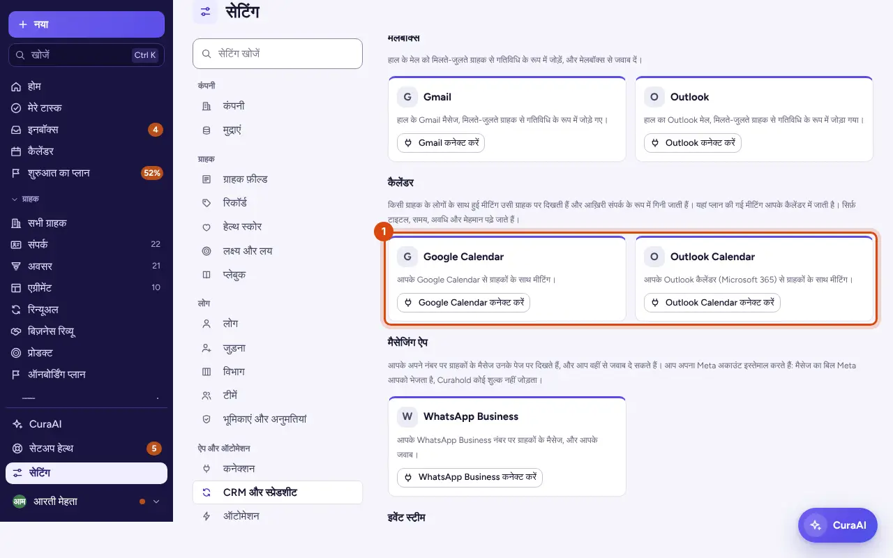

# Google Calendar और Outlook Calendar

अपना कैलेंडर कनेक्ट करें, और किसी ग्राहक के लोगों के साथ हुई हर मीटिंग उस ग्राहक की टाइमलाइन पर उसकी अवधि के साथ मीटिंग के रूप में दिखेगी। यह आख़िरी संपर्क के रूप में भी गिनी जाती है। ग्राहक की टाइमलाइन से आप सीधे अपने कैलेंडर में मीटिंग प्लान कर सकते हैं; न्योते कैलेंडर भेजता है।

## क्या पढ़ा जाता है, और क्या नहीं

आपके मुख्य कैलेंडर से सिर्फ़ वे मीटिंग जो हो चुकी हैं: टाइटल, समय, अवधि और मेहमान। विवरण, जगह या कॉल लिंक कभी नहीं। निजी मीटिंग, पूरे दिन की एंट्री और ऐसी मीटिंग जिनमें बाहर का कोई नहीं, छोड़ दी जाती हैं। मीटिंग उस ग्राहक के अंतर्गत रखी जाती है जिसका कोई संपर्क मेहमान है, या जिसका वेब पता किसी मेहमान का डोमेन है।

## Curahold में {#connect}

1. **सेटिंग → CRM और स्प्रेडशीट** खोलें, **कैलेंडर** ढूंढें और **Google Calendar कनेक्ट करें** या **Outlook Calendar कनेक्ट करें** पर क्लिक करें।
   

Google या Microsoft खुलता है। अपना ऑफ़िस वाला अकाउंट चुनें और **Allow** (Google) या **Accept** (Microsoft) पर क्लिक करें। Curahold में लौटकर **शुरू करें** पर क्लिक करें: पिछले 90 दिन पढ़े जाते हैं, फिर हर घंटे।

## मीटिंग प्लान करें

किसी ग्राहक के पेज पर **टाइमलाइन** खोलें और **Google Calendar में मीटिंग प्लान करें** (या Outlook) पर क्लिक करें। टाइटल, समय, अवधि और मेहमानों के ईमेल लिखें, फिर **… में जोड़ें** पर क्लिक करें। मीटिंग हो जाने के बाद वह टाइमलाइन पर दिखती है।

## सीमाएं और समय

हर घंटे पढ़ा जाता है; पिछले हफ़्ते की कोई मीटिंग जिसे खिसकाया गया या जिसका नाम बदला गया, अपडेट हो जाती है। रद्द हुई मीटिंग बनी रहती है: अगर वह नहीं हुई तो उसे टाइमलाइन से हटा दें (वह ट्रैश में जाती है)। Google और Microsoft प्रति मिनट अनुरोधों को सीमित करते हैं: व्यस्त होने का जवाब पढ़ना रोक देता है, जो अगली बार आगे बढ़ता है।

## अगर कुछ ग़लत हो जाए

अगर साइन-इन की अवधि ख़त्म हो जाए तो वह अपने आप नवीनीकृत होता है। अगर एक्सेस वापस ले लिया गया हो (बदला हुआ पासवर्ड, एडमिनिस्ट्रेटर का फ़ैसला), तो कनेक्शन **ध्यान देने की ज़रूरत** दिखाता है: **फिर से कनेक्ट करें** पर क्लिक करें और उसी अकाउंट से साइन इन करें। **हटाएं** साइन-इन मिटा देता है; टाइमलाइन पर पहले से मौजूद मीटिंग बनी रहती हैं।

## यह भी देखें

- [टाइमलाइन और हेल्थ स्कोर](/docs/hi/timeline-and-health/)
- [कनेक्शन और CRM](/docs/hi/connections/)
