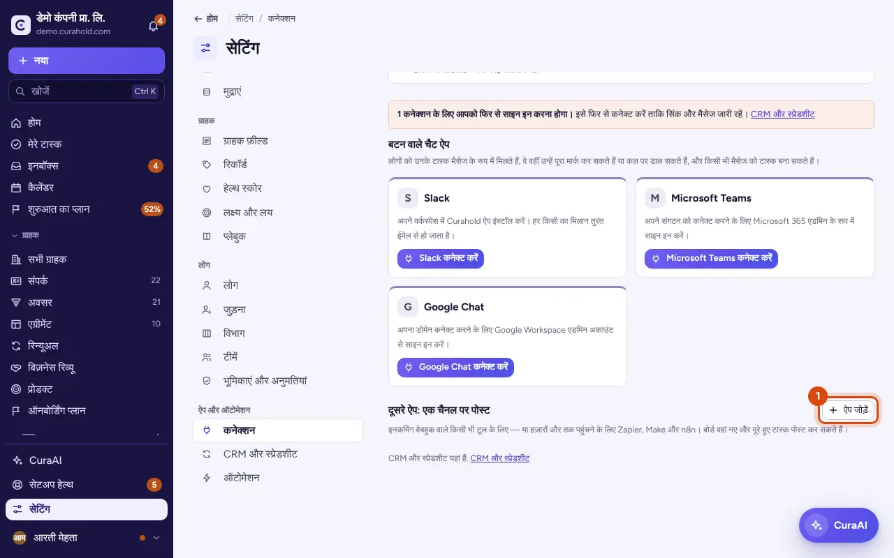
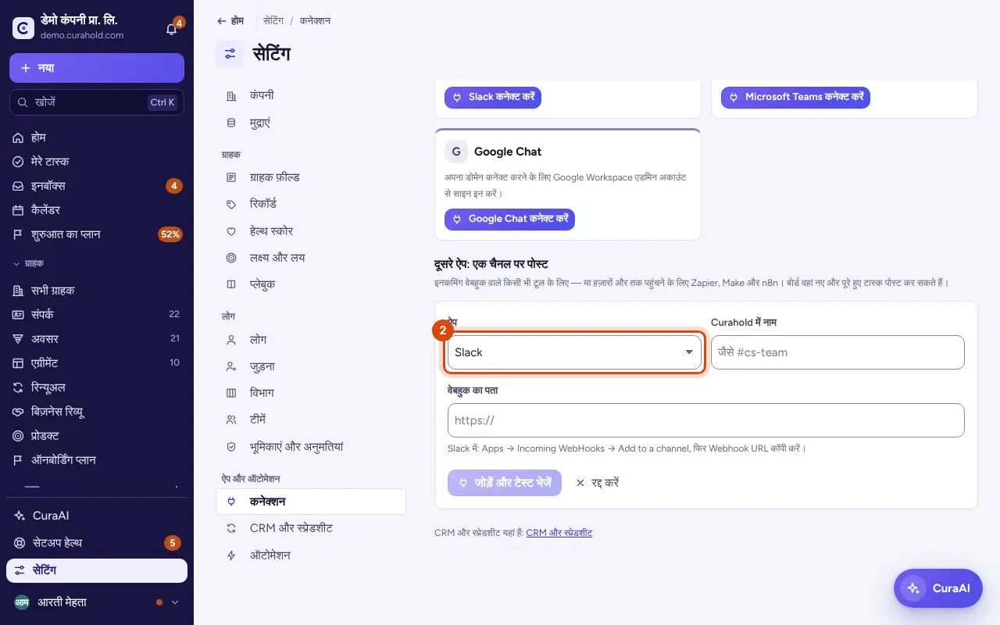

# Lark, Feishu और Telegram सूचनाएं

कोई बोर्ड अपनी ख़बरें (नया टास्क, पूरा हुआ टास्क) किसी ग्रुप चैट में पोस्ट कर सकता है। Lark और Feishu ग्रुप के कस्टम बॉट का इस्तेमाल करते हैं; Telegram एक ऐसे बॉट का, जिसे आप दो मिनट में बना लेते हैं। दोनों एकतरफ़ा हैं: वे पोस्ट करते हैं, उनके ज़रिए कोई जवाब वापस नहीं आता।

## Curahold में {#connect}

1. **सेटिंग → कनेक्शन** खोलें और **ऐप जोड़ें** पर क्लिक करें।
   
2. **ऐप** में **Lark · Feishu** या **Telegram** चुनें, नीचे के स्टेप से मिली जानकारी पेस्ट करें, और **जोड़ें और टेस्ट भेजें** पर क्लिक करें। ग्रुप में एक टेस्ट मैसेज आता है।
   

इसके बाद बोर्ड खोलें, **बोर्ड की सेटिंग → सूचनाएं** चुनें और जिन ख़बरों को आप चाहते हैं उनके लिए नया कनेक्शन चुनें।

## Lark या Feishu

1. ग्रुप में **Settings → Bots → Add bot → Custom bot** खोलें, एक नाम दें और **Add** पर क्लिक करें।
2. **webhook address** कॉपी करें। यह कुछ ऐसा दिखता है:

```text
https://open.larksuite.com/open-apis/bot/v2/hook/0f3c2a9e-7d1b-4c55-9a7e-2b8f6c1d3e4f
```

3. वैकल्पिक, लेकिन सुझाया गया: **Security settings** में **Signature verification** पर टिक करें और secret को Curahold में **साइनिंग सीक्रेट** में कॉपी करें। कीवर्ड फ़िल्टर इस्तेमाल न करें: उससे मैसेज छूट जाएंगे।

## Telegram

1. Telegram में **@BotFather** को लिखें, `/newbot` भेजें, उसके दो सवालों के जवाब दें और मिला हुआ **token** कॉपी करें।
2. बॉट को अपने ग्रुप में जोड़ें (चैनल के लिए: उसे एडमिनिस्ट्रेटर के रूप में जोड़ें)।
3. ग्रुप में एक मैसेज भेजें। Curahold उसी से ग्रुप ढूंढ लेता है, इसलिए आपको उसकी id की ज़रूरत नहीं।
4. token को Curahold में **बॉट टोकन** में पेस्ट करें। पब्लिक चैनल के लिए आप उसकी जगह उसका `@name` लिख सकते हैं।

## सीमाएं और समय

Lark हर बॉट से प्रति मिनट करीब 100 पोस्ट और Telegram हर ग्रुप में प्रति मिनट करीब 20 पोस्ट स्वीकार करता है; व्यस्त होने का जवाब मिलने पर दोबारा कोशिश की जाती है, कुछ खोता नहीं। Telegram मैसेज सादा टेक्स्ट होते हैं, ज़्यादा से ज़्यादा 4,096 अक्षर।

## अगर कुछ ग़लत हो जाए

ग़लत साइनिंग सीक्रेट, हटाया गया बॉट या रद्द किया गया टोकन सेटिंग → कनेक्शन में कनेक्शन को **ध्यान देने की ज़रूरत** के रूप में दिखाता है, और टेस्ट भी यही बताता है। दूसरी तरफ़ इसे ठीक करें, फिर दोबारा **टेस्ट भेजें** पर क्लिक करें: सफल टेस्ट समस्या हटा देता है। **हटाएं** पोस्ट रोक देता है; बॉट आपके ग्रुप में तब तक रहता है जब तक आप उसे वहां से न हटाएं।

## यह भी देखें

- [कनेक्शन और CRM](/docs/hi/connections/)
- [सूचनाएं](/docs/hi/notifications/)
