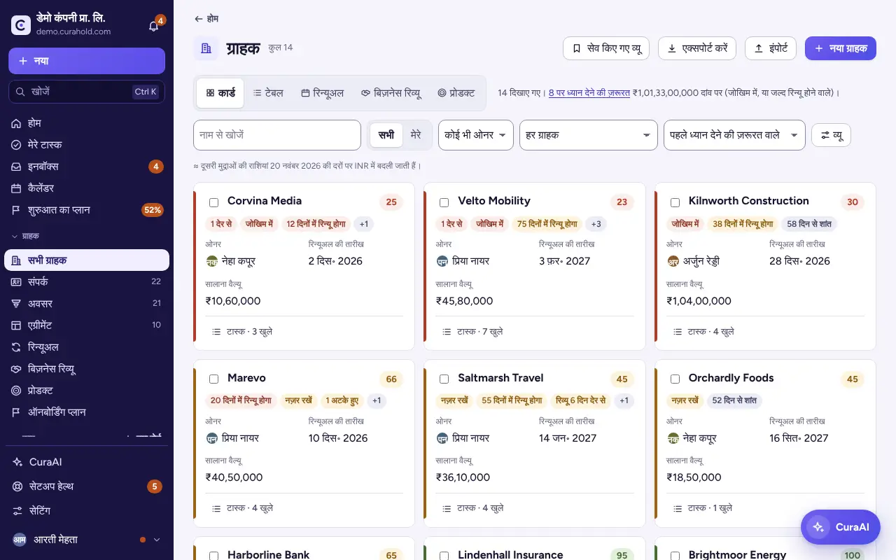
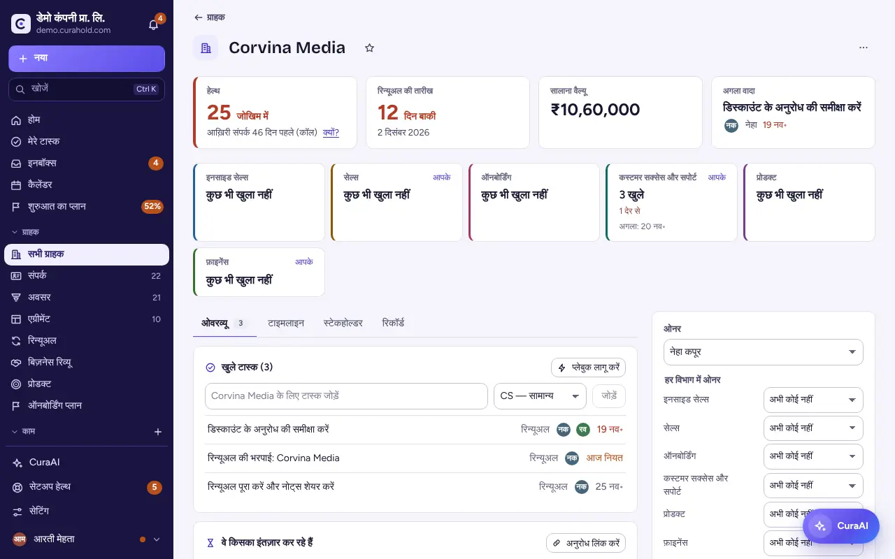

# ग्राहक, फ़ील्ड और रिकॉर्ड

ग्राहक Curahold के केंद्र में हैं। हर ग्राहक का एक ओनर, एक वैकल्पिक टीम और आपके अपने फ़ील्ड होते हैं।

## ग्राहक का पेज

ग्राहक के पेज पर सबसे ऊपर एक नज़र में पढ़ने लायक पट्टी होती है: अपनी वजह और **क्यों?** बटन के साथ **हेल्थ**, रिन्यूअल की तारीख और बचे दिन, सालाना वैल्यू, और **अगला वादा**: ग्राहक से किया गया सबसे नज़दीकी स्टेप, और उसे कौन संभाल रहा है। पट्टी के नीचे टैब हैं: **ओवरव्यू** (खुले टास्क और आने वाली मीटिंग), **टाइमलाइन**, **स्टेकहोल्डर**, **रिकॉर्ड** और **जानकारी**। खुला टैब पते में बना रहता है, इसलिए रीलोड या आपका भेजा लिंक उसी पर वापस आता है।

## फ़ील्ड

सेटिंग → ग्राहक फ़ील्ड में फ़ील्ड जोड़ें: टेक्स्ट, संख्या, रकम, तारीख, विकल्प, ईमेल, लिंक। विकल्पों का रंग हो सकता है, इसलिए हेल्थ जैसा फ़ील्ड सूचियों और कार्ड में उसी रंग में दिखता है।

आप "ग्राहक" का नाम भी बदल सकते हैं: "अकाउंट", "ब्रांड", "पार्टनर" — आपकी टीम जो भी कहती है, वह इंटरफ़ेस में हर जगह दिखता है।

## रिकॉर्ड: संपर्क, अवसर और भी बहुत कुछ

ग्राहकों के तहत रिकॉर्ड रखें:

- **संपर्क (स्टेकहोल्डर):** जॉब टाइटल, निर्णय में भूमिका (निर्णय लेने वाला, बजट मंज़ूर करने वाला, प्रभावित करने वाला, मूल्यांकन करने वाला, यूज़र) और आपके प्रति रुख (चैंपियन, समर्थक, तटस्थ, शक करने वाला, रुकावट डालने वाला)।
- **अवसर:** रकम, क्लोज़ होने की तारीख, स्टेज और स्टेटस।
- **आपके अपने तरह के रिकॉर्ड:** जैसे "प्रोजेक्ट" या "कॉन्ट्रैक्ट"।

रिकॉर्ड ग्राहक फ़ील्ड भर सकते हैं: "खुली पाइपलाइन", "चैंपियन", "रुकावट डालने वाले"। रिकॉर्ड बदलने पर फ़ील्ड अपने आप अपडेट हो जाता है।

## व्यू: कार्ड, टेबल, रिन्यूअल, प्रोडक्ट

ग्राहक पेज के ऊपर के बटनों से चार व्यू के बीच बदलें; आपका चुनाव उस डिवाइस पर याद रखा जाता है।

- **कार्ड:** हर ग्राहक का एक कार्ड, जो बताता है कि किस पर नज़र डालनी है: देर वाले टास्क, जोखिम में या नज़र रखने लायक हेल्थ, आने वाला या बीत चुका रिन्यूअल, 14 दिनों से बिना छुए टास्क, 30 दिनों से कोई संपर्क नहीं। सबसे गंभीर पहले; कुछ न हो तो "सब ठीक"। कार्ड डिफ़ॉल्ट रूप से "पहले जिन्हें ध्यान चाहिए" क्रम में आते हैं और नाम, हेल्थ, वैल्यू, रिन्यूअल या खुले टास्क के हिसाब से क्रम लगाए जा सकते हैं। कार्ड पर कौन-से फ़ील्ड दिखें, यह **व्यू** मेन्यू से चुनें।
- **टेबल:** क्रम लगाई जा सकने वाली सूची, जिसमें आप कई ग्राहकों को एक साथ बदल सकते हैं।
- **रिन्यूअल:** अगले 12 महीनों के रिन्यूअल, महीने-दर-महीने, हर महीने के कुल और उसमें से कितना जोखिम में या नज़र रखने लायक है।
- **प्रोडक्ट:** किसके पास कौन-सा प्रोडक्ट है, किसी रिकॉर्ड प्रकार के विकल्प फ़ील्ड के हिसाब से (जैसे "सब्सक्रिप्शन → प्रोडक्ट")। खाली सेल में **+** उस ग्राहक के लिए क्रॉस-सेल टास्क खोलता है।

ऊपर का वाक्य बताता है कि कितने ग्राहकों को ध्यान चाहिए और कितनी वैल्यू जोखिम में है; "ध्यान देने की ज़रूरत" लिंक सूची को उन्हीं तक सीमित कर देता है। फ़ोन पर फ़िल्टर एक ही **फ़िल्टर** शीट पर साथ होते हैं।

## रिन्यूअल जोड़ना

रिन्यूअल ग्राहक की **रिन्यूअल की तारीख** है। ग्राहक खोलें और **जानकारी** में इसे भरें, या इंपोर्ट करते समय इसे एक कॉलम में लाएं। इसके बाद ग्राहक **रिन्यूअल** में अपने महीने में, अपनी वैल्यू के साथ दिखता है। ऐसा फ़ील्ड अभी नहीं है? सेटिंग → ग्राहक फ़ील्ड में एक तारीख फ़ील्ड जोड़ें। रिन्यूअल का काम अपने आप शुरू हो, इसके लिए सेटिंग → **लक्ष्य और लय** में **रिन्यूअल अपने आप शुरू करें** चालू करें और चुनें कि कितने दिन पहले और किस प्लेबुक के साथ।

## इंपोर्ट करना

Excel या CSV फ़ाइल डालें, कॉलम को फ़ील्ड से मिलाएं, प्रीव्यू जांचें, इंपोर्ट करें। गलत हुए इंपोर्ट को 30 दिन तक एक क्लिक में वापस लिया जा सकता है।

## एक्सपोर्ट करना

ग्राहक और रिकॉर्ड की सूचियां, आपके लगाए फ़िल्टर के साथ, Excel या CSV के रूप में डाउनलोड करें। फ़ाइल आपके ब्राउज़र में बनती है, और जो फ़ील्ड आप नहीं देख सकते वे उसमें भी नहीं होते।

## एक साथ कई बदलना

सूची में कई ग्राहक चुनें और उनका ओनर, टीम या कोई फ़ील्ड एक साथ बदलें। नीचे की सूचना **पहले जैसा करें** देती है।

## ग्राहक हटाना, और हटाया गया ग्राहक वापस पाना

हटाया गया ग्राहक अपने रिकॉर्ड, टाइमलाइन, मीटिंग और पोर्टल के लोगों के साथ [ट्रैश](/docs/hi/trash/) में जाता है, और उसे 30 दिन तक वापस लाया जा सकता है: हटाने के ठीक बाद सूचना में **पहले जैसा करें** चुनें, या अपना मेन्यू खोलें, **ट्रैश** चुनें और फिर **वापस लाएं**। उसके टास्क बिना ग्राहक के अपने बोर्ड पर रहते हैं, और उसके लौटने पर फिर से उसकी ओर इशारा करते हैं। किसी ग्राहक को हटाए बिना रास्ते से हटाने के लिए उसे आर्काइव करें।

## प्लेबुक

**प्लेबुक** तारीख वाले टास्क का एक सेट है जो एक क्लिक में किसी ग्राहक पर लगाया जाता है: ऑनबोर्डिंग, रिन्यूअल की तैयारी, QBR। एडमिन इसे सेटिंग → **प्लेबुक** में एक बार लिखता है (टास्क का शीर्षक, शुरुआत के कितने दिन बाद, किसके लिए); ग्राहक के पेज पर **प्लेबुक लागू करें** से आप शुरुआत का दिन चुनकर सभी टास्क जोड़ सकते हैं। शीर्षक में `{account_name}` ग्राहक के नाम में बदल जाता है।

## बिज़नेस रिव्यू

एक बार तय करें कि आप हर ग्राहक के साथ कितनी बार बैठते हैं: सेटिंग → **लक्ष्य और लय** → *बिज़नेस रिव्यू* (जैसे हर 90 दिन)। किसी एक ग्राहक की अपनी लय उसके पेज पर **बिज़नेस रिव्यू** फ़ील्ड में हो सकती है; "कोई रिव्यू नहीं" उस ग्राहक को लय से बाहर रखता है।

बिज़नेस रिव्यू वह मीटिंग है जो आप हर ग्राहक के साथ समय-समय पर (QBR) नतीजों और योजनाओं पर बात करने के लिए करते हैं। **ग्राहक → बिज़नेस रिव्यू** उन रिव्यू की सूची देता है जो ड्यू हैं: देर से, अगले 30 दिनों में, और बाद में। रिव्यू हो जाने पर पंक्ति (या ग्राहक के पेज) पर **पूरा हुआ** मीटिंग फ़ॉर्म खोलता है; सेव होने पर यह ग्राहक की **मीटिंग** और टाइमलाइन में "बिज़नेस रिव्यू" के रूप में आता है, और अगली तारीख अपने आप आगे बढ़ जाती है। जिस ग्राहक का कभी रिव्यू नहीं हुआ, उसकी गिनती उसके जोड़े जाने के दिन से शुरू होती है। देर से चल रहा रिव्यू ग्राहक के कार्ड पर एक निशान के रूप में भी दिखता है।

## मीटिंग

ग्राहक के पेज पर **मीटिंग** उस ग्राहक के साथ हुई हर मीटिंग, बिज़नेस रिव्यू और कॉल की सूची देता है, सबसे नई पहले: तारीख, प्रकार, शीर्षक, अवधि, किसने दर्ज किया, कौन मौजूद था (उनकी तरफ़ और हमारी), नोट और अगले स्टेप। इसके ऊपर के बटन सिर्फ़ एक प्रकार दिखाते हैं; अगले बिज़नेस रिव्यू की तारीख हेडिंग के पास होती है।

**मीटिंग दर्ज करें** (ग्राहक के पेज पर, या **+ नया → मीटिंग, कॉल या नोट दर्ज करें**) ये चीज़ें पूछता है:

- प्रकार (मीटिंग, बिज़नेस रिव्यू, कॉल), शीर्षक, तारीख और अवधि,
- उनके लोग जो मौजूद थे (ग्राहक के संपर्क) और हमारे,
- नोट: किस बारे में बात हुई और क्या तय हुआ,
- अगले स्टेप: हर एक, कौन करेगा और कब तक के साथ, आपके चुने बोर्ड पर इस ग्राहक का टास्क बन जाता है।

अगले स्टेप मीटिंग के नीचे अपनी प्रगति के साथ दिखते हैं (पूरे हुए स्टेप कटे हुए); टास्क खोलने के लिए किसी पर क्लिक करें। मीटिंग को बाद में बदला जा सकता है, उसमें और अगले स्टेप जोड़े जा सकते हैं, या उसे हटाया जा सकता है; हटाई गई मीटिंग के टास्क बने रहते हैं, और मीटिंग खुद 30 दिन तक [ट्रैश](/docs/hi/trash/) से वापस लाई जा सकती है।
