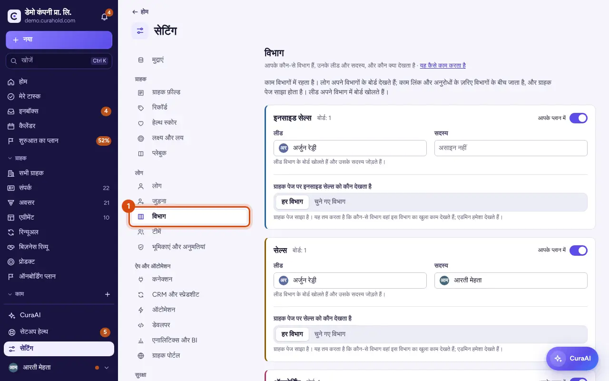
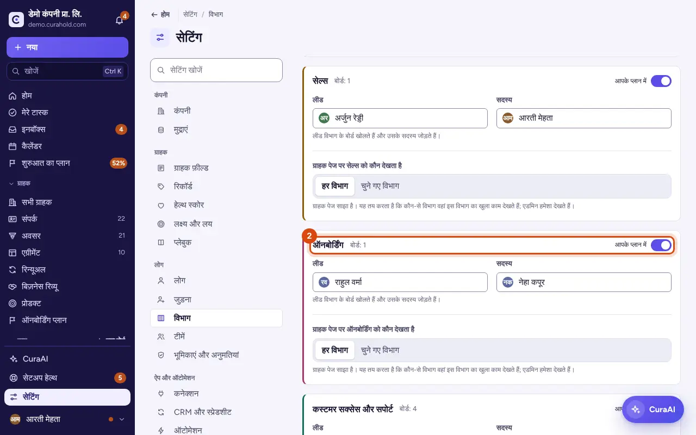
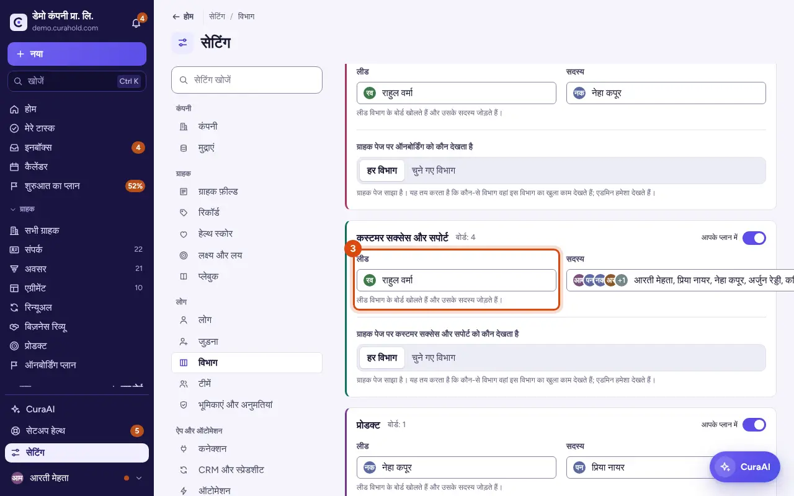
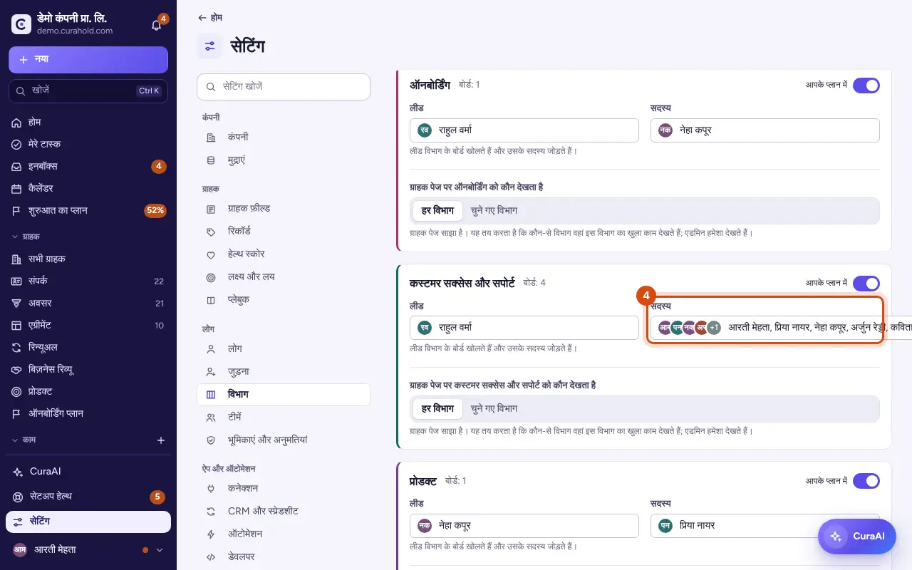
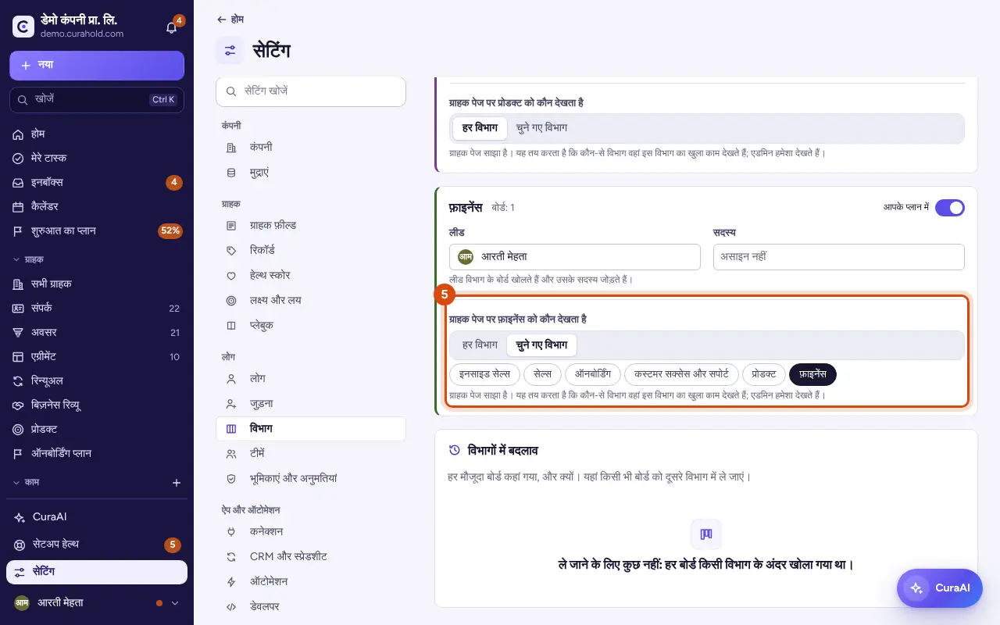
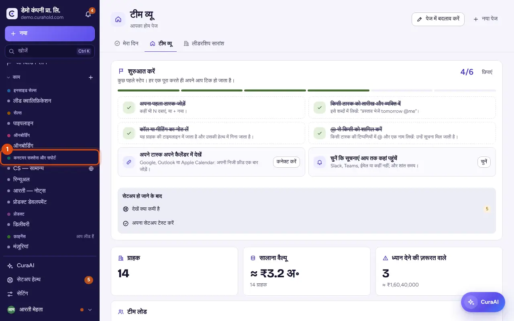
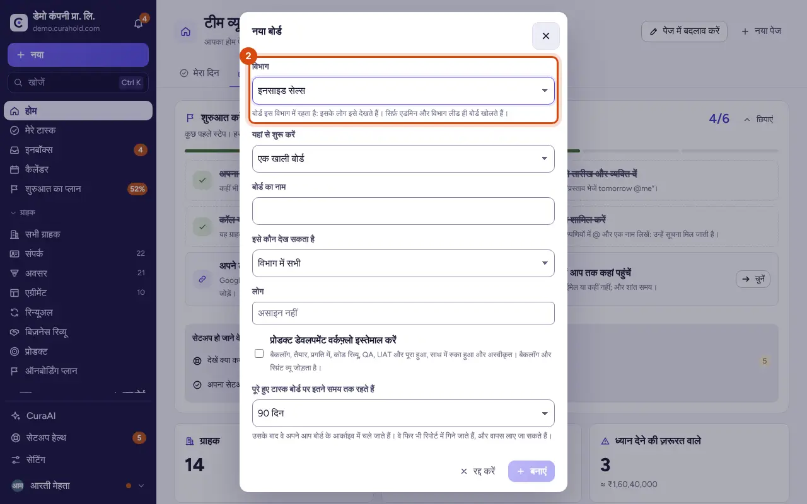
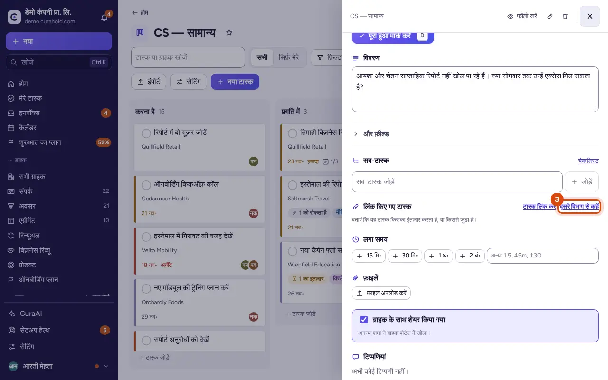
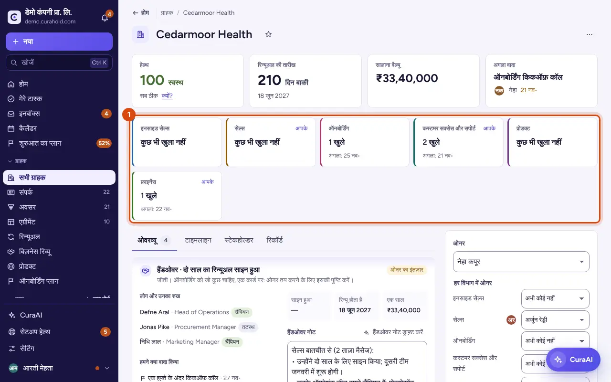
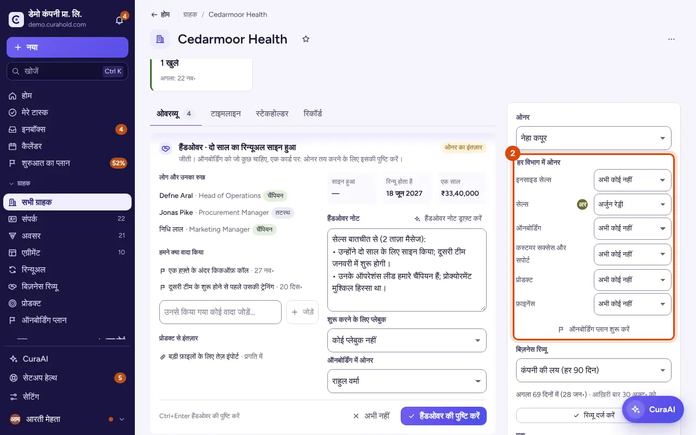

# विभाग

Curahold में काम विभागों में रहता है: इनसाइड सेल्स, सेल्स, ऑनबोर्डिंग, कस्टमर सक्सेस और सपोर्ट, प्रोडक्ट और फ़ाइनेंस। हर व्यक्ति अपने विभागों के बोर्ड देखता है। काम किसी अनुरोध के ज़रिए दूसरे विभाग में जाता है, और ग्राहक का पेज उन सभी के साथ शेयर होता है जो उस ग्राहक को देख सकते हैं।

## अपने विभाग सेट अप करें {#set-up}

आपको एडमिन (या लोगों को संभालने वाला व्यक्ति) होना चाहिए।

1. बाईं ओर के मेन्यू में **सेटिंग** पर क्लिक करें, फिर **विभाग** (**लोग** के तहत)।
   
2. आपकी कंपनी में जो भी विभाग हैं, उन सभी के लिए **आपके प्लान में** चालू रहने दें। जिसका आप इस्तेमाल नहीं करते, उसके लिए इसे बंद करें: वह सबसे छिप जाता है, और उसके बोर्ड तब तक रखे रहते हैं जब तक आप उसे फिर से चालू नहीं करते।
   
3. **लीड** में चुनें कि विभाग को कौन लीड करता है। लीड विभाग के बोर्ड खोलते हैं और उसके सदस्य जोड़ते हैं।
   
4. **सदस्य** में बाकी सभी चुनें जो उसमें काम करते हैं। एक व्यक्ति एक से ज़्यादा विभागों में हो सकता है।
   
5. **ग्राहक के पेज पर … कौन देखता है** में **हर विभाग** चुनें, या **चुने गए विभाग** चुनें और उन पर क्लिक करें जो वहां इस विभाग का खुला काम देख सकते हैं। एडमिन इसे हमेशा देखते हैं। फ़ाइनेंस की शुरुआत सिर्फ़ फ़ाइनेंस से होती है।
   

सब कुछ साथ-साथ सेव होता जाता है। जो व्यक्ति अभी किसी विभाग में नहीं है, वह अपना काम **मेरे टास्क** में तब तक रखता है जब तक आप उसे जोड़ नहीं देते।

जब आपकी कंपनी विभागों में बदली, तो हर मौजूदा बोर्ड किसी एक विभाग में रखा गया। उसी पेज के नीचे **विभागों में बदलाव** दिखाता है कि हर बोर्ड कहां गया और क्यों; वहीं किसी बोर्ड का विभाग बदलें। **जगह देने के लिए लोग** उन लोगों की सूची देता है जो पहले कोई बोर्ड देख सकते थे पर उस पर काम नहीं करते: **एक्सेस दें** उन्हें सदस्य बना देता है।

## किसी विभाग के बोर्ड {#boards}

1. मेन्यू में बोर्ड अपने विभाग के नाम के तहत समूह में होते हैं। जिस विभाग को आप लीड करते हैं, उसके पास **आप लीड हैं** दिखता है।
   
2. नया बोर्ड खोलने के लिए **काम** के पास **+** पर क्लिक करें। **विभाग** में चुनें कि बोर्ड कहां रहेगा, फिर उसे नाम दें और **बनाएं** पर क्लिक करें। सिर्फ़ एडमिन और विभाग के लीड बोर्ड खोलते हैं।
   

**इसे कौन देख सकता है** डिफ़ॉल्ट रूप से **विभाग में सभी** होता है; आप इसे किसी टीम या चुने हुए लोगों तक सीमित कर सकते हैं।

## दूसरे विभाग से कहें {#ask}

1. वह टास्क खोलें जिसके बारे में अनुरोध है और **दूसरे विभाग से कहें** पर क्लिक करें। सूची में उस विभाग का बोर्ड चुनें, उसका अनुरोध फ़ॉर्म भरें और भेजें।
   

अनुरोध उस विभाग के बोर्ड पर पहुंचता है और आपके टास्क से जुड़ जाता है। आप उसका शीर्षक और उसकी स्थिति देखते हैं, दूसरे विभाग का बोर्ड कभी नहीं। कोई विभाग अनुरोध तब लेता है जब उसका लीड किसी बोर्ड का अनुरोध फ़ॉर्म चालू करता है (**बोर्ड की सेटिंग → फ़ील्ड और अनुरोध फ़ॉर्म**)।

## ग्राहक के पेज पर {#customer-page}

1. ग्राहक के पेज पर **सभी विभागों में** उस ग्राहक के लिए हर विभाग का खुला काम दिखाता है, उसमें से कितना देर से है और अगली ड्यू डेट। **आपके** उन विभागों पर लगा होता है जिनमें आप हैं।
   
2. दाईं ओर **हर विभाग में ओनर** दिखाता है कि हर विभाग में ग्राहक की देखभाल कौन करता है। किसी को तय करने के लिए व्यक्ति चुनें।
   

विभागों के बीच हैंडओवर (जीती गई डील का ऑनबोर्डिंग या कस्टमर सक्सेस में जाना) [हैंडओवर, अनुरोध और वापसी का लूप](/docs/hi/handover-and-requests/) पर है।
