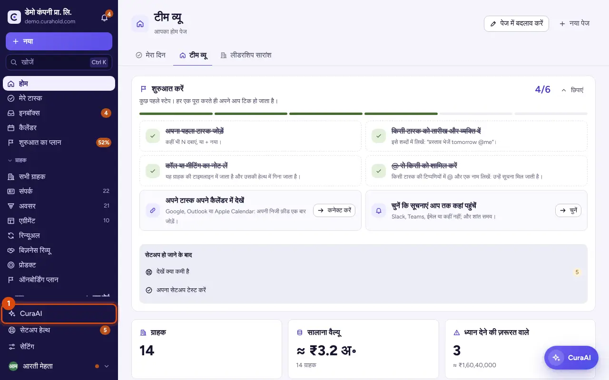
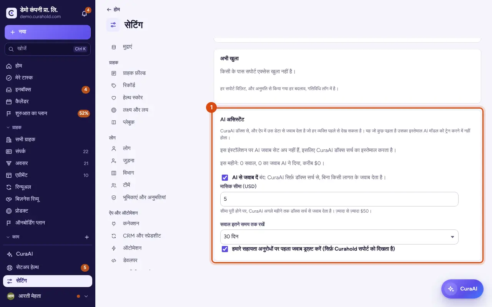
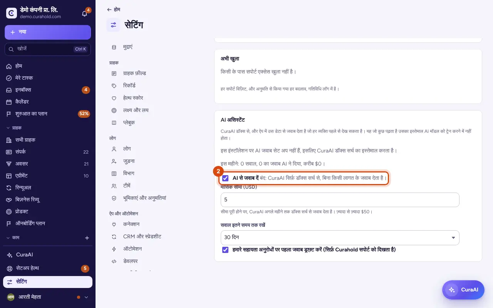

# सहायता पाना

दो स्टेप, इसी क्रम में: **पूछें**, और अगर उससे बात नहीं बनी, तो **सपोर्ट को लिखें**।

## पहले पूछें {#ask}

1. बाईं ओर के मेन्यू में **CuraAI** पर क्लिक करें (फ़ोन पर नीचे दाईं ओर का बटन; इन डॉक्स पर **पूछें** बटन)। अपना सवाल अपने शब्दों में लिखें: "ग्राहक कैसे इंपोर्ट करें", "यह फ़ील्ड कौन देख सकता है"।
   

जवाब इन डॉक्स से आता है, साथ में वह जगह भी जहां से आया। जब आपकी कंपनी में **AI जवाब** चालू हों (नीचे देखें), तो CuraAI वह भी पढ़ता है जो आप Curahold में पहले से देख सकते हैं, जैसे आपके ग्राहक, रिन्यूअल और टास्क, ताकि आप पूछ सकें "अगले 90 दिनों में क्या रिन्यू होगा?"। यह सिर्फ़ पढ़ता है; कभी कुछ नहीं बदलता। जब AI जवाब बंद हों, सेट अप न हों या महीने की सीमा पार हो गई हो, तो डॉक्स आपके अपने डिवाइस पर खोजे जाते हैं और आपका टाइप किया कुछ भी कहीं नहीं भेजा जाता।

अगर जवाब वह नहीं है जो आपको चाहिए था, तो बताएं: आपको अगली सबसे नज़दीकी जगहें मिलती हैं, और आपके सवाल के साथ पहले से भरा सपोर्ट को लिखने का बटन।

## सपोर्ट से संपर्क: अनुरोध भेजना

CuraAI के नीचे **सपोर्ट को लिखें** इस्तेमाल करें। फ़ॉर्म वह पूछता है जो सपोर्ट को समस्या ढूंढने के लिए चाहिए, ताकि उन्हें सवालों के साथ आपके पास वापस न आना पड़े। जो आपने नहीं देखा, वह कुछ भी नहीं भेजा जाता; क्या जाएगा, यह आप चुनते हैं।

1. **विषय**: कुछ काम नहीं कर रहा, मैं कैसे…?, डेटा या कनेक्शन, एक आइडिया, या बिलिंग और प्लान।
2. **असर**: गड़बड़ियों और डेटा की समस्याओं के लिए बताएं कि क्या इससे आपका काम रुक रहा है। सपोर्ट का क्रम इसी पर चलता है।
3. **शीर्षक**: कुछ शब्द। टाइप करते समय वे डॉक्स पेज सुझाए जाते हैं जिनमें शायद पहले से जवाब हो।
4. **क्या हुआ**: आप क्या करने की कोशिश कर रहे थे, आपको क्या उम्मीद थी और इसकी जगह क्या हुआ। अगर कोई गड़बड़ी का मैसेज था, तो उसे शब्दशः कॉपी करें।
5. **हम इसे होते हुए कैसे देख सकते हैं**: गड़बड़ियों के लिए, स्टेप-दर-स्टेप (वैकल्पिक, पर इससे बहुत मदद मिलती है)।

6. **जानकारी में रखें** और **कब तक चाहिए** (दोनों वैकल्पिक): वे सहकर्मी जिन्हें अनुरोध पढ़ना और जवाब सुनना चाहिए, और वह दिन जब तक आपको इसकी ज़रूरत है।

आपको एक **रेफ़रेंस** (जैसे CH-000123) और ईमेल से एक कॉपी मिलती है।

## बातचीत: जवाब, रिप्लाई, और किसकी बारी है

अनुरोध एक बातचीत है। इसे **मेरे अनुरोध** में खोलें (CuraAI के ऊपर इनबॉक्स बटन):

- **सपोर्ट का जवाब** ईमेल से और अनुरोध पर आता है। CuraAI बटन पर एक निशान बताता है कि कोई जवाब इंतज़ार कर रहा है।
- प्रोडक्ट में **जवाब दें**, या बस **ईमेल का जवाब दें**: उद्धृत हिस्से के ऊपर आप जो लिखते हैं, वह अनुरोध पर आता है।
- अनुरोध बताता है कि **किसकी बारी है**: *सपोर्ट के पास*, *आपके जवाब का इंतज़ार*, या *हल हुआ*। **हल हुआ मार्क करें** इसे बंद करता है; फिर से लिखने पर यह खुल जाता है।
- **जानकारी में रखे गए सहकर्मी** अनुरोध पढ़ते हैं, सपोर्ट के जवाब ईमेल से पाते हैं और जवाब दे सकते हैं। सिर्फ़ पूछने वाला व्यक्ति ही उन्हें जोड़ता या हटाता है। एडमिन कंपनी का कोई भी अनुरोध पढ़ सकता है पर जवाब सिर्फ़ अपने अनुरोधों पर देता है।
- Curahold की टीम किसी अनुरोध पर **अपने नोट** रख सकती है। ये कभी आपकी कंपनी को दिखाए या भेजे नहीं जाते।

## स्क्रीनशॉट और फ़ाइलें

- **स्क्रीनशॉट लें**: ब्राउज़र पूछता है कि कौन-सा टैब शेयर करना है; Curahold टैब चुनें। सहायता विंडो हट जाती है, ताकि सिर्फ़ पेज कैप्चर हो।
- **पेस्ट करें या छोड़ें**: कॉपी की गई तस्वीर फ़ॉर्म में पेस्ट करें, या फ़ाइलें उस पर छोड़ें।
- **निशान लगाएं**: ज़रूरी चीज़ को लाल फ़्रेम से हाइलाइट करें। **छिपाएं** वह सब ढक देता है जो सपोर्ट को नहीं देखना चाहिए (किसी ग्राहक का नाम, कोई रकम); इसे भेजी जाने वाली तस्वीर से हटा दिया जाता है।

6 फ़ाइलें तक, हर एक 10 MB तक। तस्वीरें, PDF, टेक्स्ट, CSV, JSON, Excel और छोटे वीडियो।

## अनुरोध में जोड़ी जाने वाली तकनीकी जानकारी

फ़ॉर्म इन्हें अपने आप जोड़ता है और भेजने से पहले आपको दिखाता है:

| जानकारी | यह कैसे मदद करती है |
|---|---|
| पेज का पता | समस्या कहां है। पते के गोपनीय हिस्से (साइन-इन कोड और ऐसे ही) हटा दिए जाते हैं। |
| ब्राउज़र, स्क्रीन, ऐप का वर्शन | उन समस्याओं के लिए जो सिर्फ़ एक ब्राउज़र में होती हैं। |
| आपके खोले आखिरी पेज | आप वहां कैसे पहुंचे। सिर्फ़ पते, पेज की सामग्री नहीं। |
| पेज पर गड़बड़ियां | बैकग्राउंड से आए गड़बड़ी के मैसेज। ईमेल पते और की जैसे टेक्स्ट छिपा दिए जाते हैं। |
| फ़ेल हुए अनुरोध | कौन-सा काम फ़ेल हुआ (पाथ और स्टेटस कोड)। |
| अभी क्या खुला है | आपका खुला ग्राहक, बोर्ड या टास्क। |

जो आप नहीं भेजना चाहते, उससे टिक हटा दें। आपका टाइप किया कुछ भी और पेज का कोई डेटा इस जानकारी का हिस्सा नहीं है।

## सपोर्ट को अपना अकाउंट देखने देना

कुछ समस्याएं देखे बिना ठीक करना मुश्किल होता है। फ़ॉर्म के आखिर में **Curahold सपोर्ट को मेरा अकाउंट देखने दें** बॉक्स इसी के लिए है। यह कभी आपके लिए अपने आप टिक नहीं होता।

- **सपोर्ट क्या देखता है**: ठीक वही जो आप देखते हैं — वही ग्राहक, बोर्ड और फ़ील्ड। इससे ज़्यादा कुछ नहीं।
- **कितने समय के लिए**: 24 घंटे, 3 दिन या 7 दिन। एक्सेस अपने आप खत्म होता है। सपोर्ट की हर विज़िट ज़्यादा से ज़्यादा 8 घंटे चलती है।
- **सपोर्ट क्या कर सकता है**: **सिर्फ़ देखना**। सपोर्ट आपके अकाउंट में कभी कुछ नहीं बदलता।
- **कभी पहुंच में नहीं**: आपके डिवाइस और सेशन, API की, ऐप और वेबहुक, लोगों को आमंत्रित करना, भूमिकाएं, कंपनी की सेटिंग, डेटा एक्सपोर्ट करना या मिटाना। सपोर्ट अपना एक्सेस खुद नहीं बढ़ा सकता।
- **इसे बंद करना**: कभी भी, **सहायता → मेरे अनुरोध → एक्सेस बंद करें** में। चल रही सपोर्ट विज़िट तुरंत खत्म हो जाती है। जब तक एक्सेस खुला है, पेज के ऊपर एक पट्टी आपको याद दिलाती है।
- **रिकॉर्ड**: सपोर्ट की हर विज़िट, और उस दौरान सपोर्ट जो पढ़ता है, सपोर्ट व्यक्ति के नाम के साथ **सेटिंग → गतिविधि लॉग** में लिखा जाता है।

जब सपोर्ट अंदर हो, तो स्क्रीन के ऊपर एक पट्टी दिखाती है कि कौन देख रहा है और कब तक।

## कंपनी की सेटिंग (एडमिन)

**सेटिंग → सुरक्षा → सपोर्ट एक्सेस** में चुनें कि सपोर्ट को अंदर आने की अनुमति कौन दे सकता है:

- **कोई भी**: उतने के लिए जितना वे खुद देख सकते हैं (डिफ़ॉल्ट)।
- **सिर्फ़ एडमिन**: बाकी सभी का खुला एक्सेस अभी खत्म हो जाता है।
- **कोई नहीं**: सपोर्ट अब भी ईमेल से जवाब दे सकता है, पर अंदर नहीं आ सकता।

यही पेज अभी खुले एक्सेस की सूची देता है, किसने दिया और आखिरी विज़िट, और आपको इनमें से कोई भी बंद करने देता है।

## सपोर्ट के लिए सेशन रिकॉर्डिंग

ताकि कुछ टूटने पर सपोर्ट देख सके कि क्या हुआ — आपसे बताने को कहने के बजाय — पेज आपके इस्तेमाल के दौरान खुद को रिकॉर्ड करता है (कौन-से बटन, कौन-सी स्क्रीन, ऐप ने क्या दिखाया)। यह सपोर्ट को अपना अकाउंट देखने देने से अलग है; यह बैकग्राउंड में चुपचाप चलता है।

- **आपका टाइप किया कुछ भी रिकॉर्ड नहीं होता।** हर फ़ील्ड — सर्च, नोट, आपकी भरी ग्राहक जानकारी — छिपा दी जाती है। रिकॉर्डिंग इंटरफ़ेस की होती है, उसमें आपके लिखे की नहीं।
- **7 दिन तक रखी जाती है**, फिर हटा दी जाती है।
- **सिर्फ़ Curahold की सपोर्ट टीम रिकॉर्डिंग खोल सकती है**, अपने डेस्क से, और हर बार खोले जाने पर यह सपोर्ट डेस्क के लॉग में लिखा जाता है। आपकी कंपनी अपनी रिकॉर्डिंग नहीं देखती।
- **एडमिन इसे बंद कर सकते हैं** **सेटिंग → सुरक्षा → सपोर्ट एक्सेस → सपोर्ट के लिए सेशन रिकॉर्डिंग** में। बंद होने पर कुछ भी रिकॉर्ड नहीं होता।

अगर आपके संगठन को अपने लोगों को प्राइवेसी नोटिस में इसके बारे में बताना है, तो वह स्विच और यह पेज उसका आधार हैं।

## AI जवाब (एडमिन) {#ai-answers}

1. **सेटिंग → सपोर्ट एक्सेस** खोलें और **AI असिस्टेंट** तक स्क्रॉल करें।
   
2. CuraAI को AI से जवाब देने देने के लिए **AI से जवाब दें** पर टिक करें, या बिना किसी लागत के सिर्फ़ डॉक्स सर्च से जवाब देने के लिए टिक हटाएं। CuraAI जो पढ़ता है, उसका इस्तेमाल कभी AI मॉडल को ट्रेन करने के लिए नहीं होता। नई कंपनी में यह **बंद** से शुरू होता है: जब तक कोई एडमिन इस पर टिक नहीं करता, AI प्रोवाइडर को कुछ नहीं भेजा जाता, और बंद रहने तक कार्ड यही बताता है।
   

उसी कार्ड पर:

- **मासिक सीमा (USD)**: इस तक पहुंचने पर CuraAI अगले महीने तक डॉक्स सर्च से जवाब देता है। कार्ड इस महीने के सवाल और उनकी लागत दिखाता है।
- **सवाल इतने समय तक रखें**: सवाल कितने समय तक रखे जाएं (या बिल्कुल नहीं)। किसी व्यक्ति के अपने सवाल उसके निजी डेटा डाउनलोड में होते हैं।
- **हमारे सहायता अनुरोधों पर पहला जवाब ड्राफ़्ट करें**: Curahold सपोर्ट आपके अनुरोधों का ड्राफ़्ट किया गया पहला जवाब देखता है; आप ड्राफ़्ट कभी नहीं देखते, सिर्फ़ सपोर्ट का असली जवाब।

अगर कार्ड कहे कि इस इंस्टॉलेशन पर AI जवाब सेट अप नहीं हैं, तो CuraAI डॉक्स सर्च इस्तेमाल करता है; आपका Curahold सर्वर चलाने वाला व्यक्ति AI की जोड़ता है।

**हर किसी से पहले पूछा जाता है।** जहां AI जवाब चालू हैं, वहां कोई पहली बार CuraAI खोलता है तो CuraAI बताता है कि AI प्रोवाइडर को क्या भेजा जाता है, क्यों, कितने समय के लिए, और प्राइवेसी नोटिस का लिंक देता है, **स्वीकार करें** और **मना करें** के साथ (उनके लिए कुछ भी पहले से टिक नहीं होता)। स्वीकार करने तक उनका टाइप किया कुछ भी उनके डिवाइस से बाहर नहीं जाता और डॉक्स सर्च जवाब देता है; मना करने से उनका कुछ नहीं खोता। वे कभी भी CuraAI के नीचे या **आपकी सेटिंग → AI असिस्टेंट की सहमति** में सहमति वापस ले सकते हैं, और सूचना बदलने पर उनसे फिर पूछा जाता है। सर्वर "हां" के बिना कोई सवाल स्वीकार नहीं करता, और हर जवाब गतिविधि लॉग में होता है। ग्राहक पोर्टल और सार्वजनिक डॉक्स भी इसी तरह पूछते हैं।

## गड़बड़ी लॉग (एडमिन) {#errors}

**सेटिंग → गड़बड़ियां** बताता है कि पिछले 30 दिनों में आपके लोगों के लिए क्या गलत हुआ और कहां: स्क्रीन, फ़ेल हुआ अनुरोध और कितनी बार। इसमें कुछ भी निजी नहीं है। सपोर्ट को लिखते समय वहां जो दिखे, वह साथ लगाएं।
