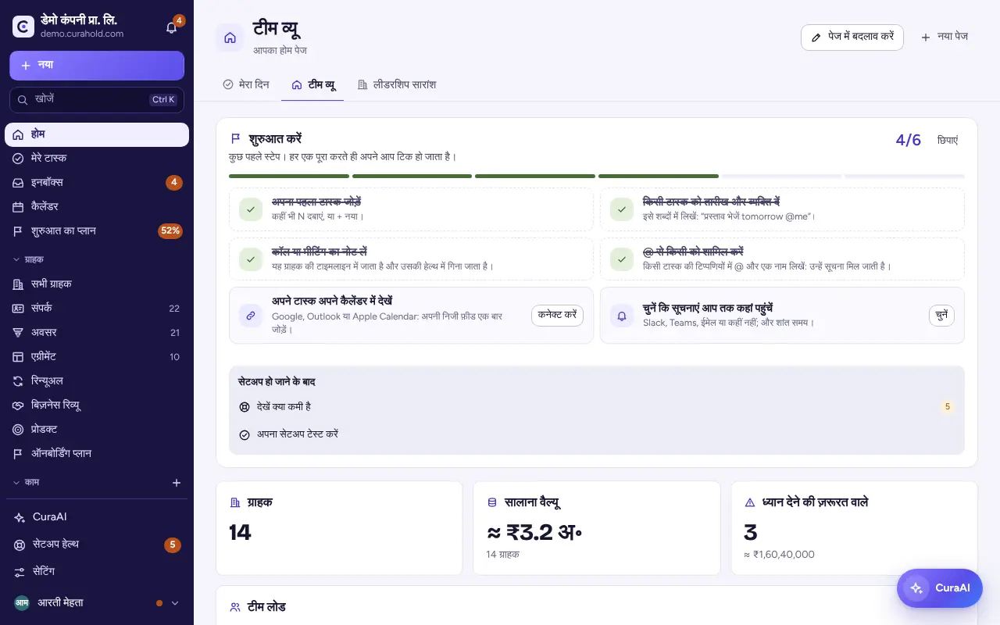

# शुरुआत करें

Curahold वह जगह है जहां कस्टमर सक्सेस और अकाउंट टीमें अपने ग्राहक, स्टेकहोल्डर और रोज़ का काम एक ही जगह संभालती हैं। यह पेज आपके पहले पंद्रह मिनट के बारे में है।

## ट्रायल शुरू करना

वेबसाइट पर **मुफ़्त आज़माएं** तुरंत कंपनी खोलने के बजाय ट्रायल का अनुरोध मांगता है: एक छोटा फ़ॉर्म, आपके ऑफ़िस ईमेल पर एक कोड, और हम जवाब देते हैं, आम तौर पर एक कामकाजी दिन के भीतर। मंज़ूर होने पर आपकी कंपनी बनाई जाती है और आपको साइन-इन लिंक मिलता है; अवधि, सीटों और रिमाइंडर के लिए [प्लान और बिलिंग](/docs/hi/billing/) देखें।

## आपकी कंपनी का पता

हर कंपनी का अपना पता होता है: `yourcompany.curahold.com`। आपकी टीम के सभी लोग वहीं साइन इन करते हैं। उस पते पर किसी दूसरी कंपनी का डेटा कभी नहीं दिखता; यह अलगाव डेटाबेस के अंदर ही लागू होता है।

## साइन इन करना

- **ईमेल लिंक:** अपना ईमेल पता टाइप करें और हमारे भेजे लिंक पर क्लिक करें। कोई पासवर्ड नहीं।
- **Google या Microsoft:** एक क्लिक, अगर आपकी कंपनी ने इसे चालू किया है। जिस डिवाइस को हमने पहले नहीं देखा, उस पर हम आपके ईमेल पर भेजा गया 6 अंकों का कोड भी मांगते हैं।
- **पासकी:** पहले साइन इन के बाद आपका फ़िंगरप्रिंट, चेहरा या डिवाइस PIN।
- **दूसरा स्टेप:** आपकी सेटिंग → **साइन-इन सुरक्षा** में 10 रिकवरी कोड के साथ एक ऑथेंटिकेटर ऐप जोड़ें। एडमिन, एडमिन के लिए या सभी के लिए दूसरा स्टेप ज़रूरी कर सकता है।
- संवेदनशील कामों से पहले (भूमिकाएं बदलना, API कुंजी, अपना डेटा एक्सपोर्ट करना…), अगर आपने पिछले दस मिनट में साइन इन नहीं किया है, तो आपसे **पुष्टि करें कि यह आप हैं** कहा जाता है।
- किसी पते पर 15 मिनट में ज़्यादा से ज़्यादा 5 साइन-इन लिंक जाते हैं।

## पहला सेटअप

कंपनी बनाने वाला एक टेम्पलेट चुनता है: कस्टमर सक्सेस, अकाउंट मैनेजमेंट, सेल्स, सपोर्ट या खाली। टेम्पलेट अपने साथ ग्राहक फ़ील्ड (रिन्यूअल की तारीख, सालाना वैल्यू, हेल्थ…), बोर्ड और तैयार ऑटोमेशन लाता है। यह सब बाद में बदला जा सकता है।

फिर अपनी टीम को आमंत्रित करें। अगर आप अपनी कंपनी का ईमेल डोमेन (`@yourcompany.com`) जोड़ते हैं, तो उस डोमेन के लोग जुड़ने का अनुरोध कर सकते हैं, या सीधे जुड़ सकते हैं।

## आपका पहला दिन

आपके होम पर **शुरुआत करें** कार्ड कुछ पहले स्टेप दिखाता है: अपना पहला टास्क जोड़ना, किसी टास्क को तारीख और व्यक्ति देना, कोई कॉल नोट करना, @ से किसी को शामिल करना, अपने टास्क अपने कैलेंडर में देखना और चुनना कि सूचनाएं आप तक कहां पहुंचें। हर स्टेप करते ही अपने आप टिक हो जाता है; **छिपाएं** कार्ड को हटा देता है।

बाईं ओर का **+ नया** बटन एक ही जगह से कुछ भी जोड़ता है: टास्क, ग्राहक, कॉल नोट या बोर्ड। टास्क लिखते समय आप तारीख, व्यक्ति और ग्राहक एक ही पंक्ति में रख सकते हैं; [क्विक ऐड और शॉर्टकट](/docs/hi/quick-add/) देखें। आपके मेन्यू (नीचे बाईं ओर आपका नाम) में लाइट या डार्क मोड, भाषा और शॉर्टकट हैं; **नया क्या है** सबसे नए जोड़ दिखाता है।

## भाषा

Curahold ग्यारह भाषाएं बोलता है: अंग्रेज़ी, तुर्की, अरबी, हिब्रू, फ़ारसी, सरलीकृत और पारंपरिक चीनी, जापानी, कोरियाई, हिन्दी और मलय। भाषा दो में से किसी एक जगह चुनी जाती है:

- **अपने लिए:** आपकी सेटिंग → भाषा। यह हर डिवाइस पर आपके साथ रहती है।
- **कंपनी के लिए:** एडमिन इसे सेटिंग → कंपनी में सेट करता है। फिर नए लोग उसी भाषा में शुरू करते हैं, और पूरी कंपनी को जाने वाले ईमेल उसी भाषा में होते हैं।

आपके ब्राउज़र से कुछ भी अंदाज़ा नहीं लगाया जाता, इसलिए एक ही लिंक खोलने वाले सभी लोग एक ही चीज़ देखते हैं। तारीखें, संख्याएं और रकम आपकी चुनी भाषा के हिसाब से चलती हैं (हिन्दी में अंक लैटिन, जैसे 1,00,000); अरबी, हिब्रू और फ़ारसी दाएं से बाएं पढ़ी जाती हैं।

## डिवाइस की सीमा

एक व्यक्ति एक साथ दो डिवाइस पर साइन इन रह सकता है; एडमिन इसे 1 से 5 के बीच सेट कर सकता है। एक और डिवाइस पर साइन इन करने से सबसे पुराना डिवाइस साइन आउट हो जाता है। इससे एक सीट कई लोगों में शेयर नहीं होती।

> **सुझाव:** आपकी सेटिंग → डिवाइस बताता है कि आप कहां-कहां साइन इन हैं, और आपको उनमें से किसी से भी साइन आउट करने देता है।

## इसे फ़ोन या कंप्यूटर पर इंस्टॉल करें

Curahold किसी ऐप की तरह इंस्टॉल होता है, बिना किसी स्टोर के।

- **Android और कंप्यूटर (Chrome, Edge):** नीचे बाईं ओर अपने नाम पर क्लिक करें → **Curahold इंस्टॉल करें**। ब्राउज़र के ऐड्रेस बार में इंस्टॉल आइकन भी यही करता है।
- **iPhone और iPad (Safari):** शेयर बटन → **Add to Home Screen** → Add।

इंस्टॉल किया गया ऐप अपनी अलग विंडो में खुलता है; उसके आइकन को देर तक दबाने पर मेरे टास्क, इनबॉक्स और ग्राहक के विकल्प मिलते हैं।

**बिना कनेक्शन के** भी ऐप खुलता है और वह दिखाता है जो आपने आखिरी बार देखा: आपके टास्क, बोर्ड, ग्राहक, इनबॉक्स। ऊपर की एक पट्टी बताती है कि आप ऑफ़लाइन हैं; कनेक्ट होने तक बदलाव सेव नहीं हो सकते। साइन आउट करने पर डिवाइस पर रखी कॉपी हट जाती है।

**लाइव रिफ़्रेश:** जब कोई पेज खुला हो, तो किसी और का बदलाव (नया कार्ड, आगे बढ़ाया गया टास्क, कमेंट, नई सूचना) कुछ ही सेकंड में अपने आप दिख जाता है; रीलोड करने की ज़रूरत नहीं। जब आप टाइप कर रहे हों या कोई कार्ड खींच रहे हों, तब आपके हाथ के नीचे कुछ नहीं हिलता।

## आगे

- [ग्राहक, फ़ील्ड और रिकॉर्ड](/docs/hi/customers/)
- [टास्क और बोर्ड](/docs/hi/tasks/)
- [भूमिकाएं और एक्सेस](/docs/hi/roles-and-access/)
- [क्विक ऐड और शॉर्टकट](/docs/hi/quick-add/)
