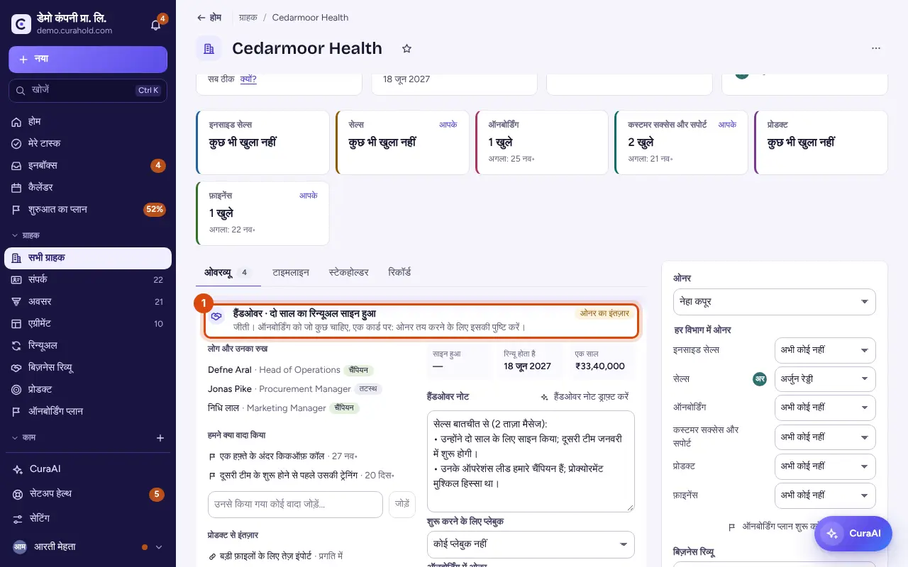
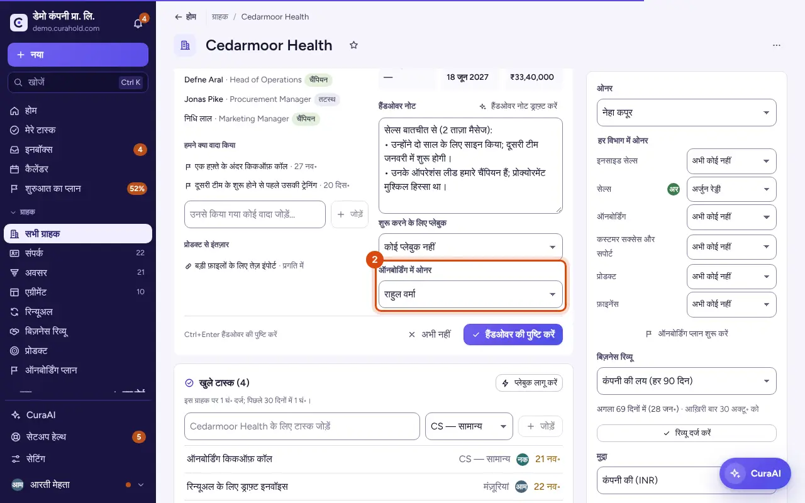
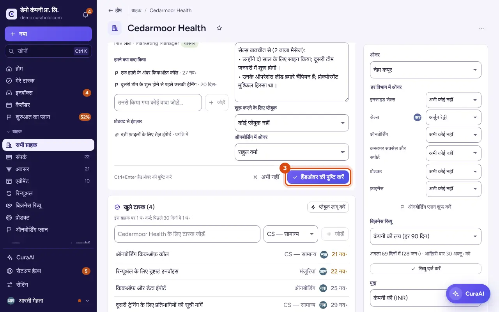
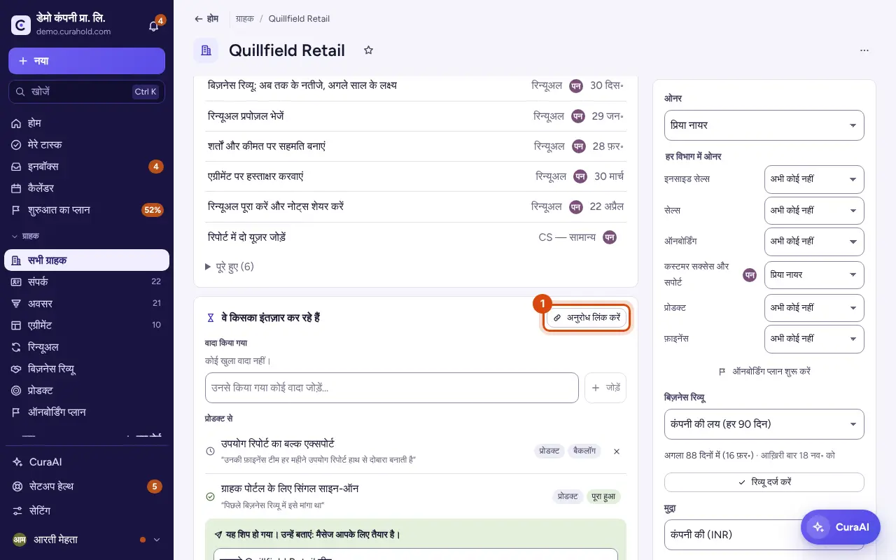
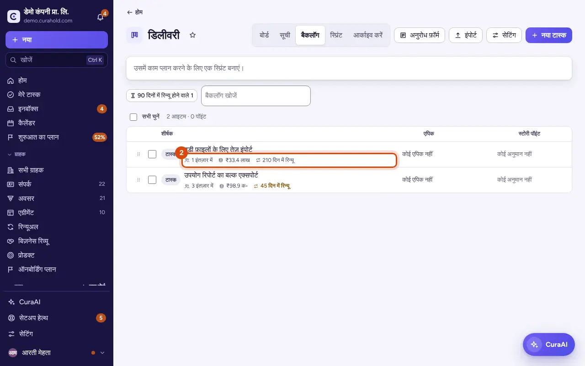
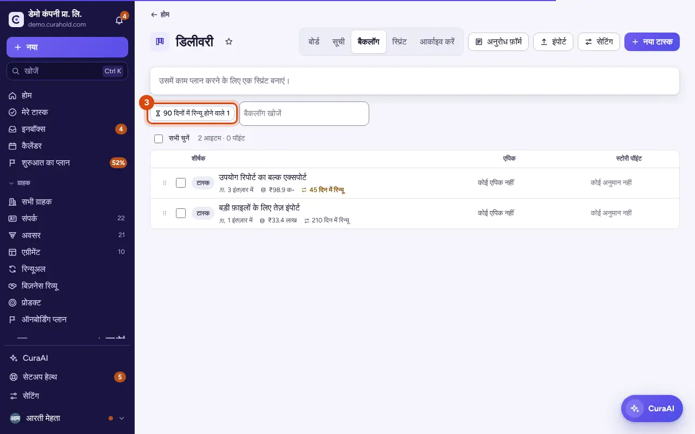
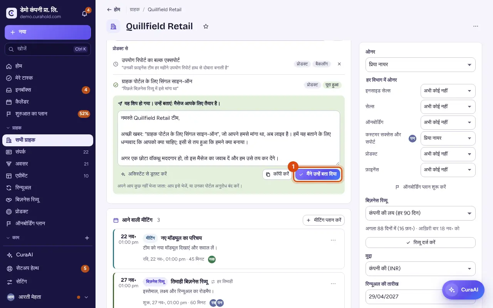
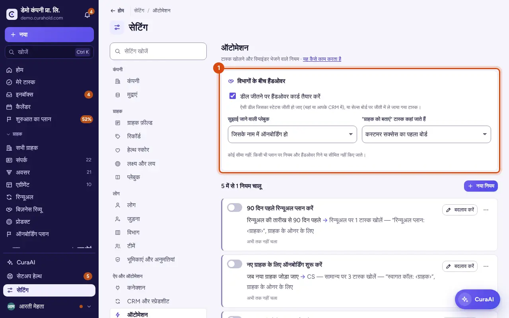

# हैंडओवर, अनुरोध और वापसी का लूप

काम सेल्स से ऑनबोर्डिंग या कस्टमर सक्सेस में जाता है, और ग्राहकों से प्रोडक्ट तक। Curahold हर टीम की ज़रूरत की जानकारी ग्राहक के पेज पर रखता है, ताकि कुछ भी दोबारा टाइप न करना पड़े और किसी को दूसरे विभाग का बोर्ड न खोलना पड़े।

## जब कोई डील जीती जाती है {#handover}

जिस डील का स्टेटस **won** हो जाता है (यहां या आपके CRM में), या सेल्स बोर्ड पर **जीती गईं** में ले जाया गया टास्क, उसे ग्राहक के पेज पर एक **हैंडओवर कार्ड** मिलता है। आपकी कंपनी में ऑनबोर्डिंग विभाग हो, तो यह **ऑनबोर्डिंग** में जाता है, नहीं तो **कस्टमर सक्सेस** में।

1. ग्राहक का पेज खोलें। कार्ड **ओवरव्यू** के ऊपर होता है, उस पर **ओनर का इंतज़ार** लिखा होता है। इसे पढ़ें: लोग और आपके प्रति उनका रुख, सेल्स ने क्या वादा किया, ग्राहक अब भी प्रोडक्ट से किसका इंतज़ार कर रहा है, तारीखें, सालाना वैल्यू (अगर आप वह फ़ील्ड देख सकते हैं) और सेल्स थ्रेड से हैंडओवर नोट।
   
2. **… में ओनर** में चुनें कि ग्राहक को कौन संभालेगा। उसके पास **शुरू करने के लिए प्लेबुक** जांचें।
   
3. **हैंडओवर की पुष्टि करें** पर क्लिक करें (या Ctrl+Enter दबाएं, Mac पर ⌘+Enter)। ओनर तय हो जाता है, प्लेबुक शुरू होती है, ओनर को बताया जाता है, और ग्राहक की टाइमलाइन दोनों स्टेप दर्ज करती है।
   

**अभी नहीं** कार्ड को हटा देता है। **हैंडओवर नोट ड्राफ़्ट करें** असिस्टेंट से नोट लिखने को कहता है; कुछ भी सेव होने से पहले आप उसे पढ़ते और बदलते हैं।

## ग्राहक के अनुरोध को प्रोडक्ट के काम से जोड़ें {#requests}

1. ग्राहक के पेज पर **वे किसका इंतज़ार कर रहे हैं** के तहत **अनुरोध लिंक करें** पर क्लिक करें। प्रोडक्ट का काम खोजें, स्टोरी चुनें, और चाहें तो उन्होंने अपने शब्दों में जो मांगा वह जोड़ें। अगर कुछ फ़िट नहीं होता, तो उसी विंडो से प्रोडक्ट से इसके लिए कहें।
   

कई ग्राहक एक ही स्टोरी का इंतज़ार कर सकते हैं; हर एक गिना जाता है। जो भी ग्राहक को देख सकता है, वह काम का शीर्षक, स्टेटस, स्प्रिंट का अंत और विभाग देखता है, प्रोडक्ट का बोर्ड कभी नहीं।

## प्रोडक्ट क्या देखता है {#backlog}

1. प्रोडक्ट बोर्ड पर **बैकलॉग** खोलें। हर स्टोरी के नीचे: कितने ग्राहक उसका इंतज़ार कर रहे हैं, उनकी सालाना वैल्यू कितनी है (सिर्फ़ उन लोगों को जो वह फ़ील्ड देख सकते हैं) और सबसे नज़दीकी रिन्यूअल।
   
2. सिर्फ़ वह काम देखने के लिए जिसका इंतज़ार जल्द रिन्यू होने वाले ग्राहक कर रहे हैं, **90 दिनों में रिन्यू होने वाले** पर क्लिक करें, सबसे नज़दीकी रिन्यूअल पहले।
   

## जब यह शिप होता है {#shipped}

जब कोई जुड़ी हुई स्टोरी पूरी होती है, तो हर ग्राहक के ओनर को एक टास्क मिलता है, और ग्राहक का पेज स्टोरी के नीचे एक तैयार मैसेज दिखाता है।

1. मैसेज पढ़ें, चाहें तो बदलें, **कॉपी करें** पर क्लिक करें और अपने ईमेल या चैट से भेजें। फिर **मैंने उन्हें बता दिया** पर क्लिक करें। अगर ग्राहक ने पोर्टल से पूछा था, तो **उनका पोर्टल अनुरोध बंद करें** उसे वहां भी बंद कर देता है।
   

**अपने आप कुछ नहीं भेजा जाता।** टाइमलाइन पर "उनके लिए बनाया गया" लिखा होता है, और रिन्यूअल के सारांश में यह शामिल होता है।

## सेटिंग (एडमिन) {#settings}

1. **सेटिंग → ऑटोमेशन** खोलें। **विभागों के बीच हैंडओवर** के तहत चुनें कि जीती गई डील को हैंडओवर कार्ड मिले या नहीं, यह कौन-सी प्लेबुक सुझाए और "ग्राहक को बताएं" वाले टास्क कहां जाएं।
   

## असिस्टेंट के ड्राफ़्ट

हैंडओवर नोट, "यह शिप हो गया" मैसेज, और किसी मीटिंग के वादे और अगले स्टेप असिस्टेंट ड्राफ़्ट कर सकता है। कुछ भी सेव होने से पहले आप हर ड्राफ़्ट पढ़ते और बदलते हैं, पहले जैसा करें उसे वापस ले लेता है, और असिस्टेंट के बिना (या उसकी मासिक सीमा पार होने पर) ड्राफ़्ट टेम्पलेट से आता है।

## नियम

नियम तब शुरू हो सकते हैं जब कोई टास्क जोड़ा या पूरा किया जाए, कोई अनुरोध फ़ॉर्म से आए, कोई रिकॉर्ड किसी स्टेज तक पहुंचे या कोई सपोर्ट टिकट खुले, और वे असाइन कर सकते हैं, आगे बढ़ा सकते हैं, फ़ील्ड भर सकते हैं, कमेंट कर सकते हैं, आपके वेबहुक पर भेज सकते हैं या हैंडओवर तैयार कर सकते हैं। नियम न कभी गिने जाते हैं, न उनकी कोई सीमा है।
