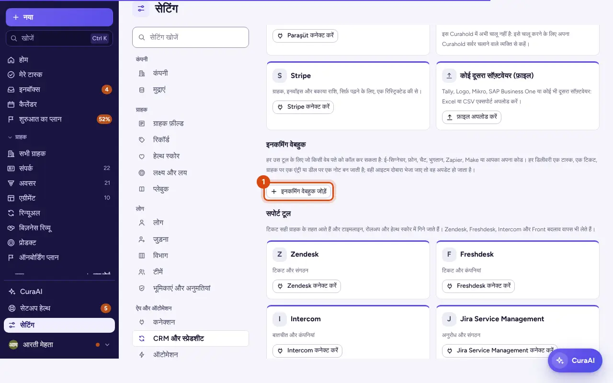
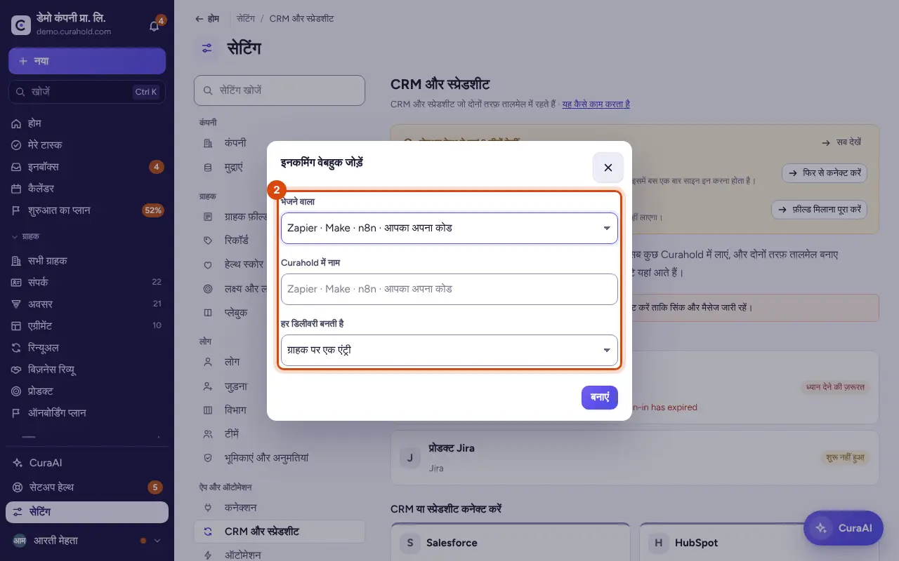
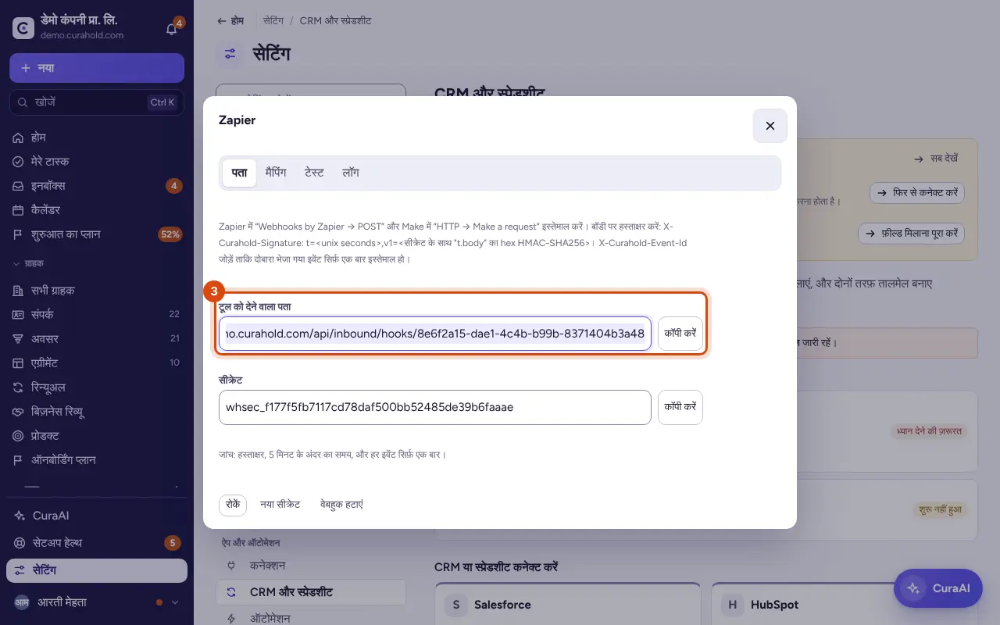
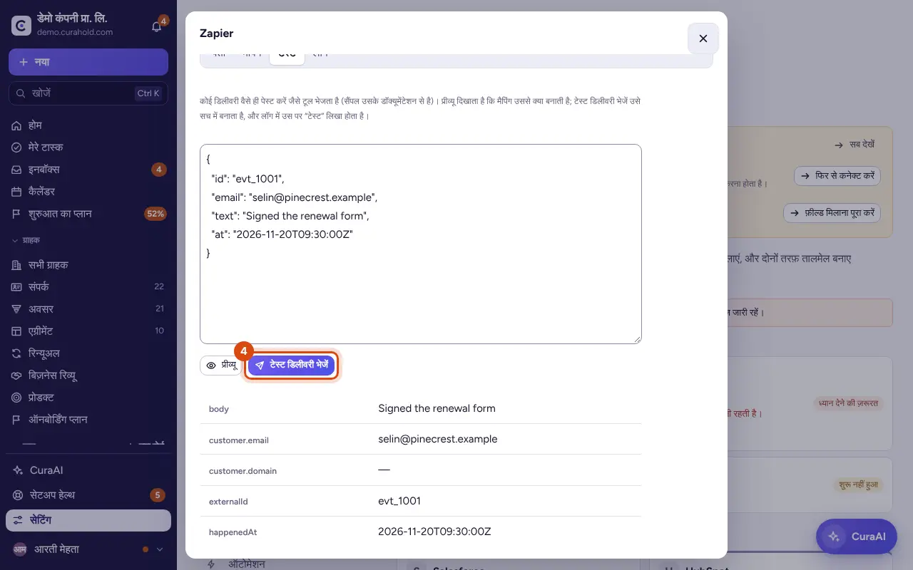
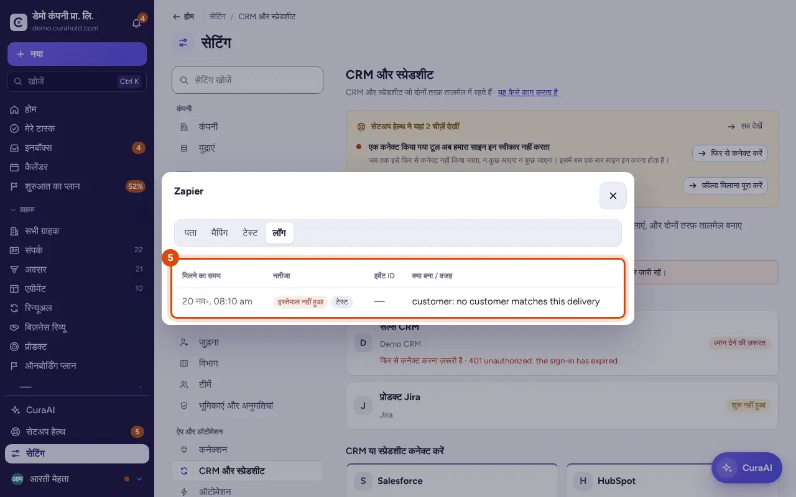

# इनकमिंग वेबहुक

उन टूल के लिए जिनका Curahold में कोई तैयार कनेक्टर नहीं है। टूल आपके एक पते पर पोस्ट करता है; हर डिलीवरी एक **टास्क**, एक **सपोर्ट टिकट**, **ग्राहक की टाइमलाइन पर एक एंट्री** या **डील पर एक नोट** बन जाती है। वही आइटम दोबारा भेजा जाए तो जो बना था वह अपडेट होता है। हर डिलीवरी जांची जाती है: हस्ताक्षर (या साझा टोकन), उसका समय, और हर इवेंट सिर्फ़ एक बार।

## Curahold में {#connect}

1. **सेटिंग → CRM और स्प्रेडशीट** खोलें, **इनकमिंग वेबहुक** तक स्क्रॉल करें और **इनकमिंग वेबहुक जोड़ें** पर क्लिक करें।
   
2. **भेजने वाला** में टूल चुनें (या **Zapier · Make · n8n · आपका अपना कोड**), **हर डिलीवरी बनती है** जांचें, और **बनाएं** पर क्लिक करें।
   
3. **पता** टैब पर पता और सीक्रेट कॉपी करके टूल में डालें।
   
4. **टेस्ट** टैब पर **प्रीव्यू** पर क्लिक करें, ताकि दिखे कि मैपिंग सैंपल से क्या बनाती है, फिर **टेस्ट डिलीवरी भेजें** पर।
   
5. **लॉग** टैब पर हर डिलीवरी जांचें: इस्तेमाल हुई, छोड़ी गई, इस्तेमाल नहीं हुई (वजह के साथ) या अस्वीकार।
   

## मैपिंग

हर वैल्यू टेक्स्ट होती है, जिसमें डिलीवरी की किसी वैल्यू के लिए `{{path}}` होता है, उदाहरण के लिए `{{data.envelopeSummary.status}}` या `{{items[0].email}}`। ग्राहक पहले किसी संपर्क के ईमेल से, फिर वेब पते से, फिर नाम से ढूंढा जाता है। **टूल में आइटम की id** से "बनाएं या अपडेट करें" काम करता है। **सिर्फ़ तब इस्तेमाल करें जब यह वैल्यू…** दूसरे इवेंट छोड़ देता है (लॉग में वे छोड़े गए के रूप में दर्ज होते हैं)।

## तैयार रेसिपी

| टूल | किससे साइन होता है | क्या बनता है |
| --- | --- | --- |
| ई-सिग्नेचर (DocuSign Connect; CloudSign, Modusign, Leegality भी इसी तरह) | `X-DocuSign-Signature-1`, HMAC-SHA256, base64, टूल में बनाई गई की | डील पर एक नोट |
| Aircall | body में वेबहुक का टोकन | ग्राहक पर एक कॉल |
| Tawk.to | `X-Tawk-Signature`, HMAC-SHA1, hex | एक टिकट |
| Razorpay (iyzico भी इसी तरह) | `X-Razorpay-Signature`, HMAC-SHA256, hex | ग्राहक पर एक एंट्री |
| Freshchat, Kylas, Sansan और बाकी सब | साझा टोकन (`X-Curahold-Token` या `?token=`) | आपकी पसंद |

## ख़ुद साइन करना (Zapier, Make, n8n, कोड) {#sign}

`X-Curahold-Signature` और `X-Curahold-Event-Id` भेजें:

```text
X-Curahold-Signature: t=1763631000,v1=<hex HMAC-SHA256 of "1763631000.<raw body>" with the secret>
X-Curahold-Event-Id: evt_1001
```

कोड में (Node.js):

```js
const t = Math.floor(Date.now() / 1000);
const v1 = crypto.createHmac('sha256', secret).update(`${t}.${body}`).digest('hex');
fetch(address, { method: 'POST', body, headers: { 'content-type': 'application/json', 'x-curahold-signature': `t=${t},v1=${v1}`, 'x-curahold-event-id': id } });
```

समय 5 मिनट के अंदर होना चाहिए। दोहराई गई event id को `200` और `duplicate` के साथ जवाब मिलता है और वह दोबारा इस्तेमाल नहीं होती। जवाब: `200` (`status` ok, skipped या failed के साथ), `401` (हस्ताक्षर, समय या टोकन), `404` (अनजान या रुका हुआ)। पूरी सूची डेवलपर डॉक्यूमेंटेशन के API रेफ़रेंस में है।

## उन टूल के लिए Zapier और Make रेसिपी जिनका अभी कनेक्टर नहीं है

टूल का ट्रिगर इस्तेमाल करें, फिर ऊपर वाले पते पर दोनों header के साथ **Webhooks by Zapier → POST** (Zapier) या **HTTP → Make a request** (Make)। Make का **Custom JS** या Zapier का **Code** स्टेप हस्ताक्षर बनाता है (ऊपर वाला कोड)।

| टूल | ट्रिगर | body में भेजे जाने वाले फ़ील्ड | क्या बनता है |
| --- | --- | --- | --- |
| LINE WORKS | बॉट चैनल में नया मैसेज | `id`, भेजने वाले का `email`, `text` | एंट्री |
| Chatwork | किसी रूम में नया मैसेज | `id`, `email`, `text` | एंट्री |
| kintone | रिकॉर्ड जोड़ा या बदला गया | `id`, `email`, `title`, `status` | टास्क |
| Money Forward Cloud | इनवॉइस बना या भुगतान हुआ | `id`, `email`, `text` (नंबर, राशि, ड्यू डेट) | एंट्री |
| Channel Talk | चैट बंद हुई | `id`, `email`, `title` | टिकट |
| KakaoWork | बॉट मैसेज | `id`, `email`, `text` | एंट्री |
| LeadSquared | लीड या अवसर अपडेट हुआ | `id`, `email`, `title`, `status` | टास्क |
| Razorpay | भुगतान captured | `id`, `email`, `text` | एंट्री (या रेसिपी इस्तेमाल करें) |
| DingTalk | रोबोट मैसेज | `id`, `email`, `text` | एंट्री |
| WeCom | ऐप मैसेज | `id`, `email`, `text` | एंट्री |

## रखना और हटाना

लॉग 30 दिन और हर वेबहुक के लिए ज़्यादा से ज़्यादा 500 डिलीवरी रखता है। **नया सीक्रेट** पुराने को तुरंत बंद कर देता है; **रोकें** फिर से शुरू होने तक `404` जवाब देता है; **वेबहुक हटाएं** उसे और उसका लॉग मिटा देता है, और जो उसने बनाया वह बना रहता है। वेबहुक उसे सेट अप करने वाले व्यक्ति के अधिकारों से काम करता है: वह सिर्फ़ उन्हीं बोर्ड और ग्राहकों तक पहुंचता है जिन तक वह व्यक्ति पहुंच सकता है, और उसके जाने पर रुक जाता है।

## यह भी देखें

- [कनेक्शन और CRM](/docs/hi/connections/)
