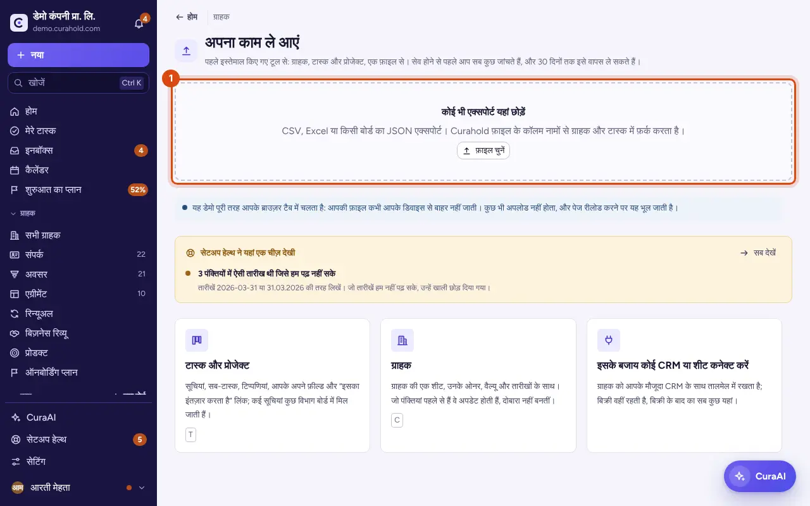
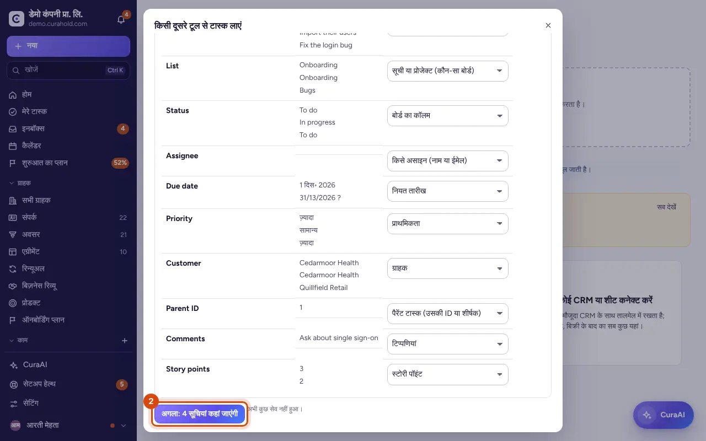
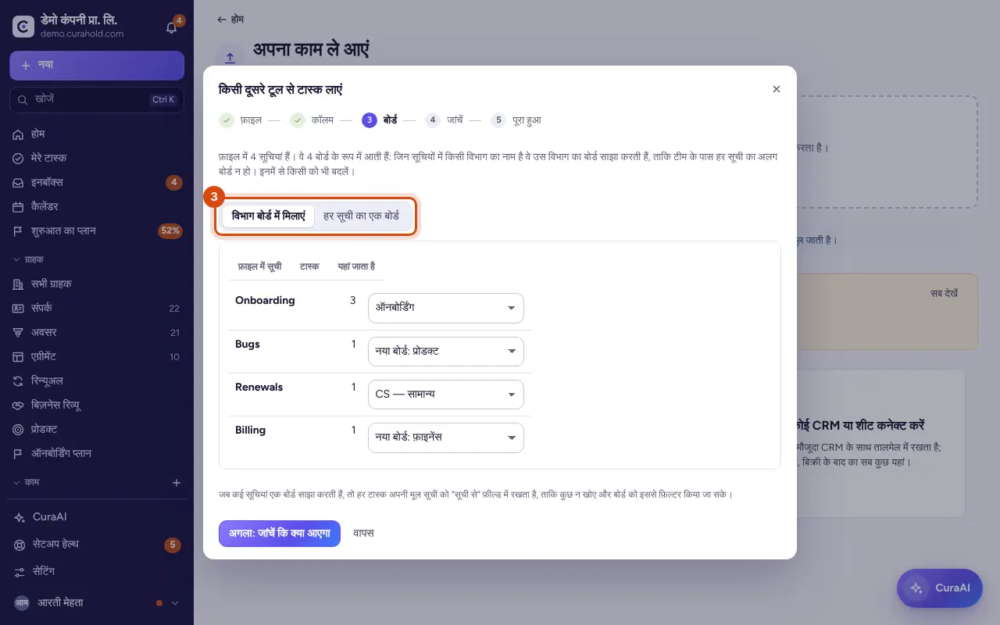
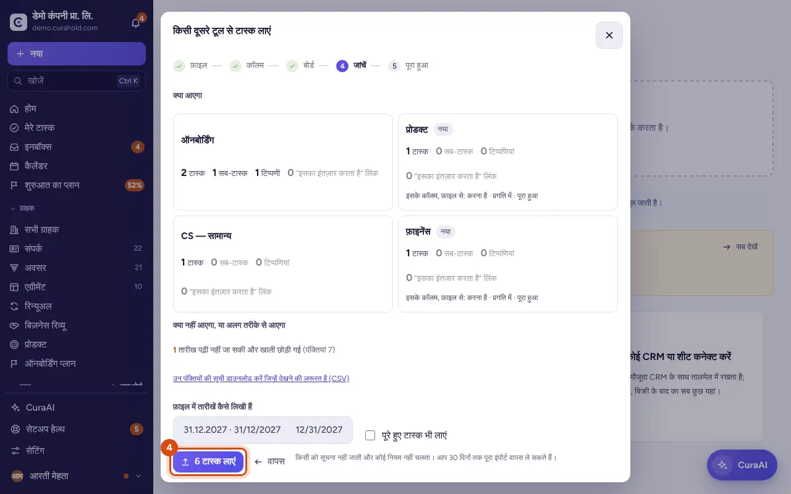
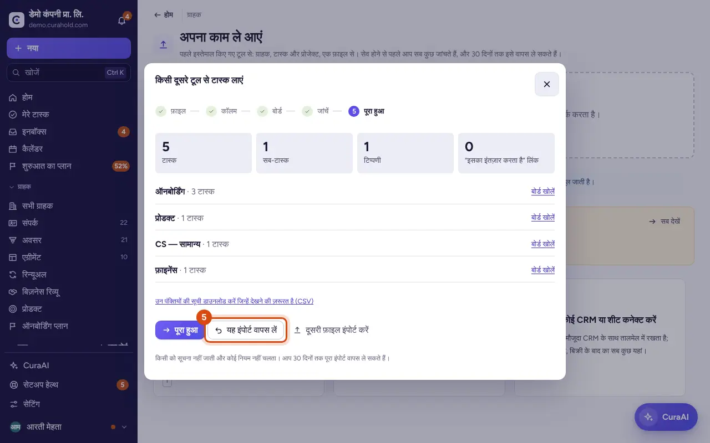

# किसी दूसरे टूल से आना

पहले इस्तेमाल किए गए टूल से अपना काम एक्सपोर्ट करें (CSV, Excel शीट (.xlsx) या किसी कानबन बोर्ड का JSON एक्सपोर्ट) और उस फ़ाइल से उसे यहां ले आएं। आखिरी स्टेप तक कुछ भी सेव नहीं होता, किसी को सूचना नहीं जाती और कोई नियम नहीं चलता: यह घर बदलना है, नया काम नहीं।

## अपने टास्क ले आएं {#tasks}

1. **अपना काम ले आएं** खोलें: सर्च में "import" टाइप करें (Ctrl K, या Mac पर ⌘ K), या किसी बोर्ड पर ऊपर वाले तीर का बटन इस्तेमाल करें। अपनी फ़ाइल **कोई भी एक्सपोर्ट यहां छोड़ें** पर छोड़ें, या **फ़ाइल चुनें** पर क्लिक करें। Curahold फ़ाइल के कॉलम के नामों से ग्राहकों और टास्क को अलग पहचानता है; खुद चुनने के लिए टास्क के लिए **T** या ग्राहकों के लिए **C** दबाएं।
   
2. **कॉलम।** आपकी फ़ाइल के हर कॉलम का मिलान उसकी जगह से किया जाता है: शीर्षक, ब्योरा, बोर्ड का कॉलम, लोग, तारीखें, प्राथमिकता, ग्राहक, स्टोरी पॉइंट, पुराने टूल की ID, पैरेंट टास्क, कमेंट, "इसका इंतज़ार करता है" लिंक, या उसका अपना फ़ील्ड। पहली वैल्यू दिखाती हैं कि हर एक क्या बनेगा। जो गलत हो उसे बदलें, फिर **अगला** पर क्लिक करें।
   
3. **बोर्ड।** अगर फ़ाइल में कई सूचियां हैं, तो वे कुछ विभाग बोर्ड में समा जाती हैं: "Renewals" नाम की सूची कस्टमर सक्सेस में जाती है, "Bugs" प्रोडक्ट में। उन्हें अलग रखने के लिए **हर सूची का एक बोर्ड** पर क्लिक करें, या किसी भी सूची के लिए कोई भी बोर्ड चुनें। हर टास्क **सूची से** फ़ील्ड में वह सूची रखता है जिससे वह आया। **अगला: जांचें कि क्या आएगा** पर क्लिक करें।
   
4. **जांच।** बोर्ड-दर-बोर्ड पढ़ें कि कितने टास्क, सब-टास्क, कमेंट और लिंक आएंगे, और पंक्ति नंबर के साथ, क्या नहीं आएगा या अलग तरह से आएगा। अगर आप पहले अपनी फ़ाइल में उन्हें ठीक करना चाहते हैं, तो **उन पंक्तियों की सूची डाउनलोड करें जिन्हें देखने की ज़रूरत है (CSV)**। फिर **… टास्क लाएं** पर क्लिक करें।
   
5. **हो गया।** हर बोर्ड पर **बोर्ड खोलें** लिंक होता है। अगर कुछ आपकी मर्ज़ी का नहीं है, तो **यह इंपोर्ट वापस लें** पर क्लिक करें।
   

Curahold हेडिंग के ऊपर शीर्षक वाली पंक्ति, हर समूह के नीचे दोहराई गई हेडिंग वाले समूह, और अपने आइटम के नीचे इंडेंट किए गए सब-आइटम समझता है।

## वापस लेना {#undo}

**यह इंपोर्ट वापस लें** 30 दिन तक काम करता है, नतीजे से या पहले स्टेप पर **आपके पिछले इंपोर्ट** से। जिन टास्क को किसी ने नहीं छुआ, वे एक आइटम के रूप में ट्रैश में जाते हैं; जिस टास्क को तब से किसी ने बदला या उस पर कमेंट किया, वह उसके बोर्ड के आर्काइव में रखा जाता है। इंपोर्ट के लिए बना और खाली रह गया बोर्ड हटा दिया जाता है।

## टेम्पलेट {#template}

पहले स्टेप पर **टेम्पलेट डाउनलोड करें** एक फ़ाइल देता है जिसमें Curahold के पढ़े जाने वाले हर कॉलम और तीन उदाहरण पंक्तियां होती हैं। यह Excel में खुलती है। इसकी पहली पंक्ति (Region आपके अपने कॉलम का एक उदाहरण है):

```text
ID,Title,Description,List,Status,Assignee,Due date,Priority,Customer,Parent ID,Comments,Depends on,Story points,Region
```

## डेमो में

डेमो पूरी तरह आपके ब्राउज़र टैब में चलता है। डेमो बार में **अपनी फ़ाइल आज़माएं** वही पेज खोलता है: आपकी फ़ाइल टैब में पढ़ी जाती है और कभी आपके डिवाइस से बाहर नहीं जाती, और पेज रीलोड करने पर वह भूल जाती है।
