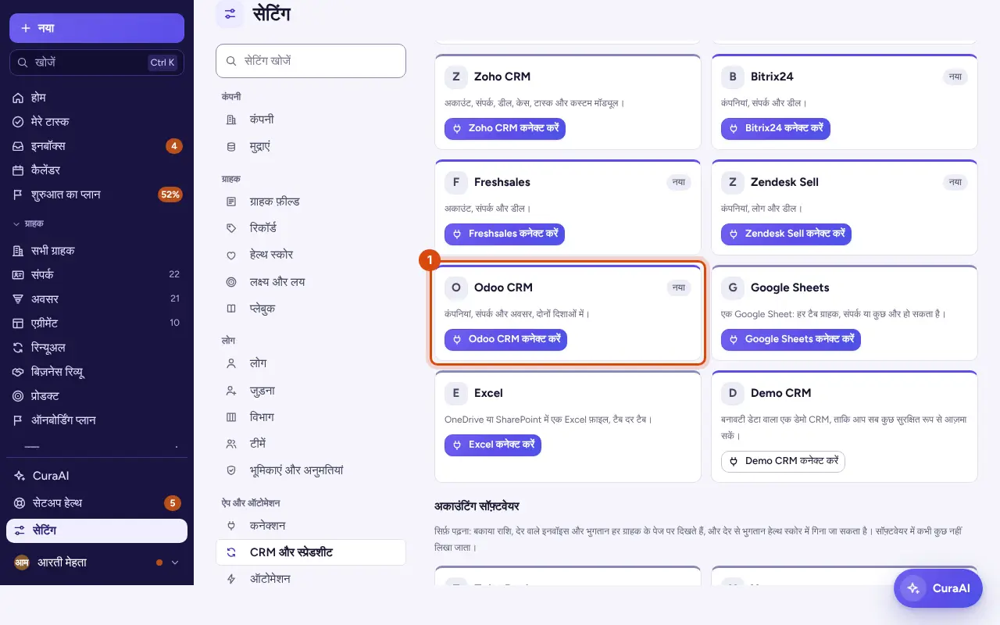

# Odoo CRM

Odoo Online, Odoo.sh या आपके अपने सर्वर से कंपनियां, उनके संपर्क और अवसर, दोनों दिशाओं में तालमेल में: Odoo में हुआ बदलाव एक घंटे के अंदर आता है, Curahold में हुआ बदलाव तुरंत वापस जाता है।

## Curahold में {#connect}

1. **सेटिंग → CRM और स्प्रेडशीट** खोलें और उसकी टाइल पर **Odoo CRM कनेक्ट करें** पर क्लिक करें।
   

फिर चारों फ़ील्ड भरें और **जांचें और कनेक्ट करें** पर क्लिक करें:

- **Odoo पता**, उदाहरण के लिए:

```text
https://yourcompany.odoo.com
```

- **डेटाबेस का नाम**: सिर्फ़ Odoo.sh पर या कई डेटाबेस वाले आपके अपने सर्वर पर।
- **लॉगिन (ईमेल)**: वह Odoo यूज़र जिसके अधिकारों के साथ Curahold काम करता है।
- **API की**: नीचे देखें।

इसके बाद **कंपनियां**, **संपर्क** और **अवसर** पर टिक करें, सुझाए गए फ़ील्ड जोड़े जांचें और **सिंक शुरू करें** पर क्लिक करें। कोई अवसर 100 % संभावना पर जीता हुआ और Odoo के आर्काइव करने पर हारा हुआ गिना जाता है।

## Odoo में

1. अपनी तस्वीर (ऊपर दाईं ओर) → **Preferences** पर क्लिक करें (Odoo 17 और उसके बाद: **My Profile**)।
2. **Account Security** खोलें और **New API Key** पर क्लिक करें।
3. एक नाम लिखें (उदाहरण के लिए `Curahold`), चुनें कि यह कितने समय चले, और **Generate key** पर क्लिक करें।
4. की कॉपी करें। Odoo इसे सिर्फ़ एक बार दिखाता है।

Odoo Online पर API एक्सेस के लिए **Custom** प्लान ज़रूरी है (Odoo का नियम)। CRM ऐप इंस्टॉल होना चाहिए।

## सीमाएं और समय

Odoo कोई तय सीमा प्रकाशित नहीं करता; Curahold प्रति सेकंड करीब दो अनुरोधों तक सीमित रहता है। Odoo 19 और उसके बाद के वर्ज़न JSON-2 API पर जवाब देते हैं; पुराने वर्ज़न JSON-RPC पर, जिसे Odoo वर्ज़न 20 में हटा देगा। Odoo 19 में एक की ज़्यादा से ज़्यादा तीन महीने चलती है: उसके ख़त्म होने से पहले नई की बनाएं और फिर से कनेक्ट करें।

## टकराव, त्रुटियां और डिस्कनेक्ट करना

जब दोनों तरफ़ एक ही फ़ील्ड बदला हो, तो कनेक्शन के लिए चुना गया नियम तय करता है (डिफ़ॉल्ट रूप से बाद वाला बदलाव)। अस्वीकार हुई वैल्यू Odoo के अपने मैसेज के साथ कनेक्शन के **स्टेटस** टैब पर इंतज़ार करती है। रद्द या एक्सपायर हुई की कनेक्शन को **ध्यान देने की ज़रूरत** के रूप में दिखाती है: **फिर से कनेक्ट करें** से नई की पेस्ट करें; मैपिंग बनी रहती है। **हटाएं** की को मिटा देता है; पहले से आए ग्राहक और रिकॉर्ड Curahold में रहते हैं।

## यह भी देखें

- [कनेक्शन और CRM](/docs/hi/connections/)
- [Odoo (अकाउंटिंग)](/docs/hi/accounting-odoo/)
