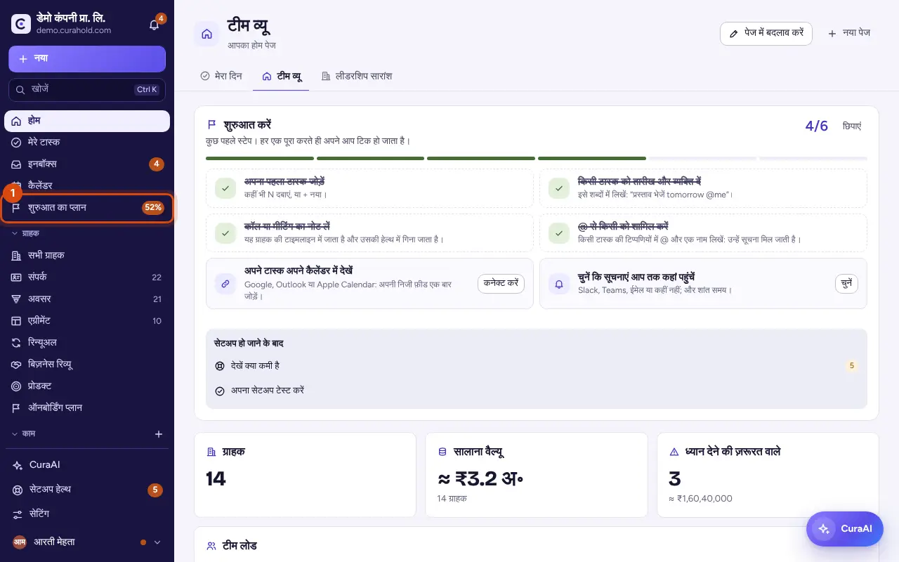
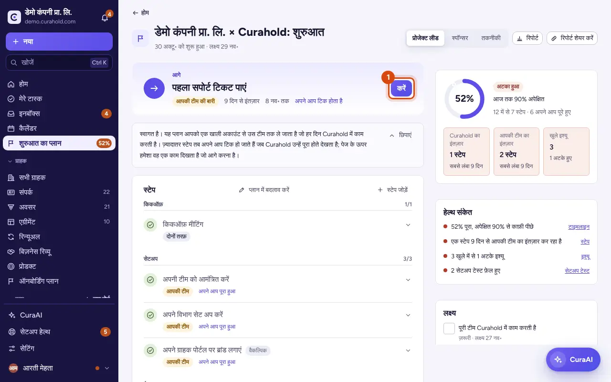
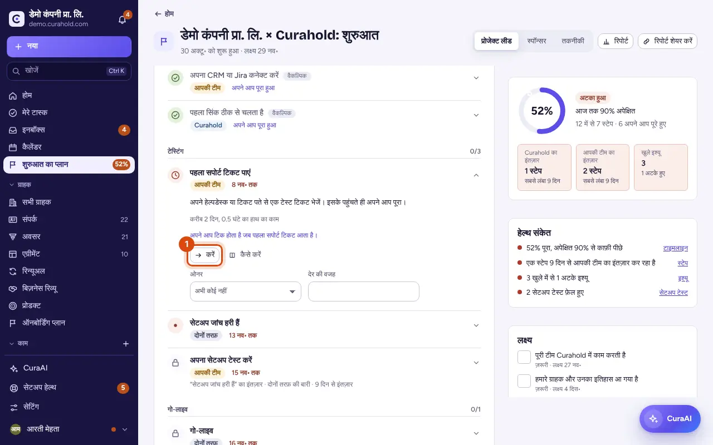
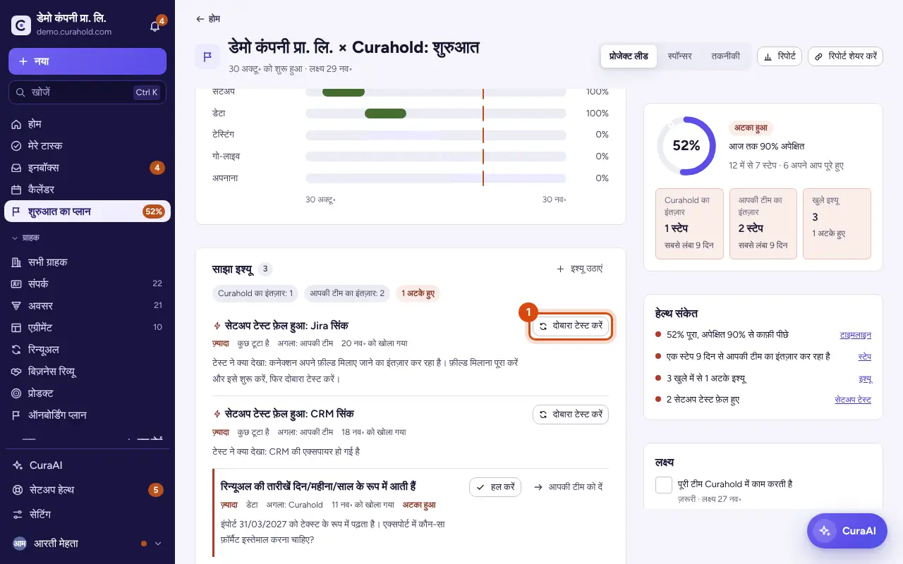
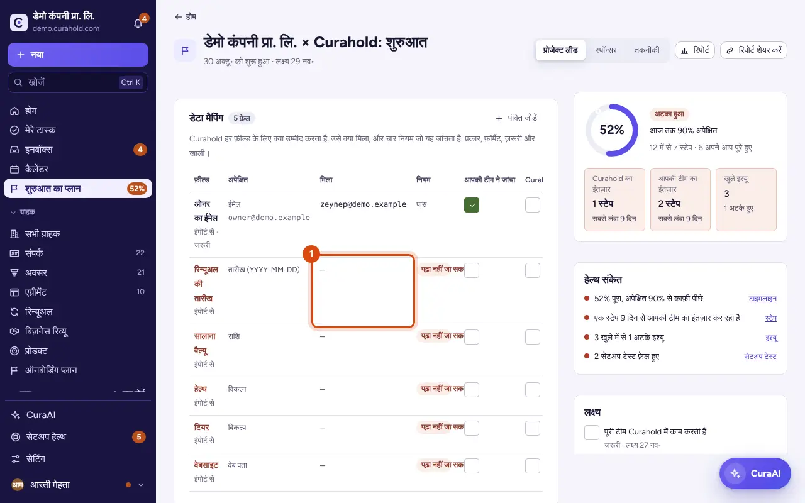
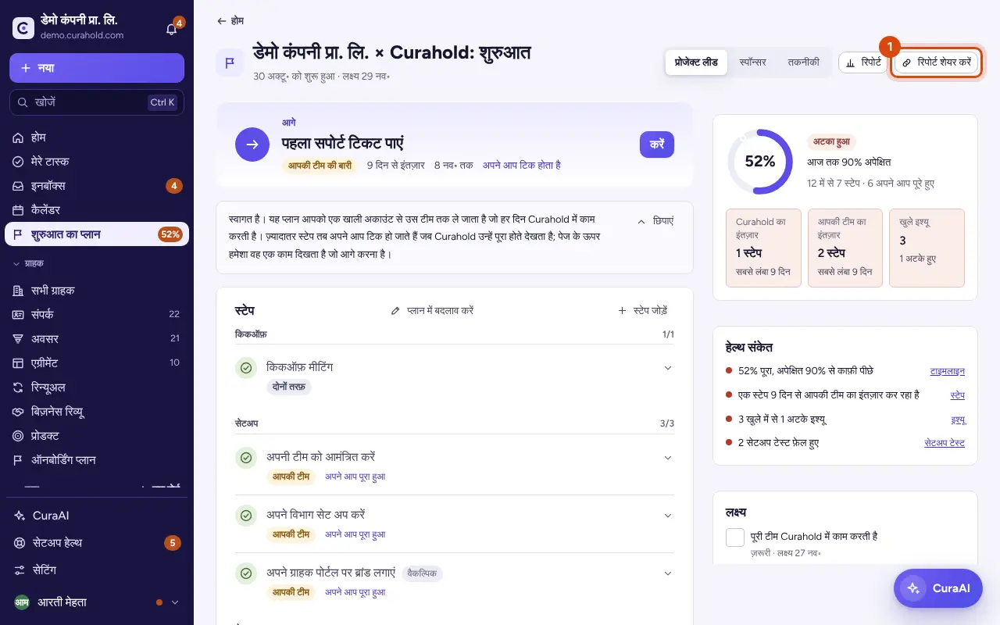
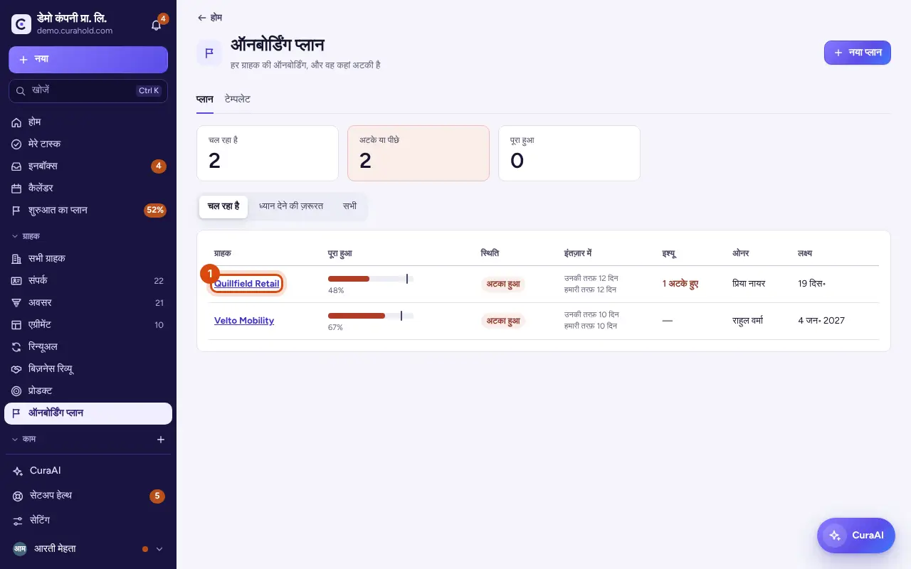
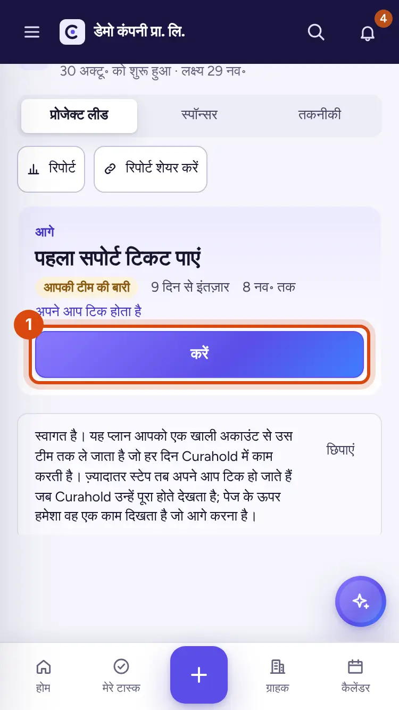

# ऑनबोर्डिंग प्लान

ऑनबोर्डिंग प्लान एक पेज है जिस पर दोनों पक्ष मिलकर काम करते हैं। आपकी कंपनी Curahold के साथ शुरुआत करने के लिए इसका इस्तेमाल करती है, और आप अपने हर नए ग्राहक की ऑनबोर्डिंग के लिए यही प्लान इस्तेमाल करते हैं। ज़्यादातर स्टेप तब अपने आप टिक हो जाते हैं जब Curahold उन्हें पूरा होते देखता है; आप हाथ से सिर्फ़ वही टिक करते हैं जो Curahold नहीं देख सकता, जैसे कोई मीटिंग।

## 1. अपना प्लान खोलें {#start}

बाईं ओर के मेन्यू में **शुरुआत का प्लान** पर क्लिक करें। उसके पास की संख्या बताती है कि कितना पूरा हुआ है।



आपका प्लान आपकी कंपनी के अपने पते पर रहता है:

```text
https://<your-company>.curahold.com/onboarding
```

## 2. अगला काम करें {#next}

ऊपर का कार्ड हमेशा वह एक काम दिखाता है जो आपका सेटअप पूरा करने के लिए अगला है, किसकी बारी है और वह कितने समय से इंतज़ार कर रहा है। **करें** पर क्लिक करें: Curahold वह स्क्रीन खोलता है जहां यह किया जाता है।



## 3. कोई स्टेप खोलें {#team}

कोई भी स्टेप यह देखने के लिए क्लिक करें कि वह किसलिए है, कितना समय लेता है और क्या वह अपने आप टिक होता है। ताले वाला स्टेप किसी दूसरे स्टेप का इंतज़ार करता है; उसके नीचे की पंक्ति बताती है कि किसका और किसकी बारी है। **पूरा हुआ मार्क करें** सिर्फ़ उन स्टेप पर क्लिक करें जिन्हें Curahold नहीं देख सकता।



अपने आप टिक होने वाले स्टेप: आपकी टीम को आमंत्रित किया गया, विभाग सेट अप हुए, कोई इंपोर्ट जो पंक्तियां लाया, कोई कनेक्शन जिसे अनुमति मिली और जिसकी आखिरी रन बिना गड़बड़ी के चली, पहला सपोर्ट टिकट, आपके लोगो या रंग के साथ चालू हुआ पोर्टल, हरे सेटअप चेक और पास हुआ हर सेटअप टेस्ट।

## 4. साझा इश्यू ठीक करें {#health}

साझा इश्यू दोनों पक्षों के बीच के सवाल और समस्याएं हैं। हर इश्यू बताता है कि अगला कदम किसका है; पांच दिन से खुला या अपनी तारीख पार कर चुका इश्यू **अटका हुआ** मार्क होता है। फ़ेल हुआ सेटअप टेस्ट यहां एक बार दिखता है। उसे ठीक करने के बाद **दोबारा टेस्ट करें** पर क्लिक करें: टेस्ट पास होने पर इश्यू अपने आप बंद हो जाता है।



## 5. अपना डेटा जांचें {#mapping}

डेटा टेबल हर फ़ील्ड के लिए दिखाती है कि Curahold क्या उम्मीद करता है, उसे क्या मिला और वह कौन-से चार नियम जांचता है: प्रकार, फ़ॉर्मैट, ज़रूरी और खाली। फ़ेल होने वाली पंक्ति बताती है कि कौन-सा नियम फ़ेल हुआ। वैल्यू सही होने पर अपनी तरफ़ के बॉक्स पर टिक करें।



तारीखें इस तरह लिखी जाती हैं:

```text
2027-03-31
```

## 6. लोगों के नाम दें {#people}

**दोनों तरफ़ के लोग** के तहत **व्यक्ति जोड़ें** पर क्लिक करें और उनकी भूमिका बताएं। हर स्टेप का एक ओनर हो सकता है; बारी आने पर Curahold उस व्यक्ति को ऐप में याद दिलाता है, और स्टेप अटकने पर फिर से। ईमेल से रिमाइंडर तब तक बंद रहते हैं जब तक कोई एडमिन उन्हें चालू नहीं करता।

## 7. प्रगति रिपोर्ट शेयर करें {#report}

**रिपोर्ट शेयर करें** पर क्लिक करें और लिंक कॉपी करें। जिसके पास यह लिंक है, वह प्रगति रिपोर्ट देखता है (कोई नोट नहीं, कोई संपर्क जानकारी नहीं)। इसे प्रिंट करने या PDF के रूप में सेव करने के लिए **रिपोर्ट** खोलें।



## 8. आपके ग्राहकों के शुरुआत के प्लान {#customers}

ग्राहक के तहत **ऑनबोर्डिंग प्लान** पर क्लिक करें। जीती गई डील पर प्लान अपने आप सिर्फ़ तब खुलता है जब यह चालू हो (सेक्शन 10)। सूची हर प्लान दिखाती है, वह कितना आगे है, किसका इंतज़ार है और कौन-से अटके हैं। किसी ग्राहक का प्लान खोलने के लिए उस पर क्लिक करें।

किसी ग्राहक के लिए प्लान खोलने के लिए ऊपर दाईं ओर **नया प्लान** पर क्लिक करें, ग्राहक और टेम्पलेट चुनें, और **प्लान खोलें** पर क्लिक करें। यह आज शुरू होता है: इसे इस ग्राहक के हिसाब से बनाएं (सेक्शन 9)।

ग्राहक के पेज पर **हर विभाग में ओनर** के तहत **ऑनबोर्डिंग प्लान शुरू करें** भी यही करता है।



आपका ग्राहक आपके पोर्टल में, आपके रंगों में, वही प्लान देखता है: वे अपने स्टेप टिक करते हैं, छोटे फ़ॉर्म भरते हैं जो सीधे उनके रिकॉर्ड में जाते हैं, अपनी डेटा पंक्तियां जांचते हैं और इश्यू उठाते हैं। पूरा होने पर **पूरा करें और हैंडओवर करें** पर क्लिक करें: हेल्थ स्कोर बेसलाइन के रूप में रखा जाता है और कस्टमर सक्सेस को हैंडओवर कार्ड मिलता है।

## 9. किसी ग्राहक के प्लान को अपने हिसाब से बनाएं {#personal}

हर ग्राहक का प्लान उसकी अपनी कॉपी है: टेम्पलेट को छुए बिना इसे बदलें।

1. प्लान के **स्टेप** में **प्लान में बदलाव करें** पर क्लिक करें।
2. किसी चरण का नाम उसके बॉक्स में बदलें, तीरों से उसे आगे-पीछे करें, या **चरण जोड़ें** से नया जोड़ें। जिस चरण में स्टेप हैं, उसे हटाया नहीं जा सकता: पहले उसके स्टेप आगे-पीछे करें या हटाएं।
3. किसी स्टेप का नाम उसके बॉक्स में बदलें, तीरों से उसे आगे-पीछे करें, उसके लिए दूसरा चरण चुनें, या उसे हटाएं।
4. **बदलाव पूरे हुए** पर क्लिक करें। इस प्लान को फिर से इस्तेमाल करने के लिए **टेम्पलेट के रूप में सेव करें** पर क्लिक करें और इसे नाम दें।

## 10. अपने आप खुलने वाले प्लान {#won}

एडमिन **ऑनबोर्डिंग प्लान → टेम्पलेट** में, सबसे नीचे, यह तय करता है:

1. **डील जीतने पर ऑनबोर्डिंग प्लान खोलें** पर टिक करें। जब तक आप इसे चालू नहीं करते, यह बंद रहता है।
2. वह टेम्पलेट चुनें जो यह खोलता है, या **हर बार पूछें**: तब ड्राफ़्ट ग्राहक को संभालने वाले व्यक्ति से चुनने को कहता है।
3. वैकल्पिक: सेगमेंट, प्लान या क्षेत्र (कोई भी ग्राहक फ़ील्ड) के हिसाब से नियम जोड़ें। ग्राहक जिस पहले नियम से मेल खाता है, वही टेम्पलेट चुनता है।

रिमाइंडर हमेशा ऐप में दिखते हैं। हर व्यक्ति अपनी सूचना सेटिंग में तय करता है कि उसे ये ईमेल से भी मिलें या नहीं।

## फ़ोन पर

वही पेज, एक कॉलम में: अगला काम सबसे पहले।


